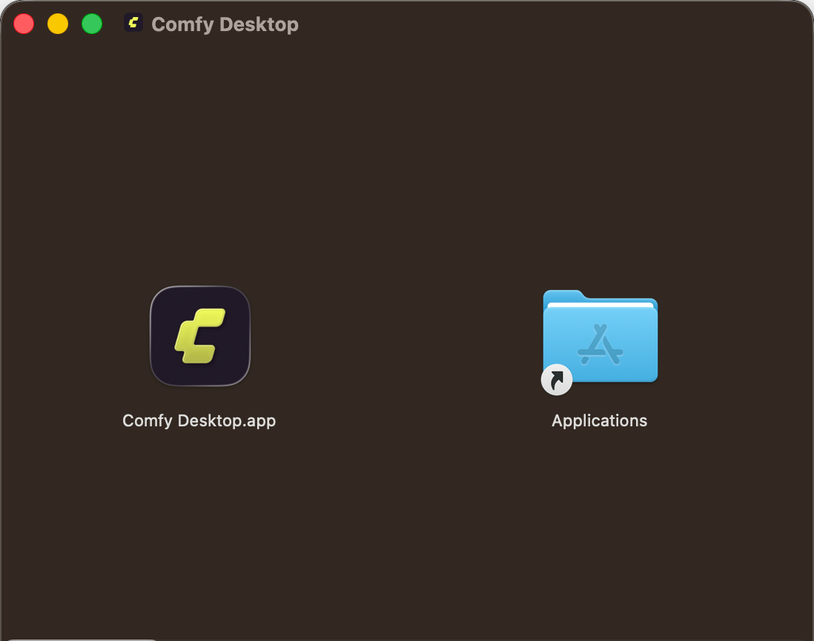
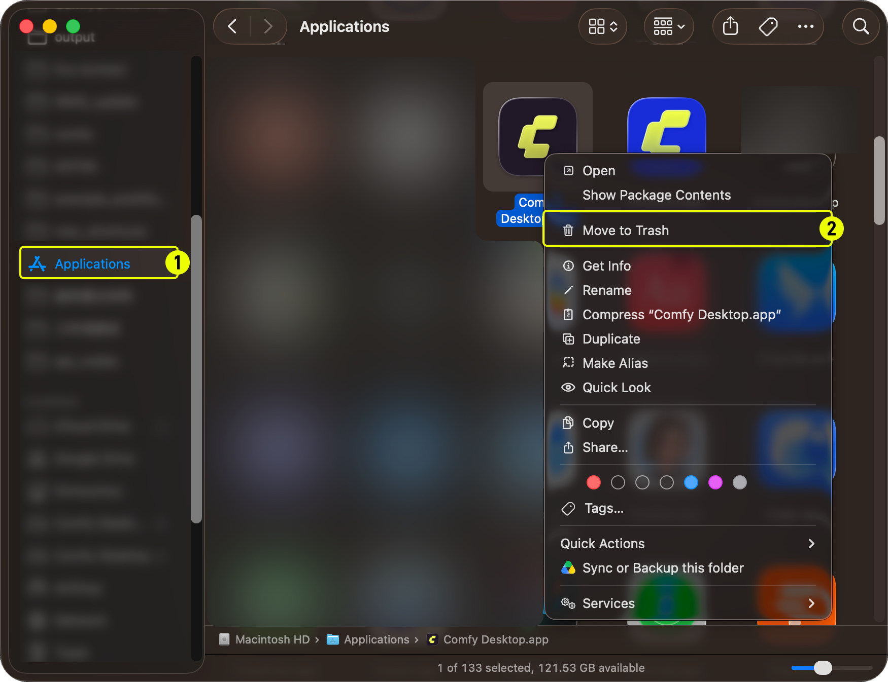

import MigrateTip from '/snippets/ja/desktop/migrate.mdx'
import UpdateGuide from '/snippets/ja/desktop/update.mdx'

**Comfy Desktop** は複数の ComfyUI インスタンスを1つのランチャーから実行できるマルチインストールマネージャーです。このガイドでは、macOS に Comfy Desktop をインストールおよびアンインストールする方法を説明します。

## システム要件

- **OS:** macOS 13 (Ventura) 以降
- **ハードウェア:** Apple Silicon（M1 以降）
- **ディスク容量:** インストールごとに最低 4.85 GB を推奨

<Card title="Comfy Desktop をダウンロード" icon="download" href="https://comfy.org/download">
    macOS 用の最新インストーラーをダウンロードしてください。ページが自動的にプラットフォームを検出します。
</Card>

## インストール

1. ダウンロードした `.dmg` ファイルを開きます
2. **Comfy Desktop** を **Applications** フォルダにドラッグします
3. Launchpad または Spotlight から起動します



初回起動時に、macOS がセキュリティ警告を表示する場合があります。**システム設定 → プライバシーとセキュリティ** に移動し、**このまま開く** をクリックして許可してください。

<MigrateTip />

<Card title="次のステップ：Comfy Desktop を使う" icon="book-open" href="/ja/installation/desktop/usage/overview">
  インストール後は、インスタンスの作成、インストール管理、設定の構成方法をご確認ください。
</Card>

## Comfy Desktop の更新

<UpdateGuide />

## アンインストール

### Comfy Desktop の削除

1. Finder で **Applications** フォルダを開く
2. **Comfy Desktop** を右クリックして **ゴミ箱に入れる** を選択



### アンインストールで削除されないもの

Comfy Desktop のアンインストールはランチャーアプリ自体のみを削除します。以下のデータは**削除されません**。完全にクリーンアップするには手動で削除が必要です：

| データ | 場所 | 説明 |
|------|------|------|
| インストール | `~/ComfyUI-Installs` | 作成した各 ComfyUI インストール（アプリ内からも削除可）。カスタムインストールパスも削除されません。 |
| 共有モデルと出力 | `~/ComfyUI-Shared` | 共有モデルライブラリ、入出力ディレクトリ |
| アプリ設定と記録 | `~/Library/Application Support/Comfy Desktop` | 設定とインストール記録 |
| ログ | `~/Library/Logs/Comfy Desktop` | デスクトップアプリのログ（`app.log`） |

<Warning>上記のディレクトリには、モデル、出力、設定、インストールといったあなたの **個人用 ComfyUI データ** が含まれています。これらは Comfy Desktop アプリケーションファイルではありません。削除するとデータが完全に消去されます。</Warning>

完全にすべてを削除するには：

1. **アプリデータフォルダを削除**: `~/Library/Application Support/Comfy Desktop`
2. **ログフォルダーを削除**: `~/Library/Logs/Comfy Desktop`
3. **アプリ内から個別のインストールを削除**、または `~/ComfyUI-Installs` と設定したカスタムインストールディレクトリを手動で削除
4. **共有モデルライブラリ** `~/ComfyUI-Shared` を削除（ファイルが不要な場合のみ）

## アプリが壊れた状態で起動する場合

手動アップデートの後、Comfy Desktop がスタイルなしで起動したり、翻訳が欠けたり、ボタンやドロップダウンが反応しなくなることがあります。多くの場合、前のバージョンが残した Chromium プロファイルか、キャッシュされた保留中の更新が原因です。

まず Comfy Desktop を終了し、[Comfy-Desktop リポジトリ](https://github.com/Comfy-Org/Comfy-Desktop/blob/main/scripts/reset-mac.sh)のリセットスクリプトを実行します：

```bash
curl -fsSLO https://raw.githubusercontent.com/Comfy-Org/Comfy-Desktop/main/scripts/reset-mac.sh && bash reset-mac.sh
```

スクリプトは削除するパスをすべて表示し、確認してから削除します。現在のバージョンと以前のアプリ名の設定、キャッシュ、Chromium プロファイルを消去するため、古いビルドのプロファイルが再び使われることはありません。Comfy Desktop の実行中は拒否されます。ログフォルダーも削除対象なので、問題を報告する可能性がある場合は先にログをコピーしてください（[アプリログの場所](#アプリログの場所)）。

`~/ComfyUI-Installs` の ComfyUI インストールと `~/ComfyUI-Shared` の共有モデルは残りますが、インストール一覧を記録するファイルは他のアプリデータと一緒に削除されるため、次回起動時に **Add Existing Instance** で追加し直す必要がある場合があります。スクリプトは Mac 上で見つけたアプリの追加コピーも報告します（削除はしません）。Dock に古いコピーが残っていると、リセットしても変化がないように見えることが多いためです。

### アプリログの場所

リセットしても解決せず [Comfy-Desktop の issue](https://github.com/Comfy-Org/Comfy-Desktop/issues) に報告する場合、添付するファイルは `~/Library/Logs/Comfy Desktop` の `app.log` です。このフォルダーはリセットでも削除されるため、スクリプトを実行する前に別の場所へコピーしてください。Comfy Desktop は起動のたびに新しい `app.log` を書き、直近 50 個までの過去のファイルを `app.log_<timestamp>.log` として同じフォルダに残します。問題が起きたセッションのファイルを選んでください。ファイルは 5 MB に達すると切り替わるため、長いセッションは複数のファイルに分かれることがあります。
