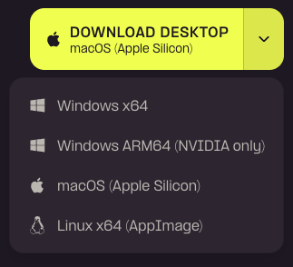
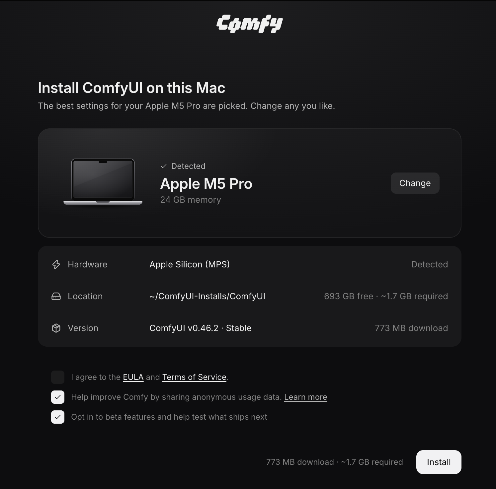

Comfyデスクトップは、このコンピューターにインストールされたコピー（ローカルビルド）として、またはクラウドのGPUで実行されどのコンピューターでも動作するComfy Cloud上で、ComfyUIを実行するために使用するアプリです。ComfyUIに必要なものをすべてダウンロードしてセットアップするため、インストールするアプリはComfyデスクトップだけです。このページでは、Comfyデスクトップをダウンロードし、初回起動時に開くセットアップ画面を確認して、ComfyUIを開きます。


<Note>
  Comfyデスクトップでは、ComfyUIの各コピーをビルドと呼びます。以前のバージョンのComfyデスクトップを使用していた場合、インスタンスは同じモデルと設定を持つビルドとして表示されます。
</Note>

## ComfyUIを実行する場所を選択

Comfyデスクトップは、ComfyUIを2つの場所で実行します。このコンピューター上のローカルビルドか、[Comfy Cloud](https://comfy.org/cloud)です。開始する前にどちらを使用するかを選択してください。初回起動時のセットアップ画面ではローカルビルドがインストールされるためです。

| | ローカルビルド | Comfy Cloud |
| --- | --- | --- |
| 実行場所 | このコンピューター | クラウド上のGPU。そのためどのコンピューターでも動作します |
| セットアップ | 初回起動時にセットアップ画面でインストールされます | なし。**Home**に**Comfy Cloud**カードが表示されます |
| コスト | 無料 | Comfyクレジット。GPUの実行中にのみ消費されます |
| 必要なもの | インストール用の空きディスク容量（セットアップ画面にその量が表示されます） | Comfyアカウント |

Comfy Cloudのみを使用する場合は、セットアップ画面が開いたときにインストールをスキップしてください。[ComfyデスクトップでComfy Cloudを開く](#comfyデスクトップでcomfy-cloudを開く)でその方法を説明しています。

## Comfyデスクトップのダウンロード

ダウンロードページでは、Windows、macOS、Linux 用のインストーラーを提供しています。

1. [comfy.org/download](https://comfy.org/download) にアクセスします。
2. **DOWNLOAD DESKTOP** をクリックします。このボタンは、ページが検出したオペレーティングシステム用のインストーラーをダウンロードします。インストーラーの名前はボタンのテキストの下に表示されます。
3. 別のインストーラーを選択するには、ボタンの横にある矢印 (**All installers**) をクリックし、インストーラーを選択します。リストには **Windows x64**、**Windows ARM64 (NVIDIA only)**、**macOS (Apple Silicon)**、**Linux x64 (AppImage)** が用意されています。

   

## お使いの OS に Comfyデスクトップをインストール

お使いの OS のタブを選択し、要件を確認して、ダウンロードしたファイルをインストールします。

<Tabs>
  <Tab title="Windows">
    **システム要件**

    - Windows 10 以降（x64 または ARM64）。
    - 専用の NVIDIA または AMD GPU を推奨しますが、必須ではありません。ARM64 では、ローカルビルドに NVIDIA GPU が必要です。
    - ビルドごとに少なくとも 4.85 GB の空きディスク容量が必要です。

    **インストール**

    1. ダウンロードした `.exe` インストーラーを実行し、画面の指示に従います。
    2. **スタート**メニューまたはデスクトップのショートカットから Comfyデスクトップを開きます。

    
  </Tab>
  <Tab title="macOS">
    **システム要件**

    - macOS 13（Ventura）以降。
    - Apple silicon（M1 以降）を搭載した Mac。
    - ビルドごとに少なくとも 4.85 GB の空きディスク容量が必要です。

    **インストール**

    1. ダウンロードした `.dmg` ファイルを開きます。
    2. **Comfyデスクトップ**を**アプリケーション**フォルダーにドラッグします。
    3. Launchpad または Spotlight から Comfyデスクトップを開きます。

    

    初回起動時に macOS でセキュリティ警告が表示された場合は、**システム設定** > **プライバシーとセキュリティ**に移動し、**このまま開く**をクリックします。
  </Tab>
  <Tab title="Linux">
    **システム要件**

    - x64 上の Linux。Ubuntu 22.04 以降を推奨します。
    - 専用の NVIDIA または AMD GPU を推奨しますが、必須ではありません。
    - ビルドごとに少なくとも 4.85 GB の空きディスク容量が必要です。

    ダウンロードページでは AppImage を提供しています。Debian および Ubuntu 向けの `.deb` パッケージは、お使いのプラットフォームを検出する[ユニバーサルダウンロードリンク](https://dl.todesktop.com/241130tqe9q3y)からも入手できます。

    **.deb パッケージをインストール**

    ```bash
    sudo apt install ./*.deb
    ```

    このパッケージは Comfyデスクトップを `/opt/Comfy Desktop` にインストールし、APT ソースを追加するため、通常のシステム更新（`sudo apt update` および `sudo apt upgrade`）で新しいリリースが届きます。Ubuntu 24.04 以降では、Electron のサンドボックスが動作するように AppArmor プロファイルもインストールします。Ubuntu 22.04 でパッケージをインストールした後に 24.04 へアップグレードした場合は、プロファイルを追加するために `sudo apt reinstall comfyui-desktop-2` を実行します。

    **AppImage を実行**

    1. AppImage に必要な FUSE 2 をインストールします。Ubuntu 24.04 以降では、`sudo apt install libfuse2t64` を実行します。Ubuntu 22.04 では、`sudo apt install libfuse2` を実行します。
    2. ファイルに実行権限を付与して実行します。

       ```bash
       chmod +x ./*.AppImage
       ./*.AppImage
       ```

    AppImage は、起動したファイルを置き換えることで自身を更新するため、ユーザーアカウントに書き込み権限があるフォルダーに置いてください。ディストリビューションが Electron のサンドボックスをブロックしているために起動に失敗する場合は、`--no-sandbox` を付けて実行します。このフラグはすべてのプロセスのサンドボックスを無効にするため、通常の起動が失敗した場合にのみ使用してください。

    <Accordion title="ソースからビルドして実行">
      開発用に、[リポジトリ](https://github.com/Comfy-Org/Comfy-Desktop#development)から Comfyデスクトップを実行します。Node.js 24、Corepack 経由の pnpm 10、`build-essential`、および `git` が必要です。

      ```bash
      sudo apt install build-essential git
      nvm install 24 && nvm use 24
      corepack enable
      git clone https://github.com/Comfy-Org/Comfy-Desktop.git
      cd Comfy-Desktop
      pnpm run init
      ./linux-dev.sh
      ```

      ソースのチェックアウトは自身を更新しません。更新するには、`git pull` と `pnpm run init` を実行し、その後 `./linux-dev.sh` を再度起動します。
    </Accordion>
  </Tab>
</Tabs>

次に、Comfyデスクトップを開きます。初回起動時にはセットアップ画面が開きます。

<Tip>
  中国語のダウンロードページ [comfy.org/zh-CN/download](https://comfy.org/zh-CN/download) でも同じインストーラーを提供しています。ボタンの表示は **下载桌面版** です。中国国内のミラーから ComfyUI のファイルをダウンロードするには、[セットアップ画面を確認する](#セットアップ画面を確認する)を参照してください。
</Tip>

## セットアップ画面を確認する

初回起動時、Comfyデスクトップはセットアップ画面を開きます。タイトルはmacOSでは**Install ComfyUI on this Mac**、Windowsでは**Install ComfyUI on this PC**、Linuxでは**Install ComfyUI on this computer**です。**Install**をクリックするまで、何もダウンロードされません。



Comfyデスクトップは、お使いのコンピューターに合わせて設定を選択します。インストールする前に確認してください:

- **Detected**: 上部のパネルには、Comfyデスクトップが検出したGPUまたはプロセッサーと、そのメモリが表示されます。
- **Hardware**: ビルドの対象となるハードウェア。**No GPU acceleration** は、ComfyUIがプロセッサー上で動作することを意味します。
- **Version**: ComfyUIバージョンとそのリリースチャンネル（例: **Stable**）。
- **Location**: ビルドをインストールするフォルダーと、そのドライブの空き容量。

セットアップ画面では、**Install**の横にダウンロードサイズが表示されます。その隣の情報アイコンにポインターを合わせると、インストールに必要なディスク容量を確認できます。

他の設定を選ぶには、**Change**をクリックし、**Change setup**画面で編集してから**Save changes**をクリックします。

<Tip>
  初回インストールでは、Comfyデスクトップが選択した設定をそのまま使用してください。[ビルド](/ja/installation/desktop/usage/instance-management)では、変更できるすべての設定を説明しています。
</Tip>

インストールするには:

1. **I agree to the EULA and Terms of Service.** にチェックを入れます。**EULA**または**Terms of Service**をクリックすると、それぞれの内容を読めます。
2. **Install**をクリックします。

利用規約のボックスにチェックを入れる前に**Install**をクリックすると、その横に**Agree to install.** が表示されます。

<Note>
  Comfyデスクトップが中国語で動作している場合、**Install**をクリックした後に**Enable Chinese mirrors?** と尋ねられます。**Enable mirrors** は `gitcode.com`、`mirrors.aliyun.com`、`mirrors.cloud.tencent.com` からダウンロードします。**Not now** は `github.com` と `pypi.org` を使い続けます。
</Note>

### 既存のビルドを保持するか移行する

- **Use my builds**: このコンピューターにレガシーデスクトップ以外のローカルビルドがすでにある場合、**Install**の横に表示されます。利用規約のボックスにチェックを入れ、これをクリックするとインストールをスキップします。**Home** を開くと、あなたのビルドが表示されます。
- **Migrate**: Comfyデスクトップがレガシーデスクトップのインストールを検出すると、**Install**の代わりに表示されます。[レガシーデスクトップからの移行](/ja/installation/desktop/usage/migrate)に、移行される内容が記載されています。

## ホームでインストールを確認する

セットアップ画面が閉じると、**ホーム**が開きます。ビルド行にあるお使いのビルドのカードには、**ComfyUIをインストール中 · 60%** のような進行状況が表示され、続いて **ComfyUIを起動中** と表示されます。


インストールの実行中、カードには古いComfyUIバージョンが表示されることがあります。インストールの最後のステップで、ビルドはセットアップ画面に表示されていたバージョンに更新されます。

デフォルトでは、準備ができるとComfyUIは専用のウィンドウで開き、カードには**実行中**と表示されます。

インストールまたは起動に失敗した場合は、[トラブルシューティング](#トラブルシューティング)を参照してください。

## ComfyデスクトップでComfy Cloudを開く

**ホーム**には、ビルド行のローカルビルドの隣に**Comfy Cloud**カードが表示されます。


### ローカルインストールをスキップしてホームへ進む

セットアップ画面には、すでにビルドがある場合を除いてスキップボタンはありません。**ホーム**に移動してComfy Cloudのみを使うには:

1. セットアップ画面で、利用規約のボックスにチェックを入れます。
2. **検出されました**パネルで、**変更**をクリックします。
3. **タイトルバー**で**メニュー**をクリックし、**オンボーディングをスキップ**を選択します。

**ホーム**が開き、ビルド行に**Comfy Cloud**カードが表示されます。

### ログインしてComfy Cloudを開く

ログインするまで、**Comfy Cloud**カードには**ログインして使用**と表示されます。

<Warning>
  Comfy CloudはGPUの実行中にComfyクレジットを消費します。開く前に**クレジット**残高を確認してください。
</Warning>

1. **サイドバー**の**Comfyにログイン**カードで、**ログイン**をクリックします。カードには**ブラウザで続ける**と表示されます。

   

2. ブラウザでログインを完了します。**サイドバー**に**クレジット**残高が表示され、アカウントが機能していることを確認できます。
3. **ホーム**で、**Comfy Cloud**カードをクリックします。

Comfy Cloudは専用のウィンドウで開きます。

<Tip>
  代わりにブラウザでComfy Cloudを使うには、[cloud.comfy.org](https://cloud.comfy.org/)を開きます。
</Tip>

## ComfyUI を開く

初回インストール後は、**ホーム**からビルドを起動して ComfyUI を開きます。

- 右上の **Open ComfyUI** をクリックします。最新のビルドが開きます。別のビルドを開くには、ボタン右側の矢印（**Choose the build to open**）をクリックし、開きたいビルドを選択します。
- または、ビルド行にあるビルドのカードをクリックします。

**Builds** ページでビルドのタイルをクリックするか、ビルドのページで **Start** をクリックしても開けます。**サイドバー**でビルドをクリックすると、そのページが開くだけで、ビルドは起動しません。

ComfyUI の起動中、ビルドの表示は **Starting…** になります。準備ができると ComfyUI が専用のウィンドウで開き、ビルドの表示は **Running** になり、**サイドバー**で緑のドットが付きます。後でウィンドウを再表示するには、実行中のビルドをもう一度クリックします。

ComfyUI が起動しない場合は、[起動に失敗したビルドを修正する](/ja/installation/desktop/usage/instance-management#ビルドの失敗を修正する) を参照してください。**ホーム**と**サイドバー**のその他の機能については、[Comfy Desktop の画面構成](/ja/installation/desktop/usage/overview) を参照してください。最初の画像を生成するには、[ComfyUI ではじめての画像生成](/ja/get_started/first_generation) に従ってください。

## Comfy Desktopのアンインストール

Comfy Desktopをアンインストールしても、削除されるのはアプリだけです。ビルド、共有モデルと出力、設定、ログは、削除するまでコンピューター上に残ります。代わりに1つのビルドだけを削除するには、[ビルドを削除する](/ja/installation/desktop/usage/instance-management#ビルドを削除する)を参照してください。

<Warning>
  以下のフォルダーには、ビルド、モデル、出力、設定といったあなた自身のデータが保存されています。これらを削除すると元に戻せません。
</Warning>

macOSとLinuxでは、先に[デスクトップ設定](/ja/installation/desktop/usage/settings#storage)の**Comfy Desktopのデータを削除**を実行して、アプリのログ、キャッシュ、一時ファイルを消去できます。

<Tabs>
  <Tab title="Windows">
    1. **設定** > **アプリ** > **インストールされているアプリ**に移動します。
    2. **Comfy Desktop**を見つけて、**アンインストール**をクリックします。

    

    | データ | 既定の場所 |
    | --- | --- |
    | ビルド | `%LOCALAPPDATA%\Comfy-Desktop\ComfyUI-Installs`（古いビルド：`%USERPROFILE%\ComfyUI-Installs`）、および選択した任意のフォルダー |
    | 共有モデル、入力、出力 | `%LOCALAPPDATA%\Comfy-Desktop\ComfyUI-Shared`（古い場合：`%USERPROFILE%\ComfyUI-Shared`） |
    | 設定とビルドの一覧 | `%APPDATA%\Comfy Desktop` |
    | ログ | `%APPDATA%\Comfy Desktop\logs` |

    すべてを削除するには、これらのフォルダーを削除します。共有フォルダーは、そのモデルと出力が不要になった場合にのみ削除してください。
  </Tab>
  <Tab title="macOS">
    1. Finderで**アプリケーション**フォルダーを開きます。
    2. **Comfy Desktop**を右クリックし、**ゴミ箱に入れる**を選択します。

    

    | データ | 既定の場所 |
    | --- | --- |
    | ビルド | `~/ComfyUI-Installs`、および選択した任意のフォルダー |
    | 共有モデル、入力、出力 | `~/ComfyUI-Shared` |
    | 設定とビルドの一覧 | `~/Library/Application Support/Comfy Desktop` |
    | ログ | `~/Library/Logs/Comfy Desktop` |

    すべてを削除するには、これらのフォルダーを削除します。共有フォルダーは、そのモデルと出力が不要になった場合にのみ削除してください。
  </Tab>
  <Tab title="Linux">
    - **.deb**：`sudo apt remove comfyui-desktop-2` を実行します。AppArmorプロファイルも削除されます。APTソースも削除するには、`sudo apt purge comfyui-desktop-2` を使用します。
    - **AppImage**：`.AppImage` ファイルを削除します。

    | データ | 既定の場所 |
    | --- | --- |
    | ビルド | `~/ComfyUI-Installs`、および選択した任意のフォルダー |
    | 共有モデル、入力、出力 | `~/ComfyUI-Shared` |
    | 設定 | `~/.config/comfyui-desktop-2` |
    | ビルドの一覧を含むアプリデータ | `~/.local/share/comfyui-desktop-2` |
    | キャッシュ | `~/.cache/comfyui-desktop-2` |
    | 状態 | `~/.local/state/comfyui-desktop-2` |
    | ログ | `~/.config/Comfy Desktop/logs` |

    すべてを削除するには、これらのフォルダーを削除するか、リポジトリの[reset-linux.sh](https://github.com/Comfy-Org/Comfy-Desktop/blob/main/scripts/reset-linux.sh)スクリプトを実行します。このスクリプトはアプリのフォルダーをクリアし、`~/ComfyUI-Installs`と`~/ComfyUI-Shared`はそのまま残します。共有フォルダーは、そのモデルと出力が不要になった場合にのみ削除してください。
  </Tab>
</Tabs>

## トラブルシューティング

セットアップ画面やインストールが想定どおりに進まない場合は、以下の項目を参照してください。

<AccordionGroup>
  <Accordion title="インストールボタンを押しても何も起こらない場合の対処">
    - **ハードウェア**行に**サポート対象外**と表示される場合: Comfy Cloudを使用してください。[ローカルインストールをスキップしてホームへ進む](#ローカルインストールをスキップしてホームへ進む)でホームに移動し、その後[ログインしてComfy Cloudを開く](#ログインしてcomfy-cloudを開く)を行います。
    - **ComfyUIダウンロードサーバーに接続できませんでした**と表示される場合: インターネット接続を確認してから、**再試行**をクリックしてください。
    - 利用規約ボックスの横に**インストールに同意します**と表示される場合: [セットアップ画面を確認する](#セットアップ画面を確認する)を参照してください。
  </Accordion>
  <Accordion title="ディスク容量を空ける">
    ドライブの空き容量が不足している場合、**場所**行に**空き容量が…のみ、インストールには約…必要です**と表示されます。[場所を変更する](#セットアップ画面を確認する)で空き容量の多いドライブに変更するか、このドライブの空き容量を増やしてください。
  </Accordion>
  <Accordion title="インストールできなかったビルドの対処">
    インストールが完了しない場合、**ホーム**のビルドカードに**インストール失敗**と表示されます。

    <Warning>
      アンインストールすると、そのビルドとすべてのファイルが完全に削除されます。他のビルドには影響しません。残しておきたいものは、先にビルドのフォルダーからコピーしてください。
    </Warning>

    1. ビルドカードをクリックします。ビルドのページが開きます。
    2. **その他**をクリックし、**アンインストール**を選択します。**アンインストール**で確認します。
    3. **ホーム**で**新規ビルド**をクリックして、新しいビルドをインストールします。
  </Accordion>
  <Accordion title="セットアップを閉じた後の復帰">
    セットアップ中にComfyデスクトップを閉じると、**セットアップを終了しますか?**と確認されます。**セットアップを終了**をクリックすると、Comfyデスクトップは選択内容を保存しません。次回Comfyデスクトップを起動すると、セットアップ画面が再び開きます。
  </Accordion>
  <Accordion title="起動できなかったビルドの対処">
    ComfyUIが起動しない場合、**ホーム**のビルドカードに**起動しませんでした**と表示されます。

    1. ビルドカードをクリックします。**ComfyUIが起動しませんでした**というタイトルのダイアログが開きます。
    2. **ログを表示**をクリックして、何が問題だったかを確認します。
    3. **再試行**をクリックします。
  </Accordion>
  <Accordion title="macOSでComfyデスクトップが壊れた状態で起動する">
    手動更新後、Comfyデスクトップがスタイルのない状態、テキストが欠落した状態、またはボタンを押しても何も起こらない状態で開くことがあります。通常は、前のバージョンのプロフィールやキャッシュされた更新が原因です。

    1. 問題を報告する可能性がある場合は、`app.log` を `~/Library/Logs/Comfy Desktop` からコピーしてください。リセットするとこのフォルダーは削除されます。
    2. Comfyデスクトップを終了します。
    3. [リセットスクリプト](https://github.com/Comfy-Org/Comfy-Desktop/blob/main/scripts/reset-mac.sh)を実行します。削除するすべてのパスが一覧表示され、削除する前に確認を求められます:

       ```bash
       curl -fsSLO https://raw.githubusercontent.com/Comfy-Org/Comfy-Desktop/main/scripts/reset-mac.sh && bash reset-mac.sh
       ```

    `~/ComfyUI-Installs` 内のビルドと `~/ComfyUI-Shared` 内のモデルは残りますが、ビルドの一覧は削除されます。[既存のビルドを追加する](/ja/installation/desktop/usage/instance-management#既存のcomfyuiを追加する)で追加し直してください。問題を報告する場合は、[Comfyデスクトップのイシュートラッカー](https://github.com/Comfy-Org/Comfy-Desktop/issues)で `app.log` を添付してください。
  </Accordion>
</AccordionGroup>

## ソースコードを表示

Comfyデスクトップのソースコードは[GitHub](https://github.com/Comfy-Org/Comfy-Desktop)にあります。AGPL-3.0-or-later、またはComfy Orgからの商用ライセンスによるデュアルライセンスです。
