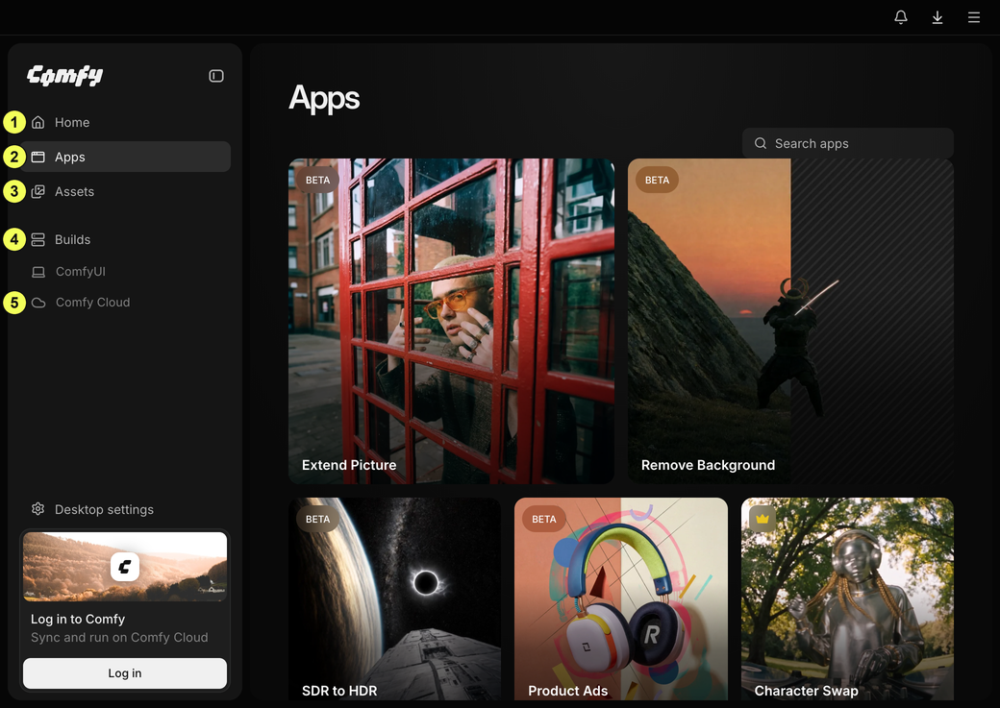
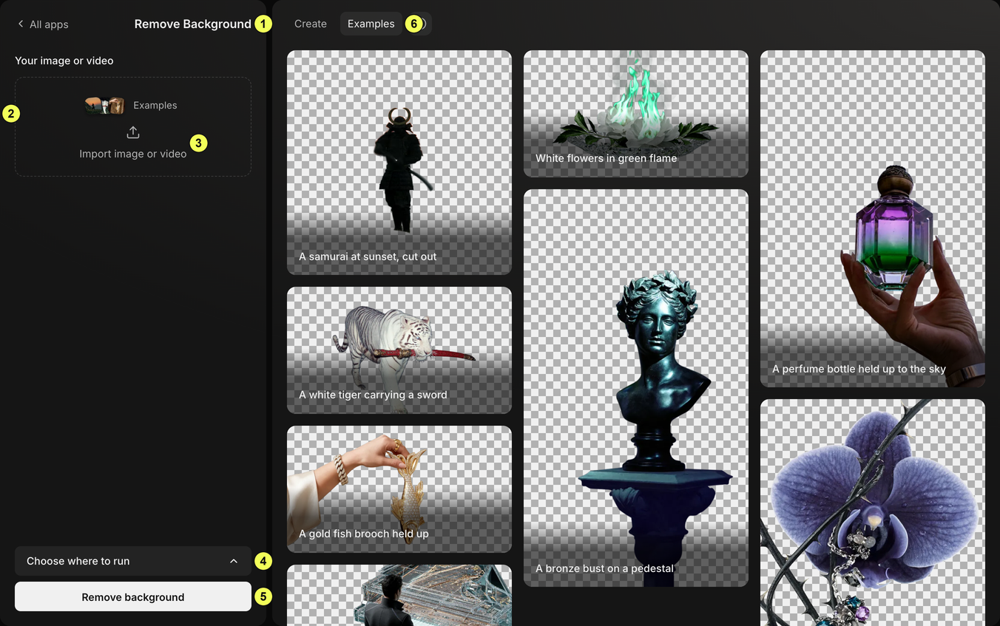
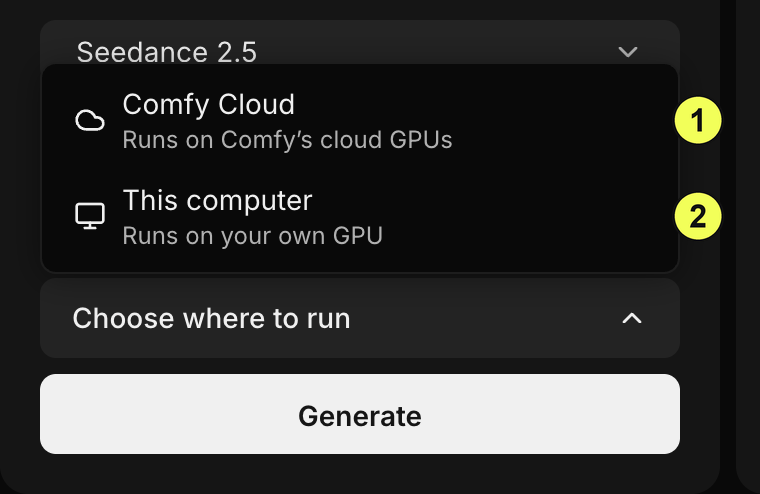

Comfyデスクトップのアプリは、Comfy が提供するすぐに使えるツールです。各アプリはシンプルなインターフェースで1つのジョブを実行します。ワークフローを構築することなく、画像、ビデオ、またはテキストを追加して実行するだけです。アプリは Comfyデスクトップ内で開き、Comfy Cloud またはお使いの GPU 上で動作します。

1. **Search apps**: アプリの名前と説明でカードを絞り込みます。
2. **アプリカード**: アプリの名前とできることを表示します。**BETA** タグはプレビュー中のアプリを示します。カードをクリックするとアプリが開きます。
3. **Missing an app?**: **Ask for an app** を開き、Comfy がまだ作っていないアプリをリクエストできます。[アプリをリクエストする](#アプリをリクエストする)を参照してください。

| アプリ | できること |
| --- | --- |
| **背景を除去** | あらゆる画像やビデオからクリーンな切り抜きを作成します。 |
| **SDR to HDR** | スタンダードな画像をハイダイナミックレンジに変換します。 |
| **Product Ads** | 商品写真を広告用のビジュアルに変換します。 |
| **画像を拡張** | オリジナルのフレームの外側をアウトペイントします。 |
| **キャラクタースワップ** | シーン内のキャラクターを置き換えます。 |
| **商品スワップ** | シーン内の商品を置き換えます。 |

<Note>
  デスクトップアプリは、ComfyUI 内の **Apps** タブ（自分で保存したアプリのワークフローを一覧表示するもの）や[アプリモード](/ja/interface/app-mode)とは異なります。詳しくは[ComfyUI の Apps タブ](/ja/interface/apps)をご覧ください。
</Note>

## アプリを探す

次のいずれかの方法で **アプリ** ページを開きます:

- **サイドバー**で **アプリ** をクリックします。
- **ホーム**で、アプリの行の下にある **すべてのアプリを表示** をクリックします。

1. **Home**: Comfyデスクトップが起動時に開くページです。
2. **Apps**: Apps ページです。このページを開いている間は選択状態になります。
3. **Assets**: ビルドと Comfy Cloud が生成したものをまとめた場所です。
4. **Builds**: ビルドの一覧です。隣のプラス（**+**）ボタンで新規作成します。
5. **Comfy Cloud**: Cloud ビルドです。**Comfy Cloud** を選ぶとこのビルドでアプリが動きます。

各アプリは名前が付いたカードです。カードにポインタを合わせると、そのアプリの説明を読むことができます。アプリを探すには、右上の **アプリを検索** に入力します。検索はアプリの名前と説明に一致します。このページにはカテゴリやフィルターはありません。

**ホーム**では、左右どちらかのカードをクリックするとアプリの行が回転します。中央のカードをクリックすると、そのアプリが開きます。

## アプリを実行する

1. アプリのカードをクリックします。アプリはComfyデスクトップのウィンドウ内、**サイドバー**の隣に開きます。
2. 左側のパネルで入力を追加します。**例**をクリックしてサンプルから始めるか、自分の画像やビデオをインポートします。アプリによってはプロンプトやモデルも求められます。
3. **実行場所を選択**をクリックし、**Comfy Cloud**または**このコンピューター**を選択します。詳しくは[アプリの実行場所](#アプリの実行場所)を参照してください。
4. パネル下部のボタンをクリックします。ボタン名はアプリによって異なり、**生成**や**背景を除去**のようになります。

右側の**例**タブには、そのアプリのサンプル結果が表示されます。**作成**をクリックすると、自分の結果を確認できます。

1. **All apps**: Apps 一覧に戻ります。その隣にアプリ名が表示されます。
2. **Your image or video**: 入力欄です。隣の **Examples** からサンプルを読み込めます。
3. **Import image or video**: パソコンから画像または動画を選びます。
4. **Choose where to run**: Comfy Cloud とこのコンピューターのどちらで実行するかを選びます。
5. **Remove background**: アプリを実行します。
6. **Examples**: 右側の切り抜きサンプルで、それぞれに **Use** ボタンがあります。**Create** で自分の結果を表示します。

**Character Swap**のように入力が多いアプリでは、キャラクター画像、ビデオ、プロンプト、モデル、品質設定を指定します:

1. **Your character**: 動画に入れる人物の画像で、最大3枚までです。
2. **Your video**: 人物を入れ替える動画クリップです。
3. **Prompt**: 結果をどんな内容にするかの指示です。
4. **Model**: アプリが使用するモデルです。
5. **Quality**: 結果の解像度です。
6. **Choose where to run**: Comfy Cloud かこのコンピューターを選びます。
7. **Generate**: アプリを実行します。
8. **Examples**: 右側のビフォーアフター例で、それぞれに **Use** ボタンがあります。**Create** で自分の結果を表示します。

## アプリの切り替えまたは退出

- 一覧に戻るには、アプリ左上の**すべてのアプリ**、または**サイドバー**の**アプリ**をクリックします。
- アプリを開いている間は、その名前が**サイドバー**の**アプリ**の下に表示されます。名前をクリックすると、退出したアプリに戻ります。

ウィンドウには一度に1つのアプリしか表示できません。別のアプリを開くと、開いているアプリが置き換わります。アプリの外に移動するリンクは、ブラウザで開きます。

## アプリの実行場所

**実行場所を選択**では、2つの場所を提供します:

1. **Comfy Cloud**: アプリはComfyのクラウドGPU上で実行されます。Comfyアカウントが必要で、ログインしていない場合はアプリがログインを求めます。詳細は[ログインしてComfy Cloudを開く](/ja/installation/desktop/overview#ログインしてcomfy-cloudを開く)を参照してください。
2. **このコンピューター**: アプリは自分のGPU上で、ローカルビルドの1つを使用して実行されます。Comfyデスクトップは、アプリが要求するビルドを選択し、なければ実行中のビルド、それもなければ最後に使用したビルドを選択します。また、アプリが必要とするComfyUIバージョンより古いビルドはスキップします。そのビルドをComfyUIウィンドウなしでバックグラウンドで起動します。アプリ専用に起動されたビルドは、何もすることがない状態が10分続くと停止します。

アプリはリモートビルドやレガシーデスクトップビルドでは実行されません。ローカルビルドを追加するには、[ビルド](/ja/installation/desktop/usage/instance-management#新しいビルドをインストール)を参照してください。

## クレジット

アプリの閲覧と起動は無料です。実行にかかるコストは、アプリが使用するモデルと実行場所によって異なります。

- オープンモデルで構築されたアプリは、ご自身の GPU で無料で実行できます。
- パートナーモデルを使用するアプリは、実行場所にかかわらず Comfy クレジットを消費します。
- Comfy Cloud での実行は、他の Comfy Cloud の実行と同様に Comfy クレジットを消費します。

**サイドバー**の下部に表示される**クレジット**残高は、アプリを閉じると更新されます。プランと料金については、[Comfy Cloud](/ja/get_started/cloud) をご覧ください。

## アプリのワークフローを ComfyUI で開く

アプリは、その背後にあるワークフローを ComfyUI で開くことができるため、自分で変更できます。これにはアプリ独自のコントロールを使用します。Comfy Desktop は、ビルドが実行されていない場合は起動し、その ComfyUI ウィンドウを開いて、そこにワークフローを読み込みます。ワークフローは、アプリが実行された場所に応じて、Comfy Cloud またはローカルビルドで開きます。

## 結果を保存して表示する

アプリが結果を表示すると、Comfy Desktop はそれをビューアーで開きます。

- **ダウンロード**: ファイルがまだこのコンピューター上にない場合にコピーを保存します。
- **Finder で表示**、**エクスプローラーで表示**、または **フォルダーで表示**: ファイルがこのコンピューター上にある場合に、そのファイルのフォルダーを開きます。
- **ワークフローを開く**: そのファイルを生成したワークフローを開きます。
- **アセットで表示**: Comfy Cloud の結果を [アセット](/ja/installation/desktop/usage/assets) ページで開きます。

このコンピューター上で実行中のアプリがモデルを必要とすると、そのダウンロードは[ダウンロード](/ja/installation/desktop/usage/downloads)トレイに表示されます。Comfy Desktop はアプリ向けに Hugging Face から `.safetensors` モデルのみをダウンロードします。

## アプリをリクエストする

**アプリ**ページの最後のカードには、**不足しているアプリはありますか？**と表示されます。

1. **アプリをリクエストする**をクリックします。
2. **どのアプリが必要ですか？**で、アプリを500文字以内で説明します。
3. **送信**をクリックします。

ダイアログには、**ありがとうございます。リクエストを受け付けました。**と表示されます。リクエストは、Comfy が次にどのアプリを開発するかを決めるのに役立ちます。

## トラブルシューティング

<AccordionGroup>
  <Accordion title="アプリがサイドバーに表示されない">
    お使いのComfy Desktopではまだアプリを利用できません。アプリはComfy側で有効化されるもので、設定できる項目はありません。代わりに**ホーム**にサンプルのワークフローが表示されます。
  </Accordion>
  <Accordion title="アプリが読み込まれない">
    **アプリ**ページに**アプリが読み込まれませんでした**と表示される、または**ホーム**に**アプリを読み込めませんでした。接続を確認して、もう一度お試しください。**と表示される場合は、インターネット接続を確認してから**再試行**をクリックしてください。
  </Accordion>
  <Accordion title="特定のアプリが読み込まれない">
    アプリに**{app}を読み込めませんでした**と**インターネット接続を確認して、もう一度お試しください。**が表示されます。**再試行**をクリックするか、**すべてのアプリ**をクリックして一覧に戻ります。
  </Accordion>
  <Accordion title="このコンピューターでアプリを実行できない">
    アプリに次のいずれかのメッセージが表示されます。

    - **このコンピューターでアプリを実行するには、Comfy Desktopでローカルビルドを追加してください。**[ビルドをインストール](/ja/installation/desktop/usage/instance-management#新しいビルドをインストール)するか、Comfy Cloudでアプリを実行してください。
    - **このアプリにはComfyUI {version}以降が必要です。Comfy Desktopのローカルビルドをアップデートしてください。**ビルド内で[ComfyUIをアップデート](/ja/installation/desktop/usage/build-management#comfyuiをアップデート)してください。
    - **{name}はまだインストール中です。完了してから再試行してください。****ホーム**でインストールが完了するのを待ち、その後アプリを再度実行してください。
    - **Comfy Desktopは{name}を起動できませんでした。**[失敗したビルドを修正する](/ja/installation/desktop/usage/build-troubleshooting#ビルドの失敗を修正する)を参照してください。
  </Accordion>
  <Accordion title="検索で何も見つからない">
    ページに**一致するものがありません**と表示されます。別の単語を試すか、**検索をクリア**をクリックしてください。まだ存在しないアプリをリクエストするには、**アプリをリクエスト**をクリックしてください。
  </Accordion>
</AccordionGroup>
