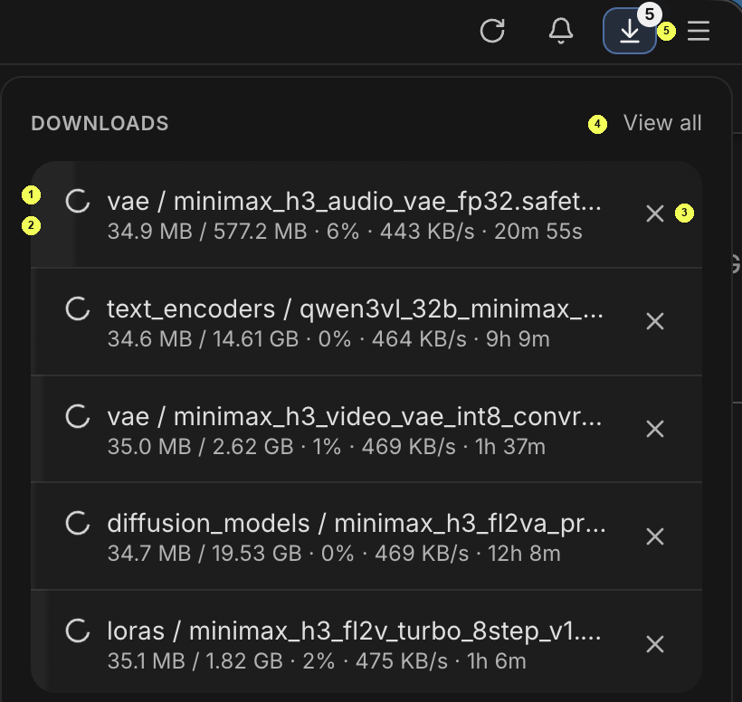

Comfy Desktop はビルドに必要なファイルをダウンロードし、すべての転送を 1 か所で追跡します。アプリが代わりに取得するモデルでも、自分で保存するファイルでも同じです。ComfyUI がディスク上にないモデルを要求し、ダウンロードリンクを提示した場合、Comfy Desktop が転送を実行してファイルを対応するモデルフォルダーに保存するため、手動で配置する必要はありません。

**タイトルバー**の **Downloads** ボタンをクリックすると、進行中の転送の確認、転送の一時停止や再試行、完了したファイルが保存されたフォルダーを開くことができます。

## ダウンロード一覧に表示されるもの

- **不足しているモデル**: ComfyUI がダウンロードリンク付きの不足しているモデルを、不足しているモデルのダイアログまたは右側パネルの **エラー** タブで報告すると、そのダウンロードは Comfy Desktop 経由で実行されます。ファイルは対応するモデルフォルダー（`checkpoints`、`diffusion_models`、`text_encoders`、`loras`、`vae` など）に保存されます。対応するモデルファイル形式は `.safetensors`、`.sft`、`.ckpt`、`.pth`、`.pt` です。
- **アプリ用のモデル**: [アプリ](/ja/installation/desktop/usage/apps)がこのコンピューターで実行され、ディスク上にないモデルを必要とすると、Comfy Desktop がそのモデルをダウンロードし、その転送はトレイに表示されます。
- **Comfy Cloud およびリモートビルドからの出力**: **出力を自動ダウンロード** がオンの場合、完了した出力は出力フォルダーに自動的に保存されます。[リモートおよび Comfy Cloud ビルドの出力オプションを設定する](/ja/installation/desktop/usage/instance-management#リモートビルドとcomfy-cloudビルドの出力オプションを設定する)を参照してください。
- **自分でダウンロードするファイル**: **アセット** ページから保存するアセットです。[Comfy Cloud からダウンロードする](/ja/installation/desktop/usage/assets#comfy-cloud-からダウンロード)を参照してください。

## ダウンロードトレイ

タイトルバーの **ダウンロード** ボタンをクリックすると、トレイが開きます。

ボタンには、進行中のダウンロードの件数を示すバッジが付きます。ダウンロードが何も進行していないときは、代わりにまだ確認していない失敗したダウンロード、または完了してまだ開いていないダウンロードを示します。

ダウンロードは最新順に表示され、モデルフォルダーとファイル名がラベルとして付きます。進行中の行には転送済みサイズとパーセントが表示され、Comfyデスクトップが推定できるようになると速度と残り時間も表示されます。行にポインターを合わせるとボタンが表示されます:

- 失敗またはキャンセル済みのダウンロードでは **再試行**。
- 完了した行のフォルダーボタンを押すと、ファイルが保存されているフォルダーが開きます。ツールチップには **Finder で表示**、**エクスプローラーで表示**、**フォルダーで表示** のいずれかが表示されます。
- **✕** は進行中のダウンロードをキャンセルして途中までのファイルを破棄し、完了した行は一覧から削除します。

トレイ下部の **すべてのダウンロードを表示** をクリックすると、ダウンロードの全体ビューが開きます。一時停止と再開はこの全体ビューで行います。

## ダウンロードの全体ビュー

全体ビューではダウンロード履歴が保持され、トレイに収まらない操作をここで行えます:

- 状態で一覧を絞り込みます: **All**、**Active**、**Completed**、**Failed**。絞り込みチップは、2 つ以上の状態に行がある場合にだけ表示されます。**Failed** にはキャンセル済みのダウンロードも含まれます。
- 進行中のダウンロードを **Pause**、一時停止中のダウンロードを **Resume** で再開します。
- 失敗またはキャンセル済みのダウンロードには **Try again** を使います。
- ファイルのフォルダーを開く、または 1 行だけ削除します。
- **Clear finished** で完了した行をまとめて削除します。

フッターには、一覧内の進行中、完了、失敗、キャンセル済みのダウンロード件数が表示されます。

## ダウンロード中に終了する場合

モデルのダウンロードは再開できます。モデルの転送中に Comfy Desktop を終了しても、受信済みのバイトは保持され、次回起動時にその転送は **Downloads** トレイに一時停止中の項目として戻ります。**View all downloads** を開いて **Resume** すると途中から再開でき、キャンセルすると未完了のファイルは破棄されます。

Comfy Cloud およびリモートビルドからの出力ダウンロードは別の経路で転送されるため、終了後に再開されません。

**タイトルバー**の**メニュー**にある **Quit Desktop** は、すべてのウィンドウを一度に閉じます。ComfyUI を実行するウィンドウが開いている間は、Comfy Desktop が先に確認を求め、その確認には閉じられるビルドと進行中の操作が一覧表示されます。

## ダウンロードの保存先

モデルファイルは、ビルドに共有フォルダーが含まれている場合は [デスクトップ設定 → フォルダー](/ja/installation/desktop/usage/settings#storage) で **ダウンロード** とマークされたモデルフォルダーに書き込まれ、含まれていない場合はビルド自身の `models` フォルダーに書き込まれます。新しいダウンロードを別の共有モデルフォルダーに保存するには、同じタブ内のそのフォルダーの行で **ダウンロードに使用** をクリックします。各ビルドは、それぞれの[フォルダータブ](/ja/installation/desktop/usage/instance-management#ビルドが使用するフォルダーを選択)で共有フォルダーをオフにできます。

Comfy Cloud またはリモートビルドからダウンロードした出力は、ビルドの出力フォルダーに保存されます。ビルドが共有出力フォルダーを使用している場合は、その共有出力フォルダーに保存されます。リモート接続では、**起動引数** タブの **出力の自動ダウンロード** で出力の自動ダウンロードをオフにできます。

**アセット** から自分でダウンロードするファイルは例外です。保存ダイアログで指定した場所に保存されるため、ビルドの完全に外に置かれることもあります。
