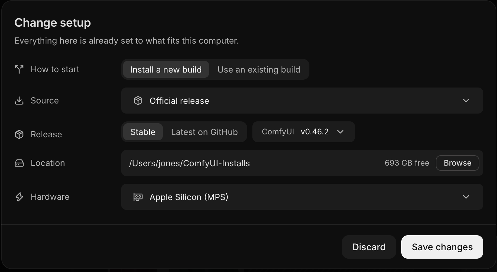
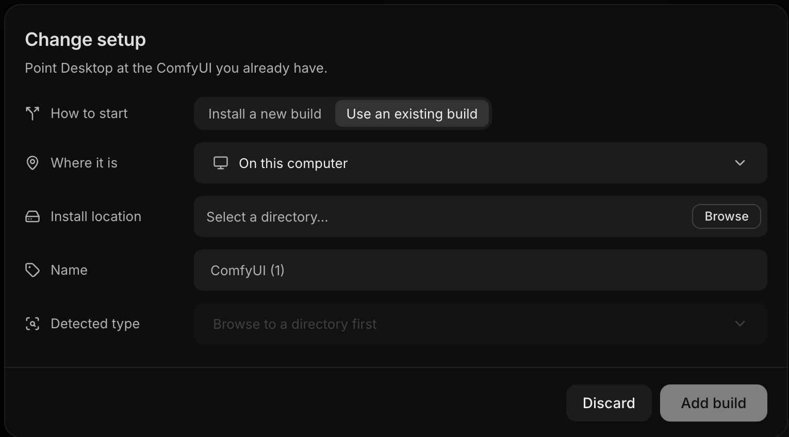

Comfy Desktop では、このコンピューター上、Comfy Cloud 上、または別のマシン上の ComfyUI サーバー上で ComfyUI を実行できます。これらのそれぞれがビルドです。Comfy Desktop は Comfy Cloud をあらかじめ一覧に表示し、それ以外のビルドは開く前にインストール、追加、または接続します。このページでは、ビルドのセットアップと実行、ビルドページからの更新と設定、不要になったビルドの削除について説明します。

## Comfy ビルドの種類

ビルドの実行場所によって、そのビルドでできることが決まります。**Builds** ページでは、ビルドを実行場所ごとにグループ化しています:

| 実行場所 | 内容 | 入手方法 |
| --- | --- | --- |
| **このコンピューター** | このコンピューターにインストールされた ComfyUI。種類は **Standalone**、**Git clone**、**Portable**、**Legacy Desktop**、または **Build**（チームのワークスペースにある Developer Platform の Build）です。 | [新しいビルドをインストールする](#新しいビルドをインストール)、または[すでにお持ちの ComfyUI を追加する](#既存のcomfyuiを追加する)。 |
| **クラウド** | Comfy Cloud。クラウド上の GPU で実行され、Comfy アカウントが必要です。 | Comfy Desktop では **Comfy Cloud** として一覧に表示されます。 |
| **リモート** | 別のマシンで実行されている ComfyUI サーバー。URL で接続します。 | [ComfyUI サーバーに接続する](#comfyuiサーバーへの接続)。 |

<Note>
  Comfy Cloud では、[ログイン](/ja/installation/desktop/overview#ログインしてcomfy-cloudを開く)するまで **Log in to use** と表示されます。クイックアクションメニューには **Stop**、**Auto start**、**Uninstall** がなく、名前は **Comfy Cloud** のままです。
</Note>

## ビルドを見つける

**ビルド**ページには、ワークスペース内のすべてのビルドが一覧表示されます。開くには、**サイドバー**の**ビルド**をクリックします。

ページの上部には次のものがあります：

- **新規ビルド**：新しいビルドを開始します。横の矢印（**その他のビルドオプション**）をクリックすると、**既存のビルドを追加**と**スナップショットを読み込む**が表示されます。
- **実行場所**：リストをフィルターします。**すべて**と**このコンピューター**は常に表示されます。**クラウド**と**リモート**は、その種類のビルドがある場合に表示されます。
- **並び替え**：ビルドを**最終使用日**または**名前**で並び替えます。インストール中のビルドは常に上部に表示されます。
- **ビルドを検索**：名前でビルドを検索します。一致するものがない場合は、**フィルターをクリア**をクリックします。

各ビルドはタイルで表示されます。タイルには、**実行中**、**起動中…**、**自動起動**、**エラー**などのビルドのステータスが表示されます。タイルにポインタを合わせると、クリックしたときの動作が表示されます：**クリックして開始**、**クリックして開く**、**クリックしてログを表示**。

ビルドがない場合、ページには**ビルドはまだありません**と**このコンピューターにComfyUIをインストールするか、Comfy Cloudで実行してください。**と表示されます。

**サイドバー**にも、**ビルド**の下に各ビルドが一覧表示されます：

- スピナーとパーセントは、ビルドがインストール中であることを示します。
- 緑の点は、ビルドが実行中であることを示します。
- 赤の点は、ビルドがクラッシュしたか起動しなかったことを示します。ビルドにポインタを合わせると理由が表示されます。
- ビルドをクリックすると、その[ビルドページ](#ビルドの管理)が開きます。
- ビルドを右クリックすると、[クイックアクションメニュー](#ビルドリストからのクイックアクション)が表示されます。

**ホーム**と**サイドバー**のその他の項目については、[Comfyデスクトップの画面構成](/ja/installation/desktop/usage/overview)を参照してください。

### ビルドリストからのクイックアクション

**サイドバー**のビルドを右クリックするか、**ビルド**ページのタイルまたは**ホーム**のカードを右クリックすると、短いアクションメニューが表示されます。タイルまたはカードでは、右側に**⋯**ボタンが表示されるまでポインタを合わせ、その後クリックすることもできます。

メニューには、現在そのビルドに適用されるアクションのみが表示されます：

- **開始**、またはビルドの実行中は**ログを表示**、**再起動**、**停止**。インストール中または起動中は、**ログを表示**と**キャンセル**。クラッシュ後は、**エラーを表示**。
- **自動起動**または**自動起動をオフにする**。[Comfyデスクトップの起動時にビルドを開始する](#comfy-desktop-の起動時にビルドを開始する)を参照してください。
- **管理**。クリックすると[ビルドのページ](#ビルドの管理)が開きます。
- **更新**（アップデートがある場合）、および**スタンドアロンに移行**（ビルドをスタンドアロンビルドに移行できる場合）。[後で移行する](/ja/installation/desktop/usage/migrate#後で移行する)を参照してください。
- **複製**、および**Finderに表示**、**エクスプローラーに表示**、または**フォルダーに表示**。
- **スナップショットをエクスポート**と**スナップショットを復元**。[スナップショット](#スナップショットを保存して復元する)を参照してください。
- **ビルドをアップロード**（ワークスペースにログインしている場合）。[チームビルド](/ja/installation/desktop/usage/workspaces-and-builds)を参照してください。
- **アンインストール**。[ビルドを削除する](#ビルドを削除する)を参照してください。

**自動起動**、**再起動**、**ログを表示**、**ビルドをアップロード**はこのメニューにのみあります。それ以外はビルドのページにもあります。項目がグレーアウトしている場合は、ポインタを合わせると理由が表示されます（例：**先に実行中のビルドを停止してください。**）。

## 新しいビルドをインストール

新しいビルドは、Comfyデスクトップがユーザーに代わってインストールするComfyUIです。公式リリースの**スタンドアロン**ビルド、またはチームのワークスペースからのDeveloper Platform Buildです。**新規ビルド**ダイアログがこのコンピューターに合わせて設定を選択します。インストールではComfyUIをダウンロードし、Python環境をセットアップするので、**インストール**をクリックする前に概要を確認してください。

<Steps>
  <Step title="新規ビルドダイアログを開く">
    次のいずれかの方法でダイアログを開きます：

    - **サイドバー**で、ポインタを**ビルド**の上に置き、プラス（**+**）ボタン（**新規ビルド**）をクリックします。
    - **ビルド**ページで、**新規ビルド**をクリックします。
    - **ホーム**で、**ホーム**に**新規ビルド**タイルが表示されている場合は、そのタイルをクリックします。

    **新規ビルド**ダイアログが開き、先頭に**新しいComfyUIインストールをセットアップします。**と表示されます。
  </Step>
  <Step title="概要を確認">
    ログインしていてワークスペースにビルドがある場合、ダイアログは**チームのビルド**で開きます。その**リリース**行にそれらが一覧表示され、プレースホルダー**ビルドを選択**が表示されます。代わりに公式リリースをインストールするには、次の手順で**ソース**を**公式リリース**に設定します。

    公式リリースの場合、ダイアログにはインストール内容が表示されます：

    

    - **名前**：**サイドバー**と**ビルド**ページでビルドに付けられる名前です。ボックスには候補名が表示されます。その名前を使用するには空のままにするか、独自の名前を入力します。
    - **検出されました**：Comfyデスクトップが見つけたコンピューターまたはGPUで、メモリはGB単位です。その横にある**変更**をクリックしてセットアップを変更します。
    - **リリース**：テスト済みリリースの場合は**安定版**、または**GitHubの最新**。
    - **ハードウェア**：ビルドの対象となるGPUタイプ（**NVIDIA**、**AMD**、**Intel Arc (XPU)**、**Apple Silicon (MPS)**、**CPU**など）。その注記は次のとおりです：
      - **検出されました**：GPUタイプがComfyデスクトップで見つかったGPUと一致します。
      - **GPUアクセラレーションなし**：ビルドは**CPU**向けです。
      - **サポートされていません**：このコンピューターは選択したGPUタイプをサポートしていません。
    - **バージョン**：インストールされるComfyUIバージョンとそのリリース（**安定版**など）。
    - **場所**：ビルドのインストール先フォルダーで、そのドライブの空き容量とインストールに必要な容量が表示されます。別のフォルダーを選択するには**ブラウズ**をクリックします。

    **ハードウェア**の注記が**検出されました**と表示され、**場所**に警告なしで空き容量が表示されている場合、セットアップはこのコンピューターに適合しています。

  </Step>
  <Step title="セットアップを変更する（任意）">
    **変更**をクリックして**セットアップの変更**を開きます。**ここにあるものはすべて、このコンピューターに適合するようにすでに設定されています。**と表示されます。

    

    - **開始方法**：**新しいビルドをインストール**を選択したままにします。
    - **ソース**：**公式リリース**はComfyUIをインストールします。**チームのビルド**はワークスペースからDeveloper Platform Buildをインストールします。詳細は[チームのビルド](/ja/installation/desktop/usage/workspaces-and-builds)を参照してください。
    - **リリース**：**安定版**はテスト済みリリースをインストールします。**安定版**の横のリストでバージョンを選択します。**GitHubの最新**はmasterブランチの最新コミットをインストールします。
    - **場所**：インストールフォルダーです。Comfyデスクトップのフォルダー、OneDrive、共有のモデルフォルダー、入力フォルダー、出力フォルダー、または別のビルドの内部ではないフォルダーを選択してください。別のフォルダーを選択するには**ブラウズ**をクリックします。
    - **ハードウェア**：ビルドの対象となるGPUタイプです。各オプションには、ComfyUIバージョン、Pythonバージョン、ダウンロードサイズが表示されます。

    **変更を保存**をクリックして概要に戻るか、**破棄**をクリックして変更を破棄します。

  </Step>
  <Step title="インストールをクリック">
    **インストール**をクリックします。インストールが開始される前に、Comfyデスクトップが停止させることがあります：

    - **場所**の下に問題が表示され、フォルダーがビルドを格納できない場合、**インストール**はグレー表示のままです。**ブラウズ**をクリックして別のフォルダーを選択します。
    - **ディスク容量不足**は、ドライブの空き容量がインストールに必要な量より少ない場合、または1 GB未満の場合に開きます。インストールするには**そのまま続行**をクリックするか、ダイアログを閉じて別のフォルダーを選択します。
    - **NVIDIAドライバーを更新**は、ドライバーがバージョン580より古い場合に**NVIDIA**ビルドで開きます。現在のドライバーバージョンと推奨最小バージョンが表示されます。現在のドライバーでインストールするには**そのまま続行**をクリックするか、先にドライバーを更新してください。
  </Step>
  <Step title="インストールの進行を確認">
    Comfyデスクトップは**ホーム**に戻り、インストールはバックグラウンドで実行されます。ビルドには**ComfyUIをインストール中**とパーセントが**ホーム**と**ビルド**ページに表示され、**サイドバー**にはスピナーとパーセントが表示されます。

    各ステップを表示するには、ビルドのタイルをクリックするか、[クイックアクションメニュー](#ビルドリストからのクイックアクション)で**ログを表示**を選択します。**ComfyUIをインストール中**ダイアログにステップが一覧表示されます：

    1. **ダウンロード**
    2. **展開**
    3. **環境をセットアップ**
    4. **最新のComfyUIを取得**、または**ComfyUIを取得**と選択したバージョン

    ダイアログで**ログを表示**をクリックすると、インストール出力を確認できます。

    インストールを停止するには：

    1. クイックアクションメニューで、**キャンセル**を選択します。
    2. **インストールをキャンセル**をクリックします。

    インストールが停止し、Comfyデスクトップはダウンロードしたファイルを削除します。
  </Step>
</Steps>

インストールが完了すると、**サイドバー**のスピナーが消え、ビルドにノートPCのアイコンが表示されます。**自動起動**については、[Comfyデスクトップの起動時にビルドを開始する](#comfy-desktop-の起動時にビルドを開始する)を参照してください。インストールが失敗した場合は、[失敗したビルドを修正する](#ビルドの失敗を修正する)を参照してください。

## 既存のComfyUIを追加する

Gitクローンやポータブル版のダウンロードからComfyUIを自分でセットアップした場合は、それをComfyデスクトップに追加できます。Comfyデスクトップはそのフォルダーから実行し、ファイルの移動やコピーは行いません。

1. **ビルド**ページで、**新規ビルド**の横にある矢印（**その他のビルドオプション**）をクリックし、**既存のビルドを追加**を選択します。または、**新規ビルド**を開いて**変更**をクリックし、**起動方法**を**既存のビルドを使用**に設定し、**場所**を**このコンピューター上**に設定します。シートには**お使いの既存のComfyUIをデスクトップに指定してください。**と表示されます。

   

2. **インストール先**の横にある**ブラウズ**をクリックし、ComfyUIのフォルダーを選択します。
3. **検出された種類**を確認します。**スタンドアロン**、**ポータブル**、**Gitクローン**、**レガシーデスクトップ**のいずれかが表示されます。**レガシーデスクトップ**と表示された場合は、作業を中止してダイアログを閉じてください。ここで追加すると、Comfyデスクトップによる移行が行われなくなります。代わりに[レガシーデスクトップからの移行](/ja/installation/desktop/usage/migrate)に従ってください。**既知のインストールが検出されません**と表示された場合は、その上のフォルダーではなく、ComfyUI本体が入っているフォルダーを選択してください。
4. **名前**は、提案された名前をそのまま使用するか、任意の名前を入力します。
5. **Gitクローン**の場合は、**バージョン**、**リポジトリ**、**ブランチ**を確認します。**仮想環境**には、Comfyデスクトップが検出した`.venv`、`venv`、`.env`、または`env`フォルダーが表示されます。別のフォルダーを使用するには、その横にある**ブラウズ**をクリックします。
6. **ビルドを追加**をクリックします。

ビルドは**サイドバー**と**ビルド**ページに表示されます。入力した名前が別のビルドで使われている場合、**名前**には**「…」という名前のビルドはすでに存在します。別の名前を選択してください。**と表示されます。

スナップショットファイルからビルドを作成するには、**その他のビルドオプション**で**スナップショットを読み込む**を選択します。詳細は[スナップショットファイルからビルドを作成する](#スナップショットファイルからビルドを作成する)を参照してください。

## ComfyUIサーバーへの接続

リモートビルドは、ネットワーク上のGPUサーバーなど、別のマシンで実行されているComfyUIサーバーを開きます。サーバーのURLが必要です。

1. [新しいビルドのインストール](#新しいビルドをインストール)と同様に**新規ビルド**ダイアログを開き、**変更**をクリックします。
2. **起動方法**を**既存のビルドを使用**に設定します。
3. **場所**を**サーバー上**に設定します。

   

4. **名前**には、提案された名前をそのまま使用するか、独自の名前を入力します。
5. **ComfyUI URL**に、サーバーのアドレスを入力します。ボックスには例として `http://localhost:8188` が表示されます。
6. **接続**をクリックします。

ビルドは**サイドバー**と**ビルド**ページに表示され、**実行場所**フィルタに**リモート**が追加されます。アドレスがURLでない場合、ダイアログに**有効なURLを入力してください**（例：`http://localhost:8188`）と表示されます。後でアドレスを変更するには、[リモートビルドのURLを変更する](#リモートビルドの-url-を変更する)を参照してください。

## ビルドの開始、停止、再起動

ビルドを開始して ComfyUI を開くには、[ComfyUI を開く](/ja/installation/desktop/overview#comfyui-を開く) を参照してください。Comfy Cloud のビルドはそのページの **Open Cloud** で開き、リモートのビルドは **Open remote** で開きます。

### 複数のビルドを実行する

このコンピューターで、別のビルドが実行中または起動中のときにビルドを開始すると、Comfy Desktop は **A build is already running** を開きます。**Will be stopped** には、停止されるビルドが一覧表示されます。

<Warning>
  **Close and start** は一覧に表示されたビルドを停止し、それらの未保存の作業は失われます。先にワークフローを保存してください。
</Warning>

- **Close and start**: 一覧に表示されたビルドを停止してから、選択したビルドを開始します。
- **Run all**: そのビルドを開始し、他のビルドは実行したままにします。

開始をキャンセルするには、ダイアログを閉じます。このダイアログが表示されないようにするには、**サイドバー** から **デスクトップ設定** を開き、**Preferences** で **Warn before running multiple builds** をオフにします。

### 停止と再起動

ビルドをアンインストールする前に停止してください。起動引数への変更を適用するには、再起動します。

<Warning>
  ビルドを停止または再起動すると、ComfyUI の未保存の作業は失われます。先にワークフローを保存してください。
</Warning>

実行中のビルドを停止するには:

1. [ビルドページ](#ビルドの管理)で **More** (**⋯**) をクリックし、**Stop** を選択します。[クイックアクション](#ビルドリストからのクイックアクション)で **Stop** を選択することもできます。
2. **Stop ComfyUI** で **Stop** をクリックします。

ComfyUI が停止し、そのウィンドウが閉じます。

実行中のビルドを再起動するには:

1. [クイックアクション](#ビルドリストからのクイックアクション)で **Restart** を選択します。
2. **Restart ComfyUI** で **Restart** をクリックします。

タイルには **Starting…** と表示され、続いて **Running** になります。再起動では **A build is already running** は開きません。

## Comfy Desktop の起動時にビルドを開始する

**自動起動**を設定すると、Comfy Desktop を開くたびに 1 つのビルドが開始されます。**自動起動**を設定できるビルドは一度に 1 つだけです。

- このコンピューター上のビルドまたはリモートビルドの[クイックアクションメニュー](#ビルドリストからのクイックアクション)で、**自動起動**を選択します。

ビルドのタイルには**自動起動**と表示されます。別のビルドに**自動起動**が設定されていた場合、そのビルドの設定は解除されます。オフにするには、同じメニューで**自動起動をオフにする**を選択します。

このコンピューターに最初のビルドをインストールし、他のビルドに**自動起動**が設定されていない場合、新しいビルドに自動起動が設定されます。そのビルドが初回に起動しない場合、Comfy Desktop はそのビルドの**自動起動**をオフにします。

## ビルドの管理

各ビルドには専用のページがあります。ここで 1 つのビルドを管理します。ビルドを起動し、ComfyUI をアップデートし、PyTorch を変更し、使用するフォルダを選択し、スタートアップ引数を設定し、名前の変更、コピー、削除を行えます。開く方法は次のいずれかです。

- **sidebar** で、**Builds** の下にあるビルドをクリックします。
- [ビルド一覧のクイックアクション](#ビルドリストからのクイックアクション)で **Manage** を選択します。

ヘッダーには、そのビルドが何であるかと、実行中かどうかが表示されます。左から順に次のとおりです。

- **Name**: 名前をクリックするか、鉛筆アイコン (**Edit build name**) をクリックすると、ビルドの名前を変更できます。新しい名前を入力して `Enter` を押します。`Esc` を押すと元の名前のままになります。Standalone、Portable、git、リモートの各ビルドは名前を変更できますが、Comfy Cloud と Legacy Desktop のビルドは変更できません。名前は他のビルドと重複しないものにする必要があります。
- **Status chip**: **Running**、**Starting…**、**Stopping…**、またはビルドがクラッシュしたか起動しなかった場合は失敗ラベルが表示されます。失敗ラベルをクリックするとエラーを確認できます。
- **Meta line**: ビルドが動作する場所 (**This computer**、**Cloud**、**Remote**)、種類、バージョンをドットで区切って表示します。
- **Primary button**: ローカルビルドが停止中のときは **Start**、実行中は **Open**、Comfy Cloud では **Open Cloud**、リモートビルドでは **Open remote** になります。
- **More** (**⋯**): ビルド全体に対する操作です。[More メニューを使う](#more-メニューを使う)を参照してください。

ヘッダーの下では、各タブが 1 種類の設定をまとめています。タブは、そのビルドにその設定がある場合にのみ表示されます。

| ビルド | タブ |
| --- | --- |
| Standalone | **Overview**、**Folders**、**Startup arguments**、**Snapshots**、**Terminal** |
| Remote | **Overview**、**Startup arguments** |
| Comfy Cloud | **Overview**、**Storage** |

Portable ビルドや git ビルドなど他のローカルビルドでは、設定のあるタブに加えて **Terminal** が表示されます。各タブの詳細は、このページのそれぞれのセクションで説明します。

| タブ | ここでできること | セクション |
| --- | --- | --- |
| **Overview** | ビルドが実行している内容の確認、ComfyUI のアップデート、アップデートチャンネルの切り替え、PyTorch の変更、リモートビルドの URL の変更 | [ComfyUI をアップデートする](#comfyui-をアップデートする) |
| **Folders** | モデル、入力、出力のフォルダを選択 | [ビルドが使うフォルダを選択する](#ビルドが使うフォルダを選択する) |
| **Startup arguments** | フラグ、ComfyUI Manager のポリシー、ウィンドウ、ポート、環境変数を設定 | [スタートアップ引数を設定する](#スタートアップ引数を設定する) |
| **Snapshots** | ビルドのセットアップを保存して復元 | [スナップショットを保存して復元する](#スナップショットを保存して復元する) |
| **Terminal** | ビルドの Python 環境でコマンドを実行 | [ターミナルでコマンドを実行する](#ターミナルでコマンドを実行する) |
| **Storage** (Comfy Cloud) | ブラウザキャッシュと出力のダウンロード | [リモートビルドと Comfy Cloud ビルドの出力設定](#リモートビルドと-comfy-cloud-ビルドの出力設定) |

### More メニューを使う

**Start** や **Open** の隣にある **More** (**⋯**) ボタンには、ビルド全体に対する操作がまとまっています。Standalone ビルドでは次の項目が並びます。

- **Stop**: ビルドの実行中に表示されます。
- **Rename**: ヘッダーの名前を選択状態にします。
- **Duplicate**: [ビルドを複製する](#ビルドを複製する)を参照してください。
- **Show in Finder**、**Show in Explorer**、**Show in folder**: お使いのオペレーティングシステムに合わせた名前になります。
- **Export snapshot**: [スナップショットを保存して復元する](#スナップショットを保存して復元する)を参照してください。
- **Forget** と **Uninstall**: [ビルドを削除する](#ビルドを削除する)を参照してください。

リモートビルドでは **Rename** と **Forget**、実行中はさらに **Stop** が並びます。Comfy Cloud ビルドでは **More** ボタンはグレー表示になり、使用できません。

### ComfyUI をアップデートする

**Overview** には、ビルドが実行している内容と、アップデートを行う場所が表示されます。Standalone ビルドでは **ComfyUI** カードとタイルの行が表示されます。

- **PyTorch**: インストール済みの PyTorch バージョン、対象ハードウェア、**Change** メニュー。[PyTorch を変更する](#pytorch-を変更する)を参照してください。
- **On disk**: ビルドが使用している容量。その下に `{size} free` と表示されます。
- **Python**: Python のバージョンとビルドの種類。
- 詳細タイル: ビルドの **Location**、フォルダを開くボタンと **Copy path** ボタン、実行中のポート。他のビルドからコピーしたビルドでは、**Copied from** などコピー元も表示されます。

他のビルドでは、**Overview** にビルドの情報がグループごとに表示されます: **Build details**、**Running details** (ビルドの実行中のみ)、**Location & storage** (ローカルビルドのみ)、**Lineage** (他のビルドからコピーしたビルド)。

アップデートすると、ビルドはそのチャンネルで最新の ComfyUI になります。**Overview** タブにドットが付いている場合は、利用可能なアップデートがあることを示します。**ComfyUI** カードの下部にある行に、ビルドの状態が表示されます。

| 行の表示 | 意味 | ボタン |
| --- | --- | --- |
| **{version} available**、**Saves a snapshot first · Checked {time}** | このチャンネルに新しいバージョンがあります。 | **Update** |
| **Up to date**、**Checked {time}** | ビルドはこのチャンネルの最新バージョンです。 | **Check for updates** |
| **Not checked yet** | Comfy Desktop にこのチャンネルのバージョン情報がありません。 | **Check for updates** |

ビルドをアップデートするには次のようにします。

1. **Overview** で **Update** をクリックします。[クイックアクションメニュー](#ビルドリストからのクイックアクション)で **Update** を選択することもできます。
2. **Update ComfyUI** ダイアログで、ビルドが移行するバージョンと **Release notes** を確認し、**Update now** をクリックします。

アップデートの実行中は、タブの代わりに進行状況カードが表示されます。失敗した場合は、カードに **Try again** と **Dismiss** が表示されます。

Comfy Desktop はアップデートの前にスナップショットを保存します。アップデートで Custom Node が壊れた場合は、**Snapshots** タブからそのスナップショットを復元してください。[スナップショットを保存して復元する](#スナップショットを保存して復元する)を参照してください。

このビルドに影響を与えずに新しいバージョンを試すには、コピーをアップデートします。

1. **Update** の横にある矢印 (**More update options**) をクリックし、**Copy & update** を選択します。
2. コピーの名前を入力し、**Copy & update** をクリックします。

#### アップデートチャンネルを切り替える

チャンネルによって、アップデートの取得元が決まります。

<Warning>
  安定版より先に進んでいるビルドで **Stable** を選択すると、ビルドはロールバックされ、新しいコミットが削除されます。
</Warning>

**ComfyUI** カードでチャンネル名をクリックすると **Update channel** ドロップダウンが開きます。そこから 1 つ選択してください。

- **Stable**: テスト済みのリリースです。ほとんどのビルドでこれを使用します。ビルドはデフォルトでこのチャンネルを使用します。
- **Latest on GitHub**: master ブランチの最新コミットです。

ビルドが使用していないチャンネルを選択すると、行には **Switch to {channel}** と表示されます。

- そのチャンネルに新しいバージョンがある場合は、**Update** をクリックしてビルドをそのバージョンへ移行します。
- 新しいものが何もない場合は、**Switch channel** をクリックすると、アップデートせずにビルドをそのチャンネルへ移します。
- Comfy Desktop にそのチャンネルのバージョン情報がない場合、行には **Select this channel and check for updates to see version info.** と表示されます。**Check for updates** をクリックしてください。

#### PyTorch を変更する

PyTorch を変更すると、ビルドで別の PyTorch バージョンやバックエンド (新しい CUDA バージョンなど) を使えるようになります。**Change** メニューは、そのビルドにインストールできるバージョンを Comfy Desktop が把握すると、**PyTorch** タイルに表示されます。PyTorch を変更する前に、ビルドの環境全体のコピーを置けるだけの空き容量がディスクにあることを確認してください。

<Warning>
  torchaudio を含まないバージョンに変更すると torchaudio が削除され、それに依存する Custom Node は動作しなくなります。メニューでは、そのようなバージョンにラベルが付きます。
</Warning>

1. **Overview** で **PyTorch** タイルの **Change** をクリックします。
2. 目的のバージョンにポインターを合わせます。
3. 次のいずれかを選択します。
   - **Change PyTorch**: このビルドを変更します。**Change PyTorch** ダイアログには変更内容が表示され、バンドルの場合はダウンロードサイズも表示されます。Comfy Desktop は変更中に現在の環境をバックアップし、失敗した場合は元に戻します。
   - **Copy & change PyTorch**: このビルドのコピーに対して変更を行い、元のビルドはそのままにします。コピーの名前を入力し、**Copy & change PyTorch** をクリックします。

**Change** メニューでは、バージョンがバックエンドごとにグループ化され、インストール済みのバージョンには **In use** と表示されます。Nightly バージョンは **Nightly (unstable)** で終わる見出しの下に並び、古い Nightly バージョンはメニューから外れます。

#### リモートビルドの URL を変更する

リモートビルドは、URL にある ComfyUI サーバーに接続します。別のアドレスを指定するには次のようにします。

1. **Overview** の **Build details** で **URL** をクリックするか、その横の鉛筆アイコン (**Edit connection URL**) をクリックします。
2. 新しいアドレスを入力し、`Enter` を押すか、他の場所をクリックします。

スキームを省略した場合、Comfy Desktop は `http://` を使用します。Comfy Desktop がアドレスを読み取れない場合は、以前のアドレスが保持されます。ビルドの接続中は、行に **Restart to apply** と表示され、実行中のセッションは再起動するまで古いアドレスを使い続けます。

### ビルドが使うフォルダを選択する

ビルドページの **Folders** タブでは、ビルドがモデルを探す場所、入力の読み取り元、出力の保存先を設定します。**Models**、**Input**、**Output** の 3 つのセクションがあります。デフォルトでは、3 つとも **Desktop settings** の共有フォルダを使用します。

- **Models**: **Include shared directories** で、このビルドに対して共有モデルフォルダを使用するかどうかを切り替えます。一覧には次のものが表示されます。
  - **Shared** のタグが付いた共有フォルダ。
  - **Build** のタグが付いたビルド自身のモデルフォルダ。ビルドは常にこれを使用します。
  - **Add models folder** でこのビルド専用に追加したフォルダ。
  - ビルドに `extra_model_paths.yaml` ファイルがある場合、**YAML** のタグが付いた行。
- **Input**: **Use shared input** がオンのとき、ビルドは共有入力フォルダから入力を読み取ります。オフにするとビルド自身の入力フォルダを使用します。
- **Output**: **Use shared output** がオンのとき、ビルドは共有出力フォルダに出力を保存します。オフにするとビルド自身の出力フォルダを使用します。

**Models** の一覧について:

- **Downloads** のタグが付いたフォルダが、新しいモデルのダウンロード先になります。
- フォルダのメニューには、そのフォルダで行える操作 (**Use for model downloads**、**Change folder**、**Remove** など) が表示されます。
- 共有フォルダでは、**Manage shared directories in Desktop settings** を選択すると共有フォルダを変更できます。

**YAML** の行をクリックすると **Custom model paths** が開きます。これは `extra_model_paths.yaml` が追加しているフォルダの読み取り専用の一覧です。これらのフォルダを変更するには次のようにします。

1. **Custom model paths** で **Show extra_model_paths.yaml** をクリックし、ファイルの場所を確認します。
2. ファイルを編集して保存します。
3. **Refresh status** をクリックします。

変更後、タブには **Restart the application (or close and reopen) for these changes to take effect.** と表示されます。

#### リモートビルドと Comfy Cloud ビルドの出力設定

リモートビルドの **Startup arguments** タブと、Comfy Cloud ビルドの **Storage** タブには、次の設定があります。

- **Browser cache**: デフォルトは **Shared**、または **Unique to this build**。
- **Auto-download outputs**: デフォルトでオンです。各実行の出力をこのコンピューターにダウンロードします。
- **Use shared output directory**: **Auto-download outputs** がオンのときに表示され、出力を共有出力フォルダに保存します。このビルド用のフォルダを指定する場合はオフにします。

### スタートアップ引数を設定する

ビルドページの **Startup arguments** タブでは、このビルドで ComfyUI を起動する方法 (コマンドラインフラグ、ComfyUI Manager のポリシー、ウィンドウ、環境) を制御します。

変更はすべて、次にビルドを起動したときに適用されます。フィールドを変更したときにビルドが実行中の場合、そのフィールドには **Restart to apply** と表示され、ヘッダーのボタンは **Restart to apply changes** になります。クリックすると、ビルドが新しい設定で再起動します。

#### 一覧からフラグを選ぶ

**Startup arguments** フィールドには、`--listen` など ComfyUI に渡すコマンドライン引数が入ります。直接入力することも、カテゴリ別に並んだ一覧から選ぶこともできます。ベータ機能が引数を追加する場合、フィールドの横に **+N beta** ピルが表示され、それらが一覧されます。すべてのフラグについては[スタートアップフラグのリファレンス](/ja/development/comfyui-server/startup-flags)を参照してください。

1. **Startup arguments** の横にある歯車アイコン (**Configure arguments**) をクリックします。
2. カテゴリ内でフラグを切り替えるか、**Raw arguments** を編集します。どちらもこのビルドの同じ引数を変更します。
3. **Back** をクリックしてタブに戻ります。

#### ComfyUI Manager がインストールできるものを制御する

2 つの設定で、このビルドに対して ComfyUI Manager がインストールできる Node パックが決まります。まず **Manager security level** を設定します。

- **Strict**: Node パックのインストール、アップデート、アンインストールをすべてブロックします。ComfyUI Manager は読み取り専用になります。
- **Standard (recommended)**: 登録済みの Node パックを許可し、任意の git URL など未登録の提供元からのインストールをブロックします。これがデフォルトです。
- **Relaxed**: Standard と同様ですが、ComfyUI がこのコンピューターからのみ到達できる場合に限り、未登録の提供元からのインストールも許可します。`--listen` を指定すると再びブロックされます。
- **Permissive**: すべてのリスクレベルを許可します。

次に **Manager network mode** を設定します。これは、ComfyUI Manager が Node レジストリに到達する方法を決めます。

<Warning>
  **Personal cloud** は `--listen` によるインストールのブロックを解除します。自分で管理しているコンピューターでのみ選択してください。
</Warning>

- **Public (default)**: 公開レジストリを使用します。`--listen` を指定すると、どのセキュリティレベルでも Node パックのインストールはブロックされます。
- **Private**: 自分で設定したプライベートな Node データベースを使用します。
- **Offline**: 外部ネットワークに接続しません。ダウンロードが必要なインストールとアップデートは利用できません。
- **Personal cloud**: このコンピューターを自分が所有する信頼できるリモートマシンとして扱い、`--listen` によるインストールのブロックを解除します。セキュリティレベルは引き続き適用されます。

#### ウィンドウ、キャッシュ、ポートを設定する

次の設定は、ビルドの起動方法と、ポートが使用中の場合の動作を決めます。

- **Launch mode**: **App window** (デフォルト) または **Console only**。
- **Browser cache**: **Unique to this build**、または他のビルドと **Shared**。新しい Standalone ビルドは **Unique to this build** で始まります。
- **If port is busy**: **Ask what to do** または **Use next available port (asks if --port is set)**。Standalone ビルドと Portable ビルドはデフォルトで **Use next available port (asks if --port is set)** を使用し、git ビルドは **Ask what to do** を使用します。

#### 環境変数を追加する

環境変数は、ビルドの起動時に ComfyUI へ追加の設定を渡します。

<Warning>
  Comfy Desktop は環境変数の値を暗号化せずにディスクへ保存します。API キー、トークン、パスワードは追加しないでください。
</Warning>

- **Environment variables** で **Add variable** をクリックし、名前と値を入力します。

`HF_TOKEN` など認証情報らしい名前の値は、表示するまで隠れています。名前が重複している場合は **Duplicate key** と表示されます。

### スナップショットを保存して復元する

スナップショットはビルドの ComfyUI バージョン、Custom Node、Python パッケージを記録するので、アップデートや Custom Node の不具合で壊れたビルドを元の状態に戻せます。モデル、入力、出力はスナップショットに含まれません。**Snapshots** タブは、インストール済みの Standalone ビルドで表示されます。

#### Comfy Desktop がスナップショットを保存するタイミング

Comfy Desktop は自動でスナップショットを保存し、保存した理由をタグとして付けます。

| タグ | 保存されるタイミング |
| --- | --- |
| **Boot** | ComfyUI が起動し、前回のスナップショット以降にセットアップが変わったとき。初回インストール後に 1 回 |
| **Manager** | ComfyUI Manager が ComfyUI を再起動したとき |
| **Update**、**Updated** | ComfyUI をアップデートする前と後、または PyTorch を変更する前と後 |
| **Restored** | スナップショットを復元した後 |
| **Manual** | **Create snapshot** をクリックしたとき |

Comfy Desktop は **Boot** と **Manager** のスナップショットを最大 200 個保持し、それを超えると最も古いものから削除します。ラベルのあるスナップショットは削除しません。

#### タイムラインを確認する

**Snapshots** タブには、スナップショットが新しい順に並び、**Latest:** と最後のスナップショットを保存してからの経過時間が表示されます。最新のスナップショットは自動的に開きます。他のスナップショットをクリックすると開き、**What changed in this snapshot** をクリックすると、追加、削除、変更された Custom Node とパッケージを確認できます。スナップショットにラベルがあればそのラベルが表示され、アップデート後は **v0.42.1 → v0.46.2** のようなバージョンの変化が表示されます。

#### スナップショットを作成する

新しい Custom Node を試すときなど、リスクのある作業の前にスナップショットを保存します。

1. **Create snapshot** をクリックします。
2. **Create snapshot** で、必要なら `before-experiment` のようなラベルを入力します。ラベルのあるスナップショットは、場所を空けるために削除されることはありません。
3. **Create snapshot** をクリックします。

#### スナップショットを復元する

1. スナップショットの **Restore** をクリックします。最新のスナップショットには **Restore** がありません。ビルドがすでにその状態と一致しているためです。
2. **Restore this snapshot?** で変更内容を確認し、確定します。

Comfy Desktop は先にビルドをバックアップします。ビルドが実行中の場合は停止し、スナップショットを復元してから再び起動します。スナップショットが別の PyTorch を使用していた場合、復元によって PyTorch も変更されます。その PyTorch が利用できない場合、Comfy Desktop は現在の PyTorch を維持するか、何も変更せずに停止します。

復元が完了すると、ビルドには **Snapshot restored** と表示されます。失敗した場合は **Try again** または **Dismiss** をクリックしてください。

[クイックアクションメニュー](#ビルドリストからのクイックアクション)からビルドのスナップショットを開くこともできます。**Restore snapshot** を選択してください。

#### スナップショットのエクスポート、インポート、削除

- **スナップショットを 1 つエクスポート**: スナップショットの **More actions** (**⋯**) をクリックし、**Export** を選択します。タブを開かずに最新のスナップショットをエクスポートするには、クイックアクションメニューまたはビルドページの [**More** メニュー](#more-メニューを使う)で **Export snapshot** を選択します。
- **Export all**: ビルドのすべてのスナップショットをファイルに保存します。
- **Import**: スナップショットファイルを選択します。**Import snapshot?** で確認を求められ、その後 Comfy Desktop はすぐにビルドをそのスナップショットへ復元します。スナップショットが別の PyTorch を使用している場合、ダイアログには **Snapshot uses a different PyTorch** という警告が表示されます。
- **Delete**: スナップショットの **More actions** (**⋯**) をクリックし、**Delete** を選択して確定します。ビルドと他のスナップショットは変更されません。

Comfy Desktop はビルドのスナップショットを、ビルドのフォルダ内の `.launcher/snapshots` フォルダに保存します。

#### スナップショットファイルからビルドを作成する

スナップショットファイルを使うと、チームメンバーがエクスポートしたものなどと同じ ComfyUI バージョン、Custom Node、パッケージを持つ新しいビルドをセットアップできます。

1. **Builds** ページで **New build** の横にある矢印 (**More build options**) をクリックし、**Load snapshot** を選択します。ページには **Load a snapshot file to install a build.** と表示されます。
2. `.json` ファイルをページにドロップするか、**Browse** をクリックして選択します。
3. **Name**、**Release**、**Hardware** を確認します。スナップショットが別のハードウェア向けに作成されている場合、ページに警告が表示されます。
4. **Create build** をクリックします。

新しい Standalone ビルドがインストールされ、インストールが完了すると起動します。

### ターミナルでコマンドを実行する

ビルドページの **Terminal** タブでは、ビルドのフォルダ内にある `ComfyUI` フォルダでシェルが開きます。ビルドの Python 環境が有効になっているため、`pip` などのコマンドはこのビルドに対して作用します。

- ターミナルは、ComfyUI が実行中でも停止中でも使用できます。
- ターミナルを右クリックすると **Copy**、**Paste**、**Select all** を選べます。

### ビルドを複製する

複製はビルドのコピーで、元のビルドに影響を与えずに変更できます。**Standalone** ビルド、またはチームのワークスペースにある Developer Platform Build を複製できます。

1. [クイックアクションメニュー](#ビルドリストからのクイックアクション)または **More** メニューで **Duplicate** を選択します。
2. **Duplicate build** でコピーの名前を入力します。
3. **Duplicate** をクリックします。

Comfy Desktop は元のビルドの隣にコピーを作成します。コピーの準備ができると、Comfy Desktop はコピーのビルドページを開きます。コピーと変更を 1 ステップで行うには、[ComfyUI をアップデートする](#comfyui-をアップデートする)の **Copy & update**、または [PyTorch を変更する](#pytorch-を変更する)の **Copy & change PyTorch** を使用します。

### ビルドを削除する

ビルドを削除する操作は 2 つあります。**Forget** はファイルをディスクに残します。**Uninstall** はファイルを削除します。

**Forget** はビルドを Comfy Desktop から削除します。フォルダはコンピューターに残るので、[**Add existing build**](#既存のcomfyuiを追加する)で再び追加できます。

1. [ビルドページ](#ビルドの管理)を開き、**More** をクリックします。
2. **Forget** を選択し、**Forget build** で確定します。

リモートビルドの場合、**Forget** は接続を削除します。サーバーは変更されません。Legacy Desktop から Comfy Desktop が作成した **Standalone** ビルドには **Forget** がありません。

**Uninstall** はこのコンピューターからビルドを削除します。リモートビルドの場合は Comfy Desktop からビルドを削除し、サーバーは変更しません。

<Warning>
  **Uninstall** はビルドとそのすべてのファイルを完全に削除し、元に戻すことはできません。他のビルドには影響しません。アンインストールをキャンセルしても、Comfy Desktop がすでに削除したファイルは復元できません。
</Warning>

1. ビルドが実行中の場合は停止します。
2. [クイックアクションメニュー](#ビルドリストからのクイックアクション)または **More** メニューで **Uninstall** を選択します。
3. ダイアログに表示されたフォルダを確認し、**Uninstall** をクリックします。

ビルドには **Uninstalling** とパーセントが表示されます。完了すると、ビルドは **sidebar** と **Builds** ページから消えます。

アンインストールを停止するには次のようにします。

1. クイックアクションメニューで **Cancel** を選択します。
2. **Stop uninstalling** をクリックします。

ビルドはビルド一覧に残ります。Comfy Desktop がすでに削除したファイルは復元できないため、完了させるにはもう一度アンインストールしてください。アンインストールが失敗した場合は、[ビルドの失敗を修正する](#ビルドの失敗を修正する)を参照してください。

## ビルドの失敗を修正する

ビルドが失敗すると、Comfy Desktop はいくつかの場所でそのことを示します:

- **Sidebar**: 赤い点が表示されます。ツールチップには、たとえば **Crashed (exit code 1)** や **Didn't start:** とその理由が表示されます。
- **Builds page**: タイル上のステータスチップに、**Didn't start**、**Crashed**、**Error** などが表示されます。
- **Quick actions menu**: **View error** を選ぶと詳細が開きます。
- **Build page**: 名前の横に赤いチップが表示されます。クリックすると詳細が開きます。
- **Home**: ビルドカードに **Didn't start** と表示されるか、**Install failed** や **Folder not found** などビルドの問題が示されます。クラッシュはカードには表示されません。

画面に表示されているメッセージを以下から探してください。

<AccordionGroup>
  <Accordion title="ComfyUI がインストールされない">
    インストールが完了する前に停止しました。**Installing ComfyUI** ダイアログに **ComfyUI didn't install** と表示され、失敗したステップが示されます。ダイアログの **View logs** をクリックすると出力を確認できます。

    その後ビルドに **Install failed** と表示されます: **This build's installation did not finish. Uninstall it and reinstall.** ビルドを[**Uninstall**](#ビルドを削除する) してから、[もう一度インストール](#新しいビルドをインストール)してください。
  </Accordion>
  <Accordion title="ComfyUI が起動しない">
    ビルドの起動に失敗しました。ビルドページに **ComfyUI didn't start** とその理由が表示されます。

    1. ビルドページの **View logs** をクリックするか、クイックアクションメニューの **View error** を選択して、何が問題だったかを確認します。
    2. 原因を修正します。開いたダイアログで **Try again** をクリックします。
  </Accordion>
  <Accordion title="ComfyUI が予期せず終了する">
    ComfyUI の実行中に停止しました。**sidebar** のツールチップには終了コードまたはシグナルとともに **Crashed** と表示され、ビルドページには **ComfyUI exited unexpectedly** と表示されます。

    - クイックアクションメニューの **View error** を選択すると、メッセージと ComfyUI が最後に出力した行を確認できます。
    - ComfyUI ウィンドウで **Restart ComfyUI** をクリックすると再度起動でき、**Back to Home** をクリックするとホームに戻ります。

    Windows では、クラッシュがメモリ アクセス違反を報告することがあります。Microsoft Visual C++ 再頒布可能パッケージのファイルが見つからない可能性があるというメッセージも表示された場合は、最新の再頒布可能パッケージを修復またはインストールしてから、ビルドを再起動してください。
  </Accordion>
  <Accordion title="フォルダが見つからない、またはフォルダへのアクセスが拒否される">
    Comfy Desktop がビルドのフォルダにアクセスできません。

    - **Folder not found**: **Build folder not found. Reconnect the drive or restore the folder, then try again.**
    - **Folder access denied**: **Can't access the build folder. Check that you have permission to read it (or that the drive is online), then try again.**

    クイックアクションメニューの **View error** を選択すると、メッセージとフォルダのパスを確認できます。
  </Accordion>
  <Accordion title="アンインストールが完了しない">
    ビルドページに **Uninstall didn't finish** とその理由が表示されます。ファイルが使用中の場合、理由にはそのファイルを保持しているプログラム名が示されるか、Comfy Desktop が特定できなかったと表示されます。そのプログラムを終了してから **Try again** をクリックします。**Dismiss** をクリックするとメッセージを閉じられます。

    以前のアンインストールが中断されている場合、ビルドには **Uninstall interrupted**: **A previous uninstall of this build was interrupted. Open it to resume or retry the uninstall.** と表示されます。ビルドページを開いてから、もう一度[アンインストール](#ビルドを削除する)してください。
  </Accordion>
  <Accordion title="ポートがすでに使用されている">
    ComfyUI はポートで待ち受けます。ビルドの起動引数で `--port` を設定していない場合は `8188` です。別のプログラムがそのポートを使用している場合、[ウィンドウ、キャッシュ、ポートの設定](#ウィンドウ、キャッシュ、ポートを設定する)にある **If port is busy** 設定によって動作が決まります:

    - **Use next available port (asks if --port is set)**: **Standalone** と **Portable** ビルドの既定値です。Comfy Desktop は次の空きポートでビルドを起動し、起動の進行状況に、使用中のポートと代わりに使用するポートが表示されます。
    - **Ask what to do**: その他のビルドタイプの既定値です。

    **If port is busy** が **Ask what to do** の場合、起動引数で `--port` を設定している場合、または Comfy Desktop が空きポートを見つけられない場合、Comfy Desktop は **Port already in use** を開き、そのポートを保持しているプログラムを示します。

    <Warning>
      **Stop process and retry** は、他の ComfyUI を停止し、その保存されていない作業を失います。
    </Warning>

    - **Use next available port**: このビルドを次の空きポートで起動します。
    - **Stop process and retry**: ポートを保持しているプログラムを停止してから、ビルドを再度起動します。そのプログラムが ComfyUI であると思われる場合にのみ表示されます。

    ダイアログを閉じると起動がキャンセルされます。

    ビルドの起動引数に `--enable-assets` が含まれる場合、Comfy Desktop は、そのポートが同じビルドを実行する別の ComfyUI によって保持されていないかも確認します。その場合、2 つの ComfyUI が同じデータベースを使用することになるため、Comfy Desktop は別のポートを提示しません。先にそのコピーを停止するか、それを起動したアプリを閉じてください。
  </Accordion>
  <Accordion title="以前の ComfyUI がまだ実行中">
    以前の Comfy Desktop セッションが、このビルド用の ComfyUI を実行したままにしています。その ComfyUI がビルドのデータベースを保持しているため、このビルド用の新しい ComfyUI を起動できません。

    <Warning>
      **Stop it and start this build** は、以前の ComfyUI が処理中のプロンプトをキャンセルします。
    </Warning>

    - **ComfyUI is still running a prompt**: **Stop it and start this build** をクリックすると、それを停止してプロンプトをキャンセルします。実行したままにして、この起動をキャンセルすることもできます。
    - **Processes from an earlier ComfyUI are still running**: メッセージにそれらのプロセス ID が一覧表示されます。**Stop them and start this build** をクリックします。
    - 以前の ComfyUI が終了しない場合は、ご自身でプロセスを終了してから、ビルドを再度起動してください。
  </Accordion>
  <Accordion title="別の ComfyUI がこのビルドのデータベースを使用している">
    別の ComfyUI がこのビルドのデータベースを使用しているため、このビルドの ComfyUI を起動できません。他の ComfyUI、またはそれを起動したアプリを閉じて、ビルドを再度起動してください。両方を同時に実行するには、いずれかの ComfyUI に `--database-url` 起動引数で専用のデータベースの場所を指定します。
  </Accordion>
</AccordionGroup>
