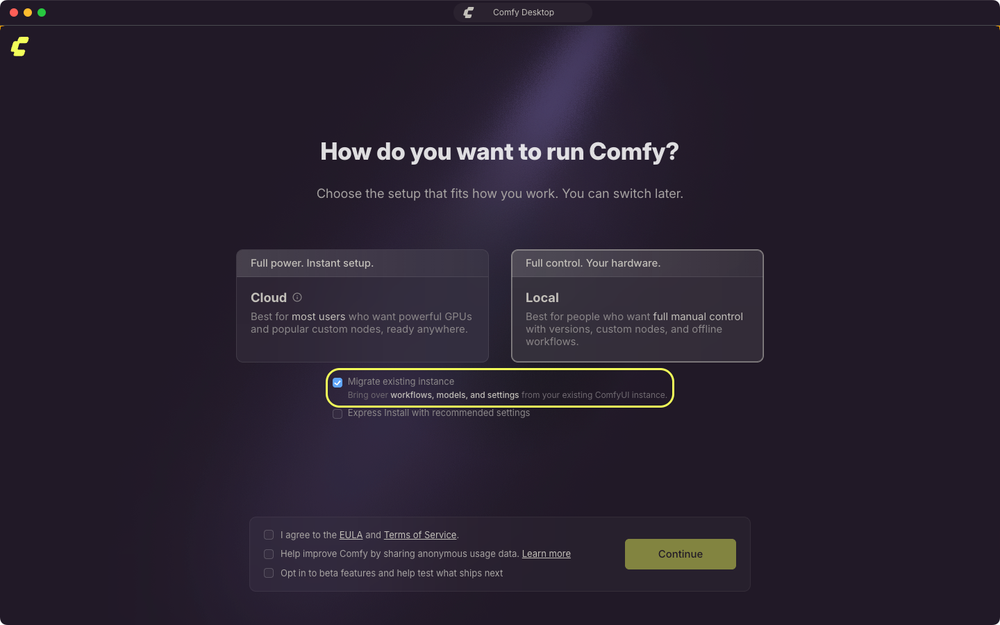
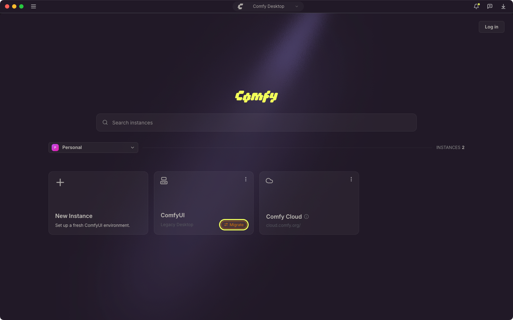
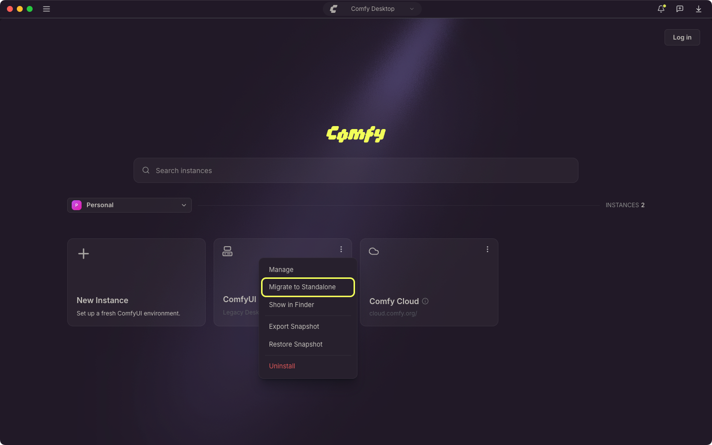
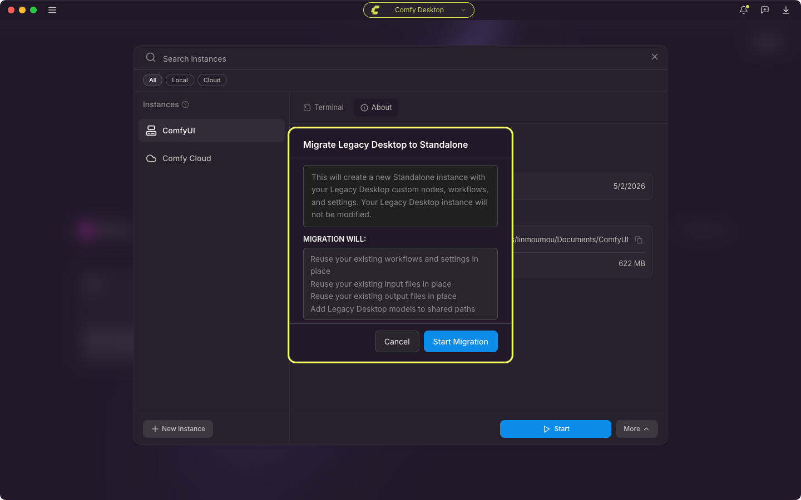

<Info>
このページは **Legacy Desktop**（旧シングルインストール版）からの移行について説明します。初めて Comfy Desktop を使用する方はスキップしてください。
</Info>

<CardGroup cols={1}>
  <Card title="別のインストールをお探しですか？" icon="compass" href="/ja/installation/desktop/usage/instance-management#既存インストールの追跡">
    既存の ComfyUI インストール（portable、手動 git clone など）を Comfy Desktop に追加したい場合は、**インスタンス管理 → 既存のインストールを追跡する** を参照してください。
  </Card>
</CardGroup>

Legacy Desktop をすでにインストールしている場合、Comfy Desktop は自動的に検出して移行を促し、Chooser ビューに新しい Standalone インストールを作成します。

## 移行される内容

Legacy Desktop はシングルインストールのアプリです。Comfy Desktop はマルチインストールマネージャーです。移行時：

- **ワークフローと設定**：その場で再利用され、新しいインストールが同じユーザーデータを引き継ぎます。
- **カスタムノード**：既存の `custom_nodes` フォルダにそのまま残ります。移行後のインストールは Legacy Desktop のデータフォルダをベースディレクトリとして実行されるため、同じノードが読み込まれ、そのパッケージも再利用される Python 環境に残ります。
- **モデル**：既存のモデルフォルダが共有モデルディレクトリに追加され、すべてのインストールが元の場所にあるファイルを読み取れます。
- **入力ファイルと出力結果**：既存のフォルダからその場で再利用されます。
- **Python 環境**：既存の環境を検証してから再利用します。Comfy Desktop は torch をインポートできることを確認し、その後 ComfyUI 自体の依存関係をその環境にインストールします。
- **ComfyUI バージョン**：ComfyUI のソースは新しい管理ディレクトリにステージングされ、以降の更新は Comfy Desktop が管理します。

Legacy Desktop アプリ自体はインストールされたまま残ります。移行はコピーではなくその場での再利用であるため、共有されるデータフォルダと Python 環境は未変更のコピーではありません。完全なコピーが必要な場合は、移行前にご自身でバックアップしてください。

## 移行時にバックアップされる内容

変更を加える前に、Comfy Desktop は Legacy Desktop の設定ファイルを、レガシー設定フォルダ内の日時付きフォルダにコピーします：

- macOS：`~/Library/Application Support/ComfyUI/legacy-backup/<timestamp>/`
- Windows：`%APPDATA%\ComfyUI\legacy-backup\<timestamp>\`

コピーされるのは、その時点で存在するファイルのみです：

- `config.json`：使用していたデータフォルダを含む Legacy Desktop アプリの設定。
- `comfy.settings.json`：レガシーのユーザーフォルダに保存されている ComfyUI フロントエンド設定。
- `extra_models_config.yaml`：Legacy Desktop で設定した追加のモデルパス。
- `window.json`：保存されたウィンドウサイズと位置。

このバックアップに含まれるのは設定のみです。モデル、ワークフロー、カスタムノード、入力ファイル、出力結果はコピーされません。移行後のインストールがそれらを元の場所で使い続けるためです。また移行では、レガシー環境のスナップショット（カスタムノードとインストール済みパッケージ）をレガシーデータフォルダ内の `.snapshots/` に書き出します。

ファイルをコピーできなかった場合、移行はログに記録して続行します。バックアップの失敗で移行が止まることはありません。

## 移行中に表示されるもの

移行は専用の進行画面を表示し、次の順でステップを進めます：

1. **Back up legacy state**
2. **Check folder access**（macOS のみ）
3. **Validate Python environment**
4. **Capture snapshot**
5. **Allocate install folder**
6. **Stage ComfyUI source code**
7. **Install requirements**
8. **Carry over settings**
9. **Register installation**

途中で確認を求めて止まる場合があります：

- **Folder access needed**（macOS）：macOS が Legacy Desktop フォルダへのアクセスをブロックしました。システム設定 → プライバシーとセキュリティで Comfy Desktop にフルディスクアクセスを許可し、移行をやり直してください。
- **Python environment looks broken**：レガシー環境が torch をインポートできませんでした。その環境のまま続行するには **Adopt anyway**、停止するには **Cancel** を選択します。
- **ComfyUI source code unavailable**：新しいインストール用の ComfyUI ソースを取得できませんでした。**Retry** を選択するか、**Cancel** を選んでダッシュボードから新しいインストールを作成してください。

進行画面では各ステップの出力が **View logs** パネルに残り、ステップが失敗すると自動で開きます。パネル内のコピーボタンでテキストをコピーできるほか、同じ出力は Desktop のアプリログにも書き込まれます。依存関係のインストールに失敗した場合は警告として記録され、移行は停止しません。

## 移行後の変化

移行完了後、新しい Standalone インストールは他の Comfy Desktop インストールと同様に動作します：

- **起動方法**：Chooser ビューで新しいインストールカードの再生ボタンをクリックして起動。
- **ポート**：Legacy Desktop はデフォルトでポート `8000` を使用。移行時にはこのポート設定（およびその他のカスタム起動引数）が引き継がれます。
- **管理方法**：Manage パネルで更新、スナップショット、設定を管理。
- **更新方法**：Manage パネルで直接更新可能。Legacy Desktop のように更新のたびに新規ダウンロードする必要はありません。
- **マルチインスタンス**：複数の Standalone インストールを同時に持ち、それぞれ異なる ComfyUI バージョンと設定を使用可能。
- **共有ストレージ**：モデルはデフォルトですべての Standalone インストール間で共有。入力/出力ディレクトリは従来の Legacy ワークスペースに固定されるため、既存ファイルの位置は変わりません。

移行したインストールは自動では更新されません。新しい ComfyUI バージョンが必要なときは、Manage パネルの[更新タブ](/ja/installation/desktop/usage/manage#更新タブ)を使用します。

## 以前のリンクは使えますか？

Legacy Desktop はデフォルトでポート `8000` で動作していました。新しいインストールは**このポートを引き継ぐ**ため、`http://localhost:8000` はそのまま使えるはずです。

カスタム起動引数（例：`--port 8188`）を設定していた場合も、それらは引き継がれます。

URL短縮サービスやブックマーク、外部連携で Legacy Desktop アプリを異なるアドレスで参照している場合は、新しいインストールの Startup Args タブを確認し、適宜更新してください。

## 移行手順

<Steps>
<Step title="Comfy Desktop をインストール">
[公式ダウンロードページ](https://comfy.org/download) から Comfy Desktop をダウンロードしてインストールします。
</Step>

<Step title="Comfy Desktop を起動">
初めて Comfy Desktop を開くと、初回セットアップがシステム上の Legacy Desktop インストールを自動検出します。**Local** を選択すると **Migrate existing instance** が選択済みの状態で表示され、続行すると既存の環境が引き継がれます。

</Step>

<Step title="移行を確認">
**Continue** を選択し、確認ダイアログで **Start Migration** を選びます。Comfy Desktop は次の処理を行います：

1. 既存のインストールをスキャン（カスタムノード、モデル、ワークフロー）
2. 既存のデータフォルダと Python 環境をその場で再利用し、ComfyUI のソースを新しい管理ディレクトリにステージングして更新が正常に機能するようにします
3. ワークフロー、設定、その他のユーザーデータをその場で再利用します
4. 入力ファイルと出力結果をその場で再利用します
5. モデルフォルダを共有ディレクトリとして追加
6. 既存のカスタムノードをそのまま使い、ComfyUI の依存関係を再利用する環境にインストール

完了後、新しい Standalone インストールカードが Chooser ビューに表示されます。
</Step>

<Step title="確認">
新しいインストールを起動して確認：
- ワークフローが利用可能
- カスタムノードがインストール済み
- モデルにアクセス可能
- サーバーが引き継いだ URL で動作（デフォルト `http://localhost:8000`）
</Step>
</Steps>

## Chooser から移行する

初回セットアップを完了済みの場合、または Legacy Desktop インストールがすでに Chooser に表示されている場合は、インスタンスカードから移行を開始できます：

1. Legacy Desktop のインスタンスカードを探します。カードには **Migrate** ピルが表示されます。

   

2. ピルをクリックするか、カードの **⋮** メニューから **Migrate to Standalone** を選択します。

   

3. 確認ダイアログの内容を確認し、**Start Migration** を選択します。

   

Legacy Desktop インストールはその場で採用され、Chooser に表示されるインスタンスは既存の環境を Comfy Desktop で管理するものになります。追跡中の Git および portable インストールの場合は代わりに新しい Standalone インストールが作成され、追跡元のインストールはそのまま残ります。どちらの場合もモデルファイルはコピーされず、元の場所から読み込まれます。

更新が保留中の場合は更新ピルが優先され、**Migrate** は表示されません。

## トラブルシューティング

### Legacy Desktop が自動検出されない

Legacy Desktop ソースは移行専用で、**新しいインスタンス** ピッカーに表示されないため手動で追加することはできません。Comfy Desktop が Legacy Desktop インストールを検出しなかった場合：

1. そのインストールを追跡インストールとして追加します。手順は [**既存のインストールを追跡する**](/ja/installation/desktop/usage/instance-management#既存インストールの追跡) を参照してください。
2. Chooser に表示されたら、カードの **Migrate** ピル、または **⋮** メニューの **Migrate to Standalone** で移行します。

### 移行に失敗する

- **ログを確認**：移行画面で **View logs** を選ぶか、Desktop のアプリログ（`app.log`）を開きます。macOS は `~/Library/Logs/Comfy Desktop`、Windows は `%APPDATA%\Comfy Desktop\logs` にあります。
- **Legacy インストールが完全であることを確認**：移行は既存フォルダからモデル、ワークフロー、カスタムノードを読み取るため、フォルダが移動・削除されていると停止します。
- **再試行**：ネットワークの問題でソースのステージングが失敗することがあり、2 回目の実行で通る場合がよくあります。

### 移行が途中で止まった場合

いずれかの確認で **Cancel** を選ぶと実行は停止し、ステップが明確に失敗した場合も同様です（依存関係インストールの警告では停止しません）。停止した実行は Chooser にインスタンスを追加しないため、カードの **Migrate** ピルから移行をやり直してください。Legacy Desktop のフォルダが削除されることはありません。

### 移行後、モデルが見つからない

モデルは共有モデルディレクトリに追加されるのであり、コピーされるわけではありません。モデルが表示されない場合：

1. [Desktop Settings → Storage](/ja/installation/desktop/usage/settings#ストレージ) を開きます
2. 旧モデルフォルダと、Legacy Desktop の `extra_models_config.yaml` に記載された追加のモデルパスが共有ディレクトリにあるか確認します。欠けているものがあれば **+ Add Shared Directory** を選んでそのフォルダを指定します。
3. 移行したインストールの Manage パネルで**ストレージタブ**を開き、**Include Shared Directories** がオンになっていることを確認します。
