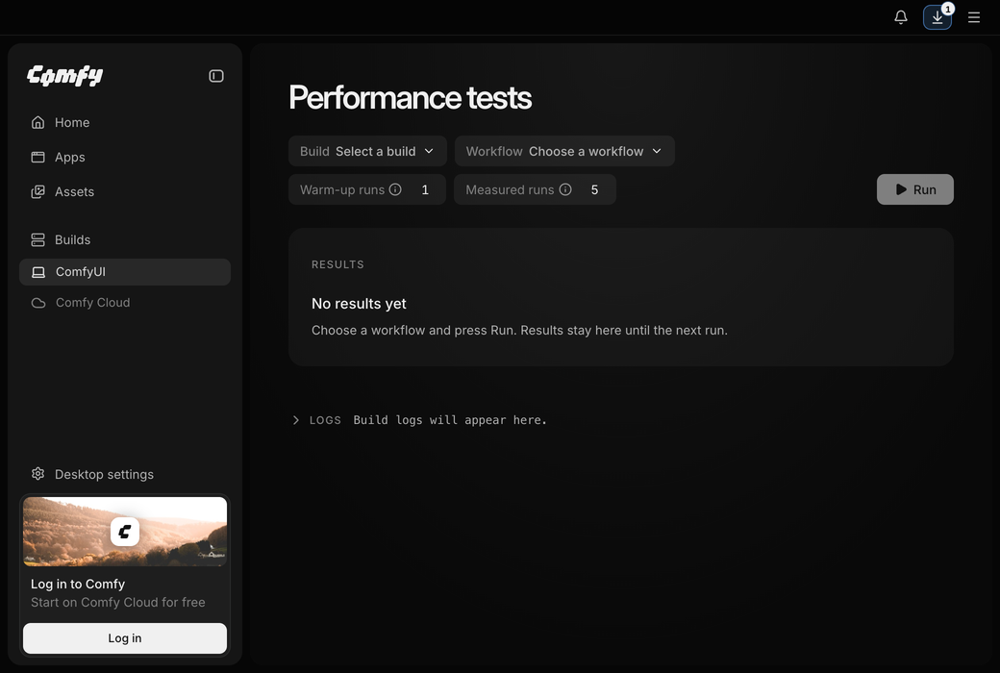
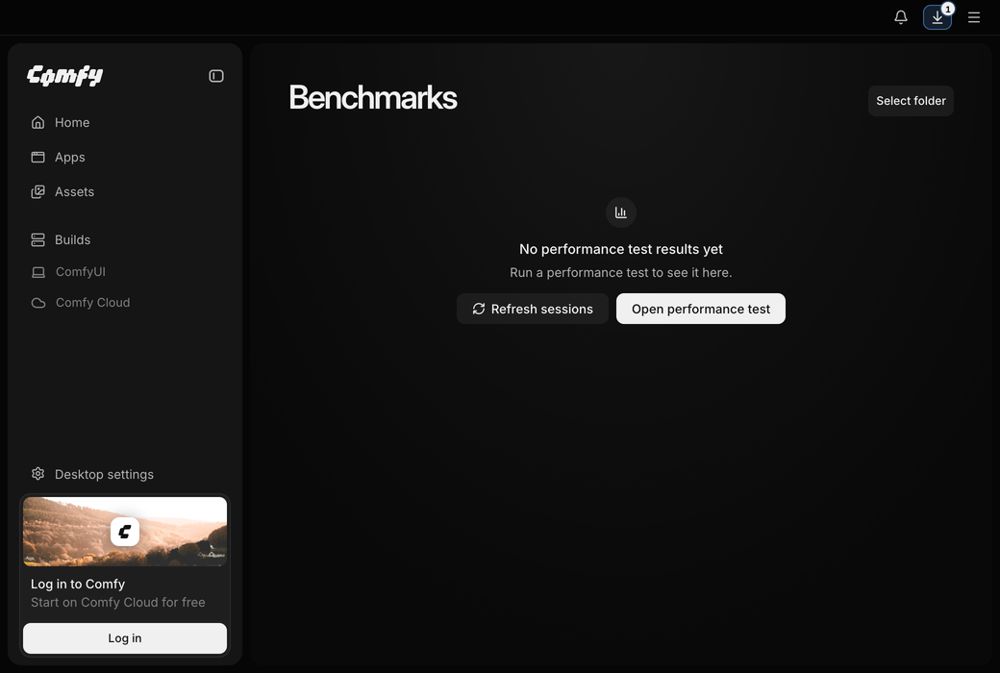

Comfy Desktop では、お使いのビルドの 1 つで、たとえばサンプルのビデオワークフローや自作の画像ワークフローなどのワークフローの所要時間を計測し、その結果を別の GPU や別のビルドでの実行結果と比較できます。計測結果が意味を持つのは、GPU を巡って競合する他の処理がなく、どのハードウェアで計測されたかが分かっている場合だけです。そのため、パフォーマンステストでは、ビルド上でワークフローを単独で実行し、それを繰り返して、各結果をシステム情報とともに保存します。**Performance tests** でテストを実行して結果を確認し、保存された実行結果は **Benchmarks** で比較します。

## パフォーマンステストまたはベンチマークを開く

どちらのページも、**タイトルバー**の**メニュー**から開きます。そこにある他のボタンについては、[タイトルバーを使用する](/ja/installation/desktop/usage/overview#タイトルバーを使用する)を参照してください。

1. **ホーム**で、**タイトルバー**の右端にある**メニュー**をクリックします。
2. **パフォーマンステスト**または**ベンチマーク**を選択します。

ページは**ホーム**ウィンドウの**サイドバー**の隣に開きます。ComfyUIを実行しているウィンドウでは、同じ**メニュー**項目を選ぶと、新しいComfyデスクトップウィンドウでページが開きます。


## パフォーマンステストを実行する

パフォーマンステストは、専用のセッションでビルドを起動し、ワークフローを複数回実行し、完了するとビルドを停止します。設定は**パフォーマンステスト**上部のツールバーで左から右へ順に行います: **ビルド**、**ワークフロー**、**ウォームアップ回数**、**計測回数**、**実行**。

何も選択していない状態では、**ビルド**には**ビルドを選択**、**ワークフロー**には**ワークフローを選択**、**結果**には**結果なし**と表示されます。



### ビルドを選択

選択したビルドがテストで起動・計測される対象となり、その名前は結果とともに保存されます。

- **ビルド**をクリックし（選択するまで**ビルドを選択**と表示されます）、ビルドを選択します。

リスト内の各ビルドには名前が表示され、その下に種類とバージョンが表示されます。リストには、**サイドバー**で選択しているワークスペースのビルドが表示されます。別のワークスペースのビルドをテストするには、[ワークスペースメニューを使用する](/ja/installation/desktop/usage/overview#ワークスペースメニューを使用する)に記載されているとおり、先にワークスペースを切り替えてください。ワークスペースを切り替えると、選択したビルドはクリアされます。

<Note>
  Comfy Cloudのビルドは一覧に表示されません。テストにはComfyデスクトップが起動するビルドが必要だからです。ログアウトしている場合、リストにはインストール済みのビルドのみが表示されます。
</Note>

### ワークフローを選択

ビルドを選択したら、計測するワークフローを選択します。Comfy Desktop に付属するサンプルワークフローを使用するか、独自のワークフローをインポートしてください。

#### サンプルワークフローを使用する

サンプルワークフローはすぐに実行できます。Comfy Desktop がそれぞれに必要なモデルをダウンロードします。

1. **ワークフロー** をクリックし、**サンプルワークフローを選択** を選択します。
2. **サンプルワークフローを選択** で、**ビデオ**、**画像**、**オーディオ** のいずれかのタブを選択してから、カードを選択します。各カードには、ワークフローの名前、タスク、ダウンロードするモデルのおおよそのサイズが表示されます。サイズの代わりにハードディスクのアイコンが表示されている場合は、モデルがすでにディスク上にあります。その上にポインタを合わせると、**ダウンロード済み** とサイズが表示されます。
3. **ワークフローを使用** をクリックします。

Comfy Desktop はディスク上にないモデルをダウンロードします。ツールバーの下のステータス行に **ワークフローを準備し、必要なモデルをダウンロードしています…** と表示され、その後、進行状況バーと **ダウンロードをキャンセル** とともにダウンロードが表示されます。ダウンロードは **タイトルバー** の **ダウンロード** トレイにも表示されます。そちらでの進行状況は [Comfy Desktop のダウンロード](/ja/installation/desktop/usage/downloads) を参照してください。ダウンロードが完了すると、**ワークフロー** にサンプルの名前が **サンプル** タグ付きで表示されます。

何らかの理由でサンプルを読み込めない場合、ツールバーの下またはダイアログに赤い行が表示されます。

| メッセージ | 対処方法 |
| --- | --- |
| **サンプルワークフローを使用するには、このビルドのインストールを完了してください。** | インストール済みのビルドを選択するか、このビルドのインストールを完了してください。 |
| **サンプルワークフローをダウンロードするにはインターネット接続が必要です。** | インターネットに接続して再試行してください。 |
| **~X が必要ですが、空きは Y のみです。空き容量を増やすか、より軽いワークフローを選択してください。** (ダイアログ内で表示され、**ワークフローを使用** は選択できません) | ディスクの空き容量を増やすか、より小さいモデルのカードを選択してください。 |
| **このワークフローに必要なすべてのモデルをダウンロードできませんでした。** | サンプルをもう一度選択してください。ダウンロードに失敗したサンプルは Comfy Desktop によって削除されます。 |

サンプルは、それを選択したビルドに属します。別のビルドを選択すると、Comfy Desktop はそのサンプルを **パフォーマンステスト** から削除します。テストですでに使用されている場合は、そのファイルはディスク上に残ります。

#### 独自のワークフローをインポートする

インポートするワークフローは [API 形式](/ja/development/api-development/workflow-api-format) である必要があります。先に ComfyUI からその形式でエクスポートしてください。

- **ワークフロー** をクリックし、**API ワークフローをインポート** を選択してから、`.json` ファイルを選択します。`.json` ファイルを **ワークフロー** にドロップすることもできます。

**ワークフロー** にファイル名が **API** タグ付きで表示されます。ファイルが API 形式でない場合、ツールバーの下の赤い行に **選択されたファイルは ComfyUI API 形式のワークフローではありません。** と表示されます。`jobs.json` または `results.json` という名前のファイルは、これらの名前が結果用に予約されているため拒否されます。

Comfy Desktop はファイルを新しいセッションフォルダーにコピーするため（[結果の保存場所](#結果の保存場所) を参照）、オリジナルを移動または編集した後でもテストはコピーを実行します。

#### ワークフローを削除する

- **ワークフロー** をクリックし、**ワークフローを削除** を選択してから、確認のために **ワークフローを削除** をクリックします。

これにより、**パフォーマンステスト** からワークフローが削除されます。まだ実行で使用されていない場合、Comfy Desktop はそのコピーを削除します。オリジナルのファイルと以前の実行結果は保持されます。サンプルのダウンロード中は、同じメニュー項目が **ダウンロードをキャンセル** と表示されます。

### 実行回数を設定する

ウォームアップ実行はタイミング計測の前にモデルを読み込むため、最初の遅い実行が結果に偏りを与えることはありません。

| 設定 | 範囲 | デフォルト | 動作 |
| --- | --- | --- | --- |
| **ウォームアップ実行** | 0 から 5 | 1 | 最初に実行され、モデルを読み込んでキャッシュをウォームアップします。結果には含まれません。0 に設定するとウォームアップをスキップします。 |
| **計測実行** | 1 から 100 | 5 | ウォームアップ実行の後に計測される実行です。これらの所要時間が結果を構成します。 |

**Run** をクリックすると、範囲外の値は最も近い上限または下限に変更されます。各実行ではワークフロー内のすべてのシード入力に 1 が加算されるため、ComfyUI がキャッシュされた結果を返すことはありません。

### テストを開始する

ゲームやビデオのエクスポートなど、GPU に負荷をかける他の作業も数値に影響するため、テストを実行する前に停止してください。

1. **実行**をクリックします。

   **実行**が使用できない場合は、ポインタを合わせると理由が表示されます：**先にビルドを選択してください。**、**先にワークフローを選択してください。**、**ワークフローが準備できるまでお待ちください。**、または**ビルドの起動が完了するまでお待ちください。**

2. **結果**でテストの進行状況を確認します。**ビルドを開始しています…**と表示され、その後、プログレスバーの下に**ウォームアップ実行**または**計測実行 X / Y**が表示された状態で**N / M 回目を実行中**と表示されます。**ログ**が開き、ビルドの出力が表示されます。

テストの実行中は、**実行**の代わりに**停止**が表示されます。テストをキャンセルするには、**停止**をクリックします。ビルドが停止するまで**停止中…**と表示されます。

すべての実行が完了すると、Comfy Desktop はビルドを停止して結果を表示します。Comfy Desktop が実行を送信してから 4 時間以内に実行が完了しない場合、テストは**パフォーマンステストジョブの待機がタイムアウトしました。**で停止します。

### テストをブロックするビルドを停止する

テストは単独で実行されるため、GPU やメモリを奪い合うものはありません。このコンピューター上の別のビルドが実行中、起動中、または停止中の場合、テストは開始されません。これには、ComfyUI で開いているテスト対象のビルドや、別のビルドに対するパフォーマンステストも含まれます。リモートビルドと Comfy Cloud ビルドは別の場所で実行されるため、テストをブロックすることはありません。

**結果** には **パフォーマンステストは開始されませんでした** と表示され、テストを妨げている各ビルドが一覧表示されます。一覧内のパフォーマンステストは、**パフォーマンステスト：** に続けてビルド名が表示されます。

<Warning>
  ビルドを停止すると、その ComfyUI ウィンドウ内の未保存の作業が失われます。先にワークフローを保存してください。
</Warning>

1. 一覧内のビルドの横にある **停止** をクリックします。
2. **ComfyUI を停止** で **停止** をクリックします。行には **停止済み** と表示されます。
3. 一覧内の各ビルドに対して繰り返し、その後 **実行** をもう一度クリックします。

ビルドページからビルドを停止することもできます。[停止または再起動](/ja/installation/desktop/usage/instance-management#停止と再起動) を参照してください。

### 結果を確認する

結果には、このビルドでワークフローに要した時間が表示されるため、他のビルドやGPUと比較できます。

- ヘッダーには、ワークフローとテストを実行したビルドが表示されます。
- 大きな数字は実行時間の中央値（秒）です。その下の **中央値実行 · N件計測 · N件失敗** は、実行時間が得られた実行と失敗した実行を数えたものです。
- **実行時間**では、**最速実行**、**中央値実行**、**平均実行**、**最遅実行**を棒グラフで比較します。
- **システム情報**には、**計算デバイス**、**VRAM**、**RAM**、**PyTorchバージョン**、**xFormersバージョン**、**CPU**、**CPUコア数**、**オペレーティングシステム**、**アーキテクチャ**が表示されます。

実行時間は、ComfyUIがジョブの実行に費やした時間（実行の開始から終了まで）であり、待機していた時間ではありません。失敗した実行は実行時間から除外されます。

結果ヘッダーの右側に2つのボタンがあります:

- macOSでは**Finderに表示**、Windowsでは**エクスプローラーで表示**、Linuxでは**フォルダーを開く**をクリックすると、セッションフォルダーが開きます。
- **結果をエクスポート**ではフォルダーの選択を求めます。**ここにエクスポート**をクリックすると、結果が `performance-test-results-<timestamp>.png` として保存されます。

テストが失敗すると、**結果**にはエラーとともに**テストは完了しませんでした**と表示され、続けて**詳細は下のログを参照してください。**と表示されます。**ログ**を展開すると、ビルドの出力を確認できます。ビルドに含まれていないノードやモデルを必要とするワークフローは、このように失敗します。

結果は次回実行するまでページに残ります。後で再度表示するには、**ベンチマーク**を開きます。

## Benchmarksで実行を比較

Benchmarksは結果フォルダーに保存されたすべてのテストを読み取り、1つのテーブルに一覧表示するので、あるGPU、ワークフロー、ビルドが別のものよりどれだけ速いかを確認できます。テストが完了するまで、**パフォーマンステストの結果はまだありません** と表示されます。**パフォーマンステストを開く** をクリックしてテストを実行するか、テストの完了後に **セッションを更新** をクリックしてください。



### 実行をフィルタして並べ替える

ツールバーを使って、比較したい実行だけにテーブルを絞り込めます:

- **ワークスペース**、**ビルド**、**ハードウェア**、**ワークフロー**: 一致する実行のみを表示します。それぞれデフォルトでは **すべて** と表示されます。
- **比較基準**: テーブルが比較する所要時間で、**最速**、**平均**、**中央値**、**最遅** のいずれかです。デフォルトは **中央値** です。
- **セッションを更新** (円形の矢印): テストの完了後に結果フォルダーを再読み込みします。
- **実行を検索…**: セッション、ワークフロー、ビルド、ワークスペース、ハードウェアに一致します。
- **列**: テーブルに表示する内容を選択します。**測定値** を選ぶと所要時間の列が追加され、**表示する列** では **ワークスペース**、**日付 / 時刻**、**実行回数**、**GPU / ハードウェア** などの列が追加されます。

デフォルトでは、テーブルには **セッション**、**ワークフロー**、**ビルド**、**中央値と範囲**、**中央値**、**ベースラインとの比較** が表示されます。2つの **中央値** 列は **比較基準** に従います。実行は **比較基準** の所要時間で並べ替えられ、最速が先頭になります。

- 列で並べ替えるには、その見出しをクリックします。もう一度クリックすると順序が逆になります。
- 実行を移動するには、行の左側にあるグリップをドラッグするか、グリップにフォーカスして `Alt+Up` または `Alt+Down` を押します。
- 追加した列を移動するには、その見出しをドラッグするか、見出しにフォーカスして `Alt+Left` または `Alt+Right` を押します。

一致する実行がない場合、ページには **一致するものがありません** と表示されます。**フィルターをクリア** をクリックすると、すべての実行が表示されます。

### ベースラインと比較する

各実行は1つの参照実行と比較されます。デフォルトでは、**比較基準** の所要時間で最速の実行が参照となり、**最速** とマークされます。

**ベースラインとの比較** 列には、他の各実行について次のように表示されます:

- **N倍高速**: その実行の所要時間はベースラインの1/Nでした。
- **N倍低速**: その実行の所要時間はベースラインのN倍でした。
- **同じ速度**: その実行はベースラインの0.5%以内です。
- **利用不可**: その実行には比較できる所要時間がありません。

任意の実行と比較するには:

- 行にポインタを合わせ、旗のアイコン (**ベースラインに設定**) をクリックします。行の末尾にある **⋯** をクリックして **ベースラインに設定** を選択することもできます。

その実行は **ベースライン** とマークされます。最速の実行に戻すには、旗をもう一度クリックします (**ベースラインをリセット**)。フィルターによってベースラインが非表示になっている場合、テーブルの下に **フィルターによって非表示になっているセッションNと比較しています。** という注記が表示されます。

### 比較をエクスポートする

比較をエクスポートして画像として共有できます。

1. エクスポートする各実行の左側にあるチェックボックスを選択します。下部のバーに選択した実行数が表示されます。
2. バーの **結果をエクスポート** をクリックします。
3. フォルダーを選択し、**ここにエクスポート** をクリックします。

Comfyデスクトップは `benchmark-comparison-<timestamp>.png` をそのフォルダーに保存します。画像に相対速度チャートが含まれるのは、ベースラインを設定した場合のみです。エクスポートできるのは最大20実行です。それ以上選択すると **結果をエクスポート** は使用できなくなり、ポインタを合わせると **最大20実行** と表示されます。選択を解除するには、バーの **選択をクリア** (**✕**) をクリックします。

### セッションの名前を変更または削除する

各テストはセッションとして保存され、デフォルトではワークフローを追加した時刻が名前になります。識別しやすい名前を付けるか、不要になったセッションを削除してください。

セッションの名前を変更するには:

1. **セッション** 列でセッション名をクリックします。ポインタを合わせると鉛筆アイコンが表示されます。行の末尾にある **⋯** をクリックして **セッションの名前を変更** を選択することもできます。
2. 新しい名前を入力して `Enter` を押します。キャンセルするには `Escape` を押します。

セッションの名前を変更すると、そのフォルダーの名前も変更されます。別のセッションがすでにその名前を使用している場合、セッションの名前は変更されません。

セッションを削除するには:

1. 行の末尾にある **⋯** をクリックし、**ファイルを削除** を選択します。
2. **ファイルを削除** をクリックして確認します。

削除すると、セッションフォルダー内のすべてのファイルが削除されます。元に戻すことはできません。

### 別のコンピューターの結果を比較する

Benchmarksは、見つけた各セッションフォルダー内の `results.json` ファイルを読み取ります。別のコンピューターの実行を比較するには、それらのセッションフォルダーを1つのフォルダーにコピーします。

1. **Benchmarks** の上部にある **フォルダーを選択** をクリックします。
2. セッションフォルダーを格納しているフォルダーを選択します。

## 結果の保存場所

Performance Tests は、ワークフローを追加したときに、その時点のタイムスタンプ（`YYYYMMDDHHMMSS`）を名前とするセッションフォルダーを作成します。

```text
ComfyUI-Shared/
└── benchmarks/
    ├── 20260930141522/
    │   ├── my_workflow.json
    │   ├── jobs.json
    │   ├── results.json
    │   └── logs.txt
    └── 20260930163005/
        └── ...
```

| プラットフォーム | デフォルトの結果フォルダー |
| --- | --- |
| Windows | `%LOCALAPPDATA%\Comfy-Desktop\ComfyUI-Shared\benchmarks` |
| macOS と Linux | `~/ComfyUI-Shared/benchmarks` |

各セッションフォルダーには次のものが含まれます。

- `my_workflow.json`（ファイルの名前）：テストが実行するワークフローのコピー
- `jobs.json`: 実行時に ComfyUI が返したジョブ詳細
- `results.json`: Benchmarks が読み取るサマリー
- `logs.txt`: テスト中のビルドの出力

同じワークフローをもう一度実行すると、同じセッションフォルダーに書き込まれ、そこに保存されている結果が置き換えられます。比較用に結果を残すには、次のテストの前にワークフローをもう一度選択するかインポートしてください。これにより新しいセッションフォルダーが作成されます。
