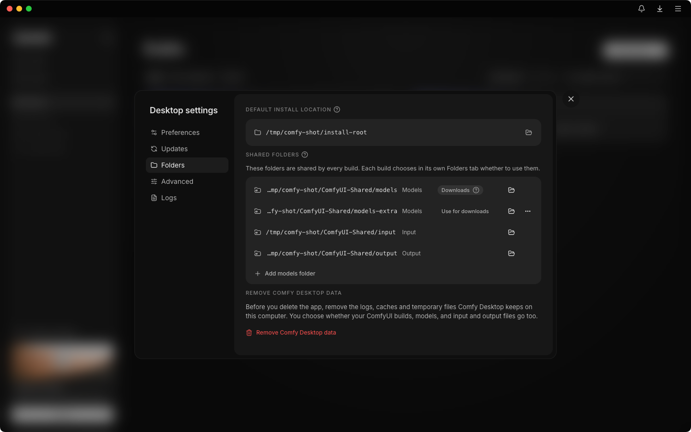

サイドバー下部の **Desktop settings** をクリックするとグローバル設定パネルが開きます。ビルドウィンドウでは **☰** メニューからも開けます。


パネルは 5 つのタブに分かれています：**環境設定**、**アップデート**、**フォルダー**、**詳細設定**、**ログ**。左の列のタブをクリックして切り替えます。

## 環境設定


環境設定タブはまず **言語** ピッカーで始まり、残りのコントロールは 3 つのセクションに分かれています。

- **言語**：表示言語を選択します。**English** と **简体中文** が利用できます。

### アプリの動作

- **Confirm before closing a window**：ウィンドウを閉じると ComfyUI が停止する場合、または Comfy Desktop が終了する場合に確認を求めます。
- **Warn before running multiple builds**：ローカルの ComfyUI ビルドが実行中または起動中のときに、別のローカルビルドを起動する前に警告を表示します。
- **Hide Cloud from the build picker**：ホームからクラウドの行を非表示にします。オフに戻せばクラウドはそのまま使えます。

### プライバシー

- **Share anonymous usage telemetry**：匿名の使用データを送信して、Comfy Desktop の改善に役立てます。
- **Opt in to beta features**：Comfy Desktop がビルドの Core 機能を先行して有効にできるようにします。**Share anonymous usage telemetry** でデータ共有を確認するまで、このスイッチは無効のままです。テレメトリーがすでに有効な場合でも同じです。

ベータ機能は、自分で設定した起動引数の前に追加される形で渡されます。自分の引数の順序はそのまま保たれ、書き換えられることもありません。インストールされている ComfyUI の引数一覧にない `--` フラグだけが取り除かれます。一覧を取得できないときは、設定したとおりに起動し、ベータの引数も追加されません。ビルドでベータ機能が有効になると、タイトルバーに **A beta feature is on** というカードが表示されます。**Got it** で閉じ、**Settings** を選ぶとこのパネルのオプトインスイッチが開きます。ベータ機能が追加した引数は、そのビルドのスタートアップ引数タブで **スタートアップ引数** の隣にある **+N beta** ピルから確認できます。

### コミュニティ

- **Comfyデスクトップ**：[Comfyデスクトップ GitHub リポジトリ](https://github.com/Comfy-Org/Comfy-Desktop) へのリンクカードです。

## アップデート


- **ステータス行**：タブの先頭行に、最新かどうか、または更新が利用可能・インストール準備完了・ダウンロード中であることが表示されます。その下にインストール済みバージョンが並び、確認を実行済みなら最後に確認した日時も表示されます。
- **アップデートを確認**：手動で新バージョンを確認。更新があるとボタンが**ダウンロード**に変わり、ダウンロードが完了すると**再起動して更新**に変わります。
- **デスクトップアップデートを自動インストール**：バックグラウンドで自動更新。

## フォルダー {#ストレージ}



- **Default install location**：ビルドを作成するときに提案される親フォルダーです。既存のビルドは移動しません。フォルダーアイコンをクリックして変更します。
- **Shared folders**：すべてのビルドが使えるフォルダーで、モデルはビルドごとではなく一度だけダウンロードされます。各行にパスと種類（**Models**、**Input**、**Output**）が表示されます。
  - **Downloads** と表示されたモデルフォルダーが新しいモデルの保存先です。別のモデルフォルダーで **Use for downloads** を選ぶと、その役割を移せます。
  - パスをクリックするとフォルダーが開き、フォルダーアイコンから保存先を選び直せます。ダウンロード先ではないモデルフォルダーには **⋯** メニューがあり、ファイルを削除せずに一覧から外せます。
  - **Add models folder** でモデルフォルダーを追加できます。
- **Remove Comfy Desktop data**（macOS と Linux）：アプリを削除する前に、このコンピューターに残るログ、キャッシュ、一時ファイルを消します。確認ダイアログには **Delete all ComfyUI builds**、**Delete all model files**、**Delete shared input and output files** の 3 つがあり、いずれも初期状態ではオフです。Comfy Desktop は終了して後片付けを行い、そのあとアプリは自分で削除します。

各ビルドは自分の **フォルダー** タブで、共有の入力・出力フォルダーを使うかどうかを選べます。そのビルドだけが見えるモデルフォルダーを追加することもできます。[ビルドの管理](/ja/installation/desktop/usage/manage)を参照してください。

## 詳細設定


- **PyPI mirror URL**：カスタム pip ミラー（例：`https://mirrors.aliyun.com/pypi/simple/`）。
- **Use Chinese mirrors (Git & PyPI)**：Git と PyPI に中国のミラーサーバーを使用します。中国本土で役立ちます。アプリの表示言語が中国語の場合、このスイッチは「環境設定」タブの **アプリの動作** に表示されます。
- **Use hardware acceleration**：GPU を使用して Comfy Desktop をレンダリングします。変更を反映するには Comfy Desktop を再起動してください。
- **Cache directory**：Comfy Desktop が一時データとキャッシュデータを保存する場所。フォルダーアイコンをクリックして変更します。

### ダウンロードキャッシュ

スタンドアロンビルドは、ComfyUI バンドルを **Cache directory**（既定パスは `download-cache` で終わる）にダウンロードします。あとから同じバンドルをインストールするとダウンロードをスキップし、**Using cached download** と表示されるため、インストールがかなり速くなります。

**Cache directory** はキャッシュ専用にしてください。ダウンロードが完了すると、中の古いサブフォルダーが整理されるため、一緒に置いたものも削除される可能性があります。専用のキャッシュフォルダーを削除しても、次回のインストールで再ダウンロードが必要になるだけです。モデル、入力、出力、ビルドは別の場所にあります。

## ログ


- **Diagnostics**：**Open logs folder** でデスクトップアプリのログディレクトリ（`app.log`）が開きます。[Comfy Desktop の起動ログを確認するには？](/ja/installation/desktop/faq#comfy-desktop-の起動ログを確認するには)を参照してください。

## データ保存場所

Comfy Desktop はプラットフォーム固有のディレクトリにデータを保存します。

<Tabs>
  <Tab title="Windows">
```
アプリデータ:     %APPDATA%\Comfy Desktop
ログ:             %APPDATA%\Comfy Desktop\logs
インストール:     %LOCALAPPDATA%\Comfy-Desktop\ComfyUI-Installs
共有データ:       %LOCALAPPDATA%\Comfy-Desktop\ComfyUI-Shared
```

新規インストールでは、大きなデータ（インストール、共有モデル、キャッシュ）は `%LOCALAPPDATA%\Comfy-Desktop` の下に置かれます。アップグレード前にユーザープロファイル内に `ComfyUI-Installs` または `ComfyUI-Shared` があった場合、それらのホーム直下のフォルダーは保持されます。アプリを別ドライブにインストールした場合、大きなデータは `<drive>\Comfy-Desktop\` に置かれます。
  </Tab>
  <Tab title="macOS">
```
アプリデータ:     ~/Library/Application Support/Comfy Desktop
ログ:             ~/Library/Logs/Comfy Desktop
インストール:     ~/ComfyUI-Installs
共有データ:       ~/ComfyUI-Shared
```
  </Tab>
  <Tab title="Linux">
```
設定:        ~/.config/comfyui-desktop-2
データ:      ~/.local/share/comfyui-desktop-2
キャッシュ:  ~/.cache/comfyui-desktop-2
状態:        ~/.local/state/comfyui-desktop-2
ログ:        ~/.config/Comfy Desktop/logs
インストール: ~/ComfyUI-Installs
共有データ:   ~/ComfyUI-Shared
```

Linux では、Comfy Desktop は設定・キャッシュ・データ・状態を `comfyui-desktop-2` に保存し、Electron はアプリのプロファイルとログを表示名 `Comfy Desktop` の下に保存します。ソースから実行する場合はどちらも `comfyui-desktop-2` になります。これらは既定の場所で、`XDG_CONFIG_HOME`、`XDG_CACHE_HOME`、`XDG_DATA_HOME`、`XDG_STATE_HOME` を設定すると移動します。ログは `XDG_CONFIG_HOME` に従います。
  </Tab>
</Tabs>

## キーボードショートカット

| ショートカット | 操作 |
|-------------|------|
| `Ctrl+R` / `Cmd+R` | 現在の ComfyUI ビューを更新 |
| `Ctrl`/`Cmd` + `+` / `-` / `0` | ComfyUI ビューの拡大・縮小、または 100% に戻す |
| `Escape` | ダイアログやポップアップを閉じる |

Comfyデスクトップは `Ctrl+W` / `Cmd+W` を割り当てていないため、誤って押しても実行中のビルドのウィンドウは閉じません。ウィンドウを閉じるには ☰ メニューの **Close window** を使用してください。

## フィードバックと問題報告

バグを発見した、または提案がある場合：Comfyデスクトップはオープンソースです。問題の報告や予定機能の確認はこちら：

- **Comfyデスクトップのissues**：[github.com/Comfy-Org/Comfy-Desktop/issues](https://github.com/Comfy-Org/Comfy-Desktop/issues)
- **ドキュメントのissues**：[github.com/Comfy-Org/docs/issues](https://github.com/Comfy-Org/docs/issues)

ComfyUI に関する一般的なご質問は、[ComfyUI GitHub Discussions](https://github.com/Comfy-Org/ComfyUI/discussions) または [ComfyUI Discord](https://www.comfy.org/discord) をご利用ください。
