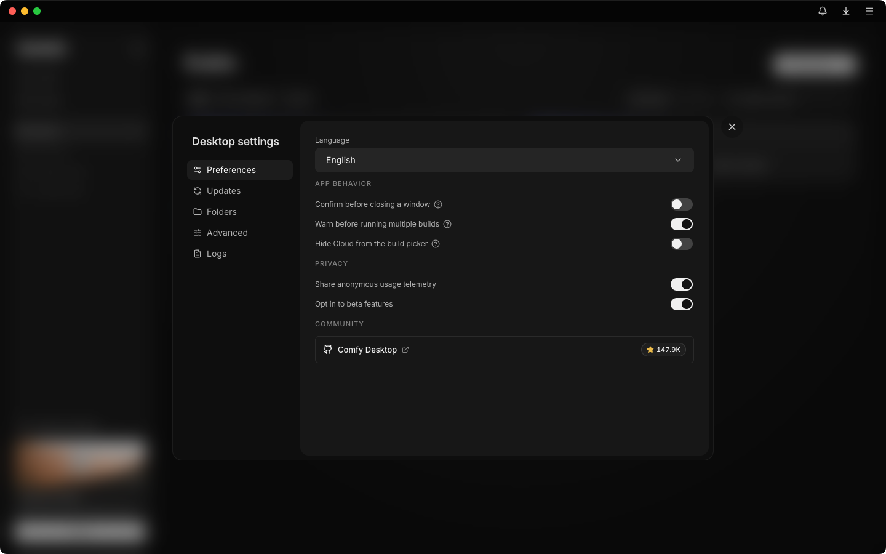

Comfy Desktop は ComfyUI のビルドを実行します。**デスクトップ設定**には、それらすべてのビルドにまとめて適用されるオプションが用意されています。たとえば、すべてのビルドがモデル用に共有するフォルダーや、パッケージのダウンロードで使うミラーなどです。個々のビルドに固有の設定（そのビルド独自のフォルダーや起動引数など）は、代わりにそのビルドのページにあります。**デスクトップ設定**では、Comfy Desktop の更新、共有フォルダーと既定のインストール先の選択、ミラーとダウンロードキャッシュの設定、ベータ機能の有効化、アプリログの確認を行えます。

## デスクトップ設定を開く

- **サイドバー**の下部にある**デスクトップ設定**をクリックします。ComfyUI が動作しているウィンドウでは、**タイトルバー**の**メニュー**を開いて**デスクトップ設定**を選択することもできます。**サイドバー**と**タイトルバー**については、[Get around Comfy Desktop](/ja/installation/desktop/usage/overview#サイドバーの構成) を参照してください。

**デスクトップ設定**ウィンドウの左側には、**環境設定**、**アップデート**、**フォルダ**、**高度な機能**、**ログ**の 5 つのタブがあります。タブをクリックすると切り替わります。

## 環境設定を行う {#preferences}

**Preferences** タブでは、アプリの言語と、ウィンドウを閉じたときやビルドを開始したときの Comfy デスクトップの動作を設定します。

- **Language**: Comfy デスクトップの言語です。**English** または **简体中文** を選択します。

**App behavior** では:

| 設定 | デフォルト | 動作 |
| --- | --- | --- |
| **Confirm before closing a window** | オフ | ウィンドウを閉じることで ComfyUI が停止したり Comfy デスクトップが終了したりする場合に、閉じる前に確認します。 |
| **Warn before running multiple builds** | オン | ローカルの ComfyUI ビルドが実行中または起動中のときに、別のビルドを開始する前に警告を表示します。 |
| **Hide Cloud from the build picker** | オフ | **Home** から Comfy Cloud の行を非表示にします。Comfy Cloud は引き続き動作し、この切り替えはいつでもオフに戻せます。 |

**Privacy** では:

- **Share anonymous usage telemetry**: 匿名の使用状況データを送信します。この切り替えは、オフにするまでオンとして表示されます。
- **Opt in to beta features**: Comfy デスクトップがビルドで早期の ComfyUI 機能を有効にできるようにします。詳しくは[ベータ機能を有効にする](#ベータ機能を有効にする)を参照してください。

**Community** の **Comfy Desktop** カードをクリックすると、[Comfy Desktop GitHub リポジトリ](https://github.com/Comfy-Org/Comfy-Desktop)が開きます。

### ベータ機能を有効にする

**Opt in to beta features** をオンにすると、ComfyUI の機能をリリース前にテストするのに協力できます。この切り替えがオンのとき、Comfy デスクトップはこのコンピューターでビルドを起動する際に、次の起動引数のいずれかを追加することがあります: `--enable-asset-hashing`、`--disable-assets`、`--enable-agent`。引数を追加するのは、そのビルドの ComfyUI バージョンがそれをサポートしている場合のみです。ビルドの起動引数でその引数またはその反対の引数をすでに設定している場合、Comfy デスクトップはあなたの設定をそのままにします。

切り替えを一度も変更していない場合は、セットアップ時の **Help improve Comfy by sharing anonymous usage data.** への回答に従います。オンにするには:

1. **Preferences** タブで **Opt in to beta features** をオンにします。
2. 切り替えがオンにならない場合は、まずデータ共有を確認します: **Share anonymous usage telemetry** をオフにしてから、もう一度オンにします。その後、**Opt in to beta features** をオンにします。

ベータ機能を有効にしてビルドが起動すると、その**タイトルバー**に **A beta feature is on** または **The {feature} beta is on** という通知が表示されます。**Got it** をクリックすると閉じ、**Settings** をクリックするとこのタブがベータの切り替え位置で開きます。ビルドでベータ機能がオフになっている場合、通知は **A beta feature is off** または **The {feature} beta is off** と表示されます。

ベータ機能が追加した引数を確認するには、ビルドの[**Startup arguments** タブ](/ja/installation/desktop/usage/instance-management#スタートアップ引数を設定する)を開き、**+N beta** ピルをクリックします。**Added for this session** または **Eligible for next launch** の下に引数が一覧表示され、**Manage beta features** をクリックするとこのタブがベータの切り替え位置で開きます。

## Comfyデスクトップを更新する {#updates}

Comfyデスクトップは、起動から2秒後に自身のアップデートを確認し、その後は10分ごとに確認します。Comfyデスクトップには選択できる更新チャンネルはありません。ビルドのページにある更新チャンネルは、そのビルド内のComfyUI用です。[ComfyUIをアップデート](/ja/installation/desktop/usage/instance-management#comfyui-をアップデートする)を参照してください。

<Note>
  Linuxでは、Comfyデスクトップの更新方法は、`.deb`パッケージ、AppImage、ソースチェックアウトのどれをインストールしたかによって異なります。[Linuxでのアップデート](/ja/installation/desktop/overview#お使いの-os-に-comfyデスクトップをインストール)を参照してください。
</Note>

### アップデートを自動でインストールする

**更新**タブの**デスクトップの更新を自動的にインストール**はデフォルトでオンです。確認で更新が見つかると、Comfyデスクトップはそれをダウンロードしてインストールします。

- macOSとLinuxでは、Comfyデスクトップを終了したとき。
- Windowsでは、次にComfyデスクトップを起動したとき。

切り替えがオフの場合、更新は**再起動して更新**をクリックしたときのみインストールされます。

### サイドバーから更新する

更新が利用可能な場合、**サイドバー**の下部に項目が表示され、その状態を示します。

| 項目の表示 | クリックすると |
| --- | --- |
| **デスクトップの更新** | **デスクトップの更新が利用可能**ダイアログが開きます。**ダウンロード**をクリックします。 |
| **更新をダウンロード中…** | **更新**タブの**デスクトップ設定**が開き、ダウンロードの進捗が表示されます。 |
| **デスクトップの更新の準備完了** | **デスクトップの更新の準備完了**ダイアログが開きます。**再起動して更新**をクリックすると、更新を適用して再起動します。 |

### 自分でアップデートを確認する

1. **デスクトップ設定**を開き、**更新**タブをクリックします。
2. **アップデートを確認**をクリックします。
3. タブに**更新 {version} が利用可能**と表示されたら、**ダウンロード**をクリックします。
4. タブに**更新 {version} のインストール準備完了**と表示されたら、**再起動して更新**をクリックします。

Comfyデスクトップは更新を適用して再起動します。**更新**タブに**Comfyデスクトップは最新の状態です**と表示され、**インストール済み**にダウンロードしたバージョンが表示されていれば、更新は成功しています。

## 共有フォルダーとインストール先を選択する {#storage}

共有フォルダーを使うと、すべてのビルドが同じモデル、入力、出力を使用できるため、モデルをビルドごとに1回ずつダウンロードするのではなく、1回ダウンロードするだけで済みます。**フォルダー**タブでは、これらのフォルダーと、作成したビルドを Comfy デスクトップが配置する場所として提案するフォルダーを設定します。

各フォルダーの行で、パスをクリックするとフォルダーが開き、フォルダーアイコンをクリックすると別のフォルダーを選択できます。

- **デフォルトのインストール先**: ビルドを作成するときに Comfy デスクトップが提案する親フォルダーです。変更しても既存のビルドは移動しません。
- **共有フォルダー**: **モデル**、**入力**、**出力**フォルダーの1つの一覧です。すべてのビルドがデフォルトでこれらを使用します。特定のビルドだけ変更する場合は、[ビルドが使用するフォルダーを選択する](/ja/installation/desktop/usage/instance-management#ビルドが使うフォルダを選択する)を参照してください。

共有モデルフォルダーを管理するには:

- **モデルフォルダーを追加する**: **モデルフォルダーを追加**をクリックし、フォルダーを選択します。
- **モデルのダウンロード先を選択する**: **モデル**の行で**ダウンロードに使用**をクリックします。その行に**ダウンロード**タグが付きます。ビルドごとに独自のダウンロードフォルダーを選択することもできます。[ダウンロードの保存先](/ja/installation/desktop/usage/downloads#ダウンロードの保存先)を参照してください。
- **モデルフォルダーを削除する**: 行の**⋯**メニューをクリックし、**削除**を選択して確認します。ファイルはディスク上に残ります。**ダウンロード**タグが付いたフォルダーには**⋯**メニューがないため、先に別のダウンロードフォルダーを選択してください。**入力**と**出力**の行は削除できません。

デフォルトでは、フォルダーは次のとおりです:

| フォルダー | macOS と Linux | Windows |
| --- | --- | --- |
| **デフォルトのインストール先** | `~/ComfyUI-Installs` | `%LOCALAPPDATA%\Comfy-Desktop\ComfyUI-Installs` |
| 共有の**モデル**、**入力**、**出力** | `~/ComfyUI-Shared/models`、`input`、`output` | `%LOCALAPPDATA%\Comfy-Desktop\ComfyUI-Shared\models`、`input`、`output` |

<Note>
  Windows では、ユーザーフォルダーにすでに `ComfyUI-Installs` または `ComfyUI-Shared` がある場合、Comfy デスクトップはそれらを使い続けます。システムドライブ以外のドライブに Comfy デスクトップをインストールした場合、フォルダーは代わりに `<drive>:\Comfy-Desktop` の下にあります。
</Note>

macOS と Linux では、**フォルダー**タブに**Comfy デスクトップのデータを削除**もあり、アンインストールする前にアプリのログ、キャッシュ、一時ファイルを削除します。[macOS で Comfy デスクトップをアンインストールする](/ja/installation/desktop/overview#comfy-desktopのアンインストール)または [Linux で残ったデータを削除する](/ja/installation/desktop/overview#comfy-desktopのアンインストール)を参照してください。

## ミラーとハードウェアアクセラレーションを設定する {#advanced}

お使いの地域で pypi.org や github.com からのダウンロードが遅い場合は、**高度な機能**タブで Comfy Desktop にミラーを指定してください。

- **PyPI ミラー URL**: `https://mirrors.aliyun.com/pypi/simple/` のような Python パッケージインデックスです。Comfy Desktop はこのインデックスから Python パッケージをインストールし、pypi.org を追加のインデックスとして使用します。デフォルトでは空です。
- **中国のミラーを使用 (Git & PyPI)**: デフォルトではオフです。オンにすると、Git リポジトリは github.com の代わりに gitcode.com からクローンされ、Python パッケージは pypi.org の代わりに mirrors.aliyun.com と mirrors.cloud.tencent.com から取得されます。アプリの言語が中国語の場合、この切り替えは代わりに**環境設定**タブの**アプリの動作**にあります。システム言語が中国語の場合、セットアップ時に **Enable Chinese mirrors?** も確認されます。
- **ハードウェアアクセラレーションを使用**: デフォルトではオンです。GPU を使用して Comfy Desktop をレンダリングします。変更を反映するには Comfy Desktop を再起動してください。

### ダウンロードキャッシュを保持する

スタンドアロンビルドをインストールすると、Comfy Desktop は**高度な機能**タブの**キャッシュ**に表示されるキャッシュフォルダーに ComfyUI バンドルをダウンロードします。デフォルトでは、このフォルダーの名前は `download-cache` です。同じバンドルを再度インストールすると、インストール画面に**キャッシュされたダウンロードを使用中**と表示され、ダウンロードがスキップされます。

Comfy Desktop はこのフォルダーに最新のバンドルのみを保持します。ダウンロードが完了すると、キャッシュフォルダー内の他のサブフォルダーが削除されるため、そこに他のものを保存しないでください。フォルダーアイコンをクリックすると、別のフォルダーを選択できます。

## アプリログを見つける {#logs}

アプリログには、ビルドのインストール時や起動時の出力など、Comfyデスクトップが実行した内容が記録されます。問題を[Comfy Desktop issue tracker](https://github.com/Comfy-Org/Comfy-Desktop/issues)で報告する際は、このログを添付してください。

- **Logs**タブの**Diagnostics**で、**Open logs folder**をクリックします。

このフォルダーには、現在のセッションの`app.log`が保存されています。起動するたびに、また`app.log`が5 MBを超えると、Comfyデスクトップは古いファイルを`app.log_<timestamp>.log`に名前変更し、最大50個まで保持します。問題が発生したセッションのファイルを選択してください。
