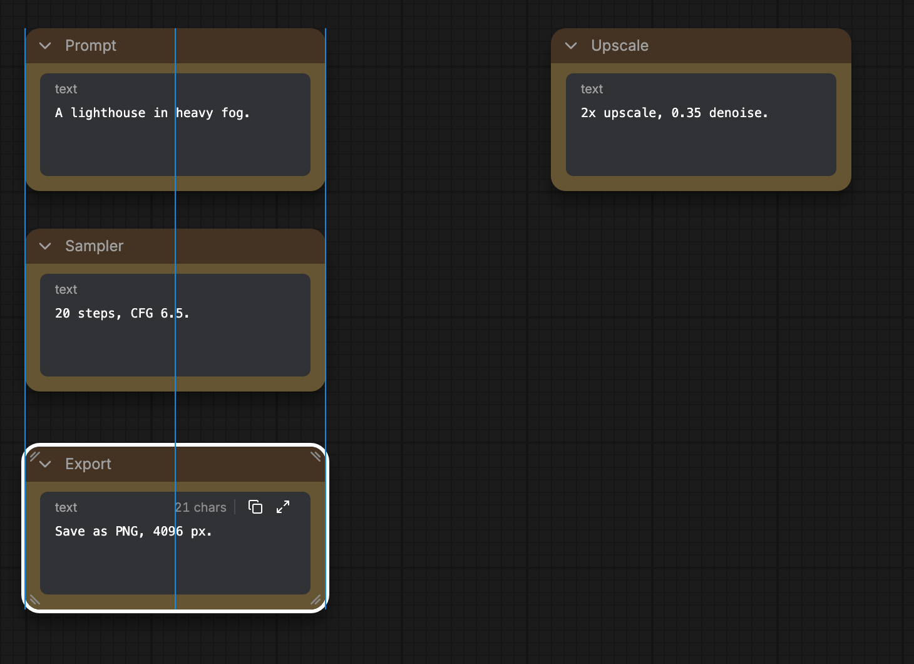
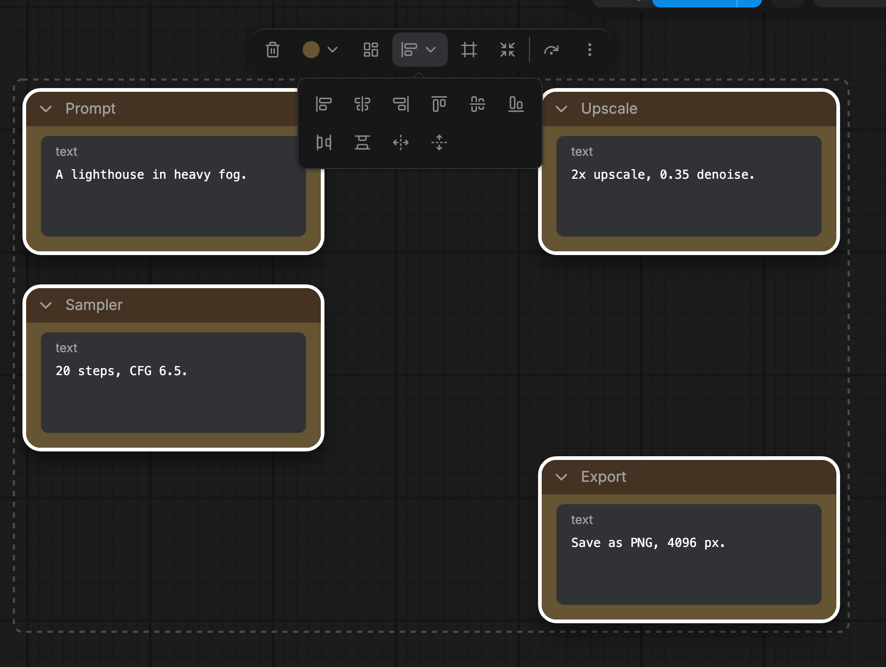

右下のキャンバスツールバーと **View** メニューで、グラフ内の移動方法を制御します。View の主要コマンドには、下部パネルを切り替え、テンプレートを参照、**フォーカスモード**、キャンバスのパフォーマンス情報、ミニマップ、リンク表示、ズームイン/アウト、ビューに合わせる、があります。

## キャンバスツールバー

**グラフキャンバスメニューを表示する**（`Comfy.Graph.CanvasMenu`）がオン（既定）のとき、キャンバス右下にフローティングツールバーが表示されます。

<Frame caption="右下にあるキャンバスツールバー。その上にミニマップパネルが開いています。">
  
</Frame>

| 操作 | 内容 |
| --- | --- |
| **キャンバスモード** | **選択**（ノードを編集）と **パンビュー**（パンのみ / 読み取り専用キャンバス）を切り替えるメニュー。既定: `v` は選択モードのロックを解除し、`h` はパンビューをロックします。 |
| **ビューに合わせる** | グラフをビューポートに収めます（`Comfy.Canvas.FitView`、既定 `.`）。 |
| **ズーム** | 拡大、縮小、全体表示にズーム、およびパーセント入力欄（1-1000%）を含むポップオーバーを開きます。既定のショートカットには、拡大/縮小用の `Alt` + `=` / `Alt` + `-` が含まれます。 |
| **ミニマップ** | 概要マップを切り替えます（`Comfy.Canvas.ToggleMinimap`、既定 `Alt` + `Shift` + `M`）。`Comfy.Minimap.Visible` として保持されます。 |
| **リンク表示** | リンクを隠すレンダーモードを切り替えて、接続線を非表示または表示します（`Comfy.Canvas.ToggleLinkVisibility`）。 |

Lite Graph / キャンバス設定の **グラフキャンバスメニューを表示する** でツールバー全体を隠せます。

## 表示メニュー

**表示**メニューには同じナビゲーションコマンドが登録されているため、メニューバーまたはコマンドパレットから実行できます。

- 下部パネル
- テンプレートを参照
- フォーカスモード
- キャンバスのパフォーマンス（`Comfy.ToggleCanvasInfo`、`Comfy.Graph.CanvasInfo` を切替）
- ミニマップ
- ノードリンク（`Comfy.Canvas.ToggleLinkVisibility`）
- 拡大 / 縮小 / 全体表示にズーム

## フォーカスモード

**フォーカスモード**（`Workspace.ToggleFocusMode`）はワークスペースの周辺UIを隠し、グラフに集中できるようにします。オンの間は次のとおりです。

- 上部のメニューセクション（新しいメニュー）が隠れます。
- 左右のサイドバーパネルと下部パネルは、スプリッタレイアウトでは描画されません。
- フォーカスモードを終了できるハンバーガーコントロールが表示されます（**メニューを表示**）。

もう一度フォーカスモードを切り替えるか、ハンバーガーコントロールを使用すると、ワークスペース全体が復元されます。

## ミニマップオプション

表示/非表示以外に、Settings の Minimap で地図の描画内容（ノード色、リンク、グループ、bypass、エラー状態）を制御します。[Lite Graph 設定](/ja/interface/settings/lite-graph) と、あれば関連する Appearance 項目を参照してください。

## スマートガイド

ComfyUI フロントエンド 1.62.0 以降が必要です。ノードやグループをドラッグまたはサイズ変更すると、キャンバス上の既存の要素に吸い付き、ガイド線で吸着先を示します。次の 3 種類が既定で有効です。

- **エッジ**: 他のノードやグループの辺と中心に揃えます。
- **間隔**: 隣り合う 2 つのノードが持つ間隔を再現し、その数値を表示します。
- **ワイヤー**: 接続したワイヤーが直線になる位置に止まります。

直線になるワイヤーが間隔より優先され、間隔がエッジより優先されます。ドラッグ中に `Shift` を押すとその操作だけスナップを切り、グリッドへのスナップに切り替えます。

<Frame caption="左の列にノートをドラッグしたところ。共有された左端、中央、右端にガイド線が出ています。">
  
</Frame>

スナップ距離と間隔は Settings の Lite Graph > Smart Guides にあり、種類ごとにスイッチがあります。[Lite Graph 設定](/ja/interface/settings/lite-graph#スマートガイド) を参照してください。

## 選択範囲の整列

2 つ以上のノードを選ぶと、選択ツールボックスに **整列** ボタンが 2 つ追加されます。1 つは行と列に並べるもの、もう 1 つはエッジを揃えるものです。

- 行と列に並べる **整列** は、選択したノードを同じ間隔で行と列に配置します。
- エッジを揃える **整列** は、左端、水平方向の中心、右端、上端、垂直方向の中心、下端の揃えに加えて、**水平方向に均等配置**、**垂直方向に均等配置**、**幅を揃える**、**高さを揃える** を提供します。
- 均等配置のあとは各間隔にハンドルが付きます。1 つドラッグするとすべての間隔がまとめて変わり、方向キーでも調整できます（1 回で 1、`Shift` を押すと 10）。

<Frame caption="4 つのノートを選択した状態の選択ツールボックスと整列ポップオーバー。">
  
</Frame>

グループは四隅すべてでサイズ変更できます。角をドラッグすると、その角の 2 辺だけが動きます。整列の操作はどれも 1 回の元に戻すで取り消せます。

## リンクとキャンバスのグローバル設定

リンクの形状や、接続されたリンクを表示するかどうかは、何も選択していないときの [右サイドパネル](/ja/interface/right-side-panel) の **グローバル設定** にあるクイック切替からも、Lite Graph 設定（`Comfy.LinkRenderMode` と関連オプション）からも完全な形で変更できます。グリッド間隔とグリッドへのスナップも、同じグローバル設定 / Lite Graph の領域にあります。

### リンクの表示切り替え

**リンクの表示切り替え** は、キャンバス上のすべてのワイヤーを一度に非表示にします。[キャンバスツールバー](#キャンバスツールバー) の右端にある斜線入りのリンクボタン、または **表示** > **ノードリンク** を使用します。リンクは削除されず、グラフもそのまま実行されます。ソケットにはドットが残り、ワイヤーの描画だけが止まるため、読み取るには密すぎるグラフで役立ちます。

コマンド（`Comfy.Canvas.ToggleLinkVisibility`）は `Comfy.LinkRenderMode` を **Hidden** に設定し、次にこのコマンドを使ったときに以前のモード（Straight、Linear、Spline）へ戻します。

<Frame caption="リンク表示がオン（上）とオフ（下）の状態。変わるのはワイヤーだけで、ソケットにはドットが残ります。">
  
</Frame>

このセクションの残りの部分では、代わりに個々のリンクを隠す方法を説明します。この方法ではソケットにバッジが残るため、接続にラベルを付けたり、そのリンクだけを個別に元に戻したりできます。

### リンクの選択

ComfyUI フロントエンド 1.59.0 以降が必要です。範囲選択でリンクを選ぶ操作は、選択モードでの既定のキャンバス動作です（設定のトグルではありません）。

操作したい接続ワイヤーの上をドラッグで囲みます。ノード、グループ、リルートを一つも含まない範囲選択は、通った可視リンクをすべて選択し、選択ツールボックスのノードボタンが二つのリンクアクションに切り替わります。**非表示** は接続を保ったままワイヤーを隠し、**削除** はリンクをグラフから取り除きます。各アクションは 1 回の元に戻す単位となり、`Delete` または `Backspace` を押しても選択したリンクを削除できます。

`Shift` や `Alt` を押しながらの範囲選択はノードとグループだけを選択し、パンビューのキャンバスモードではリンクは選択されません。

### ノードの入力または出力をクリックしてリンクを操作する

ComfyUI フロントエンド 1.59.1 以降が必要です。ノードの入力または出力のポイントからドラッグする代わりに、そのポイントをクリックします。キャンバスはそのポイントに接続されたリンクをすべて選択し（入力では 1 本、出力ではすべてのリンク）、選択ツールボックスに範囲選択と同じ **非表示** と **削除** のアクションが表示されます。

- 選択したリンクがすべてすでに非表示の場合、ツールボックスには **非表示** の代わりに **表示** が表示されます。
- **非表示** は可視リンクにだけ、**表示** は非表示リンクにだけ作用するため、どちらも空の元に戻す単位を追加しません。
- **削除** は非表示のリンクも含め、そのポイントのリンクをすべて取り除きます。
- クリック時に `Shift`、`Ctrl`、`Cmd`、`Alt` のいずれかを押していると、現在の選択が維持されます。
- `Ctrl` + `Alt` を押しながらのクリックは、キャンバスの他の場所と同じくリンクを切断します。
- リンクがないポイントではクリックは無視されます。リンク表示をオフにしたキャンバスも同様です。そこではすべてのワイヤーが隠れているためです。ポイントからのドラッグは引き続き新しいリンクを作成します。

### リンクを隠してバッジにラベルを付ける

リンクを隠す方法は 2 つあります：

- 先にリンクを選択し、選択ツールボックスの斜線入りの目（**非表示**）をクリックします。
- ワイヤーの中央を右クリックし、**リンクを隠す** を選択します。

どちらの方法でもワイヤーは描画されなくなり、各ソケットにはリンクのデータ型またはラベルを示すバッジが表示されます。バッジを右クリックすると **名前を変更** できます。フロントエンド 1.59.1 以降では、1 つのソケットのラベルが `IMAGE ×3` のような 1 つのバッジにまとめて表示されます。それ以前のバージョンではリンクごとに 1 つのバッジが描画されます。非表示のワイヤーを再び描画するには、そのバッジを右クリックして **リンクを表示** を選択します。まとめられたバッジでは **リンクを表示** が提供され、それが表すすべてのリンクを復元します。

以下の録画では、プレビューノードに接続する 3 本のリンクを非表示にし、それらのバッジの名前を変更してから、リンクを再表示します：

<video controls className="w-full">
  <source src="/images/interface/canvas-controls/hide-link.mp4" type="video/mp4" />
</video>

## 関連ページ

- [インターフェース概要](/ja/interface/overview)
- [ショートカット](/ja/interface/shortcuts)
- [Lite Graph 設定](/ja/interface/settings/lite-graph)
- [右サイドパネル](/ja/interface/right-side-panel)（Global Settings のクイック切替）
- [ボトムパネル](/ja/interface/bottom-panel)
