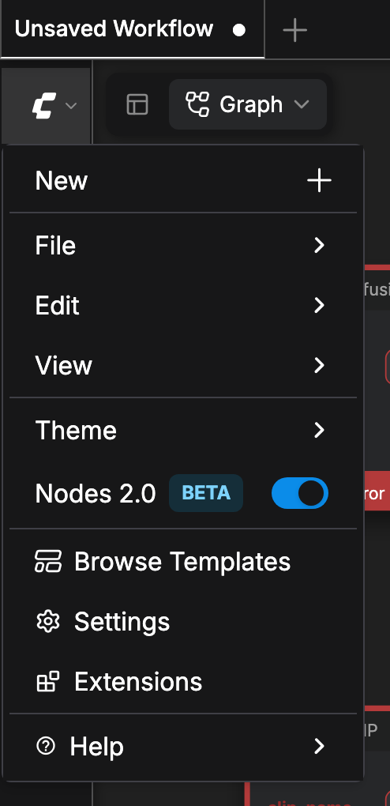
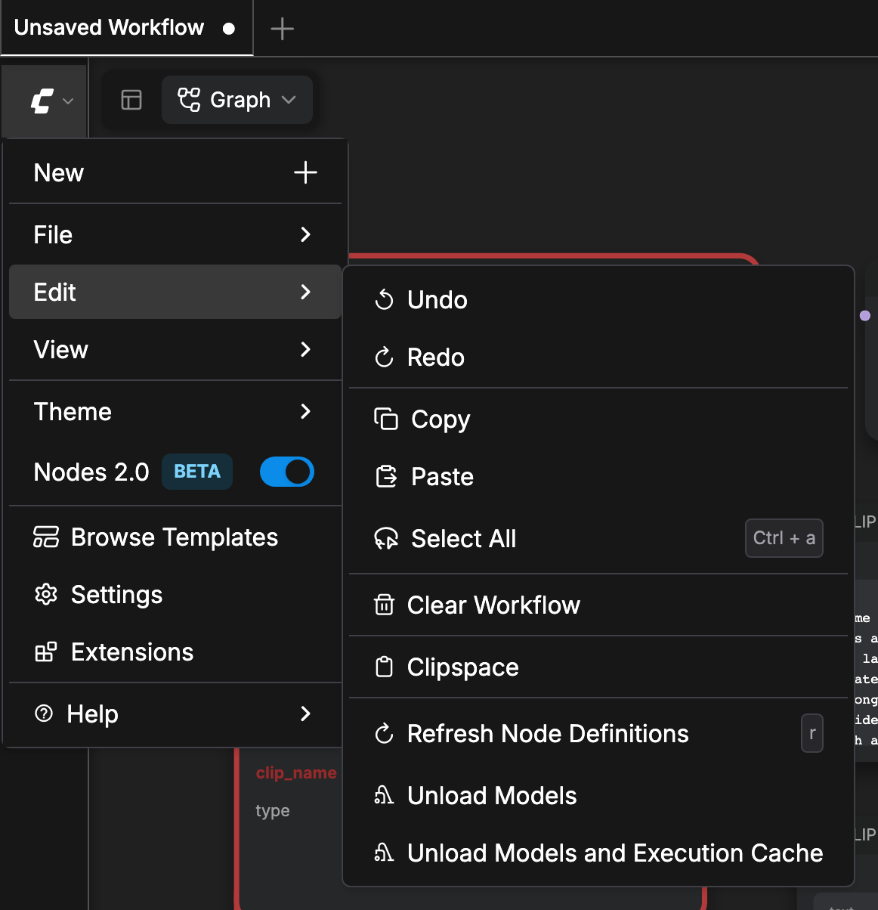

Comfyメニューは、左サイドバー上部のComfyロゴから開きます。キャンバス上の操作を伴わないコマンド（ワークフローの開始と保存、クリップボード編集、表示の切り替え、GPUメモリのクリーンアップ、ヘルプへのリンク）がまとめられています。

ロゴ、またはその横のシェブロンをクリックするとメニューが開きます。右側にシェブロンがある項目にはサブメニューがあり、マウスを合わせると開きます。

## エントリー

| エントリー | 内容 |
| --- | --- |
| **New**（新規） | 空のワークフローを開始します |
| **File**（ファイル） | ワークフローを開く、保存、エクスポートします |
| **Edit**（編集） | 元に戻す/やり直し、クリップボード、クリップスペース、ノード定義、GPUメモリ |
| **View**（表示） | 下部パネル、フォーカスモード、ミニマップ、ノードリンク、ズーム |
| **Theme**（テーマ） | 組み込みテーマとカスタムテーマのサブメニュー。使用中のテーマにはチェックが付きます |
| **Nodes 2.0** | Nodes 2.0レンダラーの切り替え。[Nodes 2.0](/ja/interface/nodes-2)を参照 |
| **Browse Templates**（テンプレートを参照） | テンプレートブラウザを開きます。[テンプレート](/ja/interface/features/template)を参照 |
| **Settings**（設定） | 設定ダイアログを開きます。`Ctrl + ,` と同じです |
| **Extensions**（拡張機能の管理） | カスタムノードとフロントエンド拡張機能のマネージャーを開きます |
| **Help**（ヘルプ） | イシュートラッカー、ドキュメント、Discord、フォーラム、About、サポート |

### File（ファイル）

| エントリー | ショートカット | 内容 |
| --- | --- | --- |
| **Open**（開く） | `Ctrl + O` | ディスクからワークフローを開きます |
| **Save**（保存） | `Ctrl + S` | 現在のワークフローを保存します |
| **Save As**（名前を付けて保存） | | 新しい名前で保存します |
| **Export**（エクスポート） | | ワークフローをJSONとしてダウンロードします |
| **Export (API)**（API形式でエクスポート） | | API形式のプロンプトをダウンロードします。[ワークフローのAPI形式](/ja/development/api-development/workflow-api-format)を参照 |
| **Export (Workflow Image)**（ワークフロー画像のエクスポート） | | ワークフローを内蔵したキャンバスのPNGをダウンロードします。ComfyUIフロントエンド 1.61.4 以降が必要です。[ワークフロー](/ja/basic-concepts/workflow)を参照 |

### Edit（編集）

| エントリー | ショートカット | 内容 |
| --- | --- | --- |
| **Undo** / **Redo**（元に戻す/やり直す） | | キャンバスの変更を1つずつ行き来します |
| **Copy** / **Paste**（コピー/貼り付け） | | 選択したノードを複製します |
| **Select All**（すべて選択） | `Ctrl + A` | キャンバス上のすべてのノードを選択します |
| **Clear Workflow**（ワークフローをクリア） | | キャンバスを空にします。保存済みのワークフローは保存されたままです |
| **Clipspace**（クリップスペース） | | 画像とコピーしたノードのためのクリップボードスペースを開きます |
| **Refresh Node Definitions**（ノード定義を更新） | `R` | ComfyUIを再起動せずにノード定義を再読み込みします |
| **Unload Models**（モデルのアンロード） | | 読み込まれているモデルが保持するGPUメモリを解放します |
| **Unload Models and Execution Cache**（モデルと実行キャッシュのアンロード） | | キャッシュされた結果も破棄するため、次回の実行時に再計算されます |

### View（表示）

| エントリー | ショートカット | 内容 |
| --- | --- | --- |
| **Bottom Panel**（下部パネル） | | [下部パネル](/ja/interface/bottom-panel)の表示/非表示を切り替えます |
| **Browse Templates**（テンプレートを参照） | | テンプレートブラウザを開きます |
| **Focus Mode**（フォーカスモード） | | キャンバス以外のすべてを隠します。[キャンバス操作](/ja/interface/canvas-controls)を参照 |
| **Canvas Performance**（キャンバスのパフォーマンス） | | キャンバスのパフォーマンス表示の表示/非表示を切り替えます |
| **Minimap**（ミニマップ） | `Alt + Shift + M` | ミニマップの表示/非表示を切り替えます |
| **Node Links**（ノードリンク） | | リンク描画の表示/非表示を切り替えます |
| **Zoom In** / **Zoom Out**（拡大/縮小） | `Alt + =` / `Alt + -` | キャンバスをズームします |
| **Zoom to fit**（全体表示にズーム） | `.` | 選択したノード、または選択がない場合はワークフロー全体をビューに収めます |

### Help（ヘルプ）

| エントリー | 開く先 |
| --- | --- |
| **ComfyUI Issues**（ComfyUIの問題） | GitHubのComfyUIイシュートラッカー |
| **ComfyUI Docs**（ComfyUIのドキュメント） | docs.comfy.org |
| **Comfy-Org Discord** | コミュニティのDiscordサーバー |
| **ComfyUI Forum**（ComfyUI フォーラム） | ComfyUIフォーラム |
| **About ComfyUI**（ComfyUIについて） | バージョンとシステム情報。[About](/ja/interface/settings/about)を参照 |
| **Contact Support**（サポートに連絡） | サポートフォーム |

## 再起動せずにメモリを解放する

編集メニューには、セッション中にメモリを解放する 2 つの項目があります:

- **モデルのアンロード**は、読み込まれているすべての checkpoint、LoRA、VAE を GPU メモリから解放します。
- **モデルと実行キャッシュのアンロード**は、キャッシュされた実行結果もクリアするため、次回の実行ではそれらを再利用せずに再計算します。

別のモデルを読み込みたいときは 1 つ目を、ディスク上のモデルファイルを変更した後は 2 つ目を使用します。どちらもローカル専用です。Comfy Cloud では、サーバーがモデルメモリを管理するため、これらの項目は表示されません。

## メニューの違い

- **Comfy Cloud** では、2つのアンロード項目が非表示になります。それ以外の項目は、ここで説明する通りに動作します。
- **Comfy Desktop** では、**ヘルプ**のサブメニューに項目が追加されます: デスクトップ版ユーザーガイド、DevTools、フォルダーを開くサブメニュー、アップデートの確認、再インストールです。

## 関連ページ

- [インターフェースの概要](/ja/interface/overview)
- [キーボードショートカット](/ja/interface/shortcuts)
- [Comfy の設定](/ja/interface/settings/comfy)
