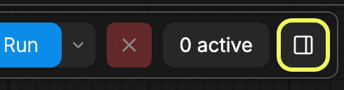
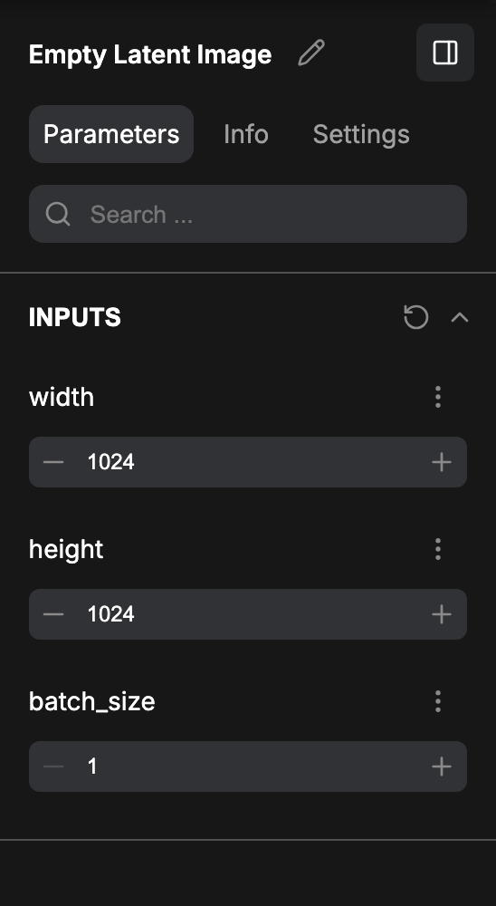
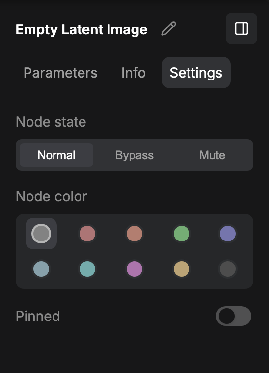
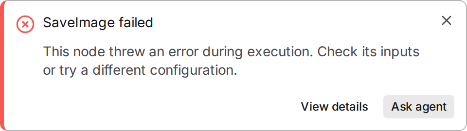
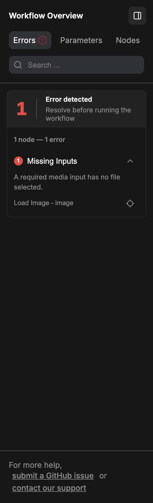
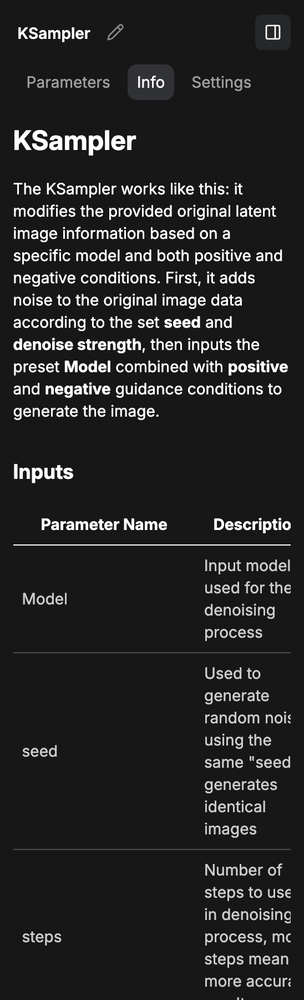
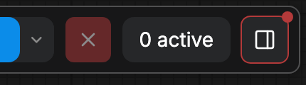

右側パネルは、ComfyUI ワークスペース右端にあるプロパティパネルです。キャンバスで選択している項目のパラメータ、情報、設定を表示し、よく使う入力をすぐ手の届く場所に置き、ワークフローのエラーとその解決方法をまとめて一覧表示します。

## パネルを開閉する

右上のコントロール領域にあるパネルのアイコンをクリックすると、パネルが開きます。ボタンのツールチップには **プロパティパネルの切り替え** と表示されます。パネルが閉じているときにワークフローにエラーがあると、ボタンに赤いドットが表示されるので、パネルを開くとそのままエラー一覧が表示されます。パネルは、パネル自体のヘッダーにあるアイコンから閉じられます。

ComfyUI はパネルの状態をセッションをまたいで記憶します。

## パネルは選択内容に合わせて変わる

パネルのタイトルと表示されるタブは、キャンバスで選択している内容によって変わります：

| 選択内容 | パネルのタイトル | タブ |
| --- | --- | --- |
| 何も選択していない | ワークフロー概要 | パラメータ、ノード、設定 |
| ノード 1 つ | ノード名 | パラメータ、情報、設定、必要に応じて問題 |
| サブグラフノード 1 つ | ノード名 | パラメータ、設定、必要に応じて問題、さらにサブグラフを編集ボタン |
| 複数の項目 | 選択中の項目数 | ノード、設定、必要に応じて問題 |

タイトル横の鉛筆ボタンをクリックすると、選択中のノードまたはグループの名前を変更できます。サブグラフノードの場合、ヘッダーに **サブグラフを編集** ボタンも表示され、パネル内でサブグラフエディタを開きます。

**問題** タブは、選択中の項目に関連する問題がある場合、または何も選択しておらずワークフローに問題がある場合にのみ表示されます。`Comfy` → `Error System` の **Show issues tab in side panel** 設定でタブ自体を非表示にできます。

### パラメータ

ノードを 1 つだけ選択しているとき、**パラメータ** タブが **INPUTS** の下に入力を一覧表示します。複数の項目を選択しているときは、同じビューが **ノード** という名前になり、選択した各項目の入力を一覧表示します。どちらのビューにも上部に検索フィールドがあり、ノードごとに折りたためます。詳細入力として扱われる入力は、別の **ADVANCED INPUTS** セクションにまとめて表示されます。各入力には操作メニューがあり、**名前を変更**、**お気に入りに追加**、**デフォルトにリセット** を選べ、サブグラフから昇格した入力には **入力を非表示** も表示されます。複数のノードを選択しているときは、各セクションにキャンバス上でノードを探すボタンも表示されます。

何も選択していないときは、同じタブがお気に入り登録した入力を表示するので、ノードを選択しなくてもよく変更する値を調整できます。

### ノード

**ノード** タブは何も選択していないときに表示されます。ワークフロー内のすべてのノードとその入力を一覧表示し、検索と折りたたみができるので、1 か所から任意のノードを確認・編集できます。複数の項目を選択しているときは、パラメータビューもこのタブ名を使います。

### 情報

**情報** タブはサブグラフではないノードを 1 つだけ選択しているときに表示されます。内容は [ノードドキュメント](/ja/interface/features/node-docs) と同じで、選択ツールボックスのドキュメントアイコンや Nodes 2.0 のヘルプボタンで開くものと一致します。

### 設定

選択内容があるとき、**設定** タブは選択中のノードとグループを対象にします：

- **ノードの状態**：**ノーマル**、**バイパス**、**ミュート**。
- **ノードカラー**：ノードの色を選びます。
- **ピン留め**：ノードをキャンバス上に固定し、操作中に動かないようにします。

変更は選択範囲のすべての項目に適用されるため、グループ全体に同じ状態や色を一度に設定できます。グループでは色とピン留めの項目のみ利用できます。

何も選択していないときは、タブの名前が **グローバル設定** になり、完全な設定ダイアログに対応するクイック切り替えをまとめて表示します：

- **ノード**：詳細パラメータを表示、選択時にツールボックスを表示、ノード 2.0。
- **キャンバス**：グリッド間隔、ノードをグリッドにスナップ。
- **接続リンク**：リンクの形状、接続されたリンクを表示。
- **すべての設定を表示**：完全な設定ダイアログを開きます。

### 問題

**問題** タブは、ワークフローを止めている問題を分類して表示するので、実行前に解決できます：

- **ノードエラー**：エラーが出たノード、エラーメッセージ、**展開** と **折りたたみ** の操作、**キャンバス上でノードを探す**。
- **ノードの入れ替え**：ComfyUI が置き換えられる不足ノードを、置き換え先とともに一覧表示します。何もインストールせずにワークフローを修復できます。詳しくは下記の [ノードの入れ替え](#ノードの入れ替え) を参照してください。
- **不足しているノードパック**：ComfyUI Manager が利用可能な場合は **すべてインストール**、**変更を適用**、**マネージャーで表示**。Comfy Cloud ではこのグループは **サポートされていないノードパック** という名前になり、クラウド上ではノードパックをインストールできません。
- **不足しているモデル**：単一ファイルの **ダウンロード** または **すべてダウンロード**、Comfy Cloud で自身で用意したモデルの **インポート**、Hugging Face でゲートされたモデルはサインインとライセンス同意が必要という注意。
- **不足している入力**：ワークフローが必要としているが見つからない入力メディア。
- **エラーログ** と、GitHub issue の投稿またはサポートへの問い合わせリンク。

#### 問題について Agent に聞く

Comfy Agent が使える環境では、問題の各画面に **Ask agent** ボタンがあり、クリックすると問題が添付された状態で Agent パネルが開くので、状況を書き直す必要はありません。Agent が使えない環境では、このボタンは表示されません。

- 実行を妨げる問題があるときにキャンバス上へ出るメッセージでは、**詳細を表示** の隣に **Ask agent** が表示されます。そのメッセージが報告した問題が添付されます。
- 問題一覧の上部にある概要の **Ask agent** は、一覧のグループが 1 つだけならそのグループを、複数あるなら一覧のすべてのグループを添付します。
- 問題一覧の下部には **Ask agent about all N issues**（問題が 1 件のときは **Ask agent about 1 issue**）があり、検索で隠れている問題も含め、一覧のすべてを添付します。

添付された問題は入力欄のチップとして表示され、ラベルには概要またはグループのタイトルが入ります。チップにカーソルを合わせると内容を確認できます。チップを削除すれば、その詳細はメッセージに含まれません。メッセージは自分で送信するまで送られず、Agent の変更も承認したときにだけ適用されます。

パネルを初めて開くとき、ComfyUI は Agent の利用への同意を求めます。拒否するとパネルは閉じたままで、何も添付されません。

#### ノードの入れ替え

ComfyUI とインストール済みのノードパックは、名前変更・分割・統合されたノードの置き換え先を宣言します。ワークフローが古い名前のままの場合、**ノードの入れ替え** グループに置き換え先が表示され、現在のインストールでワークフローを実行できるようになります。

- 各行に不足しているノードの種類と **このノードは次で置き換えられます：** の置き換え先、**ノードを置き換える** ボタンが表示されます。行にノードが 1 つだけの場合は、キャンバス上でそのノードを探す操作も表示されます。
- 同じ種類のノードが複数ある場合は 1 行にまとまり、件数が表示されます。行を展開すると各ノードを確認できます。**ノードを置き換える** はその行のすべてのノードを一度に置き換えます。
- グループ見出しの **すべて置き換える** で、ワークフロー内の置き換え可能なノードをすべて一度に変換します。
- 置き換えるとワークフローがその場で書き換えられます。不安な場合は先にコピーを保存してください。

組み込みの置き換えには次のものがあります：

| 不足しているノード | 置き換え先 |
| --- | --- |
| `ResizeImagesByLongerEdge` | `ImageScaleToMaxDimension` |
| `ImageBatch` | `BatchImagesNode` |
| `ImageScaleBy` | `ResizeImageMaskNode` |
| `T2IAdapterLoader` | `ControlNetLoader` |
| `Load3DAnimation` | `Load3D` |
| `Preview3DAnimation` | `Preview3D` |
| `SDV_img2vid_Conditioning` | `SVD_img2vid_Conditioning` |
| `TextGenerate` | `TextGenerateV2` |

これらのノードを自分で処理したい場合は、`Comfy` → `Workflow` の **Enable node replacement suggestions** をオフにします。

## 入力をお気に入り登録する

お気に入り登録した入力はパネルのショートカットになります。**パラメータ** タブを開き、任意の入力の操作メニューをクリックして **お気に入りに追加** を選ぶと、何も選択していないときにパネルへ表示され、検索と並べ替えができるようになります。同じメニューの **お気に入りを解除** で削除できます。

## 関連項目

- [インターフェース概要](/ja/interface/overview)：ワークスペースの各領域について。
- [ComfyUI 設定の概要](/ja/interface/settings/overview)：完全な設定ダイアログについて。
- [ノードドキュメント](/ja/interface/features/node-docs)：情報タブと同じヘルプ内容。
- [ノードライブラリ](/ja/interface/node-library)。
