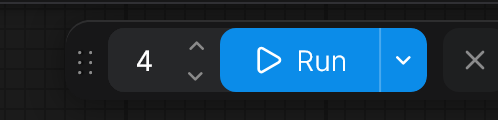
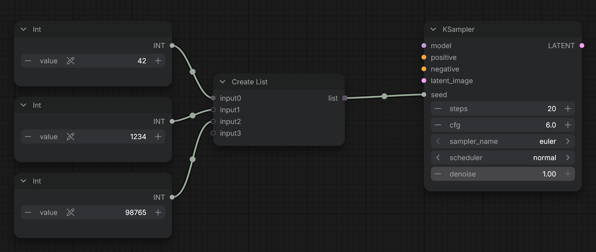
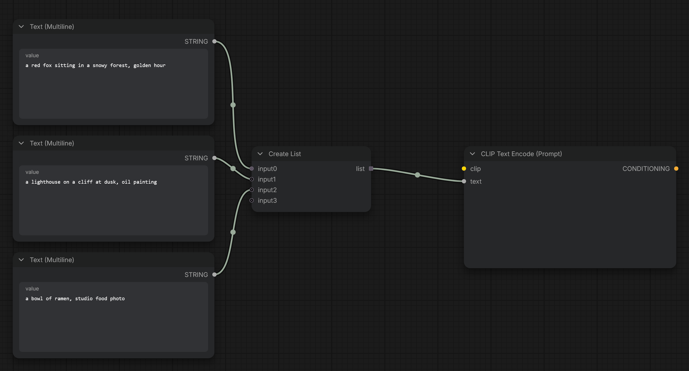
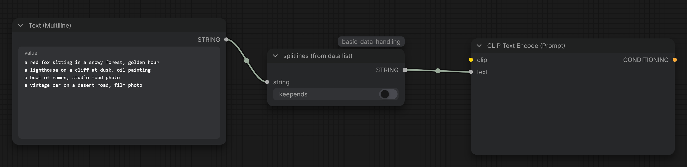
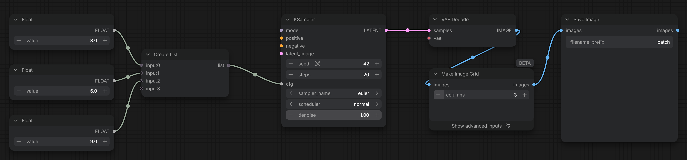
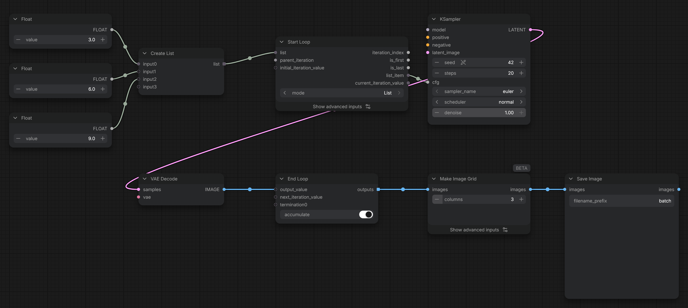
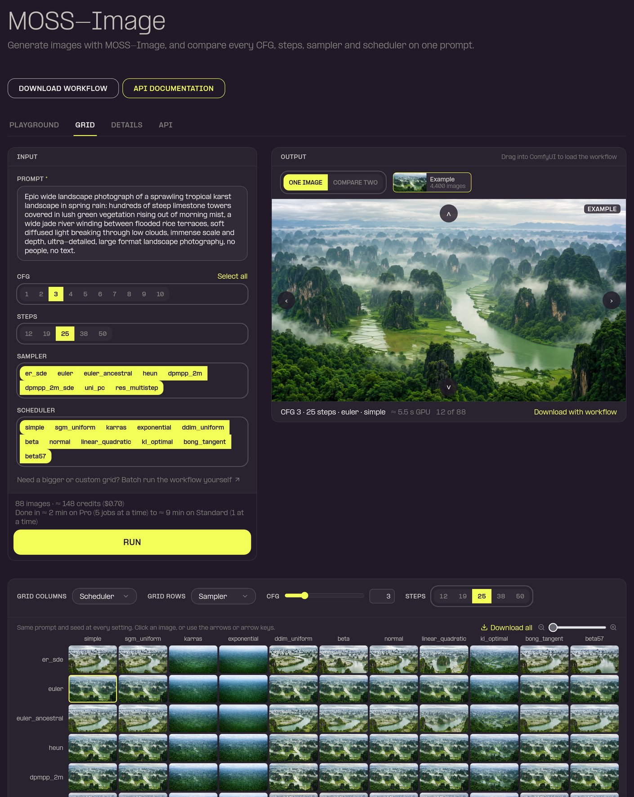
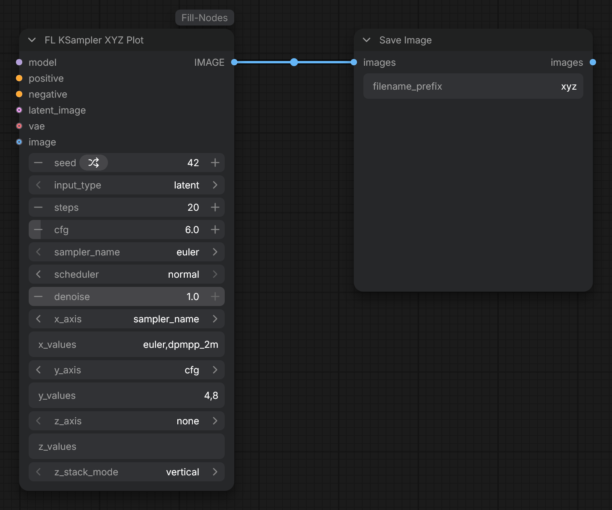
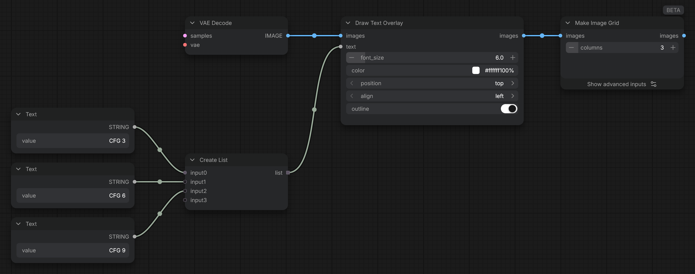

**バッチ生成**とは、1つのワークフローを何度も実行し、実行の合間に何かを変更することです。変更する対象は、シード、プロンプト、CFG、サンプラー、モデル、あるいはこれらのうち複数を同時に変更する場合もあります。**設定グリッド**はその一つの使い方で、同じプロンプトとシードを使い、セルごとに1つまたは2つの設定を変えることで、各設定が何をするのかを確認できます。

このガイドでは、最も単純なケースから始め、1ステップずつ追加していきます：

1. [バッチシード](#batch-seeds)：1つのプロンプトの多数のバリエーション
2. [バッチプロンプト](#batch-prompts)：プロンプトごとに1回の実行
3. [任意の設定のバッチ](#batch-any-setting)：CFG、ステップ、その他の入力の値ごとに1回の実行
4. [ループ](#loops)：Start Loop と End Loop
5. [設定グリッド](#settings-grids)：2つ以上の設定を交差させ、結果をレイアウトする
6. [Comfy API によるスクリプト](#scripting-with-the-comfy-api)：あらゆる組み合わせを、あらゆる規模で


| 方法 | 実行間で変わるもの | セクション |
|--------|---------------------------|---------|
| バッチ数 | シード、または `increment` もしくは `randomize` に設定された任意のウィジェット | [バッチシード](#batch-seeds) |
| `batch_size` | 1回のサンプリングパスにおける各画像のノイズ | [バッチシード](#batch-seeds) |
| リスト | リストから入力する任意の値：シード、プロンプト、CFG、ステップ | [バッチプロンプト](#batch-prompts)、[任意の設定のバッチ](#batch-any-setting) |
| Start Loop / End Loop | 任意の入力、1イテレーションずつ | [ループ](#loops) |
| XY プロットノード | 2つまたは3つのサンプラー設定を交差させたもの | [設定グリッド](#settings-grids) |
| スクリプト | あらゆるものを、すべての組み合わせで | [スクリプト](#scripting-with-the-comfy-api) |

<Tip>
シンプルな設定グリッドだけが必要な場合や、自分で構築する前にその表示内容を確認したい場合は、[Comfy Hub](https://comfy.org/hub/workflows) のオープンモデルのテキストから画像へのページにある **Grid** タブをご利用ください。セットアップなしで、1つのシードで CFG、ステップ、サンプラー、スケジューラーを並べて確認できます。[MOSS-Image の Grid タブ](https://comfy.org/hub/workflows/moss-image-text-to-image/)をお試しください。詳細は[設定グリッド](#settings-grids)をご覧ください。
</Tip>

<Note>
一部のステップではカスタムノードを使用します。このページで名前が挙げられているカスタムノードはすべて [Comfy Cloud](https://cloud.comfy.org) にインストール済みです。Comfy Cloud では、カスタムノードは追加される前にレビューされます。自分の ComfyUI では、先に[ノードパックをインストール](/ja/installation/install_custom_node)してください。
</Note>

## バッチシード {#batch-seeds}

シードは開始ノイズを決めるため、新しいシードにすると同じプロンプトでも新しい構図が得られます。シードの変更は最もシンプルなバッチです。

### バッチ数

**バッチ数**は実行バーの**実行**ボタンの隣にあります。1回のクリックでワークフローを何回キューに入れるかを設定します。場所については[実行バー](/ja/interface/overview)を参照してください。

1. `KSampler` の `seed` の `control after generate` を `randomize` または `increment` に設定します。
2. **バッチ数**を生成したい画像数に設定します。
3. **実行**をクリックします。キューに入った各実行は次のシードを取得します。



`control after generate` はシードだけでなく、それを持つ任意の数値ウィジェットで機能します。すべてのウィジェットが `fixed` に設定されている場合、キューに入った各実行は同一になり、同じ画像が生成されます。

### 潜在画像の `batch_size`

`Empty Latent Image` ノードの `batch_size` は一度に複数の潜在を作成し、`KSampler` がそれらを1パスでまとめてデノイズします。バッチ内の各画像には異なるノイズが与えられます。

1. `Empty Latent Image` で `batch_size` を画像数（例: `4`）に設定します。
2. **実行**をクリックします。`Save Image` がそれらすべてを保存します。

バッチを大きくすると、すべての画像を同時にサンプリングするため、より多くのVRAMを使用します。

### 特定のシード

すでに気に入ったシードを再実行する場合、たとえば新しい設定で比較する場合は、リストからシードを渡します。

1. シードごとに [Int](/ja/built-in-nodes/PrimitiveInt) ノードを追加します。
2. [Create List](/ja/built-in-nodes/CreateList) ノードを追加し、各 `Int` を次の空いている入力に接続します。接続するたびに新しい入力が現れます。
3. `Create List` の `list` 出力を `KSampler` の `seed` 入力に接続します。
4. **実行**をクリックします。`KSampler` はシードごとに1回実行されます。



次のセクションではリストの仕組みを説明します。

## バッチプロンプト {#batch-prompts}

ノードが**リスト**を受け取ると、ComfyUI はリストの各項目について1回ずつ実行し、すべての結果を下流に渡します。プロンプトのリストを `CLIP Text Encode` に接続すると、プロンプト1つにつき画像1枚が生成されます。

### プロンプトごとに1つのテキストノード

1. プロンプトごとに [Text (Multiline)](/ja/built-in-nodes/PrimitiveStringMultiline) ノードを追加します。
2. `Create List` でそれらを結合します。
3. `list` 出力を、ポジティブ側の `CLIP Text Encode` の `text` 入力に接続します。
4. **Run** をクリックします。各プロンプトは個別の実行としてエンコードされ、サンプリングされます。



### 1行につき1プロンプト

プロンプトが複数ある場合は、1つのテキストボックスに1行1プロンプトでまとめて記述し、[Basic data handling](https://github.com/StableLlama/ComfyUI-basic_data_handling) パックの **splitlines (from data list)** ノードでリストに分割します。

1. `Text (Multiline)` ノードを追加し、1行につき1プロンプトを記述します。
2. **splitlines (from data list)** ノードを追加し（`splitlines` で検索）、テキストをその `string` 入力に接続します。`keepends` はオフのままにしてください。改行がプロンプトの一部にならないようにするためです。
3. その出力を、ポジティブ側の `CLIP Text Encode` の `text` 入力に接続します。
4. **Run** をクリックします。各行が個別の実行になります。



この方法なら、プロンプトファイル全体をテキストボックスに貼り付けることができます。空行は空のプロンプトになるため、事前に削除してください。

## 任意の設定をバッチ化する {#batch-any-setting}

リストはシードやプロンプトだけでなく、ほぼすべての入力に接続できます。`cfg` などのウィジェットにリストを接続するには、リンクをウィジェットへドラッグします。CFG をスイープするには:

1. CFG の値ごとに [Float](/ja/built-in-nodes/PrimitiveFloat) ノードを追加します。たとえば `3`、`6`、`9` です。
2. それらを `Create List` で結合し、リストを `KSampler` の `cfg` 入力に接続します。
3. シードは固定したままにします。シードの `control after generate` を `fixed` に設定します。
4. `VAE Decode` を [Make Image Grid](/ja/built-in-nodes/ImageGrid) ノードに接続し、さらに `Save Image` に接続します。
5. **Run** をクリックします。`KSampler` と `VAE Decode` は CFG の値ごとに1回実行され、`Make Image Grid` はすべての画像を受け取ります。



`steps`、`denoise`、画像サイズ、LoRA の強度も同じように動作し、`Int` または `Float` ノードを使用します。

<Warning>
ノードが**複数のリスト**を受け取ると、ComfyUI は項目を位置ごとにペアにします。1番目と1番目、2番目と2番目という具合で、短い方のリストの最後の項目が繰り返されます。すべての組み合わせが作られるわけではありません。3つのプロンプトと3つのシードでは、9枚ではなく3枚の画像が生成されます。2つの設定を掛け合わせるには、[設定グリッド](#settings-grids) または [スクリプト](#scripting-with-the-comfy-api) を参照してください。
</Warning>

**ドロップダウン。** `sampler_name`、`scheduler`、モデルファイルはドロップダウンであり、テキスト値のリストを直接接続することはできません。いくつかを比較するには、値ごとに `KSampler` と `VAE Decode` ノードをコピーし、同じモデル、プロンプト、潜在に接続し、各コピーを別々に設定して、`Make Image Grid` で画像をまとめます。サンプラーとスケジューラーについては、[設定グリッド](#settings-grids) の XY プロットノードの方が手早く行えます。

## ループ {#loops}

[Start Loop](/ja/built-in-nodes/StartLoop) と [End Loop](/ja/built-in-nodes/EndLoop) ノードは、2つの間に挟まれたノードを1イテレーションにつき1回実行します。`Start Loop` には3つのモードがあります:

| モード | 反復回数 |
|------|------------|
| `simple` | `num_iterations` 回。`iteration_index` は 0 から始まる |
| `For` | `start_iteration_index` から `max_iteration` まで（`max_iteration` は含まない）、`step` 刻み |
| `List` | 接続された `list` の各項目につき1回。現在の項目は `list_item` から出力される |

値のリスト（たとえば CFG）をループするには:

1. 上記のように、`Float` ノードと `Create List` でリストを作成します。プロンプトやシードのリストでも同じように動作します。
2. `Start Loop` ノードを追加し、`mode` を `List` に設定して、リストを `list` 入力に接続します。
3. `Start Loop` の `list_item` を、変更したい入力（ここでは `KSampler` の `cfg` 入力）に接続します。
4. `End Loop` ノードを追加します。`VAE Decode` の `IMAGE` 出力を `output_value` に接続し、`accumulate` をオンにして、End Loop が最後の1回だけでなく毎回のイテレーションの画像を返すようにします。
5. `End Loop` の `outputs` を `Make Image Grid` に、さらに `Save Image` に接続します。
6. **Run** をクリックします。



1つのリストに対しては、ループと通常のリストは同じ画像を生成します。ループではさらに、1つのイテレーションから次のイテレーションへ値を渡すことができ（End Loop の `next_iteration_value`、Start Loop の `current_iteration_value`）、外側のループの `iteration_index` を内側のループの `parent_iteration` に接続することで、ループを別のループの内側に入れ子にできます。

<Note>
Start Loop と End Loop は最新のコアノードです。見つからない場合は、[ComfyUIをアップデート](/ja/installation/update_comfyui)してください。Comfy Cloud は ComfyUI の安定版リリースごとに更新されます。
</Note>

## 設定グリッド {#settings-grids}

設定グリッドでは、プロンプト、モデル、シードを固定し、サンプラー設定だけを変更します。そのため、2 つのセル間の違いは、変更した設定によるものになります。ランダムシードを使うと、各セルで構図も変わり、変化が設定によるものかノイズによるものかを判別できなくなります。

プロンプトとモデルを除き、画像を最も大きく変える `KSampler` の 4 つの設定は次のとおりです。

| 設定 | 変わる内容 |
|---------|-----------------|
| `cfg` | モデルがプロンプトにどれだけ厳密に従うか。低い値ではゆるく柔らかい印象になり、高い値では彩度が高くシャープになりすぎた印象になります。 |
| `steps` | サンプラーが実行するノイズ除去ステップの数。ステップを増やすと、ある程度まではディテールが増えますが、それ以降は時間が増えるだけです。 |
| `sampler_name` | 各ステップでノイズを除去するアルゴリズム（`euler`、`dpmpp_2m` など）。 |
| `scheduler` | ステップごとにノイズレベルがどのように低下するか（`normal`、`karras`、`simple` など）。 |

完全なスイープでは組み合わせがすぐに膨れ上がります。4 つの CFG 値 × 3 つのステップ数 × 3 つのサンプラー × 2 つのスケジューラーで 72 枚の画像になります。まず 1 つか 2 つの設定から始め、良さそうな範囲を見つけてから絞り込んでください。

### Comfy Hub の Grid タブ

単純な設定グリッドだけが必要なら、自分で構築する必要はありません。[Comfy Hub](https://comfy.org/hub/workflows) のオープンモデルのテキストから画像へのページには、1 つのシードで CFG × ステップ数 × サンプラー × スケジューラーのスイープを事前レンダリングした **Grid** タブがあります。たとえば [MOSS-Image](https://comfy.org/hub/workflows/moss-image-text-to-image/) です。

- どの設定を列と行に配置するかを選び、任意のセルをクリックするとフルサイズで表示されます。
- 自分のプロンプトを入力し、比較する値を選択して **Run** をクリックすると、Comfy Cloud 上でバッチ実行されます。タブには、実行前に画像が何枚になるかとコストが表示されます。
- **Download with workflow** は、ComfyUI にドラッグすると正確な設定を読み込める画像を保存します。



より多くの設定、他のモデル、または独自のワークフローが必要な場合は、以下で説明するように自分でグリッドを構築してください。

### XY プロットノードで設定を掛け合わせる

[Fill-Nodes](https://github.com/filliptm/ComfyUI_Fill-Nodes) パックの **FL KSampler XYZ Plot** ノードは `KSampler` を置き換え、最大 3 つの設定を掛け合わせます。すべての組み合わせをレンダリングし、軸に沿って値が書き込まれた 1 枚の画像を返します。

1. `KSampler` を **FL KSampler XYZ Plot** に置き換えます。`model`、`positive`、`negative`、`latent_image`、およびチェックポイントローダーの `vae` を接続します。
2. シードと、変更しない設定の基準値を設定します。
3. `x_axis` と `y_axis` を、`steps`、`cfg`、`denoise`、`sampler_name`、`scheduler` のうち 2 つに設定します。
4. 各軸の値を `x_values` と `y_values` にカンマ区切りで入力します。たとえば `euler,dpmpp_2m` と `4,8` です。
5. 3 つ目の設定を掛け合わせるには、`z_axis` と `z_values` を設定します。`z_stack_mode` は追加のグリッドを下または横に並べます。
6. `IMAGE` 出力を `Save Image` に接続し、**Run** をクリックします。




プロンプト × シードや LoRA 強度 × CFG など、他の入力同士を掛け合わせるには、[ネストしたループ](#loops) または [スクリプト](#scripting-with-the-comfy-api) を使用します。

### 独自のグリッドを配置する

画像がリストまたはループから生成される場合、[Make Image Grid](/ja/built-in-nodes/ImageGrid) ノードがそれらを左から右、上から下へ行単位で並べます。

| 入力 | 動作 |
|-------|--------------|
| `columns` | 1 行あたりの画像数。水平軸の値の数に設定します。 |
| `cell_width`, `cell_height` | 各画像のリサイズ後のサイズ。 |
| `padding` | セル間のピクセル数。 |

各セルにラベルを付けるには、`VAE Decode` と `Make Image Grid` の間に [Draw Text Overlay](/ja/built-in-nodes/TextOverlay) ノードを置きます。`Text` ノードと `Create List` を使って、`CFG 3`、`CFG 6`、`CFG 9` などのラベルの 2 つ目のリストを作成し、それを `text` 入力に接続します。画像とラベルはどちらもリストなので、各画像には同じ位置のラベルが付きます。このページの上部にあるグリッドは、この方法で作成したものです。



## Comfy API でのスクリプト作成 {#scripting-with-the-comfy-api}

設定が2つや3つを超える場合や、プロンプト、シード、モデルを掛け合わせる場合は、グラフよりスクリプトのほうが簡単です。スクリプトはすべての組み合わせを構築し、それぞれを個別のジョブとして送信し、各実行で何が変わったかの記録とともに結果を保存します。

### 1. ワークフローを API 形式でエクスポートする

1. ComfyUI で1回分のワークフローを構築してテストします。
2. ワークフローメニューを開き、**Export (API)** を選択します。これによりグラフが [API 形式](/ja/development/api-development/workflow-api-format) で保存され、各ノードはその ID をキーとして扱われます。
3. JSON を開き、変更したい各ノードの ID を確認します。デフォルトのテキストから画像へのワークフローでは、`KSampler` は `"3"`、ポジティブの `CLIP Text Encode` は `"6"` です。

### 2. 組み合わせごとに 1 つのジョブをキューに追加

[Comfy API v2](/ja/api-reference/v2/overview) は `POST /api/v2/jobs` で API 形式のグラフを受け取り、`GET /api/v2/jobs/{id}` でポーリングできるジョブを返します。同じ API は Comfy Cloud 上でも、[comfy-api-proxy](https://github.com/Comfy-Org/comfy-api-proxy) を介して自分の ComfyUI 上でも動作するため、以下のスクリプトは `BASE_URL` を変更するだけでどちらでも動作します。

Comfy Cloud はプランごとに一定数のジョブを同時に実行し、残りはキューに保持します：

| プラン | 同時実行ジョブ数 |
|------|------------------------|
| スタンダード | 1 |
| クリエイター | 3 |
| プロ | 5 |

キューに登録できるジョブは最大 100 件です。複数のジョブを同時に実行するには API と有料プランが必要です。詳細は [Cloud の同時実行制限](/ja/development/deploy/cloud-usage#同時実行の制限) を参照してください。

`AXES` では、各キーは `<node ID>.<input name>`、各値は試す値のリストです。スクリプトはすべての組み合わせを実行します。同時に送信するジョブは最大 `MAX_IN_FLIGHT` 件に抑えるため、大きなバッチでもキューを埋め尽くすことはなく、サーバーが `429` を返した場合はバックオフします。Python 3.9 以降と `pip install requests` が必要です。先に `COMFY_API_KEY` に [APIキー](/ja/development/api-development/getting-an-api-key) を設定してください。

```python batch.py
import itertools, json, os, time
import requests

BASE_URL = "https://cloud.comfy.org"  # 自分の ComfyUI を comfy-api-proxy 経由で使う場合: "http://127.0.0.1:8189"
API_KEY = os.environ.get("COMFY_API_KEY", "")
HEADERS = {"Authorization": f"Bearer {API_KEY}"} if API_KEY else {}

WORKFLOW_FILE = "workflow_api.json"  # Export (API) で出力したもの
MAX_IN_FLIGHT = 5                    # プランの同時実行上限に合わせる。100 を超えないこと
OUT_DIR = "batch"

# "<node ID>.<input name>": 試す値。すべての組み合わせを実行します。
AXES = {
    "3.seed": [42],
    "3.cfg": [3.0, 5.0, 7.0],
    "3.sampler_name": ["euler", "dpmpp_2m"],
    "6.text": ["a red fox in snow, photo", "a lighthouse at dusk, oil painting"],
}

def apply(graph, cell):
    for key, value in cell.items():
        node_id, name = key.split(".", 1)
        graph[node_id]["inputs"][name] = value

def submit(graph):
    while True:
        r = requests.post(f"{BASE_URL}/api/v2/jobs", headers=HEADERS, json={"workflow": graph})
        if r.status_code == 429:  # キューが満杯かレート制限中: 待機して再試行
            time.sleep(int(r.headers.get("Retry-After", "10")))
            continue
        r.raise_for_status()
        return r.json()["id"]

def save_outputs(job, name):
    files = []
    for i, output in enumerate(o for o in job["outputs"] if o["type"] == "image"):
        data = requests.get(output["url"], headers=HEADERS).content  # ストレージへのリダイレクトをたどる
        ext = os.path.splitext(output["name"])[1] or ".png"
        path = os.path.join(OUT_DIR, f"{name}_{i}{ext}")
        with open(path, "wb") as f:
            f.write(data)
        files.append(path)
    return files

def main():
    os.makedirs(OUT_DIR, exist_ok=True)
    with open(WORKFLOW_FILE) as f:
        base = json.load(f)

    cells = [dict(zip(AXES, values)) for values in itertools.product(*AXES.values())]
    pending = [(f"{n:04d}", cell) for n, cell in enumerate(cells)]
    in_flight = {}  # ジョブID -> (name, cell)
    manifest = {}   # name -> その実行で変更された内容とファイル

    while pending or in_flight:
        while pending and len(in_flight) < MAX_IN_FLIGHT:
            name, cell = pending.pop(0)
            graph = json.loads(json.dumps(base))
            apply(graph, cell)
            in_flight[submit(graph)] = (name, cell)

        time.sleep(3)
        for job_id, (name, cell) in list(in_flight.items()):
            r = requests.get(f"{BASE_URL}/api/v2/jobs/{job_id}", headers=HEADERS)
            if r.status_code != 200:
                continue  # レート制限または一時的なエラー: 次のラウンドで再確認
            job = r.json()
            if job["status"] == "succeeded":
                manifest[name] = {"settings": cell, "files": save_outputs(job, name)}
                with open(os.path.join(OUT_DIR, "manifest.json"), "w", encoding="utf-8") as f:
                    json.dump(manifest, f, indent=2, ensure_ascii=False)
            elif job["status"] not in ("failed", "canceled", "expired"):
                continue  # まだキュー中または実行中
            else:
                print(f"{name} {cell}: {job['status']} {job.get('error')}")
            del in_flight[job_id]
            print(f"{len(cells) - len(pending) - len(in_flight)}/{len(cells)} done")

if __name__ == "__main__":
    main()
```

ファイルは番号付けされ（`0000_0.png`、`0001_0.png` など）、`batch/manifest.json` に各ファイルの設定が記録されます。

よく使う `AXES` エントリ：

```python
"3.seed": list(range(1, 9)),             # 8 つのシード
"3.seed": [42],                          # 固定シード 1 つ。設定グリッド用
"3.scheduler": ["normal", "karras"],     # 任意のドロップダウンをオプション名で指定
"6.text": [line.strip() for line in open("prompts.txt", encoding="utf-8") if line.strip()],  # 1 行につき 1 プロンプト
```

<Tip>
Python および TypeScript 用の [Comfy SDK](/ja/development/api-development/sdks) は、アップロード、ジョブの待機、キューが満杯のときの再試行など、これらのエンドポイントをラップします。
</Tip>

### 3. 結果をレイアウトする

スクリプト化したバッチをグリッドに変換するには、[Pillow](https://pillow.readthedocs.io/)（`pip install pillow`）の数行のコードで保存されたファイルを組み立てます。この例では、1つの設定を列に、別の設定を行に割り当て、残りを固定して、値を端に沿って書き込みます：

```python make_grid.py
import json
from PIL import Image, ImageDraw

COLS = ("3.cfg", [3.0, 5.0, 7.0])
ROWS = ("3.sampler_name", ["euler", "dpmpp_2m"])
FIXED = {"3.seed": 42, "6.text": "a red fox in snow, photo"}
CELL, LABEL = 384, 100

with open("batch/manifest.json", encoding="utf-8") as f:
    runs = list(json.load(f).values())

def path(col, row):
    want = {COLS[0]: col, ROWS[0]: row, **FIXED}
    for run in runs:
        if all(run["settings"].get(k) == v for k, v in want.items()):
            return run["files"][0]
    raise KeyError(f"no run with {want}")

sheet = Image.new("RGB", (LABEL + CELL * len(COLS[1]), LABEL + CELL * len(ROWS[1])), "white")
draw = ImageDraw.Draw(sheet)
for x, col in enumerate(COLS[1]):
    draw.text((LABEL + x * CELL + 8, 12), f"{COLS[0]} {col}", fill="black")
for y, row in enumerate(ROWS[1]):
    draw.text((6, LABEL + y * CELL + 8), f"{row}", fill="black")
    for x, col in enumerate(COLS[1]):
        img = Image.open(path(col, row)).convert("RGB").resize((CELL, CELL))
        sheet.paste(img, (LABEL + x * CELL, LABEL + y * CELL))
sheet.save("grid.png")
```

残りの設定の組み合わせごとに1枚のシートを作成します。たとえば、プロンプトごとにCFG × サンプラーのシートを1枚ずつ作成します。

## 自分で試してみる

1. このページの上部にあるグリッド画像をダウンロードし、ComfyUI にドラッグします。CFG スイープのワークフローが読み込まれます（`sd_xl_base_1.0.safetensors` を使用します）。
2. `Float` ノードを `Int` ノードに置き換えて、代わりにリストを `seed` に接続するか、またはそれらを **splitlines (from data list)** ノードに置き換えてプロンプトに接続します。
3. 複数の設定のすべての組み合わせが必要な場合は、**Export (API)** でワークフローをエクスポートし、スクリプトで実行します。
