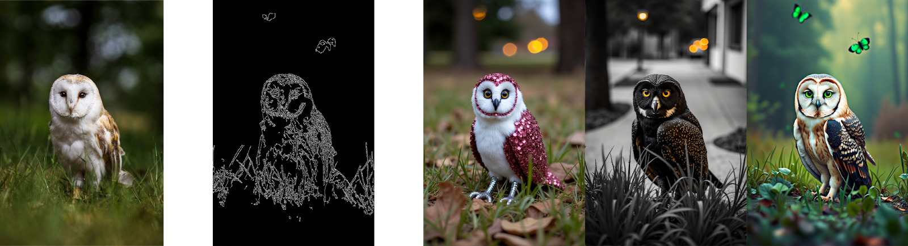
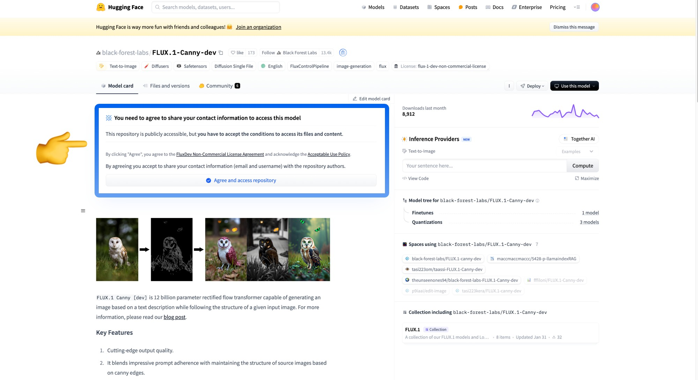
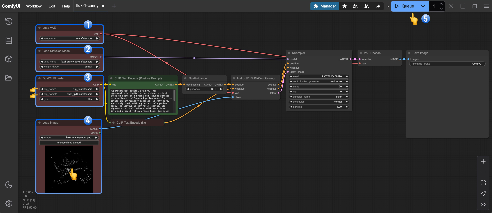
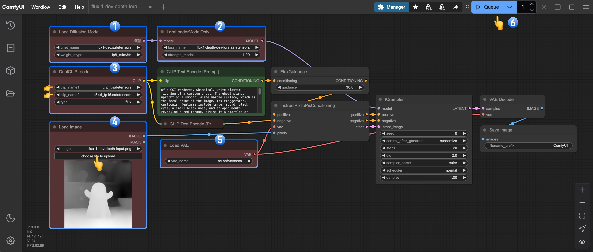

## FLUX.1 ControlNet モデルの紹介

FLUX.1 Canny と Depth は、[Black Forest Labs](https://blackforestlabs.ai/) が公開した [FLUX.1 Tools](https://blackforestlabs.ai/flux-1-tools/) に含まれる2つの強力なモデルです。このツールキットは FLUX.1 に制御とガイダンスの機能を追加するために設計されており、ユーザーが実画像や生成済み画像を修正・再生成できるようにします。

**FLUX.1-Depth-dev** と **FLUX.1-Canny-dev** は、いずれも120億パラメータの Rectified Flow Transformer モデルで、テキストによる説明に基づいて画像を生成しながら、入力画像の構造的特徴を維持することができます。  
Depth 版は深度マップ抽出技術によってソース画像の空間構造を保持し、Canny 版はエッジ検出技術によってソース画像の構造的特徴を保持します。ユーザーは用途に応じて適切な制御方法を選択できます。

両モデルには以下の特長があります：
- 最高水準の出力品質とディテール表現
- オリジナル画像との一貫性を保ちながら、優れたプロンプト追従能力を発揮
- 効率向上のため、ガイド付き蒸留技術を用いて学習
- 研究コミュニティ向けにオープンな重みを公開
- API インターフェース（プロ版）およびオープンソースの重み（dev 版）

さらに Black Forest Labs は、完全版モデルから抽出されたアダプター版 **FLUX.1-Depth-dev-lora** と **FLUX.1-Canny-dev-lora** も提供しています。  
これらは FLUX.1 [dev] ベースモデルに適用することで、より小さなファイルサイズで同様の機能を実現でき、特にリソースが限られた環境に適しています。

本チュートリアルでは、**FLUX.1-Canny-dev** の完全版と **FLUX.1-Depth-dev-lora** を用いてワークフローの例を完成させます。

<Tip>
すべてのワークフロー画像のメタデータには、対応するモデルのダウンロード情報が含まれています。ワークフローは以下の方法で読み込めます：
- ComfyUI に直接ドラッグ＆ドロップする
- またはメニュー `Workflows` -> `Open（ctrl+o）` を使用する

デスクトップ版を使用していない場合、または一部のモデルを自動でダウンロードできない場合は、手動インストールのセクションを参照して、モデルファイルを対応するフォルダーに保存してください。

画像の前処理には、以下のカスタムノードを使用して画像の前処理を完了できます。この例では、前処理済みの画像を入力として提供します。
- [ComfyUI-Advanced-ControlNet](https://github.com/Kosinkadink/ComfyUI-Advanced-ControlNet)
- [ComfyUI ControlNet aux](https://github.com/Fannovel16/comfyui_controlnet_aux)
</Tip>

## FLUX.1-Canny-dev 完全版ワークフロー

### Flux.1 Canny モデル {#flux_canny_model_example}

Flux.1 Canny を使用して、エッジ検出にガイドされた画像を生成します。


<CardGroup cols={2}>
  <Card title="Comfy Cloud で実行" icon="cloud" href="https://cloud.comfy.org/?template=flux_canny_model_example&utm_source=docs&utm_medium=referral&utm_campaign=flux-1-controlnet">
    Comfy Cloud で開く
  </Card>
  <Card title="ワークフローをダウンロード" icon="download" href="https://github.com/Comfy-Org/workflow_templates/blob/main/templates/flux_canny_model_example.json">
    JSON をダウンロードするか、テンプレートライブラリで &quot;Flux.1 Canny&quot; を検索してください
  </Card>
</CardGroup>

**入力素材**

このファイルを対応する `LoadImage` ノードにアップロードしてください：

<CardGroup cols={2}>
  <Card title="flux_canny_model_example_input_image.png" icon="image" href="https://raw.githubusercontent.com/Comfy-Org/workflow_templates/main/input/flux_canny_model_example_input_image.png">
    `LoadImage` ノード 17 · `flux_canny_model_example_input_image.png`
  </Card>
</CardGroup>

<div style={{display: 'grid', gridTemplateColumns: 'repeat(2, minmax(0, 1fr))', gap: '1rem', alignItems: 'start'}}>
  
</div>

### 1. ワークフローとアセット

### 2. モデルの手動インストール

<Note>
以前に [Flux 関連ワークフローの完全版](/ja/tutorials/flux/flux-1-text-to-image) を使用したことがある場合は、**flux1-canny-dev.safetensors** モデルファイルをダウンロードするだけで済みます。
まず [black-forest-labs/FLUX.1-Canny-dev](https://huggingface.co/black-forest-labs/FLUX.1-Canny-dev) の利用規約に同意する必要があるため、[black-forest-labs/FLUX.1-Canny-dev](https://huggingface.co/black-forest-labs/FLUX.1-Canny-dev) のページにアクセスし、下図に示すとおり、対応する利用規約に同意済みであることを確認してください。

</Note>

完全なモデル一覧：
- [clip_l.safetensors](https://huggingface.co/comfyanonymous/flux_text_encoders/blob/main/clip_l.safetensors?download=true)
- [t5xxl_fp16.safetensors](https://huggingface.co/comfyanonymous/flux_text_encoders/blob/main/t5xxl_fp16.safetensors?download=true)
- [ae.safetensors](https://huggingface.co/black-forest-labs/FLUX.1-schnell/blob/main/ae.safetensors?download=true)
- [flux1-canny-dev.safetensors](https://huggingface.co/black-forest-labs/FLUX.1-Canny-dev/blob/main/flux1-canny-dev.safetensors?download=true)（対応するリポジトリの利用規約に同意済みであることを確認してください）

ファイルの保存場所：
```
ComfyUI/
├── models/
│   ├── text_encoders/
│   │   ├── clip_l.safetensors
│   │   └── t5xxl_fp16.safetensors
│   ├── vae/
│   │   └── ae.safetensors
│   └── diffusion_models/
│       └── flux1-canny-dev.safetensors
```

### 3. ワークフローのステップバイステップ実行



1. `Load VAE` ノードに `ae.safetensors` が読み込まれていることを確認してください
2. `Load Diffusion Model` ノードに `flux1-canny-dev.safetensors` が読み込まれていることを確認してください
3. `DualCLIPLoader` ノードに以下のモデルが読み込まれていることを確認してください：
   - clip_name1: t5xxl_fp16.safetensors
   - clip_name2: clip_l.safetensors
4. 提供された入力画像を `Load Image` ノードにアップロードしてください
5. `Queue` ボタンをクリックするか、ショートカット `Ctrl(cmd) + Enter` を使用してワークフローを実行してください

### 4. 実験を始めましょう

[FLUX.1-Depth-dev](https://huggingface.co/black-forest-labs/FLUX.1-Depth-dev) モデルを使用して、ワークフローの Depth 版を完成させてみてください。

以下の画像を入力として使用できます。  


または、画像の前処理を完了するには、以下のカスタムノードを使用してください：
- [ComfyUI-Advanced-ControlNet](https://github.com/Kosinkadink/ComfyUI-Advanced-ControlNet)
- [ComfyUI ControlNet aux](https://github.com/Fannovel16/comfyui_controlnet_aux)

## FLUX.1-Depth-dev-lora ワークフロー

### Flux.1 Depth LoRA {#flux_depth_lora_example}

Flux.1 LoRA を使用して、深度情報に基づいた画像を生成します。


<CardGroup cols={2}>
  <Card title="Comfy Cloud で実行" icon="cloud" href="https://cloud.comfy.org/?template=flux_depth_lora_example&utm_source=docs&utm_medium=referral&utm_campaign=flux-1-controlnet">
    Comfy Cloud で開く
  </Card>
  <Card title="ワークフローをダウンロード" icon="download" href="https://github.com/Comfy-Org/workflow_templates/blob/main/templates/flux_depth_lora_example.json">
    JSON をダウンロードするか、テンプレートライブラリで &quot;Flux.1 Depth LoRA&quot; を検索してください
  </Card>
</CardGroup>

**入力素材**

このファイルを対応する `LoadImage` ノードにアップロードしてください。

<CardGroup cols={2}>
  <Card title="flux_depth_lora_example_input_image.png" icon="image" href="https://raw.githubusercontent.com/Comfy-Org/workflow_templates/main/input/flux_depth_lora_example_input_image.png">
    `LoadImage` ノード 17 · `flux_depth_lora_example_input_image.png`
  </Card>
</CardGroup>

<div style={{display: 'grid', gridTemplateColumns: 'repeat(2, minmax(0, 1fr))', gap: '1rem', alignItems: 'start'}}>
  
</div>

### 1. ワークフローとアセット

### 2. モデルの手動ダウンロード

<Tip>
以前に [Flux 関連ワークフローの完全版](/ja/tutorials/flux/flux-1-text-to-image) を使用したことがある場合は、**flux1-depth-dev-lora.safetensors** モデルファイルのみをダウンロードすれば十分です。
</Tip>

モデル一覧：
- [clip_l.safetensors](https://huggingface.co/comfyanonymous/flux_text_encoders/blob/main/clip_l.safetensors?download=true)
- [t5xxl_fp16.safetensors](https://huggingface.co/comfyanonymous/flux_text_encoders/blob/main/t5xxl_fp16.safetensors?download=true)
- [ae.safetensors](https://huggingface.co/black-forest-labs/FLUX.1-schnell/blob/main/ae.safetensors?download=true)
- [flux1-dev.safetensors](https://huggingface.co/black-forest-labs/FLUX.1-dev/blob/main/flux1-dev.safetensors?download=true)
- [flux1-depth-dev-lora.safetensors](https://huggingface.co/black-forest-labs/FLUX.1-Depth-dev-lora/blob/main/flux1-depth-dev-lora.safetensors?download=true)

ファイルの保存場所：
```
ComfyUI/
├── models/
│   ├── text_encoders/
│   │   ├── clip_l.safetensors
│   │   └── t5xxl_fp16.safetensors
│   ├── vae/
│   │   └── ae.safetensors
│   ├── diffusion_models/
│   │   └── flux1-dev.safetensors
│   └── loras/
│       └── flux1-depth-dev-lora.safetensors
```

### 3. ワークフローのステップごとの実行



1. `Load Diffusion Model` ノードに `flux1-dev.safetensors` が読み込まれていることを確認してください。
2. `LoraLoaderModelOnly` ノードに `flux1-depth-dev-lora.safetensors` が読み込まれていることを確認してください。
3. `DualCLIPLoader` ノードに以下のモデルが読み込まれていることを確認してください：
   - clip_name1: t5xxl_fp16.safetensors
   - clip_name2: clip_l.safetensors
4. `Load Image` ノードで提供された入力画像をアップロードしてください。
5. `Load VAE` ノードに `ae.safetensors` が読み込まれていることを確認してください。
6. `Queue` ボタンをクリックするか、ショートカット `Ctrl(cmd) + Enter` を使用してワークフローを実行してください。

### 4. 実験を開始しましょう

[FLUX.1-Canny-dev-lora](https://huggingface.co/black-forest-labs/FLUX.1-Canny-dev-lora) モデルを使用して、ワークフローの Canny 版を完成させてみてください。

画像の前処理を完了するには、[ComfyUI-Advanced-ControlNet](https://github.com/Kosinkadink/ComfyUI-Advanced-ControlNet) または [ComfyUI ControlNet aux](https://github.com/Fannovel16/comfyui_controlnet_aux) を使用してください。

## Flux ControlNet のコミュニティ版

XLab および InstantX＋Shakker Labs が、Flux 向けの ControlNet を公開しています。

**InstantX:**
- [FLUX.1-dev-Controlnet-Canny](https://huggingface.co/InstantX/FLUX.1-dev-Controlnet-Canny/blob/main/diffusion_pytorch_model.safetensors)
- [FLUX.1-dev-ControlNet-Depth](https://huggingface.co/Shakker-Labs/FLUX.1-dev-ControlNet-Depth/blob/main/diffusion_pytorch_model.safetensors)
- [FLUX.1-dev-ControlNet-Union-Pro](https://huggingface.co/Shakker-Labs/FLUX.1-dev-ControlNet-Union-Pro/blob/main/diffusion_pytorch_model.safetensors)

**XLab**: [flux-controlnet-collections](https://huggingface.co/XLabs-AI/flux-controlnet-collections) 

これらのファイルは `ComfyUI/models/controlnet` ディレクトリに配置してください。

対応するワークフロー画像は、[Flux Controlnet 使用例](https://raw.githubusercontent.com/comfyanonymous/ComfyUI_examples/refs/heads/master/flux/flux_controlnet_example.png) から取得できます。入力画像には、[こちら](https://raw.githubusercontent.com/comfyanonymous/ComfyUI_examples/refs/heads/master/flux/girl_in_field.png) の画像をご利用ください。
