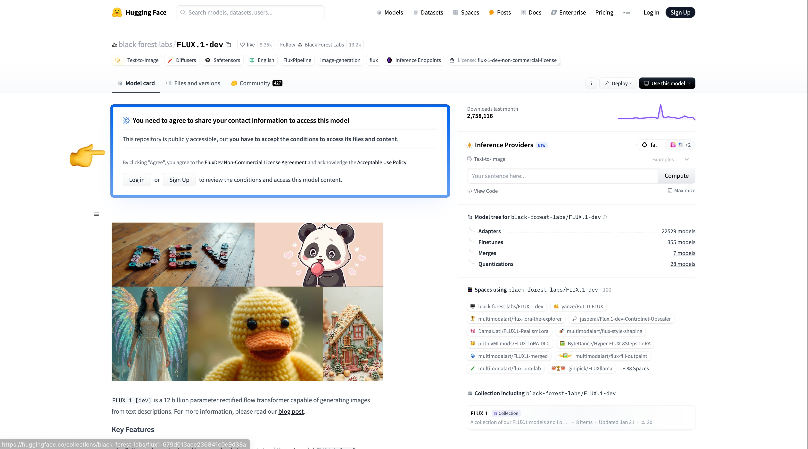
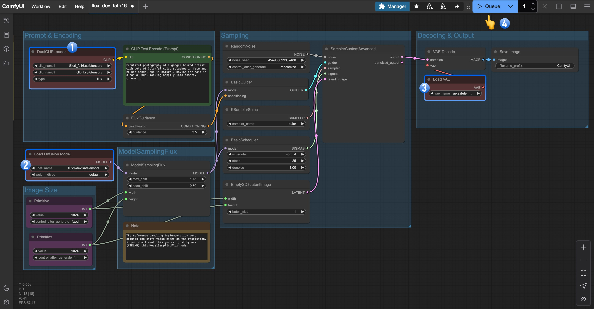
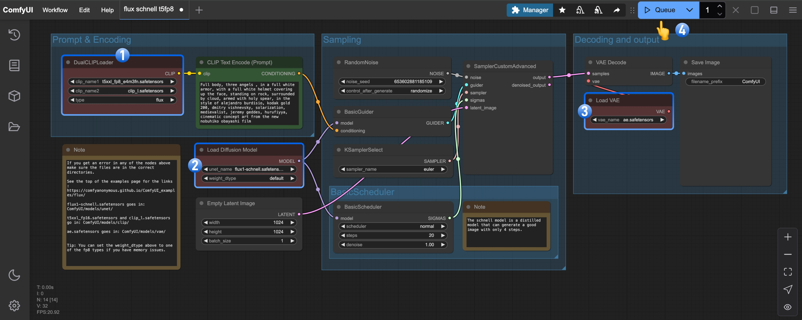

Flux は、現時点で最も大規模なオープンソースのテキストから画像へ生成するモデルの一つであり、120億（12B）パラメータを有し、オリジナルファイルサイズは約23GBです。このモデルは、元 Stable Diffusion チームのメンバーによって設立された [Black Forest Labs](https://blackforestlabs.ai/) が開発しました。
Flux は、優れた画像品質と高い柔軟性で知られており、高品質かつ多様な画像を生成できます。

現在、Flux.1 モデルには以下の主なバージョンがあります：
- **Flux.1 Pro：** 最も高性能なモデルですが、クローズドソースであり、API 経由でのみ利用可能です。
- **[Flux.1 [dev]：](https://huggingface.co/black-forest-labs/FLUX.1-dev)** オープンソースですが、非商用利用に限定されており、Pro バージョンから蒸留されたもので、その性能は Pro バージョンに近いです。
- **[Flux.1 [schnell]：](https://huggingface.co/black-forest-labs/FLUX.1-schnell)** Apache2.0 ライセンスを採用しており、画像生成にわずか4ステップしか必要とせず、低スペックのハードウェアに適しています。

**Flux.1 モデルの特徴**
- **ハイブリッドアーキテクチャ：** Transformer ネットワークと拡散モデルの長所を統合し、テキストと画像情報を効果的に統合することで、生成画像とプロンプトとの整合精度を向上させます。複雑なプロンプトに対しても、高い忠実度で再現できます。
- **パラメータ規模：** Flux は120億（12B）パラメータを有し、より複雑なパターン関係を捉えることができ、よりリアルで多様な画像を生成します。
- **複数のスタイル対応：** 多様なスタイルをサポートしており、さまざまな種類の画像に対して優れた性能を発揮します。

本例では、Flux.1 Dev および Flux.1 Schnell の両方のバージョンを用いたテキストから画像への生成例を紹介します。これには、完全版モデルおよび簡略化された FP8 Checkpoint バージョンが含まれます。

- **Flux 完全版：** 最高の性能を発揮しますが、より大きな VRAM リソースを必要とし、複数のモデルファイルのインストールが必要です。
- **Flux FP8 Checkpoint：** FP8 形式の単一モデルファイルのみを必要としますが、完全版と比較して画質はやや低下します。

<Tip>
すべてのワークフロー画像のメタデータには、対応するモデルのダウンロード情報が含まれています。ワークフローを読み込むには、以下のいずれかの方法をご利用ください：
- 画像を直接 ComfyUI にドラッグ＆ドロップする
- またはメニューから `Workflows` -> `Open（ctrl+o）` を選択する

デスクトップ版を使用していない場合、あるいは一部のモデルが自動ダウンロードできない場合は、手動インストールのセクションを参照し、モデルファイルを対応するフォルダーに保存してください。
開始前に、ComfyUI が最新バージョンに更新されていることを確認してください。
</Tip>

## Flux.1 完全版によるテキストから画像へ生成の例

<Note>
[black-forest-labs/FLUX.1-dev](https://huggingface.co/black-forest-labs/FLUX.1-dev) からモデルをダウンロードできない場合は、Hugging Face にログインし、該当リポジトリのライセンス契約に同意していることを確認してください。

</Note>

### Flux.1 Dev

### Flux.1 Dev fp8: テキストから画像へ生成 {#flux_dev_checkpoint_example}

Flux.1 Dev fp8 量子化バージョンを使用して画像を生成します。VRAM が限られたデバイスに適しており、必要なモデルファイルは1つだけですが、完全版と比較して画質はわずかに低下します。


<CardGroup cols={2}>
  <Card title="Comfy Cloud で実行" icon="cloud" href="https://cloud.comfy.org/?template=flux_dev_checkpoint_example&utm_source=docs&utm_medium=referral&utm_campaign=flux-1-text-to-image">
    このワークフローを Comfy Cloud で実行
  </Card>
  <Card title="ワークフローをダウンロード" icon="download" href="https://github.com/Comfy-Org/workflow_templates/blob/main/templates/flux_dev_checkpoint_example.json">
    JSON をダウンロードするか、テンプレートライブラリで「Flux.1 Dev fp8」を検索してください
  </Card>
</CardGroup>

**出力例**


#### 1. ワークフローファイル

#### 2. モデルの手動インストール

<Note>
- `flux1-dev.safetensors` ファイルは、ブラウザからダウンロードする前に、[black-forest-labs/FLUX.1-dev](https://huggingface.co/black-forest-labs/FLUX.1-dev) のライセンス契約に同意する必要があります。
- VRAM が少ない環境では、`t5xxl_fp16.safetensors` の代わりに [t5xxl_fp8_e4m3fn.safetensors](https://huggingface.co/comfyanonymous/flux_text_encoders/blob/main/t5xxl_fp8_e4m3fn.safetensors?download=true) を使用することを試してみてください。
</Note>

以下のモデルファイルをダウンロードしてください：
- [clip_l.safetensors](https://huggingface.co/comfyanonymous/flux_text_encoders/blob/main/clip_l.safetensors?download=true)
- [t5xxl_fp16.safetensors](https://huggingface.co/comfyanonymous/flux_text_encoders/blob/main/t5xxl_fp16.safetensors?download=true) VRAM が32GBを超える環境で推奨されます。
- [ae.safetensors](https://huggingface.co/black-forest-labs/FLUX.1-schnell/blob/main/ae.safetensors?download=true)
- [flux1-dev.safetensors](https://huggingface.co/black-forest-labs/FLUX.1-dev/blob/main/flux1-dev.safetensors) 

保存先：
```
ComfyUI/
├── models/
│   ├── text_encoders/
│   │   ├── clip_l.safetensors
│   │   └── t5xxl_fp16.safetensors
│   ├── vae/
│   │   └── ae.safetensors
│   └── diffusion_models/
│       └── flux1-dev.safetensors
```

#### 3. ワークフロー実行手順

すべてのモデルファイルが正しく読み込まれていることを確認するため、以下の画像を参照してください。



1. `DualCLIPLoader` ノードに以下のモデルが読み込まれていることを確認してください：
   - clip_name1: t5xxl_fp16.safetensors
   - clip_name2: clip_l.safetensors
2. `Load Diffusion Model` ノードに `flux1-dev.safetensors` が読み込まれていることを確認してください
3. `Load VAE` ノードに `ae.safetensors` が読み込まれていることを確認してください
4. `Queue` ボタンをクリックするか、ショートカット `Ctrl(cmd) + Enter` を使用してワークフローを実行してください

<Tip>
Flux の優れたプロンプト追従能力により、ネガティブプロンプトは不要です。
</Tip>
### Flux.1 Schnell

### Flux.1 Schnell FP8 {#flux_schnell}

Flux.1 Schnell fp8 量子化バージョンで画像を素早く生成します。低スペックなハードウェアに最適で、画像生成にはわずか4ステップで済みます。


<CardGroup cols={2}>
  <Card title="Comfy Cloud で実行" icon="cloud" href="https://cloud.comfy.org/?template=flux_schnell&utm_source=docs&utm_medium=referral&utm_campaign=flux-1-text-to-image">
    このワークフローを Comfy Cloud で実行
  </Card>
  <Card title="ワークフローをダウンロード" icon="download" href="https://github.com/Comfy-Org/workflow_templates/blob/main/templates/flux_schnell_full_text_to_image.json">
    JSON をダウンロードするか、テンプレートライブラリで「Flux.1 Schnell」を検索してください
  </Card>
</CardGroup>

#### 1. ワークフローファイル

#### 2. モデルの手動インストール

<Note>
本ワークフローでは、Flux1 Dev バージョンのワークフローと異なるモデルファイルは2つだけです。t5xxl については、より良い結果を得るために引き続き fp16 バージョンを使用できます。
- **t5xxl_fp16.safetensors** -> **t5xxl_fp8.safetensors**
- **flux1-dev.safetensors** -> **flux1-schnell.safetensors** 
</Note>

完全なモデルファイル一覧：
- [clip_l.safetensors](https://huggingface.co/comfyanonymous/flux_text_encoders/blob/main/clip_l.safetensors?download=true)
- [t5xxl_fp8_e4m3fn.safetensors](https://huggingface.co/comfyanonymous/flux_text_encoders/blob/main/t5xxl_fp8_e4m3fn.safetensors?download=true)
- [ae.safetensors](https://huggingface.co/black-forest-labs/FLUX.1-schnell/blob/main/ae.safetensors?download=true)
- [flux1-schnell.safetensors](https://huggingface.co/black-forest-labs/FLUX.1-schnell/blob/main/flux1-schnell.safetensors) 

ファイルの保存先：
```
ComfyUI/
├── models/
│   ├── text_encoders/
│   │   ├── clip_l.safetensors
│   │   └── t5xxl_fp8_e4m3fn.safetensors
│   ├── vae/
│   │   └── ae.safetensors
│   └── diffusion_models/
│       └── flux1-schnell.safetensors
```

#### 3. ワークフロー実行手順



1. `DualCLIPLoader` ノードに以下のモデルが読み込まれていることを確認してください：
   - clip_name1: t5xxl_fp8_e4m3fn.safetensors
   - clip_name2: clip_l.safetensors
2. `Load Diffusion Model` ノードに `flux1-schnell.safetensors` が読み込まれていることを確認してください
3. `Load VAE` ノードに `ae.safetensors` が読み込まれていることを確認してください
4. `Queue` ボタンをクリックするか、ショートカット `Ctrl(cmd) + Enter` を使用してワークフローを実行してください

## Flux.1 FP8 チェックポイントバージョンによるテキストから画像への生成例

fp8 バージョンは、オリジナルの Flux.1 fp16 バージョンを量子化したものです。
このバージョンの品質はある程度 fp16 バージョンより低くなりますが、
必要な VRAM も少なくなり、試しに実行するにはモデルファイルを1つインストールするだけで済みます。

### Flux.1 Dev

### Flux.1 Dev: テキストから画像へ {#flux_dev_full_text_to_image}

Flux Dev フルバージョンで高品質な画像を生成します。より多くの VRAM と複数のモデルファイルが必要ですが、最高のプロンプト追従性を提供します。


<CardGroup cols={2}>
  <Card title="Comfy Cloud で実行" icon="cloud" href="https://cloud.comfy.org/?template=flux_dev_full_text_to_image&utm_source=docs&utm_medium=referral&utm_campaign=flux-1-text-to-image">
    このワークフローを Comfy Cloud で実行します
  </Card>
  <Card title="ワークフローをダウンロード" icon="download" href="https://github.com/Comfy-Org/workflow_templates/blob/main/templates/flux_dev_full_text_to_image.json">
    JSON をダウンロードするか、テンプレートライブラリで &quot;Flux.1 Dev FP8&quot; を検索してください
  </Card>
</CardGroup>

**出力例**


下記の画像をダウンロードし、ComfyUI にドラッグしてワークフローを読み込んでください。

[flux1-dev-fp8.safetensors](https://huggingface.co/Comfy-Org/flux1-dev/blob/main/flux1-dev-fp8.safetensors?download=true) をダウンロードし、`ComfyUI/models/checkpoints/` ディレクトリに保存してください。

対応する `Load Checkpoint` ノードが `flux1-dev-fp8.safetensors` を読み込むことを確認したら、ワークフローの実行を試してみてください。

### Flux.1 Schnell

### Flux.1 Schnell FP8 {#flux_schnell}

Flux.1 Schnell fp8 量子化バージョンで画像をすばやく生成します。低スペックなハードウェアに最適で、画像の生成にはわずか4ステップしか必要ありません。


<CardGroup cols={2}>
  <Card title="Comfy Cloud で実行" icon="cloud" href="https://cloud.comfy.org/?template=flux_schnell&utm_source=docs&utm_medium=referral&utm_campaign=flux-1-text-to-image">
    このワークフローを Comfy Cloud で実行します
  </Card>
  <Card title="ワークフローをダウンロード" icon="download" href="https://github.com/Comfy-Org/workflow_templates/blob/main/templates/flux_schnell.json">
    JSON をダウンロードするか、テンプレートライブラリで &quot;Flux.1 Schnell FP8&quot; を検索してください
  </Card>
</CardGroup>

下記の画像をダウンロードし、ComfyUI にドラッグしてワークフローを読み込んでください。

[flux1-schnell-fp8.safetensors](https://huggingface.co/Comfy-Org/flux1-schnell/blob/main/flux1-schnell-fp8.safetensors?download=true) をダウンロードし、`ComfyUI/models/checkpoints/` ディレクトリに保存してください。

対応する `Load Checkpoint` ノードが `flux1-schnell-fp8.safetensors` を読み込むことを確認したら、ワークフローの実行を試してみてください。
