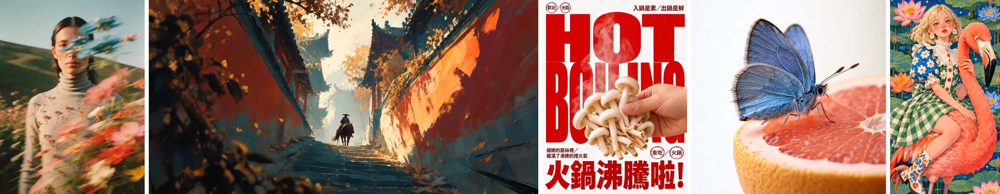
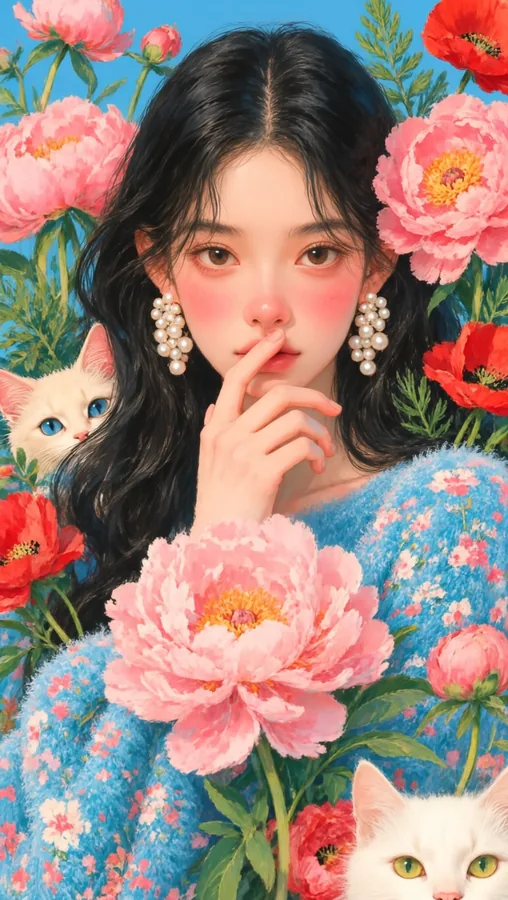
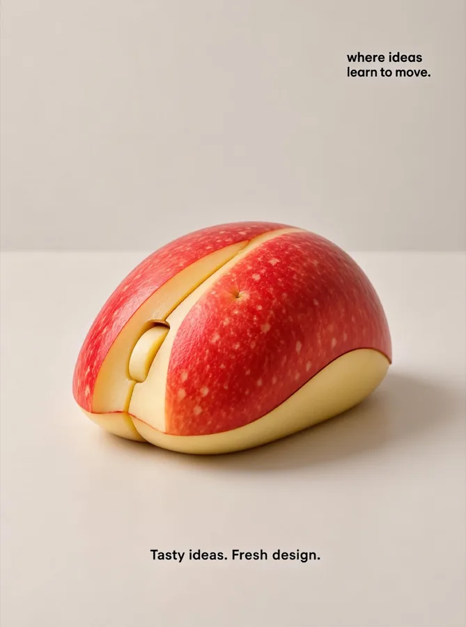
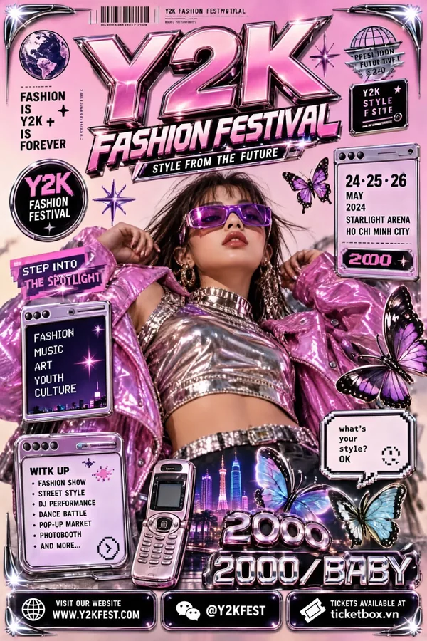
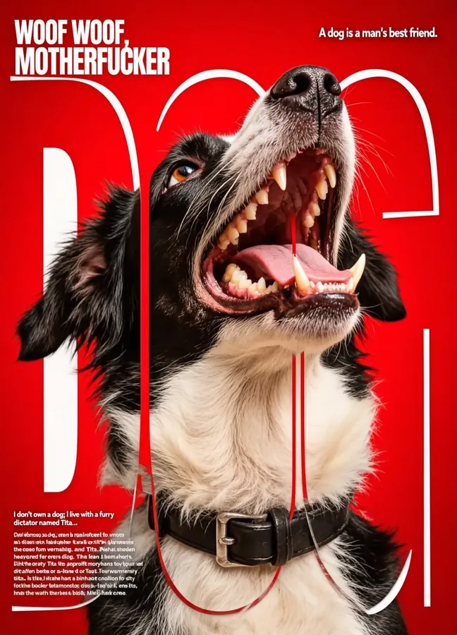
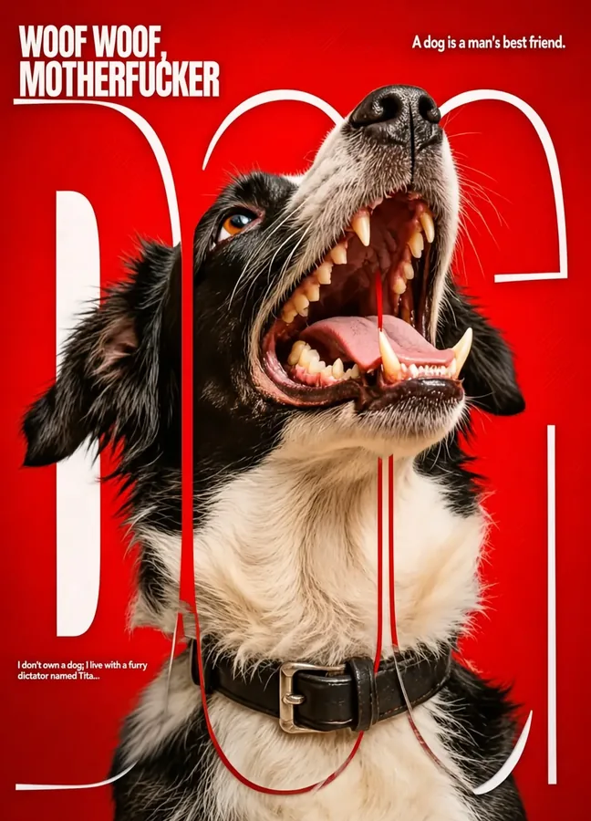
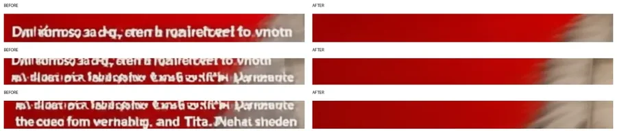
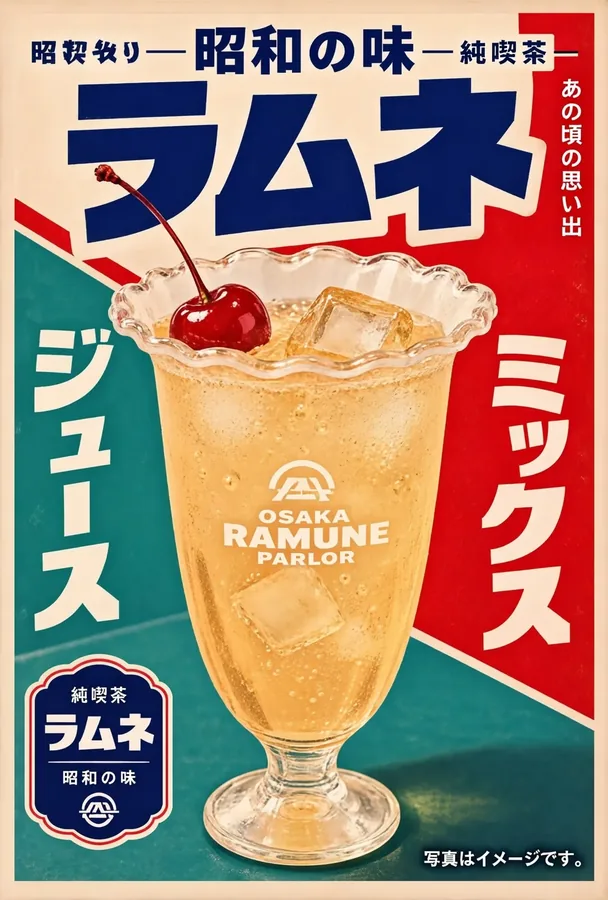
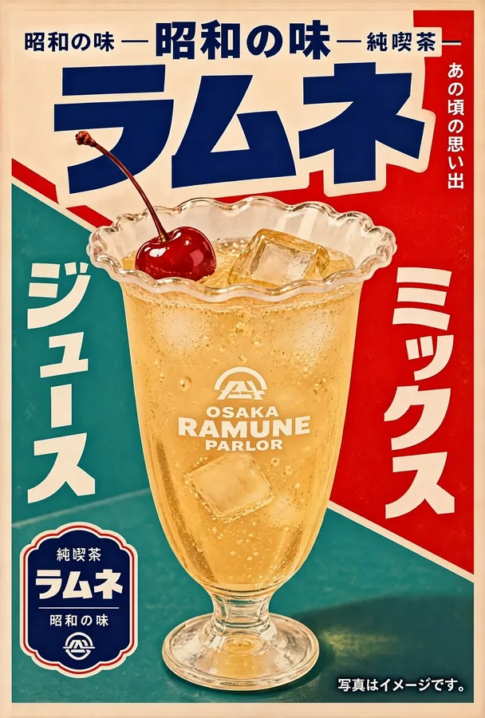
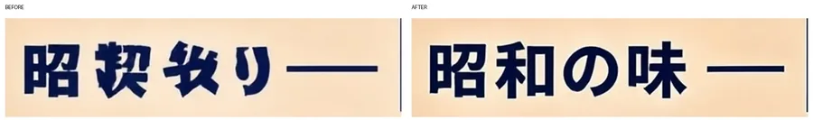

import UpdateReminder from '/snippets/ja/tutorials/update-reminder.mdx'



**SenseNova-U1.6** は統合マルチモーダルモデルです。視覚理解と画像生成が 1 つの 8B `mot` 基盤で動作するため、同じモデルがプロンプトも参照画像も読み取り、結果を返します。人物写真、ポスター、イラスト、インフォグラフィックなど、正確さと見栄えの両方が重要な作業を対象としています。

さらに自律的な自己修正パスも備えています。結果が返ったあと、モデルは自分の出力をプロンプトと比較し、一致しない箇所があれば再生成します。パスは最大 5 回です。

**ハイライト**:
- **1 つの基盤で 2 方向**: 同じ 8B `mot` モデルが解釈と描画の両方を担い、テキストからの画像生成と、参照画像による編集に対応します。
- **自律的な自己修正**: モデルが自分の出力をプロンプトと比較し、最大 5 回まで再生成します。
- **2 つのサンプリングモード**: Turbo は 8 ステップ LoRA で 8 ステップ、CFG 1.0。Quality は LoRA を使わず 50 ステップ、CFG 4.0。
- **繊細な美意識と豊かな表現**：主観評価で総合的な美観品質が U1.5 より **10% 向上**。人物・実写、アート作品、インフォグラフィックごとに美的報酬モデルを分けて学習しています。
- **自律的な振り返り**：UltraTextBench の高密度インフォグラフィックで、自己修正ループは単発生成に対して平均 **7% の相対改善**をもたらします。
- **任意の PE プロンプト書き換え**: Qwen Image 2.1 の PE テキストエンコーダーが短いプロンプトを完全な視覚的記述に展開し、画像内に入れる文字をそのまま書き出します。

**公式リンク**:
- [Hugging Face: Comfy-Org/SenseNova-U1](https://huggingface.co/Comfy-Org/SenseNova-U1)（チェックポイントと 8 ステップ LoRA）
- [GitHub: OpenSenseNova/SenseNova-U1](https://github.com/OpenSenseNova/SenseNova-U1)
- [Hugging Face: sensenova/SenseNova-U1.6-8B-MoT](https://huggingface.co/sensenova/SenseNova-U1.6-8B-MoT)（公式のモデルウェイト）
- [Hugging Face: sensenova/SenseNova-U1.6-8B-MoT-LoRAs](https://huggingface.co/sensenova/SenseNova-U1.6-8B-MoT-LoRAs)（公式の 8 ステップ LoRA）

どちらのテンプレートも ComfyUI 0.46.0 以降が必要です。

## 作例

以下は SenseNova 公式の作例 6 点で、本ワークフローで生成したものではありません。モデルが狙う創作領域をひととおり含みます。公式の位置づけは「創造的な視覚表現」と「ネイティブな自己修正」の両立で、美しさと正確さを同時に届けることを狙っています。

### 写真・イラスト・ポスター

<Columns cols={2}>
  <Frame caption="スローシャッター：人物はシャープなまま、群衆が横に流れる。">
    
  </Frame>
  <Frame caption="高速撮影の物撮り：宙に浮くグラスと飛沫を静止させた一枚。">
    
  </Frame>
  <Frame caption="イラスト：花と猫に囲まれた青い服の少女。">
    
  </Frame>
  <Frame caption="イラスト：オレンジの光に包まれた霧の山並み。">
    
  </Frame>
  <Frame caption="ポスター：見出しのタイポグラフィ「Tasty ideas. Fresh design.」">
    
  </Frame>
  <Frame caption="ポスター：Y2K ファッション・フェス、フラットなスタジオ背景にピクセル書体。">
    
  </Frame>
</Columns>

## 自己修正の実例

いずれも同じプロンプトと同じシードで、1 回の生成と「生成 / 確認 / 修正」ループを比較したものです。3 枚目は修正された文字の部分拡大です。

<Columns cols={3}>
  <Frame caption="赤いペットポスター · 修正前">
    
  </Frame>
  <Frame caption="赤いペットポスター · 修正後">
    
  </Frame>
  <Frame caption="赤いペットポスター · 部分比較">
    
  </Frame>
</Columns>

<Columns cols={3}>
  <Frame caption="昭和レトロ飲料ポスター · 修正前">
    
  </Frame>
  <Frame caption="昭和レトロ飲料ポスター · 修正後">
    
  </Frame>
  <Frame caption="昭和レトロ飲料ポスター · 部分比較">
    
  </Frame>
</Columns>

## テキストから画像へのワークフロー

<UpdateReminder />

### SenseNova U1.6: テキストから画像へ {#image_sensenova_u16_t2i}

書いたシーンを完成した画像にします。モデルはプロンプトを読み、視覚的なディテールを補い、選んだアスペクト比で 4 メガピクセルの画像を返します。


<CardGroup cols={2}>
  <Card title="Comfy Cloud で実行" icon="cloud" href="https://cloud.comfy.org/?template=image_sensenova_u16_t2i&utm_source=docs&utm_medium=referral&utm_campaign=sensenova-u1-6">
    Comfy Cloud で開く
  </Card>
  <Card title="ワークフローをダウンロード" icon="download" href="https://github.com/Comfy-Org/workflow_templates/blob/main/templates/image_sensenova_u16_t2i.json">
    JSON をダウンロードするか、テンプレートライブラリで &quot;SenseNova U1.6: Text to Image&quot; を検索してください
  </Card>
</CardGroup>

**出力例**


#### ワークフローファイル

ComfyUI を更新したら、テンプレートライブラリからテンプレートを開くか、上のプレビューを ComfyUI にドラッグして読み込みます。

ワークフローには 2 つのパイプラインがあります:
- **Base パイプライン**: 1 回の生成パス。人物写真、写真表現、ポスター、一般的なイラスト向けです。
- **自己修正パイプライン**: 生成、レビュー、修正を最大 5 回繰り返してからデコードします。インフォグラフィック、密なテキスト、グラフ、手順図に最適です。

キャンバス上のスイッチで、パイプライン、Turbo LoRA、ステップ数と CFG の値を選びます。

#### モデルのダウンロード

**チェックポイント**

- [sensenova_u1.6_8b_mot_int8_convrot.safetensors](https://huggingface.co/Comfy-Org/SenseNova-U1/resolve/main/checkpoints/sensenova_u1.6_8b_mot_int8_convrot.safetensors)

**LoRA（Turbo モード）**

- [sensenova_u1.6_8b_mot_8step_lora_bf16.safetensors](https://huggingface.co/Comfy-Org/SenseNova-U1/resolve/main/loras/sensenova_u1.6_8b_mot_8step_lora_bf16.safetensors)

**テキストエンコーダー（PE）**

- [qwen3.5_9b_qwen_image_2.1_pe_t2i.int8_convrot.safetensors](https://huggingface.co/Comfy-Org/Qwen-Image-2.1/resolve/main/text_encoders/qwen3.5_9b_qwen_image_2.1_pe_t2i.int8_convrot.safetensors)（8.82 GB）

**モデルの保存場所**

```
📂 ComfyUI/
├── 📂 models/
│   ├── 📂 checkpoints/
│   │   └── sensenova_u1.6_8b_mot_int8_convrot.safetensors
│   ├── 📂 loras/
│   │   └── sensenova_u1.6_8b_mot_8step_lora_bf16.safetensors
│   └── 📂 text_encoders/
│       └── qwen3.5_9b_qwen_image_2.1_pe_t2i.int8_convrot.safetensors
```

#### サンプリング設定

| モード | ステップ数 | CFG |
| --- | --- | --- |
| **Turbo**（8 ステップ LoRA） | 8 | 1.0 |
| **Quality**（LoRA なし） | 50 | 4.0 |

- **Turbo Mode?** は 8 ステップ LoRA を読み込むかどうかを切り替えます。試行中はオンのままにし、文字の再現性と細部を最大化したいときはオフにします。
- **Self-Correction** は生成、レビュー、修正のループを追加します。テキストの多いレイアウトではオン、単純な人物写真ではオフにします。1 パスごとにサンプリングが 1 回増えるためです。
- **Enable PE** は上記のプロンプト書き換えを有効にします。
- **Resolution** は総画素数の予算でキャンバスを決め、プリセットは 1:1 から 21:9 までです。既定は 4:3（Standard）4 メガピクセル、つまり 2368 × 1760 です。

#### プロンプトのヒント

- 画像内に入れたい単語はすべて引用符で囲んでください。引用した文字列はそのまま描画され、引用符の外のテキストが誤りの原因になります。
- PE をオフにする場合は、視覚的な記述を自分で書いてください。1 行の依頼では、このモデルのタイポグラフィとレイアウトの強みは引き出せません。

## 画像編集ワークフロー

### SenseNova U1.6: 画像編集 {#image_sensenova_u16_image_edit}

写真を参照画像として添付し、変更内容を記述して編集します。同じ 8B 基盤が元画像を読み取り、作り直し、元画像自身の解像度とアスペクト比で結果を返します。


<CardGroup cols={2}>
  <Card title="Comfy Cloud で実行" icon="cloud" href="https://cloud.comfy.org/?template=image_sensenova_u16_image_edit&utm_source=docs&utm_medium=referral&utm_campaign=sensenova-u1-6">
    Comfy Cloud で開く
  </Card>
  <Card title="ワークフローをダウンロード" icon="download" href="https://github.com/Comfy-Org/workflow_templates/blob/main/templates/image_sensenova_u16_image_edit.json">
    JSON をダウンロードするか、テンプレートライブラリで &quot;SenseNova U1.6: Image Edit&quot; を検索してください
  </Card>
</CardGroup>

**入力素材**

このファイルを対応する `LoadImage` ノードにアップロードします:

<CardGroup cols={2}>
  <Card title="sensenova_u16_edit_women_in_car.png" icon="image" href="https://raw.githubusercontent.com/Comfy-Org/workflow_templates/main/input/sensenova_u16_edit_women_in_car.png">
    `LoadImage` ノード 79 · `sensenova_u16_edit_women_in_car.png`
  </Card>
</CardGroup>

<div style={{display: 'grid', gridTemplateColumns: 'repeat(2, minmax(0, 1fr))', gap: '1rem', alignItems: 'start'}}>
  
</div>

**出力例**

<div style={{display: 'grid', gridTemplateColumns: 'repeat(2, minmax(0, 1fr))', gap: '1rem', alignItems: 'start'}}>
  
  
</div>

#### ワークフローファイル

ComfyUI を更新したら、テンプレートライブラリからテンプレートを開くか、上のプレビューを ComfyUI にドラッグして読み込みます。

元画像は 4 メガピクセル（モデルの学習レンジ）に縮小され、32 の倍数にパディングされます。出力は元画像の解像度とアスペクト比に従うため、編集後も元の構図が保たれます。

モデルは最大 5 枚の参照画像を扱えます。実際に有効なのは 1 から 4 枚で、1 枚増えるごとに視覚トークンとメモリを消費します。

`ImageCompare` は元画像と結果を並べて表示します。

#### モデルのダウンロード

**チェックポイント**

- [sensenova_u1.6_8b_mot_int8_convrot.safetensors](https://huggingface.co/Comfy-Org/SenseNova-U1/resolve/main/checkpoints/sensenova_u1.6_8b_mot_int8_convrot.safetensors)

**LoRA（Turbo モード）**

- [sensenova_u1.6_8b_mot_8step_lora_bf16.safetensors](https://huggingface.co/Comfy-Org/SenseNova-U1/resolve/main/loras/sensenova_u1.6_8b_mot_8step_lora_bf16.safetensors)

**テキストエンコーダー（PE、画像編集）**

- [qwen3.5_9b_qwen_image_2.1_pe_i2i.int8_convrot.safetensors](https://huggingface.co/Comfy-Org/Qwen-Image-2.1/resolve/main/text_encoders/qwen3.5_9b_qwen_image_2.1_pe_i2i.int8_convrot.safetensors)（8.82 GB）

**モデルの保存場所**

```
📂 ComfyUI/
├── 📂 models/
│   ├── 📂 checkpoints/
│   │   └── sensenova_u1.6_8b_mot_int8_convrot.safetensors
│   ├── 📂 loras/
│   │   └── sensenova_u1.6_8b_mot_8step_lora_bf16.safetensors
│   └── 📂 text_encoders/
│       └── qwen3.5_9b_qwen_image_2.1_pe_i2i.int8_convrot.safetensors
```

#### サンプリング設定

| モード | ステップ数 | CFG |
| --- | --- | --- |
| **Turbo**（8 ステップ LoRA） | 8 | 1.0 |
| **Quality**（LoRA なし） | 50 | 4.0 |

- **Turbo Mode?** は 8 ステップ LoRA を読み込むかどうかを切り替えます。試行中はオンのままにし、文字の再現性と細部を最大化したいときはオフにします。
- **Self-Correction** は編集、レビュー、修正のループを追加します。レイアウトにテキストが含まれるときに効果的です。
- **Enable PE** は元画像と指示を一緒に読み取り、完全な編集プロンプトに展開します。
- **参照画像**が構図を決めます。出力サイズは元画像に従うため、別の形状が必要ならキューに入れる前に元画像を切り抜くかリサイズしてください。

#### プロンプトのヒント

- 何を変えるのかを述べ、変えてはいけない点を列挙します。人物の同一性、構図、ライティング、背景は名指しする価値のあるディテールです。
- 編集後の画像に入れたい単語はすべて引用符で囲んでください。引用した文字列はそのまま描画されます。
- PE をオフにする場合は、変更内容と保持する項目の両方を含む完全な編集指示を自分で書いてください。


#### マルチターン編集

この版にはまだマルチターン編集はありません。1 回の実行は読み込んだ参照画像に対する 1 つの指示で、モデルは実行間で会話履歴を保持しません。今後 LoRA や専用ブランチとして追加される可能性があります。現時点で連続編集する場合は、結果を保存して次の参照画像として読み込み、次の変更を指示してください。


## プロンプト拡張（PE）について

SenseNova U1.6 専用のプロンプト拡張モデルはありません。この 2 つのテンプレートは任意で **Qwen Image 2.1** の PE テキストエンコーダーを読み込みます（テキストから画像は `qwen3.5_9b_qwen_image_2.1_pe_t2i`、画像編集は `..._pe_i2i`）。短いプロンプトを詳細な視覚記述に展開し、画像内に入れる文字をそのまま書き出します。**Enable PE** をオフにすれば元のプロンプトのまま生成します。
