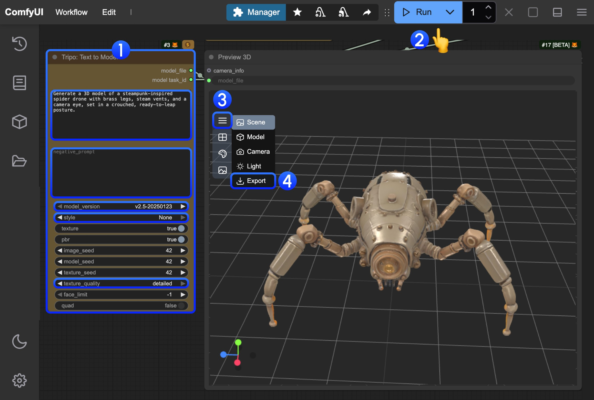
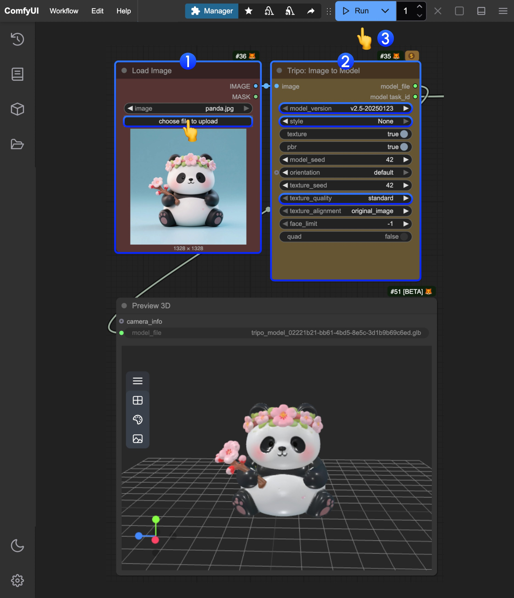
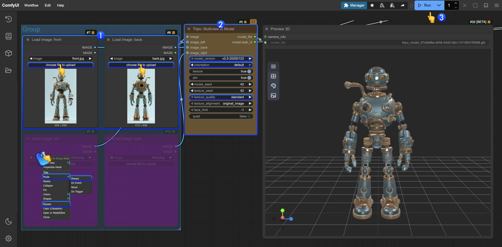
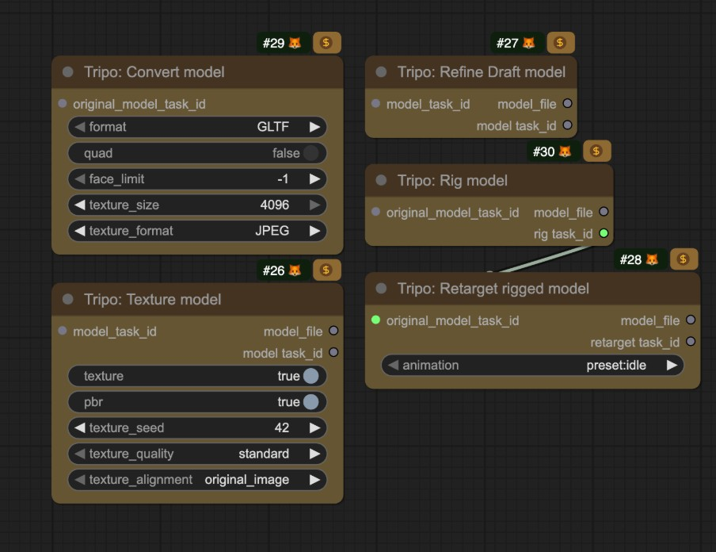

import ReqHint from "/snippets/ja/tutorials/partner-nodes/req-hint.mdx";
import UpdateReminder from "/snippets/ja/tutorials/update-reminder.mdx";

Tripo AIは、生成AIによる3Dモデリングに特化した企業です。テキストプロンプトや2D画像（単一または複数）を高品質な3Dモデルへと迅速に変換できる、ユーザーフレンドリーなプラットフォームとAPIサービスを提供しています。
ComfyUIは現在、対応するTripo APIをネイティブに統合しています。これにより、ComfyUI内の関連ノードを手軽に使用して、モデル生成を行うことができます。

## Tripo モデル生成が得意なこと

現在、ComfyUI のパートナーノードは、以下の Tripo モデル生成機能をサポートしています：

- テキストからモデル生成
- 画像からモデル生成
- マルチビューモデル生成
- モデルのリグ付け
- リグ付きモデルのリターゲット

<ReqHint/>
<UpdateReminder/>

## テキストからモデル生成ワークフロー

Tripoのテキストからモデル生成機能を使用して、テキストプロンプトから3Dモデルを生成します。

<CardGroup cols={2}>
  <Card title="クラウドでテキストからモデル生成を実行" icon="cloud" href="https://cloud.comfy.org/?template=api_tripo_text_to_model&utm_source=docs&utm_medium=referral&utm_campaign=model-generation">
    Comfy Cloudでテキストからモデル生成ワークフローをすぐに試せます。
  </Card>
  <Card title="テキストからモデル生成ワークフローをダウンロード" icon="download" href="https://raw.githubusercontent.com/Comfy-Org/example_workflows/refs/heads/main/api_nodes/tripo/api_tripo_text_to_model.json">
    ComfyUIでローカル実行するためのJSONをダウンロードします。
  </Card>
</CardGroup>

### 2. ワークフローの実行をステップバイステップで完了する

画像内の番号を参照して、基本的なテキストからモデル生成ワークフローの実行を完了できます：
1. `Tripo: Text to Model` ノードで、`prompt` フィールドにプロンプトを入力します
   - model: 異なるモデルを選択できます
   - style: 異なるスタイルを設定できます
   - texture_quality: 異なるテクスチャ品質を設定できます
2. `Run` ボタンをクリックするか、ショートカット `Ctrl(cmd) + Enter` を使用してモデル生成を実行します。ワークフローの完了後、生成されたモデルは自動的に `ComfyUI/output/` ディレクトリに保存されます
3. `Preview 3D` ノードで、クリックしてメニューを展開します
4. `Export` を選択して、生成されたモデルを直接エクスポートします

## 画像からモデル生成ワークフロー

1枚の画像から3Dモデルを生成します。

<CardGroup cols={2}>
  <Card title="画像からモデル生成をクラウドで実行" icon="cloud" href="https://cloud.comfy.org/?template=api_tripo_image_to_model&utm_source=docs&utm_medium=referral&utm_campaign=model-generation">
    Comfy Cloudで画像からモデル生成ワークフローをすぐに試せます。
  </Card>
  <Card title="画像からモデル生成ワークフローをダウンロード" icon="download" href="https://raw.githubusercontent.com/Comfy-Org/example_workflows/refs/heads/main/api_nodes/tripo/image_to_model/api_tripo_image_to_model.json">
    JSONをダウンロードして、ComfyUIでローカル実行できます。
  </Card>
</CardGroup>

入力マテリアル

このワークフローを試すには、以下のサンプル入力画像をダウンロードしてください。

<CardGroup cols={1}>
  <Card title="入力画像" icon="image" href="https://raw.githubusercontent.com/Comfy-Org/workflow_templates/main/input/api_tripo_image_to_model_input_image.jpg">
    サンプル入力画像をダウンロード
  </Card>
</CardGroup>

### 2. ワークフローの実行手順を順に完了する

画像内の番号を参照して、基本的な画像からモデル生成ワークフローの実行を完了できます。  
1. `Load Image`ノードで、提供された入力画像を読み込みます
2. `Tripo: Image to Model`ノードで、対応するパラメータ設定を変更します
   - model: 異なるモデルを選択できます
   - style: 異なるスタイルを設定できます
   - texture_quality: 異なるテクスチャ品質を設定できます
3. `Run`ボタンをクリックするか、ショートカット`Ctrl(cmd) + Enter`を使用してモデル生成を実行します。ワークフローが完了すると、対応するモデルが自動的に`ComfyUI/output/`ディレクトリに保存されます
4. モデルのダウンロードについては、テキストからモデル生成のセクションの説明を参照してください

## 単一画像からモデル生成ワークフロー（ビュー自動生成）

このテンプレートは写真 1 枚から始まります。Nano Banana 2 が背景を除去し、側面と背面のビューを生成して、3 枚の画像がすべて保存されます。Tripo の画像からモデルへのノードが、背景を除去した写真からモデルを作ります。

<CardGroup cols={2}>
  <Card title="Comfy Cloud で実行" icon="cloud" href="https://cloud.comfy.org/?template=templates_mjm_image_to_3d&utm_source=docs&utm_medium=referral&utm_campaign=model-generation">
    何もインストールせずに Comfy Cloud でこのワークフローを実行します。
  </Card>
  <Card title="ワークフローをダウンロード" icon="download" href="https://github.com/Comfy-Org/workflow_templates/blob/main/templates/templates_mjm_image_to_3d.json">
    ワークフロー JSON をダウンロードするか、テンプレートライブラリで「Generate 3D Model From Single Image」を検索してください。
  </Card>
</CardGroup>

<CardGroup cols={1}>
  <Card title="入力画像" icon="image" href="https://raw.githubusercontent.com/Comfy-Org/workflow_templates/main/input/templates_mjm_image_to_3d.png">
    被写体が 1 つだけの、背景が無地のサンプル写真です。
  </Card>
</CardGroup>

手持ちの写真を `Load Image` ノードに読み込んで実行します。1 回の実行で 4 回の API 呼び出し（画像 3 回、モデル 1 回）が発生し、生成されたモデルは GLB ファイルとして `ComfyUI/output/3d/` に保存されます。被写体が 1 つで背景がすっきりした写真ほど良い結果になります。

メッシュは背景を除去した写真だけから作られます。画像からモデルへのノードは画像を 1 枚受け取り、バッチの先頭のフレームを使うためです。側面と背面のビューは PNG 出力として保存されます。複数のビューからモデルを作る場合は、下の多視点ワークフローを使用してください。

## 多視点からモデル生成ワークフロー

複数の視点の画像から3Dモデルを生成し、精度を高めます。

<CardGroup cols={2}>
  <Card title="クラウドで多視点からモデル生成を実行" icon="cloud" href="https://cloud.comfy.org/?template=api_tripo_multiview_to_model&utm_source=docs&utm_medium=referral&utm_campaign=model-generation">
    Comfy Cloudで多視点からモデル生成ワークフローをすぐに試せます。
  </Card>
  <Card title="多視点からモデル生成ワークフローをダウンロード" icon="download" href="https://raw.githubusercontent.com/Comfy-Org/example_workflows/refs/heads/main/api_nodes/tripo/multiview_to_image/api_tripo_multiview_to_model.json">
    ComfyUIでローカル実行するためのJSONをダウンロードします。
  </Card>
</CardGroup>

入力素材

ワークフローを試すには、以下のサンプル入力画像をダウンロードしてください：

<CardGroup cols={2}>
  <Card title="正面ビュー" icon="image" href="https://raw.githubusercontent.com/Comfy-Org/workflow_templates/main/input/api_tripo_multiview_to_model_front_image.jpg">
    正面ビューの入力画像をダウンロード
  </Card>
  <Card title="背面ビュー" icon="image" href="https://raw.githubusercontent.com/Comfy-Org/workflow_templates/main/input/api_tripo_multiview_to_model_back_image.jpg">
    背面ビューの入力画像をダウンロード
  </Card>
</CardGroup>

### 2. 手順に沿ってワークフローを実行する

画像内の番号を参照して、基本的な多視点からモデル生成ワークフローの実行を完了できます。  

1. `Load Image`ノードで、提供された入力画像をそれぞれ読み込みます
2. `Tripo: Image to Model`ノードで、対応するパラメータの設定を変更します
   - model: さまざまなモデルを選択できます
   - style: さまざまなスタイルを設定できます
   - texture_quality: さまざまなテクスチャ品質を設定できます
3. `Run`ボタンをクリックするか、ショートカット`Ctrl(cmd) + Enter`を使用してモデル生成を実行します。ワークフローが完了すると、対応するモデルは自動的に`ComfyUI/output/`ディレクトリに保存されます
4. 他の視点の入力については、ステップ図を参照し、対応するノードのモードを`Always`に設定して有効にできます
5. モデルのダウンロードについては、テキストからモデル生成セクションの説明を参照してください

## 同一タスクの後続処理

Tripoの対応するノードは、同じタスクの後続処理を提供します。関連するノードに対応する`model_task_id`を入力するだけでよく、関連するテンプレートにも対応するノードを用意しています。必要に応じて、対応するノードのモードを変更して有効にすることもできます

