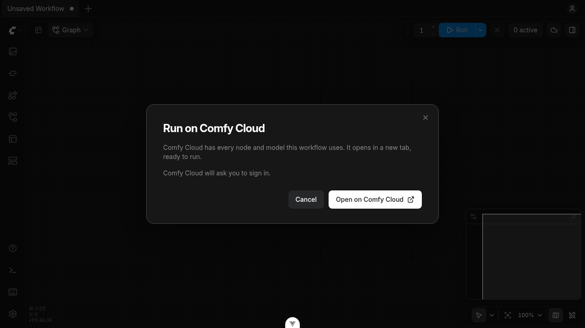
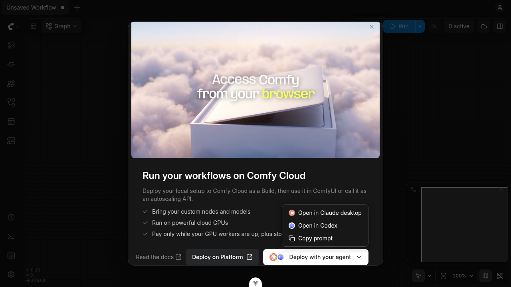

## 개요

Run 바의 Cloud 버튼은 현재 열려 있는 워크플로를 Comfy Cloud로 전송합니다. ComfyUI는 먼저 워크플로를 Cloud와 대조해 확인한 다음, 그래프가 로드된 새 브라우저 탭에서 엽니다.

이 버튼은 ComfyUI가 사용자의 컴퓨터(localhost, 사설 LAN 주소 또는 데스크톱 앱)에서 실행되고 계정에 Open on Cloud 롤아웃이 활성화된 경우에만 표시됩니다. Comfy Cloud 자체에서는 표시되지 않습니다. 버튼이 보이지 않으면 ComfyUI를 최신 버전으로 업데이트하고 페이지를 새로 고치세요.

## Comfy Cloud에서 워크플로 열기

1. Cloud에서 실행하려는 워크플로를 엽니다.
2. Run 바의 클라우드 아이콘을 클릭합니다. ComfyUI가 워크플로에서 사용하는 노드 팩과 모델을 확인합니다.
3. Cloud에 해당 항목이 모두 있으면 **Comfy Cloud에서 실행** 대화상자가 열립니다. **Comfy Cloud에서 열기**를 클릭합니다.
4. 새 탭에서 Comfy Cloud가 열리고 워크플로를 편집기에 로드합니다. 로그인하라는 메시지가 나오면 그곳에서 로그인하세요.

ComfyUI는 워크플로의 노드 및 모델 이름을 Comfy Cloud로 보내기 전에 먼저 확인을 요청합니다. 대화상자에서 **Don't ask again**을 선택하면 이후에는 묻지 않습니다. 다시 묻도록 하려면 **설정 → Comfy → Comfy Cloud**를 열고 **Ask before sending node and model names to check Comfy Cloud compatibility**를 켭니다.

로컬에서 확인할 수 없는 모델 입력도 있습니다. 링크된 모델 입력이나 같은 파일이 둘 이상의 로컬 폴더와 일치하는 모델이 그렇습니다. 대화상자에는 이런 항목이 확인되지 않음으로 표시되며, 워크플로를 여는 것을 막지는 않습니다.

워크플로가 Cloud에 나타날 때까지 로컬 탭을 열어 두세요. 그래프는 Cloud 탭의 로딩이 끝나면 전달되며, ComfyUI는 10분 후에 전달을 포기합니다. 그래도 전달되지 않으면 Cloud 버튼을 다시 클릭하세요.

브라우저가 새 탭을 차단하면 ComfyUI 주소에 대한 팝업을 허용하고 다시 시도하세요. 활성 노드가 없는 워크플로는 메시지와 함께 거부되므로, 노드를 추가하거나 음소거를 해제하고, 저장한 뒤 버튼을 다시 클릭하세요.

## Cloud에 모델 파일이 누락된 경우

누락된 것이 모델 파일뿐이라면, 대화상자에 Cloud에 없는 파일이 나열되고 열기 동작은 제공되지 않습니다. 해당 대화상자에서는 ComfyUI에서 업로드하는 기능도 사용할 수 없으므로, 대화상자를 닫고 대신 해당 파일을 Cloud로 가져오세요. [모델 가져오기](/ko/cloud/import-models)를 참조하세요.

## 워크플로에 커스텀 노드나 특이한 모델이 필요한 경우

워크플로에서 Cloud에 없는 커스텀 노드 팩을 사용하거나 Cloud가 단일 파일로 특정할 수 없는 모델을 사용하면, 대화상자에서 대신 설정을 배포하도록 제안합니다. **Platform에 배포**는 커스텀 노드와 모델을 Developer Platform의 Build로 패키징합니다. **에이전트로 배포**는 동일한 설정을 Claude desktop 또는 Codex에 넘기거나 프롬프트를 복사하며, 먼저 워크플로를 저장하라고 요청합니다. [커스텀 빌드](/ko/development/deploy/cloud-custom-builds)를 참조하세요.

## 데스크톱 앱에서

데스크톱 앱은 자체 릴레이를 통해 워크플로를 Cloud로 전달합니다. 릴레이를 사용할 수 없으면 ComfyUI가 워크플로를 JSON 파일로 다운로드하고, Comfy Cloud를 연 다음, 해당 파일을 Cloud 편집기에 끌어다 놓으라고 요청합니다.
