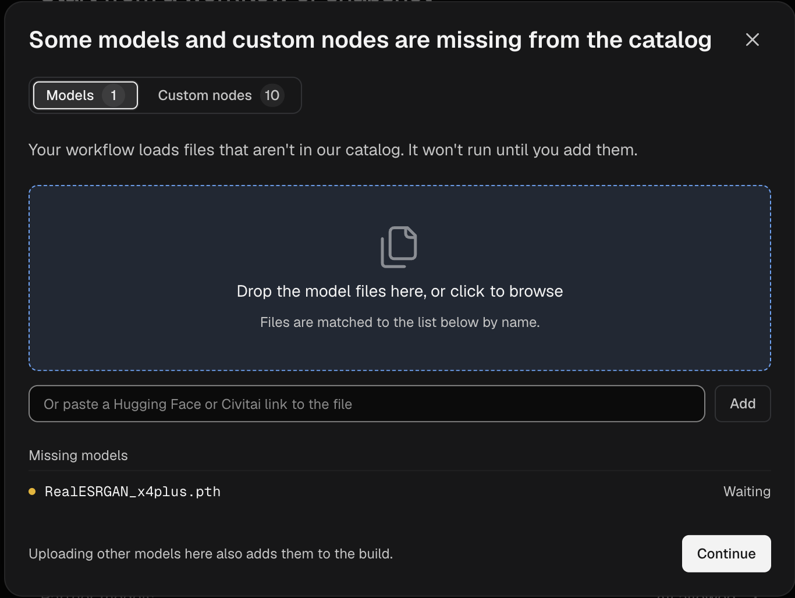

A Build packages your Custom Nodes → 빌드는 커스텀 노드, 비공개 커스텀 노드, LoRA 및 기타 모델과 Python 의존성을 패키징하여 워크플로를 Comfy Cloud에서 실행할 수 있게 합니다. 빌드는 Comfy Cloud 편집기에서 시작하고, Developer Platform에서 생성 및 배포한 다음, 편집기에서 해당 빌드 위에서 워크플로를 실행합니다.

Output:

빌드는 커스텀 노드, 비공개 커스텀 노드, LoRA 및 기타 모델, Python 의존성을 패키징하여 워크플로를 Comfy Cloud에서 실행할 수 있게 해줍니다. 빌드는 Comfy Cloud 편집기에서 시작하고, Developer Platform에서 생성 및 배포한 다음, 편집기에서 해당 빌드 위에서 워크플로를 실행합니다.

빌드를 배포하면 해당 워크플로만을 처리하는 GPU 워커도 제공됩니다. Comfy Cloud가 이미 워크플로의 모든 노드를 지원하는 경우에도 마찬가지입니다.

<Note>
  Comfy Cloud가 이미 지원하는 노드와 함께 자체 LoRA나 다른 모델을 사용하려면 빌드가 필요하지 않습니다. 대신 모델을 **모델 라이브러리**에 업로드하세요. [자체 LoRA 또는 모델 추가](#나만의-lora-또는-모델-추가)를 참조하세요.
</Note>

### 사전 요구 사항

빌드를 생성하기 전에 다음 사항을 준비하세요.

- **Comfy Cloud에 저장된 워크플로**
- **활성 구독 또는 0보다 큰 Comfy 크레딧 잔액**

<Warning>
  빌드는 생성하거나 유지하는 데 비용이 들지 않습니다. 배포는 GPU가 켜져 있는 동안 GPU 시간에 대한 비용이 발생합니다. 또한 배포가 존재하는 한, 중지 상태이거나 GPU가 켜져 있지 않은 동안에도 스토리지 비용이 발생합니다. 배포 대화상자에서는 확인하기 전에 예상 비용을 보여줍니다. 비용 지불을 중지하려면 배포를 삭제하세요. [배포 중지 또는 삭제](#배포-중지-또는-삭제)를 참조하세요.
</Warning>

## 워크플로에서 빌드 만들기

워크플로에서 Comfy Cloud가 지원하지 않는 커스텀 노드를 사용하는 경우, 해당 워크플로를 열면 Comfy Cloud에 대화상자가 표시됩니다. 대화상자에는 누락된 커스텀 노드 팩(커스텀 노드 그룹)과 LoRA 같은 모델이 나열됩니다. 워크플로를 실행하려면 이러한 항목으로 빌드를 만드세요. 저장한 워크플로를 선택하면 개발자 플랫폼이 해당 워크플로의 커스텀 노드와 모델을 찾아 자동으로 선택합니다.

<Steps>
  <Step title="개발자 플랫폼 열기">
    대화상자에서 **플랫폼에서 생성**을 클릭합니다. 새 탭에서 개발자 플랫폼의 **배포** 페이지가 열립니다.

    

    

    <Tip>
      대화상자 없이 빌드를 만들려면 **실행** 왼쪽의 클라우드 메뉴를 클릭합니다. 기본적으로 **Comfy Cloud**로 설정되어 있습니다.

      - 워크스페이스에 아직 배포가 없으면 **커스텀 배포 생성**을 선택한 다음 **플랫폼에서 생성**을 클릭합니다.
      - 이미 배포가 있으면 **배포 관리**를 선택합니다.
    </Tip>
  </Step>
  <Step title="새 빌드 시작">
    **배포** 페이지에서 **새 빌드**를 클릭합니다. 아직 빌드가 없으면 대신 **처음부터 시작**을 클릭합니다.
  </Step>
  <Step title="워크플로 선택">
    1. **Comfy Cloud에서 선택**을 클릭합니다.
    2. 워크플로를 선택한 다음 **워크플로 1개 추가**를 클릭합니다.

    워크플로의 `.json` 파일이나 해당 워크플로로 만든 `.png` 이미지를 드롭 영역으로 끌어다 놓을 수도 있습니다.

    

    워크플로 이름이 체크 표시와 함께 드롭 영역 아래에 나타나고 **제안된 기본값** 목록에 빌드의 **커스텀 노드**가 표시되면 해당 단계가 성공한 것입니다.
  </Step>
  <Step title="제안된 기본값으로 빌드">
    **기본값으로 빌드…**를 클릭합니다. **빌드 대상 선택** 대화상자가 열립니다.

    **기본값으로 빌드…**를 사용할 수 없으면 버튼 아래에 그 이유가 표시됩니다. _먼저 해당 단계에서 누락된 모델과 커스텀 노드를 추가하세요._라고 표시되면 누락된 항목을 추가합니다:

    1. **빌드 사용자 지정**을 클릭합니다.
    2. 누락된 커스텀 노드나 모델이 나열된 단계가 나올 때까지 **다음**을 클릭합니다.
    3. 각 항목에서 **제안 사용** 또는 **업로드**를 클릭합니다.
  </Step>
</Steps>

빌드에 포함할 항목을 변경하려면 대신 **빌드 사용자 지정**을 클릭하고 각 단계를 진행하세요. 다음 두 단계에서 빌드에 포함할 항목을 결정합니다:

- **빌드에 필요한 커스텀 노드는 무엇인가요?**: 커스텀 노드를 선택합니다.
- **빌드에 포함할 모델은 무엇인가요?**: 빌드에 포함할 모델을 선택합니다. 빌드에 포함되지 않은 모델은 작업에서 처음 사용될 때 다운로드됩니다.

### 빌드 게시

게시하면 빌드가 `v1`과 같이 번호가 매겨진 버전으로 바뀌며, 지금 또는 나중에 배포할 수 있습니다. 게시는 무료입니다.

1. **빌드 대상 선택** 대화상자에서 **서버리스 빌드**가 선택된 상태로 둡니다. 이 대상은 Comfy Cloud에서 실행됩니다.
2. **게시**를 클릭합니다.

빌드 페이지가 새 버전과 함께 열립니다. **서버리스 빌드** 행에 빌드 진행 상황이 표시됩니다. 빌드는 보통 10~15분 걸리며, 페이지를 나갔다가 다시 돌아와도 됩니다. 빌드가 완료되면 **서버리스 빌드** 행에 **배포** 버튼이 표시됩니다.

나중에 해당 버전으로 돌아가려면:

1. **개발자 플랫폼 사이드바**에서 **배포**를 클릭합니다.
2. **빌드** 섹션에서 해당 빌드를 클릭합니다.
3. **버전** 아래에서 최신 버전을 클릭합니다.

<AccordionGroup>
  <Accordion title="빌드가 실패하면 어떻게 하나요?">
    일부 커스텀 노드는 빌드에 실패할 수 있습니다. 이런 경우 빌드 페이지의 **서버리스 빌드** 행에 **빌드 실패**가 표시됩니다.

    1. 해당 행에서 **로그**를 열어 무엇이 실패했는지 확인합니다.
    2. **빌드 편집**을 클릭하고 실패한 커스텀 노드를 제거하는 등 빌드를 변경합니다.
    3. 빌드를 다시 게시합니다.

    행의 **에이전트로 디버그** 버튼을 클릭하면 실패 내용을 설명하는 프롬프트가 열립니다. 이 프롬프트를 복사해 코딩 에이전트에 전달하여 빌드를 복구하세요.
  </Accordion>
</AccordionGroup>

### 워크플로 배포 및 실행

배포는 Comfy Cloud GPU에서 실행되는 빌드입니다. 빌드를 배포한 다음 Comfy Cloud 편집기를 해당 배포로 전환하여 워크플로를 실행합니다.

1. **Serverless build** 행에서 **Deploy**를 클릭합니다. **Deploy v1 of** _빌드 이름_ 대화상자가 열립니다.
2. GPU를 선택합니다. 각 GPU에는 VRAM(GPU 메모리)과 시간당 가격이 표시됩니다.
3. 대화상자에 **Ready for the Cloud editor**가 표시되면 선택된 상태로 둡니다. 기본적으로 켜져 있습니다.
4. 나머지 설정은 기본값으로 둡니다. **Always-warm workers**가 `0`이면 작업이 들어오지 않을 때 배포가 GPU를 꺼둡니다. 기본적으로 **Keep worker up after a job**은 마지막 작업 이후 3분 동안 GPU를 켜 두며, 이 유휴 시간은 GPU 요금으로 청구됩니다.
5. **Estimated cost** 패널을 확인합니다. 시간당 GPU 시간과 월별 모델 저장 공간이 표시됩니다.
6. **Create deployment**를 클릭합니다. 배포 페이지가 열립니다. 배포 이름 아래의 상태가 **Ready**로 표시될 때까지 기다립니다.
7. Comfy Cloud 편집기에서 **Run** 왼쪽의 클라우드 메뉴를 클릭합니다. **Run on** 아래에서 사용할 배포를 선택합니다. 편집기가 다시 로드되며, 탭은 그대로 유지됩니다.

    

8. 워크플로를 열고 **Run**을 클릭합니다. 배포가 GPU를 시작하는 동안 첫 작업은 대기할 수 있습니다.

이 브라우저는 다른 배포를 선택할 때까지 해당 배포에서 워크플로를 계속 실행합니다. 다시 전환하려면 같은 메뉴에서 **Comfy Cloud**를 선택합니다. 워크플로에 저장되지 않은 변경 사항이 있으면 **Save your workflows before switching?** 대화상자가 열립니다. **Save and switch** 또는 **Switch without saving**을 클릭합니다.

## 나만의 LoRA 또는 모델 추가

**모델 라이브러리**에는 워크스페이스에서 업로드한 모델이 보관됩니다. 업로드한 모델은 Comfy Cloud와 배포에서 실행됩니다.

모델을 업로드하기 전에 다음 요구 사항을 충족하는지 확인하세요:

- **활성 Pro, Creator, Team 또는 엔터프라이즈 플랜**: 모델을 업로드하려면 워크스페이스에 해당 플랜이 필요합니다.
- **2 GB 이하의 `.safetensors` 파일**: SDXL 또는 Flux와 같은 더 큰 베이스 모델은 빌드에 넣으세요.

<Warning>
  라이브러리 모델이 제공되기 전에 생성된 일부 배포에서는 해당 모델을 로드할 수 없습니다. 라이브러리 모델을 사용하려면 새 배포를 생성하세요. 이전 배포에서는 작업이 다음 오류와 함께 실패할 수 있습니다: `Library model "<file name>" is unavailable on this deployment. Retry the job. If it still fails, contact support with the job ID.`
</Warning>

### 모델 업로드

Comfy Cloud 편집기 또는 개발자 플랫폼에서 업로드할 수 있습니다. 작업 중인 위치에 해당하는 탭을 선택하세요.

<Tabs>
  <Tab title="클라우드 편집기">
    1. **실행** 왼쪽의 클라우드 메뉴에서 **실행 위치** 아래에 **Comfy Cloud**가 선택되어 있는지 확인하세요. 배포에서는 **모델 라이브러리**에 **가져오기** 버튼이 없습니다.
    2. **왼쪽 사이드바**에서 **모델 라이브러리**를 클릭한 다음 **가져오기**를 클릭하세요.
    3. **파일 선택**을 클릭하거나 `.safetensors` 파일을 대화상자로 끌어다 놓으세요.
    4. **이 모델의 유형은 무엇인가요?** 아래에서 LoRA라면 **LoRA**를 유지하고, 그렇지 않으면 파일에 맞는 유형을 선택하세요.
    5. **업로드**를 클릭하세요. 대화상자에 _모델을 성공적으로 가져왔습니다._라고 표시되면 **완료**를 클릭하세요.

    

    대신 Civitai 또는 Hugging Face 링크에서 모델을 가져오려면:

    1. **가져오기** 대화상자에서 **여기에 링크를 붙여넣으세요**에 모델 링크를 붙여넣으세요.
    2. **계속**을 클릭하세요.
    3. **이 모델의 유형은 무엇인가요?** 아래에서 모델 유형을 선택하세요.
    4. **가져오기**를 클릭하세요.

    `.ckpt`와 같은 다른 형식의 링크 가져오기는 **모델 라이브러리**로 가져오지만 배포에서는 실행할 수 없습니다.
  </Tab>
  <Tab title="개발자 플랫폼">
    1. 빌드의 **빌드에 어떤 모델이 포함되나요?** 단계에서 **모델 업로드**를 클릭하세요.
    2. **워크스페이스 라이브러리**를 선택하세요.
    3. `.safetensors` 파일을 드롭 영역으로 끌어다 놓거나, 영역을 클릭하여 찾아보세요.
    4. **모델 유형** 아래에서 LoRA라면 **LoRA**를 유지하고, 그렇지 않으면 파일에 맞는 유형을 선택하세요.
    5. **업로드**를 클릭하세요.

    
  </Tab>
</Tabs>

### 워크플로에서 모델 사용

모델을 업로드한 후에는 Comfy Cloud 또는 배포에서 사용할 수 있습니다.

1. **실행** 왼쪽의 클라우드 메뉴에서 실행할 위치를 선택하세요: **Comfy Cloud** 또는 배포.
2. `Load LoRA (Model and CLIP)` 노드를 추가하거나, 해당 노드가 있는 워크플로를 여세요.
3. 노드의 `lora_name` 목록에서 파일을 선택하세요.
4. **실행**을 클릭하세요.

<Tip>
  배포에서는 첫 실행 시 모델을 다운로드하며, 큐에 있는 작업의 행에 `Downloading <file name>`이 표시됩니다. 동일한 실행 중인 GPU에서 이후 작업은 다운로드를 건너뜁니다. 배포가 나중에 시작하는 GPU는 모델을 다시 다운로드합니다. 다운로드를 건너뛰려면 모델을 빌드에 추가하세요.
</Tip>

작업이 모델을 찾을 수 있도록 다음 규칙을 따르세요:

- **일치하는 유형을 선택하세요.** 로더 노드는 해당 유형의 모델만 나열합니다. `Load LoRA (Model and CLIP)` 노드는 LoRA로 업로드된 모델을 나열합니다.
- **새 파일 이름을 사용하세요.** 빌드에 같은 이름의 모델이 이미 있으면 배포의 작업은 업로드한 파일이 아니라 빌드의 파일을 사용합니다.
- **베이스 모델을 일치시키세요.** LoRA는 워크플로가 로드하는 베이스 모델과 일치해야 합니다.
- **Comfy Cloud에 있는 로더 노드를 사용하세요.** 로더 노드가 Comfy Cloud에 없는 커스텀 노드에서 제공되는 경우 모델을 빌드에 추가하세요.

### 라이브러리 모델 변경 또는 삭제

**실행 위치**에서 배포가 선택되어 있으면 **모델 라이브러리**에는 빌드의 모델만 나열됩니다. 업로드한 모델을 변경하거나 삭제하려면 먼저 [Comfy Cloud로 다시 전환](#워크플로-배포-및-실행)한 다음, **왼쪽 사이드바**에서 **모델 라이브러리**를 클릭하세요.

모델 유형을 변경하려면:

1. 모델 카드 위로 마우스를 올린 다음 **모델 정보**를 클릭하세요.
2. 새 **모델 유형**을 선택하세요.

<Warning>
  모델을 삭제하면 **모델 라이브러리**에서 영구적으로 제거됩니다. 해당 파일을 계속 사용하는 작업은 로더 노드에서 `Value not in list` 오류와 함께 실패합니다.
</Warning>

모델을 삭제하려면:

1. 모델 카드 위로 마우스를 올리고 **더 보기**를 클릭한 다음 **삭제**를 클릭하세요.
2. **이 모델을 삭제하시겠습니까?**에서 **삭제**를 클릭하세요.

## 배포 중지 또는 삭제

배포는 중지된 상태에서도 삭제할 때까지 스토리지 비용이 발생합니다. 작업을 실행하지 않고 나중에 사용할 수 있도록 배포를 유지하려면 중지하세요. 비용 지불을 중단하려면 삭제하세요.

배포 페이지를 열려면:

1. **Developer Platform 사이드바**에서 **배포**를 클릭합니다.
2. **배포** 섹션에서 배포 이름을 클릭합니다.

배포를 중지하려면:

1. **중지**를 클릭합니다.
2. **배포 중지** 대화상자에서 **중지**를 클릭합니다.

상태가 **중지 중**으로 표시된 다음 **중지됨**으로 표시됩니다.

배포를 다시 실행하려면:

- **시작**을 클릭합니다.

<Warning>
  삭제하면 배포와 해당 기록이 영구적으로 제거됩니다. 빌드와 해당 버전은 유지되므로 나중에 다시 배포할 수 있습니다.
</Warning>

배포를 삭제하려면:

1. 중지된 배포에서 **삭제**를 클릭합니다. 실행 중인 배포에서는 **추가 작업** 메뉴를 연 다음 **삭제**를 선택합니다.
2. **배포 삭제** 대화상자에서 **삭제**를 클릭합니다.

이 브라우저에서 다음에 편집기를 열면, 편집기는 Comfy Cloud에서 워크플로를 실행합니다.

## 다음 단계

<CardGroup cols={2}>
  <Card title="API 요청에서 라이브러리 모델 사용" icon="code" href="/ko/development/serverless/overview#use-workspace-library-models-in-api-requests">
    터미널에서 모델을 업로드하고 요청마다 `lora_name`으로 선택하세요.
  </Card>
  <Card title="Comfy API 빠른 시작" icon="cloud-arrow-up" href="/ko/development/serverless/quickstart">
    자체 코드에서 배포를 오토스케일링 엔드포인트로 호출하세요.
  </Card>
  <Card title="사용량 및 한도" icon="gauge" href="/ko/development/deploy/cloud-usage">
    Comfy Cloud 크레딧과 동시 작업 한도가 어떻게 작동하는지 확인하세요.
  </Card>
  <Card title="워크플로 API 형식" icon="file-code" href="/ko/development/api-development/workflow-api-format">
    API 요청이 전송하는 형식으로 워크플로를 내보내세요.
  </Card>
</CardGroup>
