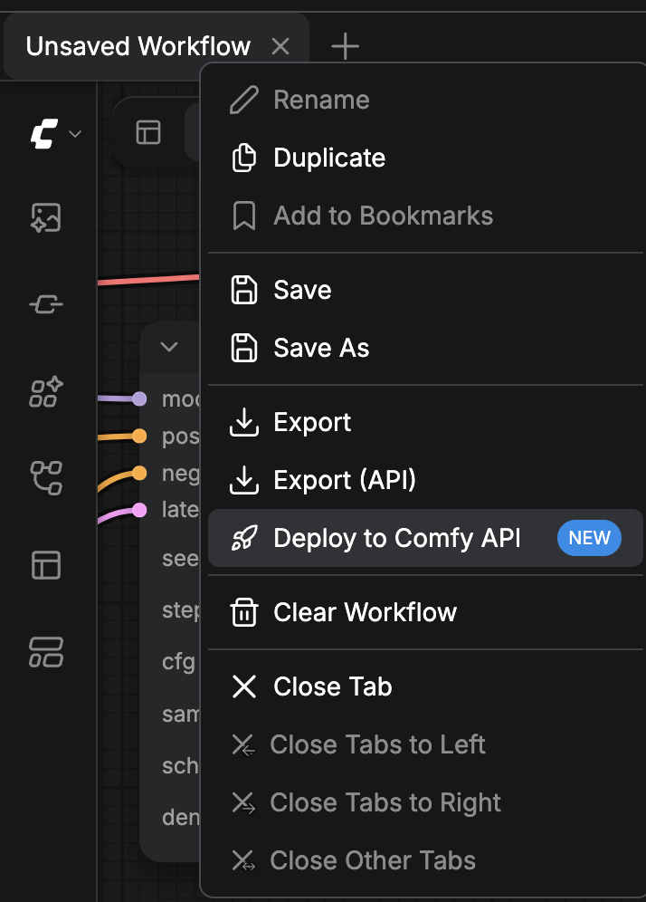
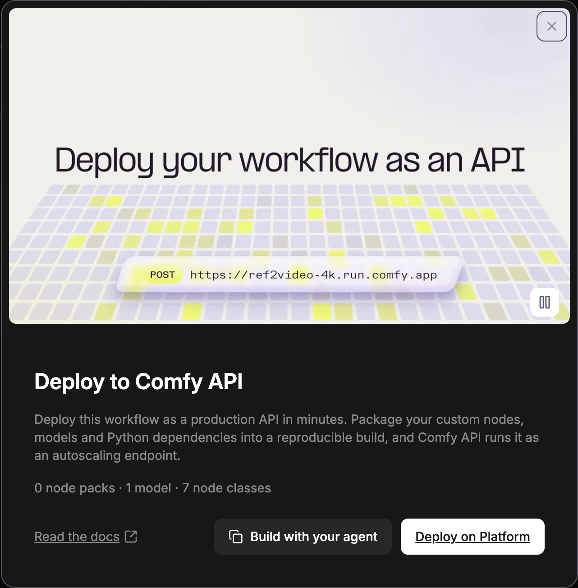

ComfyUI 워크플로는 Comfy Cloud, 직접 구축한 Comfy API 배포, 또는 직접 관리하는 서버에서 실행할 수 있습니다. Comfy Cloud와 Comfy API는 Comfy GPU에서 실행되므로 컴퓨터에 GPU가 필요하지 않습니다. 워크플로에 맞는 옵션을 선택하고 해당 카드에서 시작하세요.

<CardGroup cols={2}>
  <Card title="Comfy Cloud" icon="cloud" href="/ko/development/deploy/cloud">
    커스텀 노드와 모델이 이미 Comfy Cloud에 있는 워크플로를 빌드나 배포 없이 실행합니다.
  </Card>
  <Card title="Comfy Cloud의 커스텀 빌드" icon="puzzle-piece" href="/ko/development/deploy/cloud-custom-builds">
    브라우저에서 생성한 빌드와 함께, 자체 커스텀 노드와 모델이 필요한 워크플로를 Comfy Cloud 편집기에서 실행합니다.
  </Card>
  <Card title="Comfy API" icon="cloud-arrow-up" href="/ko/development/serverless/quickstart">
    커스텀 노드, 모델, Python 의존성을 빌드로 패키징하고 오토스케일링 엔드포인트로 실행합니다.
  </Card>
  <Card title="자체 호스팅" icon="server" href="/ko/development/deploy/self-hosting">
    직접 관리하는 머신에서 ComfyUI를 실행하고 `--listen`으로 네트워크에 제공합니다.
  </Card>
</CardGroup>

이 중 하나를 자신의 코드에서 호출하려면 [API 형식](/ko/development/api-development/workflow-api-format)으로 워크플로를 전송하세요.

## ComfyUI 앱에서 배포하기

컴퓨터의 ComfyUI 또는 Comfy Desktop에서 **Deploy to Comfy API** 카드는 열려 있는 워크플로로 Comfy API 빌드를 시작합니다.

<Warning>
  버전 게시에는 요금이 없습니다. 빌드가 끝나면 **Serverless build** 행에 **Deploy** 버튼이 나타납니다. 배포하면 배포한 순간부터 스토리지 요금이 발생하고, 워커가 가동 중일 때는 GPU 시간도 청구됩니다. 확인하기 전에 배포 대화 상자에 예상 비용이 표시됩니다.
</Warning>

<Steps>
  <Step title="Workflow actions 메뉴 열기">
    **Top bar**에서 워크플로 탭을 마우스 오른쪽 버튼으로 클릭합니다. **Canvas** 왼쪽 위의 **Workflow actions** 버튼을 클릭해도 됩니다.

    
  </Step>
  <Step title="Deploy to Comfy API 선택">
    **Deploy to Comfy API**를 선택합니다. 항목에는 **NEW** 표시가 있습니다. **Deploy to Comfy API** 카드가 열리고 워크플로가 사용하는 노드 팩, 모델, 노드 클래스를 집계합니다.

    
  </Step>
  <Step title="Developer Platform에서 계속하기">
    **Deploy on Platform**을 클릭합니다. Developer Platform([platform.comfy.org](https://platform.comfy.org))이 새 탭에서 열립니다.
  </Step>
</Steps>

Developer Platform에서는 워크플로에서 빌드를 만들고, 버전을 게시한 뒤 배포합니다. [빌드 소스](/ko/development/serverless/build-sources)는 워크플로 파일에서 빌드를 시작하는 방법을, [Comfy API 빠른 시작](/ko/development/serverless/quickstart)은 comfy-cli로 같은 흐름을 다룹니다.

## Cloud 편집기에서 배포 실행하기

Comfy Cloud 편집기에서 배포를 생성하고, 그 위에서 워크플로를 실행하고, 중지하거나 삭제하려면 [Comfy Cloud에 커스텀 빌드 추가하기](/ko/development/deploy/cloud-custom-builds)를 참고하세요.

## 애플리케이션에서 워크플로 실행하기

배포가 **Ready**이면 [워크플로 실행](/ko/development/run-workflows/overview)을 참고하여 애플리케이션에서 호출하세요. [Comfy SDK](/ko/development/api-development/sdks)는 Comfy Cloud와 자신의 배포에서 작동합니다. 자체 호스팅 ComfyUI는 Comfy API v2를 제공하려면 [API 프록시](/ko/development/comfyui-server/api-proxy)가 필요합니다.
