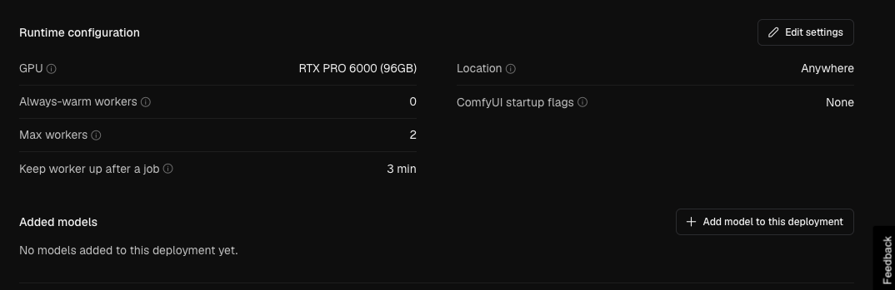
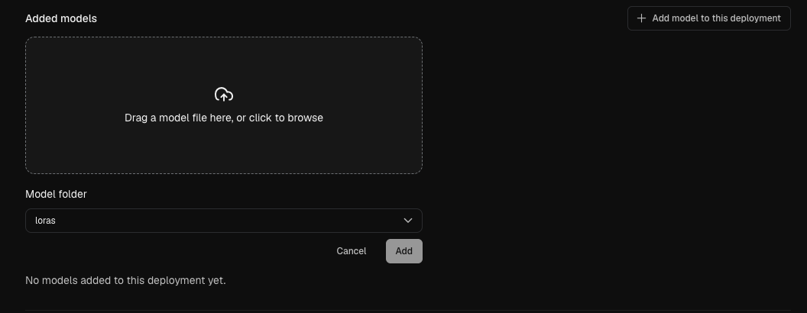
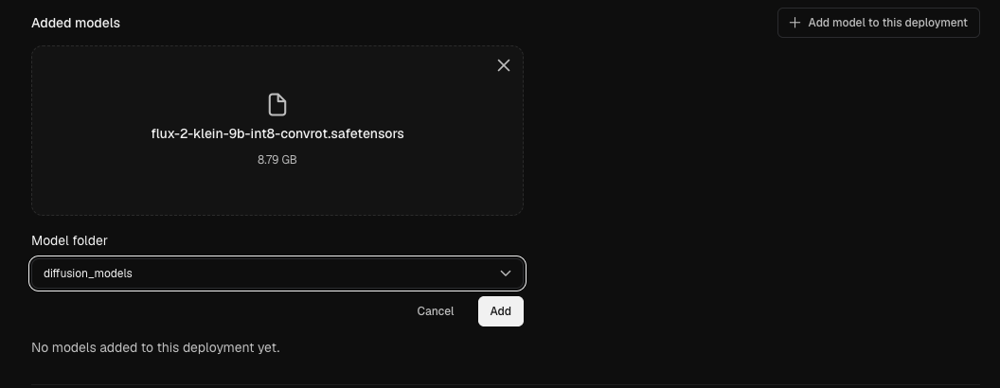
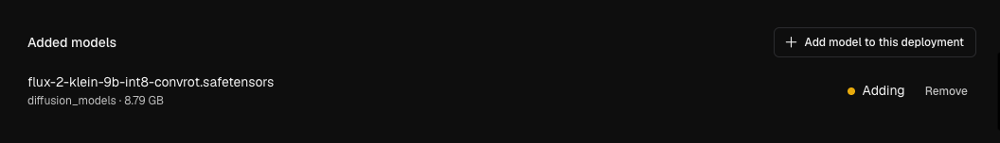
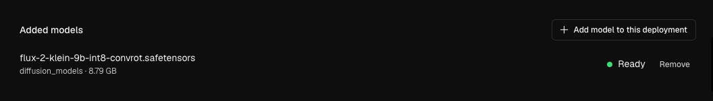

Comfy Cloud에 Build를 배포한 이후에는 Build의 새 버전을 릴리스하고, 배포의 GPU와 워커를 변경하고, 애플리케이션에서 배포 고유의 URL로 배포를 호출할 수 있습니다. 배포는 워커가 실행되는 동안 GPU 시간만큼 비용이 발생하며, 삭제할 때까지 스토리지 비용도 발생합니다. 배포를 생성한 이후에도 계속 관리할 수 있습니다. 이 페이지에서는 다른 소스에서 Build를 시작하고, 버전을 릴리스하고, GPU와 워커를 선택하고, 배포를 호출하고, 모델을 추가하고, 모니터링하고, 중지하거나 삭제하는 방법을 설명합니다.

첫 번째 Build와 배포를 생성하려면 [Custom Builds](/ko/development/deploy/cloud-custom-builds)를 참고하세요.

<Note>
  Comfy Cloud가 이미 워크플로의 모든 노드를 지원한다면, Build나 배포 없이 Comfy Cloud에서 워크플로를 실행할 수 있습니다. [Comfy Cloud에 배포](/ko/development/deploy/cloud)를 참고하세요.
</Note>

## 시작하기 전에

이 페이지의 각 작업은 두 곳에서 수행할 수 있습니다. 브라우저의 [platform.comfy.org](https://platform.comfy.org) Developer Platform과 터미널의 comfy-cli입니다. 다음 항목을 준비하세요.

- **Comfy 크레딧이 있는 워크스페이스 또는 활성 플랜**: 배포를 생성하거나 시작하려면 둘 중 하나가 필요합니다.
- **comfy-cli 탭의 경우, Comfy 계정에 로그인 완료된 comfy-cli**: `comfy cloud login`을 실행하세요.

<Tip>
  브라우저 대신 comfy-cli로 Build와 배포를 생성하려면 `ComfyUI` 설치 폴더에서 다음 명령을 실행하세요.

  ```bash
  comfy build init
  comfy build push --release --target linux/nvidia
  comfy deploy up
  ```

  `comfy build init`는 Build 파일인 `comfy-build.yaml`을 해당 폴더에 기록합니다. 이후 `comfy build` 명령은 이 파일을 읽으므로 같은 폴더에서 실행하세요.
</Tip>

## Comfy Desktop, 워크플로우 파일 또는 ComfyUI에서 빌드 시작하기

아직 빌드가 없다면 이미 가지고 있는 것에서 빌드를 시작할 수 있습니다. [커스텀 빌드](/ko/development/deploy/cloud-custom-builds)는 Comfy Cloud에 저장된 워크플로우에서 시작하는 주요 브라우저 흐름을 보여줍니다. 시작점에 해당하는 탭을 선택하세요.

<Tabs>
  <Tab title="Comfy Desktop 스냅샷">
    Comfy Desktop 스냅샷은 인스턴스의 ComfyUI 버전, 커스텀 노드, Python 패키지를 빌드로 가져옵니다. 모델은 가져오지 않으므로 빌드의 이후 단계에서 추가하세요.

    1. Comfy Desktop에서 인스턴스의 **관리**를 클릭한 다음 **스냅샷** 탭을 클릭합니다.
    2. 인스턴스의 현재 상태가 목록에 없으면 **스냅샷 생성**을 클릭합니다.
    3. 원하는 스냅샷에서 **내보내기**를 클릭합니다.

       

    4. Developer Platform의 **Developer Platform 사이드바**에서 **배포**를 클릭한 다음 **새 빌드**를 클릭합니다. 아직 빌드가 없다면 대신 **처음부터 시작**을 클릭합니다.
    5. **워크플로우 또는 스냅샷으로 시작할까요?** 단계에서 내보낸 `.json` 파일을 드롭 영역에 놓거나, 영역을 클릭해 찾아보세요.

    다른 스냅샷을 놓으면 현재 스냅샷이 대체됩니다. 커스텀 빌드의 [권장 기본값으로 빌드하기](/ko/development/deploy/cloud-custom-builds#워크플로에서-빌드-만들기)를 계속 진행하세요.
  </Tab>
  <Tab title="워크플로우 파일">
    1. Developer Platform의 **Developer Platform 사이드바**에서 **배포**를 클릭한 다음 **새 빌드**를 클릭합니다. 아직 빌드가 없다면 대신 **처음부터 시작**을 클릭합니다.
    2. **워크플로우 또는 스냅샷으로 시작할까요?** 단계에서 워크플로우의 `.json` 파일 또는 해당 워크플로우로 만든 `.png` 이미지를 드롭 영역에 놓습니다. 영역을 클릭해 찾아볼 수도 있습니다.

    

    Developer Platform은 워크플로우가 사용하는 모델과 커스텀 노드를 읽습니다. 놓는 워크플로우는 이전 것들에 추가됩니다. 커스텀 빌드의 [권장 기본값으로 빌드하기](/ko/development/deploy/cloud-custom-builds#워크플로에서-빌드-만들기)를 계속 진행하세요.
  </Tab>
  <Tab title="ComfyUI">
    ComfyUI에서 **Comfy API로 배포** 항목은 열려 있는 워크플로우에 필요한 항목을 집계한 다음 Developer Platform을 엽니다.

    1. **상단 바**에서 워크플로우의 탭을 마우스 오른쪽 버튼으로 클릭합니다. **워크플로우 작업** 버튼을 클릭할 수도 있습니다.

       

    2. **Comfy API로 배포**를 선택합니다. **Comfy API로 배포** 카드가 열리고 워크플로우가 사용하는 노드 팩, 모델, 노드 클래스 수를 집계합니다.

       

    3. **플랫폼에서 배포**를 클릭합니다. Developer Platform이 새 탭에서 열립니다.

    이 워크플로우로 빌드를 시작하려면 같은 메뉴에서 **내보내기**를 선택해 워크플로우를 `.json` 파일로 저장한 다음 **워크플로우 파일** 탭을 따르세요.
  </Tab>
</Tabs>

## 배포 찾기

여기서부터 이 페이지는 최소 한 개의 배포가 있는 Build가 있다고 가정합니다. 이후의 모든 작업은 배포에서 시작하므로, 먼저 배포를 찾으세요. 배포를 조회하는 데는 비용이 들지 않습니다. 작업하는 위치에 해당하는 탭을 선택하세요.

<Tabs>
  <Tab title="Developer Platform">
    1. **Developer Platform 사이드바**에서 **Deploy**를 클릭합니다.
    2. **Deployments** 섹션에서 배포의 이름을 클릭합니다.

    배포 페이지가 열립니다. 이름 아래에 **Ready** 또는 **Stopped** 같은 상태와 실행 중인 버전(예: `v2`)이 표시됩니다. **Overview** 탭에는 **Runtime configuration**이 표시됩니다.
  </Tab>
  <Tab title="comfy-cli">
    워크스페이스의 모든 배포를 나열합니다:

    ```bash
    comfy deploy ls --workspace
    ```

    각 줄에는 배포의 이름, ID, 상태, 실행 중인 버전이 표시됩니다. 나중에 명령에서 배포를 선택할 때는 `--deployment` 뒤에 해당 ID를 붙입니다. `production` 같은 이름만 사용하는 방식은 Build의 폴더에서 명령을 실행할 때만 동작합니다. 다른 위치에서는 ID 또는 `<build>/<name>`을 사용하세요.
  </Tab>
</Tabs>

## Build 버전 릴리스

Build의 게시된 버전은 변경되지 않습니다. 커스텀 노드를 추가하려면 버전을 게시한 다음 배포를 해당 버전으로 이동합니다. 새 버전 없이 하나의 배포에 모델이나 LoRA를 추가하려면 [실행 중인 배포에 모델 추가하기](#add-a-model-to-a-running-deployment)를 참고하세요. Developer Platform은 버전을 `v1`, `v2` 등으로 부릅니다. comfy-cli는 이를 릴리스라고 부릅니다.

<Warning>
  배포를 다른 버전으로 이동하거나 롤백하면 이전 버전과 새 버전이 모두 실행되는 동안 GPU 시간이 소요됩니다. Developer Platform에서는 **버전 변경** 대화상자에 소요량이 표시됩니다.
</Warning>

<Tabs>
  <Tab title="Developer Platform">
    버전을 게시하려면:

    1. **Developer Platform 사이드바**에서 **배포**를 클릭합니다.
    2. **빌드** 섹션에서 Build를 클릭합니다.
    3. **새 버전**을 클릭하고 단계에서 변경 사항을 적용합니다.
    4. 마지막 단계에서 **변경 사항 저장**을 클릭합니다. Build 페이지에 **v**_N_ 이후 변경됨이 표시되며, 여기서 _N_은 최신 버전입니다.
    5. **게시**를 클릭합니다. **빌드 대상 선택** 대화상자에서 **서버리스 빌드**가 선택된 상태로 두고 **게시**를 클릭합니다.

    빌드는 보통 10~15분 걸립니다. 빌드가 실패하면 [빌드 또는 배포 실패 해결](#빌드-또는-배포-실패-해결)을 참조하세요.

    배포를 해당 버전으로 이동하려면:

    1. 배포 페이지를 엽니다. 새 버전이 준비되면 배포 이름 아래에 **v**_N_ **사용 가능**이 표시됩니다.
    2. **버전 변경**을 클릭합니다.
    3. 버전을 선택한 다음 **v**_N_으로 **업데이트**를 클릭합니다.

    배포는 새 버전이 준비될 때까지 현재 실행 중인 버전을 계속 제공하며, URL은 동일하게 유지됩니다. 업데이트가 완료되면 배포 이름 아래의 버전이 **v**_N_으로 표시됩니다.

    이전 버전으로 돌아가려면:

    1. 배포 페이지에서 **기록** 탭을 클릭합니다.
    2. 해당 버전의 행에서 **이 버전으로 롤백**을 클릭합니다.
  </Tab>
  <Tab title="comfy-cli">
    Build 폴더에서 다음 명령을 실행합니다.

    1. ComfyUI 설치를 변경한 후 다시 스캔하여 Build 파일에 반영합니다:

       ```bash
       comfy build update --yes
       ```

    2. Build 파일을 설치 및 Comfy Cloud의 Build와 비교합니다:

       ```bash
       comfy build status
       ```

    3. Build 파일을 푸시하고 배포가 실행되는 대상인 `linux/nvidia`용 릴리스를 생성합니다:

       ```bash
       comfy build push --release --target linux/nvidia
       ```

    4. 빌드가 완료될 때까지 릴리스의 빌드 로그를 계속 확인합니다:

       ```bash
       comfy build release logs --target linux/nvidia --follow
       ```

    5. 배포를 최신 릴리스로 이동합니다:

       ```bash
       comfy deploy up --deployment <deployment>
       ```

    `comfy deploy up`은 이동이 완료될 때까지 배포를 추적합니다. 그때까지 배포는 현재 릴리스를 계속 제공합니다.

    이전 릴리스로 돌아가려면:

    - 현재 릴리스 이전의 릴리스로 돌아가려면 다음을 실행합니다:

      ```bash
      comfy deploy rollback --deployment <deployment>
      ```

    - 특정 릴리스로 돌아가려면 `--to`를 추가합니다(예: `--to v5`).
  </Tab>
</Tabs>

모든 Build의 모든 버전은 워크스페이스의 Build 버전 한도에 포함됩니다. 한도에 도달하면 더 이상 필요 없는 버전을 삭제합니다. [정리](#정리)를 참조하세요.

## GPU 또는 리전 변경

GPU는 워크플로가 사용할 수 있는 VRAM 용량과 각 워커의 시간당 비용을 결정합니다. 리전은 배포가 실행되는 위치를 결정하며, 선택할 수 있는 GPU는 리전에 따라 달라집니다.

<Warning>
  실행 중인 배포에서 GPU 또는 리전을 변경하면 새 GPU에서 배포의 복사본이 시작됩니다. Comfy Cloud가 배포를 새 복사본으로 옮길 때까지 이전 복사본은 계속 서비스를 제공하며 GPU 시간을 소모합니다. 중지된 배포에서는 다음에 시작할 때 변경 사항이 적용됩니다.
</Warning>

<Tabs>
  <Tab title="Developer Platform">
    배포를 생성할 때 **Location**을 선택합니다: **Anywhere** 또는 **United States**. Developer Platform은 기존 배포의 위치를 변경할 수 없습니다. 다른 위치에서 실행하려면 해당 Build의 페이지에서 다시 배포합니다.

    GPU를 변경하려면:

    1. 배포 페이지에서 **Edit settings**를 클릭합니다.
    2. **Edit deployment**에서 GPU를 선택합니다. 각 GPU에는 VRAM과 시간당 가격이 표시됩니다.
    3. **Save changes**를 클릭합니다.
  </Tab>
  <Tab title="comfy-cli">
    1. 각 리전과 리전에서 제공하는 GPU를 나열합니다:

       ```bash
       comfy deploy refs compute
       ```

       표에는 각 리전, 각 GPU 클래스, 해당 VRAM, 가용성이 표시됩니다. 하나의 리전만 나열하려면 `--region <region>`을 추가합니다.

    2. GPU 클래스, 리전 또는 둘 다를 설정합니다:

       ```bash
       comfy deploy scale --deployment <deployment> --gpu <gpu-class> --region <region>
       ```

    배포가 실행 중이라는 이유로 명령이 거부되면 먼저 `comfy deploy stop --deployment <deployment>`를 실행하고, `scale`을 다시 실행한 다음, `comfy deploy start --deployment <deployment>`를 실행합니다. 새 GPU 또는 리전은 배포가 시작될 때 적용됩니다.
  </Tab>
</Tabs>

## 워커 크기 조절

각 워커는 작업을 실행하는 하나의 GPU입니다. 두 가지 숫자를 설정합니다:

- **상시 대기 워커**: 작업이 GPU 시작을 기다리지 않도록 계속 실행 상태를 유지하는 워커입니다. `0`으로 설정하면, 작업이 들어오지 않을 때 배포가 GPU를 꺼버립니다.
- **최대 워커**: 작업이 들어왔을 때 배포가 동시에 실행하는 최대 워커 수입니다. 이를 초과하는 요청은 워커가 비어 있을 때까지 배포의 실행 대기열에서 기다립니다.

<Warning>
  **상시 대기 워커**는 작업이 없더라도 실행되는 동안 계속 GPU 시간이 과금됩니다.
</Warning>

<Tabs>
  <Tab title="Developer Platform">
    1. 배포 페이지에서 **Edit settings**를 클릭합니다.
    2. **Always-warm workers**와 **Max workers**를 설정합니다.
    3. **Save changes**를 클릭합니다.

    **Runtime configuration**에 저장한 값이 표시됩니다.
  </Tab>
  <Tab title="comfy-cli">
    두 범위를 함께 설정합니다. `--min`은 `0`에서 `20`까지, `--max`는 `1`에서 `20`까지 지정할 수 있습니다:

    ```bash
    comfy deploy scale --deployment <deployment> --min 0 --max 3
    ```

    명령은 `Scaled deployment <id> to min=0, max=3`를 출력합니다.
  </Tab>
</Tabs>

요금제에 따라 배포 하나가 실행할 수 있는 최대 워커 수가 정해집니다. 확인하려면 Developer Platform에서 [**Limits**](https://platform.comfy.org/settings/limits)를 열고 **Max workers per deployment**를 확인하십시오.

## 배포 중지 및 시작

배포를 중지하면 작업을 실행하지 않으면서 URL과 모델을 그대로 유지한 채 배포를 보관할 수 있습니다. 필요할 때 다시 시작하세요.

<Warning>
  중지된 배포에도 여전히 스토리지 비용이 발생합니다. 스토리지 요금 청구는 해당 리전에서 Build의 마지막 배포를 삭제하면 종료됩니다. [정리](#정리)를 참조하세요.
</Warning>

<Tabs>
  <Tab title="개발자 플랫폼">
    브라우저에서 배포를 중지하거나 시작하려면 [배포 중지 또는 삭제](/ko/development/deploy/cloud-custom-builds#배포-중지-또는-삭제)를 참조하세요.

    중지된 배포를 다른 버전으로 시작하려면:

    1. **Start** 옆의 화살표를 클릭한 다음 **Start on v**_N_을 선택합니다.
    2. 대화 상자에서 **Start on v**_N_을 클릭합니다.
  </Tab>
  <Tab title="comfy-cli">
    배포를 중지하려면:

    ```bash
    comfy deploy stop --deployment <deployment>
    ```

    다시 시작하려면:

    ```bash
    comfy deploy start --deployment <deployment>
    ```

    각 명령은 서비스가 해당 명령을 수락했다는 메시지를 출력합니다. 배포가 안정 상태에 이를 때까지 계속 확인하려면 [배포 모니터링](#배포-모니터링)을 참조하세요.
  </Tab>
</Tabs>

## 애플리케이션에서 배포 호출하기

애플리케이션은 워크스페이스 API 키를 사용해 [Comfy API v2](/ko/api-reference/v2/overview)로 API 형식 워크플로를 배포의 URL로 전송합니다. 작업을 보내기 전에 배포 상태가 **Ready**로 표시되는지 확인하세요. 상시 대기 워커가 `0`개인 배포에서 작업을 실행하면 GPU가 시작되는 동안 몇 분간 기다려야 할 수 있습니다.

<Tabs>
  <Tab title="Developer Platform">
    1. 배포 페이지의 **Overview** 탭에서 **Run via API**를 찾습니다.
    2. **Deployment URL**을 복사합니다.
    3. **Create API key**를 클릭하고 키를 복사합니다.
    4. Python, JavaScript 또는 cURL 스니펫을 복사합니다.
    5. `COMFY_API_KEY` 환경 변수에 키를 설정한 뒤 스니펫을 실행합니다.

    페이지에서 배포를 테스트하려면 **Quick test**를 사용하세요. 이 기능은 배포에서 모델 없이 작은 워크플로를 실행합니다.

    <Warning>
      **Quick test**는 배포의 GPU 시간을 사용합니다.
    </Warning>

    1. **Test this deployment**를 엽니다.
    2. **Quick test**를 선택합니다.
    3. **Run**을 클릭합니다.

    테스트가 완료되면 **Finished in** 뒤에 소요된 시간이 표시됩니다.
  </Tab>
  <Tab title="comfy-cli">
    API 형식 워크플로를 전송하고 출력을 기다립니다:

    ```bash
    comfy deploy run --deployment <deployment> --workflow workflow_api.json
    ```

    이 명령은 작업이 끝날 때까지 기다린 뒤 출력을 `outputs` 폴더에 다운로드합니다. 다른 위치에 저장하려면 `--output-dir <folder>`를 추가하세요.
  </Tab>
</Tabs>

자체 코드에서는 [Comfy SDKs](/ko/development/api-development/sdks)를 사용하세요. `COMFY_BASE_URL`을 **Deployment URL**로 설정합니다. [기본 URL 선택](/ko/development/api-development/sdks#기본-url-선택)을 참고하세요.

## 실행 중인 배포에 모델 추가하기 {#add-a-model-to-a-running-deployment}

Build의 새 버전을 게시하지 않고도 하나의 배포에 모델이나 LoRA를 추가할 수 있습니다. 파일은 Build의 모델과 같은 스토리지에 저장되므로 모든 워커가 다운로드 없이 디스크에서 읽습니다. 배포는 URL을 그대로 유지합니다. Build와 다른 배포는 변경되지 않습니다.

<Warning>
  추가한 모델은 배포의 모델 스토리지에 포함되며, [배포 요금 청구](/ko/development/deploy/cloud-usage#deployment-billing)에 설명된 방식으로 청구됩니다. 또한 추가할 때마다 배포의 실행 중인 워커가 해당 파일을 가진 새 워커로 교체되며, 새 워커에는 평소처럼 GPU 시간이 청구됩니다.
</Warning>

### 시작하기 전에 {#before-you-begin}

다음 항목을 준비하세요.

- **상태가 Ready 또는 Stopped인 배포**: 배포가 시작, 중지 또는 업데이트되는 동안에는 추가가 거부됩니다.
- **컴퓨터에 있는 모델 파일**: 파일 이름은 영문자, 숫자, `.`, `_`, `-`로 구성되며, [규칙 및 오류](#rules-and-errors)에 설명된 규칙을 따릅니다.

### 파일 추가하기 {#add-the-file}

<Tabs>
  <Tab title="Developer Platform">
    1. [배포 찾기](#배포-찾기)에 표시된 대로 배포 페이지를 엽니다.
    2. **Overview** 탭의 **Added models** 아래에서 **Add model to this deployment**를 클릭합니다.

       

    3. 모델 파일을 상자로 끌어다 놓거나, 상자를 클릭해 파일을 선택합니다.

       

    4. **Model folder**에서 파일을 넣을 폴더를 선택합니다(예: `loras` 또는 `diffusion_models`). 상자에 파일의 이름과 크기가 표시됩니다.
    5. **Add**를 클릭합니다.

       

    파일은 폴더, 크기, 상태와 함께 **Added models** 아래에 표시됩니다. 배포가 파일을 배치하는 동안에는 **Adding**으로 표시됩니다.

    

    작업에서 파일을 사용할 수 있게 되면 **Ready**로 표시됩니다.

    
  </Tab>
  <Tab title="comfy-cli">
    1. comfy-cli가 1.29.0 이상인지 확인합니다.

       ```bash
       comfy --version
       ```

    2. [배포 찾기](#배포-찾기)에 표시된 대로 배포의 ID를 찾습니다.

       ```bash
       comfy deploy ls --workspace
       ```

    3. 파일을 업로드하고 배포에 추가합니다. 모델 폴더는 `--type`으로 지정합니다(예: `loras` 또는 `diffusion_models`).

       ```bash
       comfy deploy models add <deployment> my_style.safetensors --type loras
       ```

       `<deployment>`는 배포의 ID 또는 `<build>/<name>`입니다. 이름만 사용하는 방식은 Build의 폴더에서만 동작합니다. 이 명령은 파일을 업로드한 뒤 배포에서 사용할 수 있을 때까지 기다립니다. 추가를 보낸 직후 반환하려면 `--no-wait`를 추가합니다.

    4. 파일이 ready로 표시되는지 확인합니다.

       ```bash
       comfy deploy models ls <deployment>
       ```

       각 줄에 추가된 파일의 폴더, 이름, 크기, 상태가 표시됩니다.
  </Tab>
</Tabs>

파일이 adding으로 표시되는 동안 배포는 파일을 자체 스토리지로 복사하고, 해당 파일을 가진 새 워커를 시작하고, 이전 워커를 중지합니다. 이미 실행 중인 작업은 이전 워커에서 완료됩니다. 당사 테스트에서 130 MB LoRA는 추가 후 40초에서 약 3분 사이에 ready로 표시되었습니다. 중지된 배포에서는 업로드가 완료되면 파일이 ready로 표시되고, 다음 시작 시 배치됩니다.

failed로 표시된 파일은 추가되지 않은 것입니다. 해당 파일을 제거한 뒤 다시 추가하세요.

<Accordion title="배포 API로 파일 추가하기">
  자체 코드에서 파일을 추가하려면 워크스페이스 API 키와 함께 배포 API를 사용합니다. 다음이 필요합니다.

  - **배포의 ID**: **Deployment URL**의 첫 부분입니다. 예를 들어 `https://dep-2bf42665-0a61-4702-962f-0774c6391e96.run.comfy.app`에서 `dep-2bf42665-0a61-4702-962f-0774c6391e96`입니다.
  - **워크스페이스 API 키**: [API 키 발급](/ko/development/api-development/getting-an-api-key)을 참고하세요. 아래 명령은 `COMFY_API_KEY` 환경 변수에서 키를 읽어 `X-API-Key` 헤더로 전송합니다.

  업로드하기 전에 마지막 단계에 표시된 대로 배포의 모델을 나열하고 `addEnabled`가 `true`인지 확인하세요. `false`이면 추가 요청이 `404`를 반환합니다.

  <Steps>
    <Step title="업로드 링크 요청하기">
      파일의 이름, 크기, SHA-256 해시를 전송합니다. `kind`는 항상 `model`입니다.

      ```bash
      FILE=my_style.safetensors
      SIZE=$(wc -c < "$FILE" | tr -d ' ')
      SHA256=$(shasum -a 256 "$FILE" | cut -d ' ' -f 1)

      curl -sS https://platformapi.comfy.org/builder/v1/blobs \
        -H "X-API-Key: $COMFY_API_KEY" \
        -H "Content-Type: application/json" \
        -d "{\"kind\": \"model\", \"filename\": \"$FILE\", \"sizeBytes\": $SIZE, \"sha256\": \"$SHA256\"}"
      ```

      응답에는 업로드의 `blobId`, `uploadUrl`, 그리고 링크가 만료되는 시각인 `expiresAt`이 포함됩니다.

      ```json
      {
        "blobId": "b1f0c2d4-...",
        "deduplicated": false,
        "uploadUrl": "https://storage.googleapis.com/...",
        "expiresAt": "2026-11-23T20:15:00Z"
      }
      ```
    </Step>
    <Step title="파일 업로드하기">
      `expiresAt` 이전에 파일을 `uploadUrl`로 PUT합니다. 이 링크는 선언한 크기의 본문만 허용하며 `x-goog-if-generation-match: 0` 헤더가 필요합니다.

      ```bash
      curl -sS -X PUT "<uploadUrl>" \
        -H "x-goog-if-generation-match: 0" \
        --upload-file "$FILE"
      ```
    </Step>
    <Step title="업로드를 배포에 추가하기">
      `blobId`와 파일을 넣을 모델 폴더(예: `loras` 또는 `checkpoints`)를 전송합니다.

      ```bash
      curl -sS https://platformapi.comfy.org/deploy/v1/deployments/<deployment-id>/models \
        -H "X-API-Key: $COMFY_API_KEY" \
        -H "Content-Type: application/json" \
        -d '{"blobId": "<blobId>", "type": "loras"}'
      ```

      응답은 `202`이며, 배포의 해당 파일 항목이 포함되고 상태는 `adding`입니다.

      ```json
      {
        "id": "655fa851-...",
        "type": "loras",
        "filename": "my_style.safetensors",
        "status": "adding",
        "sizeBytes": 134621556
      }
      ```

      폴더에서 파일에 다른 이름을 지정하려면 요청에 `"filename"`을 추가합니다. 추가하지 않으면 업로드할 때 사용한 이름이 유지됩니다.
    </Step>
    <Step title="파일이 ready로 표시될 때까지 기다리기">
      배포의 모델을 나열합니다.

      ```bash
      curl -sS https://platformapi.comfy.org/deploy/v1/deployments/<deployment-id>/models \
        -H "X-API-Key: $COMFY_API_KEY"
      ```

      ```json
      {
        "addEnabled": true,
        "models": [
          { "id": "655fa851-...", "type": "loras", "filename": "my_style.safetensors", "status": "ready", "sizeBytes": 134621556 }
        ]
      }
      ```
    </Step>
  </Steps>

  추가 요청에 대한 응답을 받지 못했다면 같은 추가 요청을 다시 보내세요. 파일이 `adding`으로 표시되는 동안에는 동일한 업로드, 폴더, 이름에 대해 동일한 항목이 반환됩니다.

  **큰 파일은 나눠서 업로드하세요.** 큰 파일의 경우 링크 만료나 연결 끊김으로 전체 파일을 다시 올리지 않도록 나눠서 업로드를 요청하세요. 업로드 요청에 `"parts": true`를 추가하면 응답에 하나의 `uploadUrl` 대신 `parts` 목록이 포함됩니다. 파일은 최대 32개 조각으로 나뉘며 각 조각은 최소 64 MiB이고, 파일은 최대 128 GiB까지 가능합니다.

  1. 각 조각의 바이트(파일의 `offsetBytes`에서 시작하는 `sizeBytes` 바이트)를 동일한 `x-goog-if-generation-match: 0` 헤더와 함께 해당 조각의 `uploadUrl`로 PUT합니다.
  2. 모든 조각이 도착하기 전에 링크가 만료되면 `POST https://platformapi.comfy.org/builder/v1/blobs/<blobId>/parts`를 보내 아직 저장되지 않은 조각의 새 링크를 받습니다.
  3. 모든 조각이 도착하면 `POST https://platformapi.comfy.org/builder/v1/blobs/<blobId>/complete`를 보냅니다. 이 요청이 조각들을 하나의 파일로 합칩니다.

  조각 업로드를 사용하면 조각이 모두 도착하기 전에 업로드를 배포에 추가할 수 있습니다. 배포는 도착하는 조각부터 복사하므로 업로드가 끝난 뒤 파일이 더 빨리 `ready`로 표시됩니다.
</Accordion>

### 추가한 모델 사용하기 {#use-the-added-model}

Build의 모델과 마찬가지로 워크플로에서 파일 이름을 지정합니다. LoRA의 경우 로더의 `lora_name` 입력을 파일 이름으로 설정하고([워크플로에서 lora\_name 설정하기](#api-요청에서-워크스페이스-라이브러리-모델-사용하기) 참고), 작업을 배포로 전송합니다.

추가 중인 파일을 지정한 작업은 워커에 도달하기 전에 거부됩니다. API는 `422`를 반환합니다.

```json
{
  "error": {
    "code": "model_not_ready",
    "message": "my_style.safetensors is still being added to this deployment. Try again when it shows Ready."
  }
}
```

실패한 파일을 지정한 작업은 `model_failed` 코드와 `my_style.safetensors was not added to this deployment. Remove it and add it again.` 메시지와 함께 거부됩니다. Comfy Cloud 편집기에서의 실행도 같은 문구로 거부됩니다.

<Tip>
  파일을 사용하는 작업은 파일이 ready로 표시된 뒤에 보내세요. 커스텀 노드 팩의 로더 노드는 배포가 몇 초 전에 나열한 내용만을 기준으로 검사되므로, 추가 직후에 보낸 작업은 파일이 없는 워커에 도달해 `Value not in list` 오류로 실패할 수 있습니다.
</Tip>

Comfy Cloud 편집기에서 **Run on** 아래의 배포를 선택한 다음, 파일이 ready로 표시되면 페이지를 새로 고치거나 `R`을 누릅니다. 편집기는 배포의 모델을 자동으로 새로 고치지 않습니다. 그러면 파일이 로더 노드의 목록(예: `Load LoRA (Model and CLIP)` 노드의 `lora_name` 목록)과 **Left sidebar**의 **Model Library**에 표시됩니다.

배포는 다른 버전으로 이동하거나, 롤백하거나, 중지하고 시작해도 추가한 모델을 유지합니다. 이동한 버전에 같은 폴더와 이름의 파일이 있으면 배포는 해당 버전의 파일을 사용합니다.

### 추가한 모델 제거하기 {#remove-an-added-model}

<Warning>
  모델을 제거하면 배포의 스토리지에서 파일이 삭제됩니다. 해당 파일을 지정한 작업은 실패합니다. 이미 실행 중인 작업은 완료될 수 있습니다. 파일을 이미 로드한 워커는 몇 분 동안 계속 사용할 수 있으며, 실행 중인 워커는 이미 실행한 작업과 동일한 작업에 대해 저장된 결과를 반환할 수 있습니다.
</Warning>

<Tabs>
  <Tab title="Developer Platform">
    1. 배포 페이지를 엽니다.
    2. **Added models**에서 해당 파일 행의 **Remove**를 클릭합니다.
  </Tab>
  <Tab title="comfy-cli">
    `comfy deploy models ls`에 표시되는 폴더와 이름을 사용해 파일을 `<folder>/<name>` 형식으로 지정합니다.

    ```bash
    comfy deploy models rm <deployment> loras/my_style.safetensors
    ```

    이 명령은 제거하기 전에 확인을 요청합니다. 확인을 건너뛰려면 `--yes`를 추가합니다.

    `<folder>/<name>` 대신 파일의 ID를 지정할 수도 있습니다. `comfy deploy models ls`는 ID를 출력하지 않습니다. ID를 보려면 `comfy --json deploy models ls <deployment>`를 실행하세요.
  </Tab>
</Tabs>

파일은 removing으로 표시되었다가 제거가 끝나면 목록에서 사라집니다. 파일을 삭제하지 못한 경우에도 마찬가지입니다. 배포가 실행하는 버전에 같은 폴더와 이름의 파일이 있으면 항목만 제거되고 버전의 파일은 남습니다.

### 규칙 및 오류 {#rules-and-errors}

추가는 다음 규칙을 따릅니다.

- **파일 이름**: 영문자, 숫자, `.`, `_`, `-`로 구성된 하나의 이름이며 영문자나 숫자로 시작합니다.
- **폴더**(`type`): `loras`, `checkpoints`, `vae` 같은 모델 폴더이거나 `models` 안의 다른 폴더입니다. `custom_nodes`나 `configs`, 또는 알려진 폴더의 다른 대소문자 표기(예: `LoRAs`)는 사용할 수 없습니다.
- **폴더와 이름당 하나의 파일**: Build의 버전이나 배포가 해당 폴더에 이미 가진 이름은 거부됩니다.
- **Build의 모델 설정 적용**: **Choose which models**로 설정된 Build는 추가되는 모든 모델을 거부하고, 특정 파일 이름을 차단한 Build는 해당 이름을 거부합니다.

거부 시에는 아무것도 추가되지 않으며, 표시할 수 있는 `error` 코드와 `message`가 반환됩니다.

```json
{
  "error": "MODEL_NAME_TAKEN",
  "message": "This deployment already has loras/my_style.safetensors. Remove it first, or add the file under another name."
}
```

| 상태 | `error` | 발생 상황 |
|--------|---------|------|
| `400` | `INVALID_REQUEST` | `blobId`가 없거나, `type`이 모델 폴더가 아니거나, 파일 이름이 위 규칙을 위반한 경우. |
| `404` | `UPLOAD_NOT_FOUND` | 업로드가 이 워크스페이스의 것이 아니거나, 모델이 아니거나, 해당 파일이 아직 없는 경우. 조각 업로드를 사용하지 않는다면 추가하기 전에 파일을 업로드하세요. |
| `404` | `NOT_FOUND` | 해당 배포 또는 제거하려는 항목이 이 워크스페이스에 없는 경우. |
| `409` | `DEPLOYMENT_BUSY` | 배포가 시작, 중지 또는 업데이트 중인 경우. Ready 또는 Stopped로 표시된 뒤에 모델을 추가하거나 제거하세요. |
| `409` | `MODEL_POLICY` | Build의 모델 설정이 해당 파일을 허용하지 않는 경우. |
| `409` | `MODEL_NAME_TAKEN` | Build의 버전이나 배포가 이미 해당 폴더와 이름의 파일을 가진 경우. |
| `409` | `MODEL_STORAGE_EXCEEDED` | Build의 모델과 추가한 모델에 배포가 가질 수 있는 것보다 많은 스토리지가 필요한 경우. |
| `409` | `MODEL_LIST_TOO_LARGE` | 배포의 모델이 너무 많아 더 추가할 수 없는 경우. 메시지에 추가한 모델을 제거할지, 모델이 더 적은 버전을 사용할지가 표시됩니다. |
| `409` | `VOLUME_SHARED` | 배포가 다른 배포와 스토리지를 공유하므로 모델을 추가할 수 없는 경우. |
| `503` | `SERVICE_UNAVAILABLE` | 서비스가 제때 추가를 확인하지 못한 경우. 같은 추가 요청을 다시 보내세요. |

## API 요청에서 워크스페이스 라이브러리 모델 사용하기

배포는 릴리스에 포함되지 않은 경우에도 워크스페이스 라이브러리의 `.safetensors` 모델을 실행합니다. 요청마다 LoRA를 선택하려면 라이브러리에 한 번 업로드한 다음, 전송하는 각 워크플로에서 이름을 지정하세요.

<Steps>
  <Step title="워크스페이스 라이브러리에 LoRA 업로드">
    Comfy Cloud 에디터 또는 Developer Platform에서 모델을 업로드하려면 [나만의 LoRA 또는 모델 추가하기](/ko/development/deploy/cloud-custom-builds#나만의-lora-또는-모델-추가)를 참고하세요. 해당 페이지에는 업로드에 필요한 플랜과 파일 크기도 나와 있습니다.

    터미널에서 업로드하려면 `--type`으로 모델 유형을 지정하세요:

    ```bash
    comfy assets library upload my_style.safetensors --type loras
    ```

    업로드가 완료되면 명령이 `Added my_style.safetensors to loras`를 출력합니다.
  </Step>
  <Step title="워크플로에서 lora_name 설정">
    [API 형식 워크플로](/ko/development/api-development/workflow-api-format)에서 로더의 `lora_name` 입력을 `.safetensors`를 포함한 라이브러리 파일 이름으로 설정하세요:

    ```json
    "10": {
      "class_type": "LoraLoader",
      "inputs": {
        "lora_name": "my_style.safetensors",
        "strength_model": 1.0,
        "strength_clip": 1.0,
        "model": ["4", 0],
        "clip": ["4", 1]
      }
    }
    ```
  </Step>
  <Step title="요청 보내기">
    [애플리케이션에서 배포 호출하기](#애플리케이션에서-배포-호출하기)에 표시된 대로 워크플로를 전송하세요.
  </Step>
</Steps>

다른 LoRA를 사용하려면 다음 요청에서 `lora_name`을 다른 라이브러리 파일 이름으로 변경하세요. 새 빌드, 릴리스 또는 재배포가 필요하지 않습니다.

- 워크플로는 최대 100개의 라이브러리 모델을 지정할 수 있습니다. 101번째 라이브러리 모델을 지정하는 로더는 해당 파일이 라이브러리에 없는 것처럼 실패합니다.
- 하나의 로더가 읽는 폴더들에서 파일 이름을 고유하게 유지하세요. 라이브러리에 같은 파일 이름이 두 폴더에 있으면 API를 통해 전송된 작업은 어느 파일도 로드하지 않습니다.

## 배포 모니터링

배포가 시작될 때, 변경한 후, 작업이 실패할 때 배포 상태를 확인하세요.

<Tabs>
  <Tab title="Developer Platform">
    배포 페이지에서:

    - 배포가 시작되는 동안 배포 이름 아래의 상태는 **Queued**, **Provisioning**, **Starting**으로 표시되며, 작업을 처리할 수 있게 되면 **Ready**로 표시됩니다.
    - 배포가 시작되는 동안 **Deployment progress**는 **Copying models**와 같은 각 단계를 보여 줍니다. 배포는 Comfy 측에서 계속 시작되므로 페이지를 닫았다가 다시 돌아와도 됩니다.
    - **Boot log** 탭은 배포가 시작되는 동안 ComfyUI가 출력한 내용을 보여 줍니다.
    - **History** 탭은 배포가 실행한 버전과 무엇이 변경을 일으켰는지 나열합니다.

    **Deploy** 페이지의 **Deployments** 섹션은 지난 7일 동안 각 배포의 GPU 크레딧을 **Spend · 7d**에 표시합니다. 모델 저장소는 포함되지 않습니다.
  </Tab>
  <Tab title="comfy-cli">
    Build 폴더에서 배포가 안정될 때까지 상태를 확인하세요:

    ```bash
    comfy deploy status --deployment <deployment> --watch
    ```

    명령은 `Deployment <name>: ready`와 같은 상태, 더 새로운 릴리스가 대기 중인지 여부, 대기 중인 작업 수를 보고합니다. 더 자세히 확인하려면:

    ```bash
    comfy deploy logs --deployment <deployment>      # ComfyUI가 시작되는 동안 출력한 내용
    comfy deploy events --deployment <deployment>    # 상태 변경 사항, 순서대로
    comfy deploy history --deployment <deployment>   # 실행한 릴리스
    ```
  </Tab>
</Tabs>

## 정리

리전에서 빌드의 마지막 배포를 삭제하면 해당 빌드의 스토리지 비용이 더 이상 발생하지 않고, 버전을 삭제하면 빌드 버전 한도에서 자리 하나가 해제됩니다. 배포가 사용 중인 빌드나 버전은 삭제할 수 없으므로, 배포를 먼저 삭제하세요.

<Warning>
  배포, 버전 또는 빌드를 삭제하면 되돌릴 수 없습니다. 배포를 삭제하면 해당 URL이 제거되므로 이를 호출하는 앱이 작동을 멈춥니다. 빌드와 버전은 그대로 유지되므로 다시 배포할 수 있습니다. 나중에 생성하는 배포에는 새 URL이 부여되는데, URL이 배포의 ID에서 비롯되기 때문입니다. URL을 유지하려면 대신 [배포를 중지](#배포-중지-및-시작)하세요.
</Warning>

<Tabs>
  <Tab title="Developer Platform">
    배포를 삭제하려면 [배포 중지 또는 삭제](/ko/development/deploy/cloud-custom-builds#배포-중지-또는-삭제)를 참조하세요.

    버전을 삭제하려면:

    1. 빌드 페이지를 엽니다.
    2. 해당 버전의 행에서 **버전 작업**을 열고 **버전 삭제**를 선택합니다.
    3. **삭제**를 클릭합니다.

    빌드를 삭제하려면:

    1. 빌드 페이지에서 **삭제**를 클릭합니다.
    2. **빌드 삭제** 대화상자에서 **삭제**를 클릭합니다.
  </Tab>
  <Tab title="comfy-cli">
    배포를 삭제하려면:

    ```bash
    comfy deploy delete --deployment <deployment>
    ```

    버전을 삭제하려면:

    ```bash
    comfy build release delete <release-id>
    ```

    빌드를 삭제하려면:

    ```bash
    comfy build delete --id <build-id>
    ```

    각 명령은 확인을 요청합니다. 빌드의 릴리스와 해당 ID를 나열하려면 `comfy build release ls --id <build-id>`를 실행하세요. 빌드를 나열하려면 `comfy build ls`를 실행하세요.
  </Tab>
</Tabs>

## 빌드 또는 배포 실패 해결

빌드나 배포가 실패하면 로그에 원인이 나옵니다. 원인을 해결한 다음 다시 게시하거나 시작하세요.

<AccordionGroup>
  <Accordion title="빌드가 실패한 경우">
    Developer Platform에서는 Custom Builds의 [빌드가 실패하면 어떻게 하나요?](/ko/development/deploy/cloud-custom-builds#빌드-게시)를 따르세요.

    comfy-cli에서는 Build 폴더에서 릴리스의 상태와 빌드 로그를 확인하세요.

    ```bash
    comfy build release show
    comfy build release logs --target linux/nvidia
    ```

    실패한 커스텀 노드를 제거하는 등 ComfyUI 설치를 변경한 다음 [다시 릴리스](#build-버전-릴리스)하세요.
  </Accordion>

  <Accordion title="배포 상태가 실패로 표시되는 경우">
    배포 페이지에는 **이 배포가 시작되지 않았습니다. 오류에 명시된 내용을 수정한 다음 다시 시작하세요.** 라는 오류가 표시됩니다. **복사**를 클릭해 오류를 복사하세요. **Boot log** 탭에는 ComfyUI가 출력한 내용이 표시됩니다.

    comfy-cli에서는 `comfy deploy status`가 원인을 출력합니다. 로그와 상태 변경은 [배포 모니터링](#배포-모니터링)을 참고하세요.

    오류에 명시된 내용을 수정한 다음 배포를 다시 시작하세요.
  </Accordion>

  <Accordion title="배포 시작에 오래 걸리는 경우">
    배포 페이지의 **Deployment progress** 단계를 따르거나 `comfy deploy status --deployment <deployment> --watch`를 실행하세요. **Copying models** 단계는 버전에 모델이 많을수록 오래 걸립니다. Developer Platform에서 배포를 생성할 때 배포 대화상자의 **Estimated time**에 배포 시작에 걸리는 시간이 표시됩니다.

    선택한 GPU에 여유 용량이 없으면 [GPU 또는 리전을 변경](#gpu-또는-리전-변경)하세요. comfy-cli에서는 `comfy deploy refs compute`가 각 GPU의 가용성을 보여줍니다.
  </Accordion>

  <Accordion title="상태가 중지됨: 크레딧 소진됨으로 표시되는 경우">
    워크스페이스의 크레딧이 소진되면 배포가 중지됩니다. 크레딧을 추가한 다음 배포를 다시 시작하세요.
  </Accordion>

  <Accordion title="상태가 중지 실패로 표시되는 경우">
    중지 요청이 실패했으므로 배포에 계속 요금이 부과될 수 있습니다. **중지**를 다시 클릭하거나 `comfy deploy stop --deployment <deployment>`를 다시 실행하세요.
  </Accordion>

  <Accordion title="버전 업데이트가 실패한 경우">
    배포 페이지에 **v**_N_ **업데이트 실패.**가 표시되고, 배포는 이전에 실행하던 버전을 계속 제공합니다. **재시도**를 클릭하거나 버전을 수정한 다음 다시 릴리스하세요.
  </Accordion>
</AccordionGroup>

## FAQ

배포 비용 청구 방식은 사용량 및 한도의 [배포 청구](/ko/development/deploy/cloud-usage#deployment-billing)를 참조하세요.

<AccordionGroup>
  <Accordion title="하나의 빌드가 여러 워크플로로 구성될 수 있나요?">
    네. 개발자 플랫폼에서 빌드를 생성할 때 하나 이상의 워크플로를 업로드하여 해당 모델과 커스텀 노드를 미리 선택할 수 있습니다. 실행할 모든 워크플로의 의존성을 포함한 다음, 각 API 형식 워크플로를 배포로 보내세요.

    각 배포는 하나의 GPU 유형을 사용합니다. 서로 다른 GPU 유형에서 워크플로를 실행하려면 동일한 빌드로 별도의 배포를 생성하세요.
  </Accordion>
</AccordionGroup>

## 다음 단계

배포가 실행되면 이 페이지들을 사용해 자체 코드에서 배포 환경으로 워크플로를 전송할 수 있습니다.

<CardGroup cols={2}>
  <Card title="Comfy SDKs" icon="code" href="/ko/development/api-development/sdks">
    Python 또는 TypeScript 앱에서 워크플로를 제출하고 입력, 진행 상황, 출력을 처리합니다.
  </Card>
  <Card title="Comfy API v2" icon="cloud" href="/ko/api-reference/v2/overview">
    모든 언어에서 HTTP API를 호출하고 요청 및 응답 형식을 확인합니다.
  </Card>
  <Card title="워크플로 API 형식" icon="file-code" href="/ko/development/api-development/workflow-api-format">
    API 요청용 워크플로 JSON을 준비하거나 입력과 출력의 문제를 해결합니다.
  </Card>
  <Card title="comfy-cli 시작하기" icon="terminal" href="/ko/comfy-cli/getting-started">
    comfy-cli를 설치하고 `comfy cloud login`으로 Comfy Cloud에 로그인합니다.
  </Card>
</CardGroup>
