이 페이지에서는 먼저 첫 이미지를 만든 다음, 워크플로가 어떻게 구성되는지 이해하도록 돕습니다.

이 튜토리얼은 자신의 컴퓨터에서 ComfyUI를 사용합니다: Comfy Desktop, ComfyUI Portable 또는 수동 설치 방식입니다. 시작하기 전에 ComfyUI를 설치하고 실행하세요.

<Tip>
  아무것도 설치하지 않고 브라우저에서 ComfyUI를 사용하려면 [Comfy Cloud에서 Z-Image-Turbo 텍스트 기반 이미지 생성 템플릿을 여세요](https://cloud.comfy.org/?template=image_z_image_turbo&utm_source=docs&utm_medium=referral&utm_campaign=first_generation).
</Tip>

## 시작 방법 고르기

탭에서 시작 경로를 고르세요. **템플릿**은 최신에 가까운 모델로 첫 이미지를 만들 때 권장합니다. **그래프 직접 만들기**는 빈 캔버스에서 Stable Diffusion 1.5로 노드와 연결을 배웁니다.

<Tabs>
<Tab title="템플릿(권장)">
현재 ComfyUI 템플릿에는 비교적 최신 오픈 모델이 포함됩니다. **Z-Image-Turbo**는 첫 이미지로 좋습니다. 샘플링 스텝이 적고, 크기 대비 품질이 좋으며, 공식 템플릿이 유지됩니다. 「그래프 직접 만들기」와 달리 노드를 손으로 조립할 필요**가 없습니다**. 템플릿을 열고 모델을 설치한 뒤 실행하면 됩니다.

<iframe width="560" height="315" src="https://www.youtube.com/embed/HvaEsnyOfSw?si=bsOQzcL0vsPcaE83" title="YouTube video player" frameborder="0" allow="accelerometer; autoplay; clipboard-write; encrypted-media; gyroscope; picture-in-picture; web-share" referrerpolicy="strict-origin-when-cross-origin" allowfullscreen></iframe>

### 1. Z-Image-Turbo 템플릿 열기

1. ComfyUI에서 템플릿 브라우저를 엽니다(**Workflow → Browse Templates**, 또는 사용 중인 UI의 Templates 항목).
2. **Z-Image-Turbo**(텍스트-이미지)를 검색합니다.
3. 템플릿을 열어 캔버스에 불러옵니다.

<Tip>
  설치 없이 브라우저에서 쓰려면 [Comfy Cloud에서 같은 템플릿 열기](https://cloud.comfy.org/?template=image_z_image_turbo&utm_source=docs&utm_medium=referral&utm_campaign=first_generation). 전체 모델 카드와 추가 워크플로는 [ComfyUI의 Z-Image-Turbo](/tutorials/image/z-image/z-image-turbo)를 보세요.
</Tip>

### 2. 모델 설치

Z-Image-Turbo에는 **세 개** 파일이 필요합니다(텍스트 인코더 + 확산 모델 + VAE). SD 1.5처럼 체크포인트 하나가 아닙니다:

| 파일 | 폴더 |
| --- | --- |
| `qwen_3_4b.safetensors` | `ComfyUI/models/text_encoders/` |
| `z_image_turbo_bf16.safetensors` | `ComfyUI/models/diffusion_models/` |
| `ae.safetensors` | `ComfyUI/models/vae/` |

**가장 쉬운 방법 — 누락 모델 UI**

1. 템플릿을 연 뒤 누락 모델 알림이 뜨면 **자세히 보기**를 클릭합니다.
2. **문제** 탭의 **누락된 모델**에서 Comfy Desktop이 **다운로드**를 제공하면 사용합니다.
3. **Portable** 또는 **수동 설치**에서는 각 파일 링크를 열거나 URL을 복사해 받은 뒤, 파일 이름 아래 폴더로 옮깁니다 — [누락된 모델 해결](#fix-a-missing-model)과 같은 흐름입니다.
4. `R`을 누르거나(또는 누락된 모델에서 **새로고침**) ComfyUI가 다시 스캔하게 합니다.

**수동 다운로드** — 문제 패널에 **다운로드**가 없으면 [Z-Image-Turbo 모델 다운로드](/tutorials/image/z-image/z-image-turbo#z-image-turbo-model-downloads)의 카드와 폴더 안내를 사용하세요.

### 3. 실행하고 이미지 확인

1. 필요하면 캔버스의 프롬프트 위젯을 수정합니다.
2. **Run**을 클릭하거나 `Ctrl+Enter`(macOS는 `Cmd+Enter`)를 누릅니다. 큐에 들어가고 ComfyUI가 이미지를 생성합니다.
3. 끝나면 템플릿의 저장/미리보기 노드에서 결과를 엽니다.
4. 또는 **왼쪽 사이드바**에서 **에셋 → 생성됨**을 엽니다. Portable·수동 설치는 `ComfyUI/output`에도 PNG를 씁니다.

**필수 입력 누락**이 보이면 [필수 입력 누락](#required-input-missing)을 참고하세요. 모델이 여전히 없으면 2단계나 [누락된 모델 해결](#fix-a-missing-model)로 돌아가세요.

이제 현재 스택에서 첫 이미지를 얻었습니다. Stable Diffusion 1.5를 노드 단위로 연결하려면 **그래프 직접 만들기** 탭으로 전환하세요.

</Tab>
<Tab title="그래프 직접 만들기">
이 경로에서는 빈 **캔버스** 위에 텍스트 기반 이미지 생성 워크플로를 만듭니다. 그림에 대한 설명을 입력하면 ComfyUI가 **Stable Diffusion 1.5** 모델로 512 × 512 이미지를 생성합니다. 모든 노드는 직접 추가하고 연결합니다. 각 단계에서는 해당 노드가 하는 일과 단계가 제대로 수행되었는지 확인하는 방법을 설명합니다.

여기 SD 1.5는 의도적으로 작고 단순합니다. 체크포인트 하나, 짧은 그래프, 분명한 학습 가치입니다. **최신 품질 목표가 아닙니다** — 현대적인 기본값을 원하면 **템플릿(권장)** 탭(또는 다른 모델 튜토리얼)으로 전환하세요.

## 워크플로의 구성 요소 알아보기 {#learn-the-parts-of-a-workflow}

워크플로는 연결로 이어진 노드의 집합입니다. 각 노드는 하나의 작업을 수행합니다:

- **입력**은 노드 왼쪽에 있는 점입니다. 다른 노드로부터 데이터를 받습니다.
- **출력**은 노드 오른쪽에 있는 점입니다. 다른 노드로 데이터를 보냅니다.
- **위젯**은 노드 내부의 설정으로, 텍스트 상자, 숫자, 목록 등이 있습니다.
- **연결**은 같은 타입의 출력에서 입력으로 데이터를 전달하는 선입니다. 예를 들어 `CLIP` 출력에서 `clip` 입력으로 이어집니다.

경로 B의 워크플로에는 6가지 타입의 노드 7개가 있습니다. 마지막 열은 각 노드가 **노드 추가** 메뉴에서 위치하는 곳이며, [노드 추가](#add-a-node)에서 설명합니다.

| 노드 | 하는 일 | **노드 추가** 경로 |
| --- | --- | --- |
| `Load Checkpoint` | 모델 파일을 로드합니다. 출력은 모델(`MODEL`), 텍스트 인코더(`CLIP`), 이미지 디코더(`VAE`)입니다. | **모델** > **로더** |
| `CLIP Text Encode (Prompt)` | 텍스트 프롬프트를 모델을 안내하는 데이터로 변환합니다. 원하는 것과 원하지 않는 것에 각각 하나씩, 두 개를 추가합니다. | **모델** > **조건화** |
| `Empty Latent Image` | 비어 있는 시작 이미지를 만들고 너비와 높이를 설정합니다. | **모델** > **잠재 데이터** |
| `KSampler` | 모델과 두 프롬프트를 사용해 비어 있는 시작 이미지를 한 단계씩 그림으로 만들어 갑니다. | **모델** > **샘플링** |
| `VAE Decode` | `KSampler`의 결과를 일반 이미지로 변환합니다. | **모델** > **잠재 데이터** |
| `Save Image` | 이미지를 표시하고 출력 폴더에 저장합니다. | **이미지** |

## 모델 다운로드 {#download-the-model}

`Load Checkpoint` 노드에는 모델 파일이 필요합니다. 이 튜토리얼에서는 `v1-5-pruned-emaonly-fp16.safetensors`를 사용합니다.

- Hugging Face에서 [`v1-5-pruned-emaonly-fp16.safetensors`](https://huggingface.co/Comfy-Org/stable-diffusion-v1-5-archive/blob/main/v1-5-pruned-emaonly-fp16.safetensors)를 다운로드하세요.

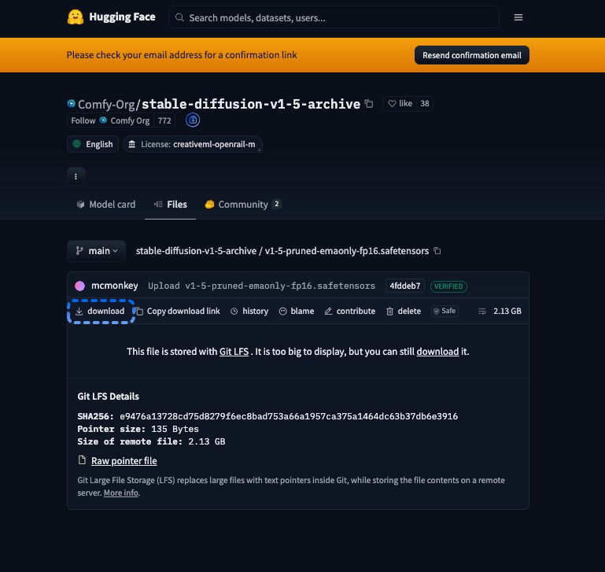

## 모델을 `checkpoints` 폴더에 넣기 {#put-the-model-in-the-checkpoints-folder}

ComfyUI는 파일이 ComfyUI가 읽는 `checkpoints` 폴더 안에 있을 때만 해당 체크포인트를 목록에 표시합니다. 다운로드한 파일을 사용 중인 설치 환경의 폴더로 옮기세요.

<Tabs>
  <Tab title="Comfy Desktop">
    기본적으로 모든 Comfy Desktop 인스턴스는 공유 모델 폴더를 읽습니다. Comfy Desktop은 모델 다운로드를 **DOWNLOADS**로 표시된 공유 모델 폴더에 저장합니다.

    1. Comfy Desktop **타이틀 바**에서 **메뉴**를 클릭한 다음 **데스크탑 설정**을 선택합니다.
    2. **저장소** 탭을 선택합니다.
    3. **공유 모델** 아래에서 **DOWNLOADS**로 표시된 폴더 경로를 클릭합니다. 파일 관리자에서 해당 폴더가 열립니다.
    4. `v1-5-pruned-emaonly-fp16.safetensors` 파일을 그 안의 `checkpoints` 폴더로 옮깁니다. `checkpoints` 폴더가 없다면 새로 생성하세요.
  </Tab>
  <Tab title="ComfyUI Portable">
    - `v1-5-pruned-emaonly-fp16.safetensors` 파일을 `ComfyUI_windows_portable\ComfyUI\models\checkpoints`로 옮깁니다.

    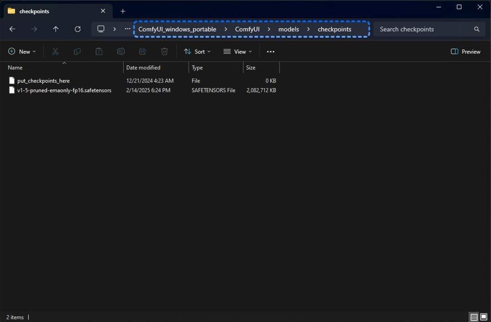
  </Tab>
  <Tab title="수동 설치">
    1. `main.py`가 들어 있는, ComfyUI를 설치한 폴더를 엽니다.
    2. `v1-5-pruned-emaonly-fp16.safetensors` 파일을 그 안의 `models/checkpoints` 폴더로 옮깁니다.
  </Tab>
</Tabs>

ComfyUI가 이미 열려 있다면 `R`을 눌러 모델 폴더를 다시 읽도록 하세요.

## 빈 워크플로 열기

**캔버스**는 노드를 배치하는 넓은 영역입니다. 이미 워크플로가 표시되어 있다면, 빈 워크플로를 여세요:

1. **왼쪽 사이드바** 상단에서 ComfyUI 로고(**메뉴**)를 클릭합니다.
2. **새로 만들기**를 선택합니다.

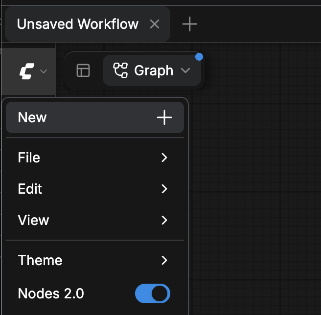

이제 **캔버스**가 비어 있습니다.

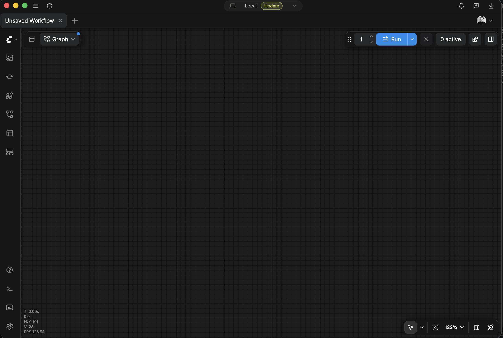

<Tip>
  **상단 바**에서 열려 있는 워크플로 탭 옆의 더하기(**+**) 버튼을 눌러도 새로운 빈 워크플로가 열립니다.

  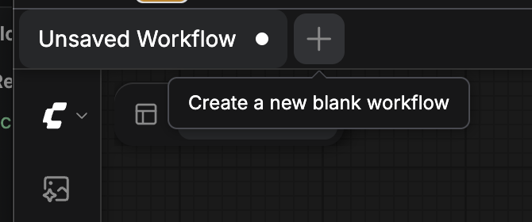
</Tip>

## 노드 추가 {#add-a-node}

노드를 추가하는 방법은 세 가지입니다. 이후 단계에서 어떤 방법을 사용할지 안내합니다.

### 노드 추가 메뉴 사용 {#use-the-add-node-menu}

1. **캔버스**의 빈 공간을 마우스 오른쪽 버튼으로 클릭합니다. 메뉴가 열립니다.
2. **노드 추가**를 선택한 다음, 해당 노드의 **노드 추가** 경로에 있는 각 카테고리를 선택합니다. [노드 표](#learn-the-parts-of-a-workflow)에 이 튜토리얼의 각 노드 경로가 나와 있습니다.
3. 노드를 선택합니다. 마우스 오른쪽 버튼을 클릭한 위치에 노드가 나타납니다.

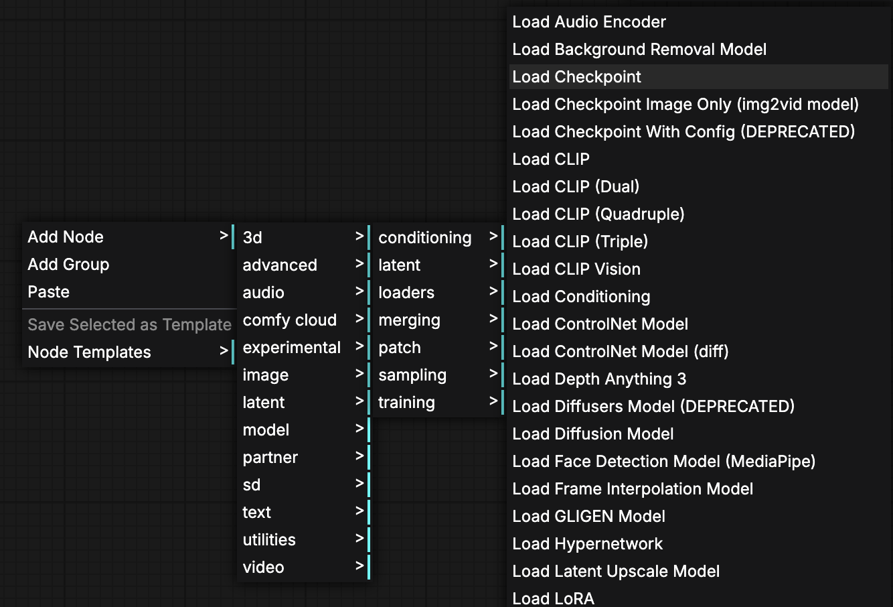

### 노드 라이브러리에서 검색 {#search-the-node-library}

1. `N`을 누르거나 **왼쪽 사이드바**에서 **노드**를 클릭합니다. **노드 라이브러리**가 열립니다.
2. **노드 라이브러리**에 탭이 두 개 이상 표시되면 **모든 노드**를 선택합니다.
3. **노드 검색...** 상자에 노드 이름을 입력합니다.
4. 결과에서 노드를 클릭한 다음, 원하는 위치의 **캔버스**를 클릭합니다. 해당 위치에 노드가 나타납니다.

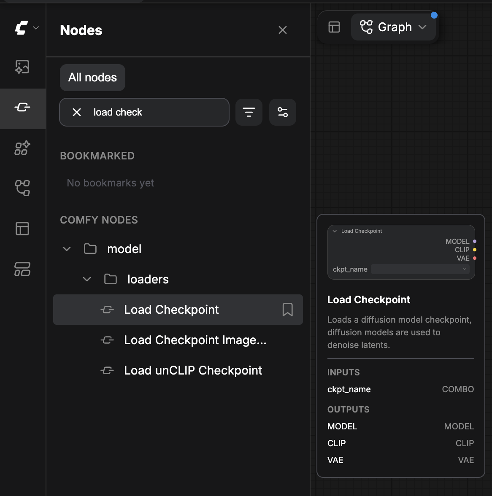

### 빈 캔버스로 링크 드래그 {#drag-a-link-to-empty-canvas}

링크를 빈 캔버스로 드래그하면 한 번의 동작으로 노드를 추가하고 연결할 수 있습니다.

1. 이미 배치한 노드의 출력 점에서 드래그합니다.
2. **캔버스**의 빈 공간에서 마우스를 놓습니다. 기본적으로 해당 위치에 노드 검색 상자가 열립니다.
3. 노드 이름을 입력한 다음 노드를 선택합니다. ComfyUI가 노드를 추가하고 드래그를 시작한 출력에 연결합니다.

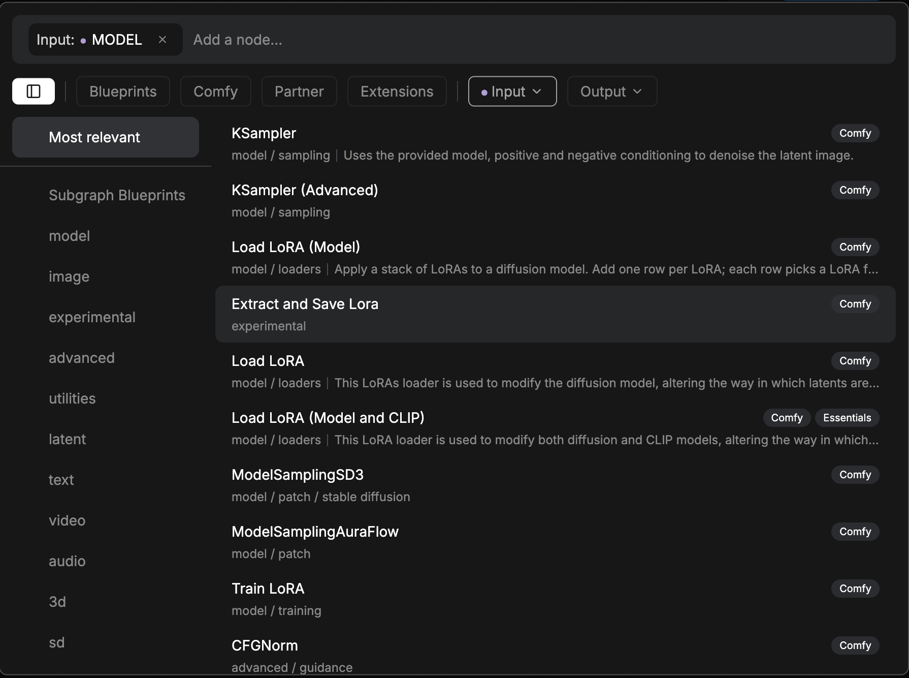

검색 상자 대신 메뉴를 열려면 마우스를 놓을 때 `Shift`를 누르고 있으면 됩니다.

## 두 노드 연결하기 {#connect-two-nodes}

링크는 한 노드의 출력에서 다른 노드의 입력으로 데이터를 전달합니다.

1. 한 노드의 출력 점에서 드래그합니다.
2. 다른 노드의 입력 점 위에서 놓습니다. 두 점 사이에 링크가 나타납니다.

다음 규칙은 모든 링크에 적용됩니다:

- 하나의 출력은 여러 입력에 연결할 수 있습니다.
- 입력은 하나의 링크를 받습니다. 입력에 새 링크를 연결하면 기존 링크가 교체됩니다.
- 링크는 같은 타입의 출력과 입력을 연결합니다. ComfyUI는 서로 다른 타입 사이에는 링크를 그리지 않습니다.

## `Load Checkpoint` 노드 추가

`Load Checkpoint` 노드는 모델 파일을 로드합니다.

1. [**노드 추가** 메뉴](#use-the-add-node-menu)에서 `Load Checkpoint` 노드를 추가합니다: **모델** > **로더** > `Load Checkpoint`(메뉴에는 **체크포인트 로드**로 표시됩니다).
2. 노드에서 `ckpt_name` 위젯을 클릭한 다음 `v1-5-pruned-emaonly-fp16.safetensors`를 선택합니다.

노드는 오른쪽에 세 개의 출력을 표시합니다: `MODEL`, `CLIP`, `VAE`.

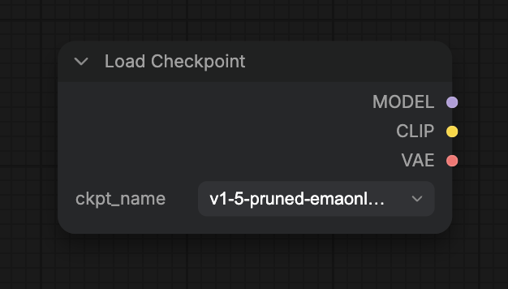

`ckpt_name` 목록에 파일이 표시되지 않으면 [모델이 체크포인트 목록에 없음](#the-model-isnt-in-the-checkpoint-list)을 참조하세요.

## `KSampler` 노드 추가

`KSampler` 노드가 생성을 수행합니다. 모델, 두 개의 프롬프트, 빈 시작 이미지, 이렇게 네 가지 연결이 필요합니다.

1. [**노드 라이브러리**](#search-the-node-library)에서 `KSampler` 노드를 추가하세요: `KSampler`를 검색합니다.
2. `Load Checkpoint`의 `MODEL` 출력을 `KSampler`의 `model` 입력에 [연결](#connect-two-nodes)하세요.

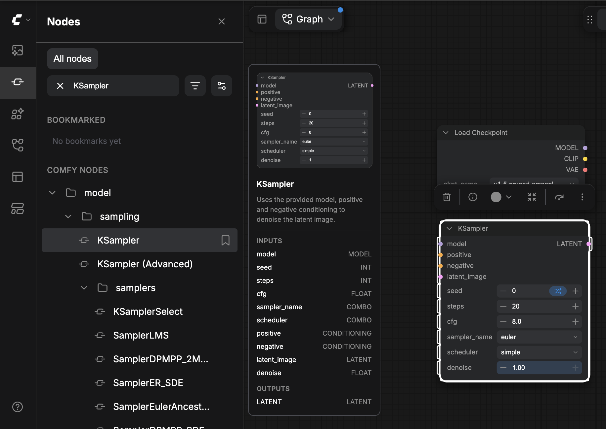

나머지 세 개의 연결은 다음 두 섹션에서 그립니다.

`KSampler` 위젯은 기본값으로 두세요. 예를 들어 `steps`는 `20`이고 `cfg`는 `8.0`입니다.

## 프롬프트 노드 추가

프롬프트는 이미지를 설명합니다. 긍정 프롬프트는 보고 싶은 내용을 나타냅니다. 네거티브 프롬프트는 원하지 않는 내용을 나타냅니다.

1. [**노드 추가** 메뉴](#use-the-add-node-menu) (**모델** > **조건화**) 또는 [**노드 라이브러리**](#search-the-node-library)를 사용하여 `CLIP Text Encode (Prompt)` 노드를 추가합니다(메뉴에는 **CLIP 텍스트 인코딩 (프롬프트)**로 표시됩니다).
2. 텍스트 상자를 클릭하고 긍정 프롬프트를 입력합니다. 예: `beautiful scenery nature glass bottle landscape, purple galaxy bottle`.
3. 노드를 마우스 오른쪽 버튼으로 클릭한 다음 **복제**를 선택합니다. 두 번째 `CLIP Text Encode (Prompt)` 노드가 나타납니다.
4. 두 번째 노드의 텍스트 상자를 클릭하고 네거티브 프롬프트를 입력합니다. 예: `text, watermark`.

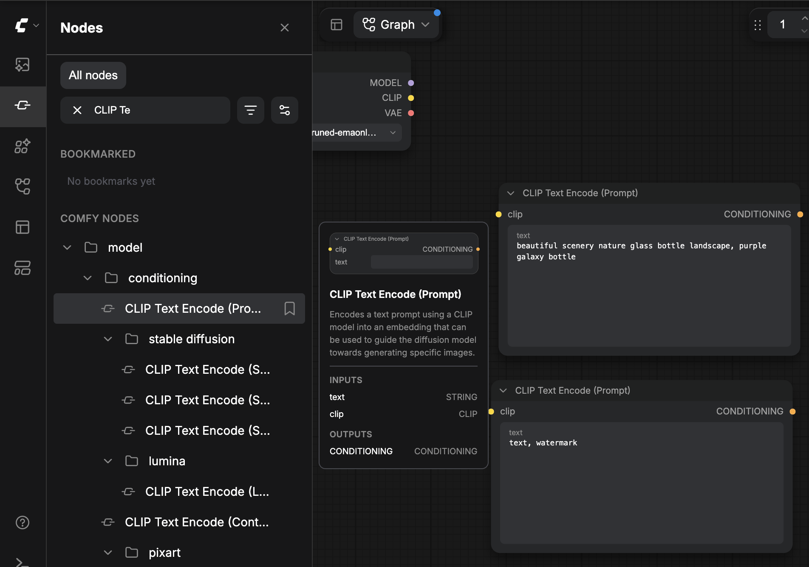

프롬프트를 [연결](#connect-two-nodes)합니다:

1. `Load Checkpoint`의 `CLIP` 출력을 각 `CLIP Text Encode (Prompt)` 노드의 `clip` 입력에 연결합니다. 두 프롬프트 노드는 하나의 `CLIP` 출력을 공유합니다.
2. 긍정 프롬프트 노드의 `CONDITIONING` 출력을 `KSampler`의 `positive` 입력에 연결합니다.
3. 네거티브 프롬프트 노드의 `CONDITIONING` 출력을 `KSampler`의 `negative` 입력에 연결합니다.

## 이미지 크기 설정

`Empty Latent Image` 노드가 이미지 크기를 설정합니다. `width`와 `height`는 `1024`에서 시작합니다. 이 워크플로는 [이미지에서 워크플로 로드](#load-a-workflow-from-an-image)의 예제 워크플로에 있는 크기인 `512`를 사용합니다.

1. [**노드 추가** 메뉴](#use-the-add-node-menu)를 사용하여 `Empty Latent Image` 노드를 추가합니다: **모델** > **잠재 데이터** > `Empty Latent Image`(메뉴에는 **빈 잠재 이미지**로 표시됩니다).
2. `width`를 `512`로 설정합니다.
3. `height`를 `512`로 설정합니다.
4. `batch_size`는 `1`로 둡니다.
5. `KSampler`의 `latent_image` 입력에 `LATENT` 출력을 [연결](#connect-two-nodes)합니다.

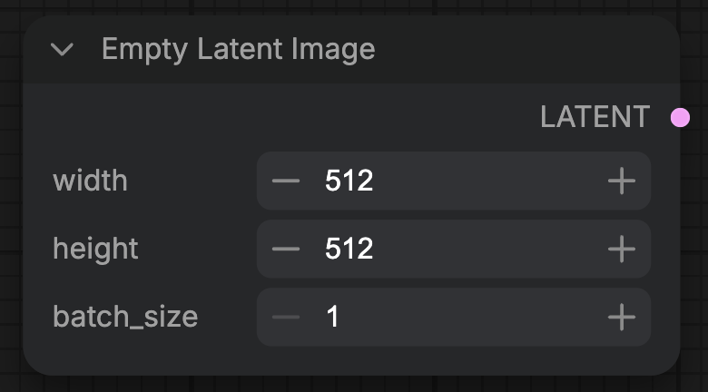

이제 `KSampler`의 네 입력 모두 연결되어 있습니다.

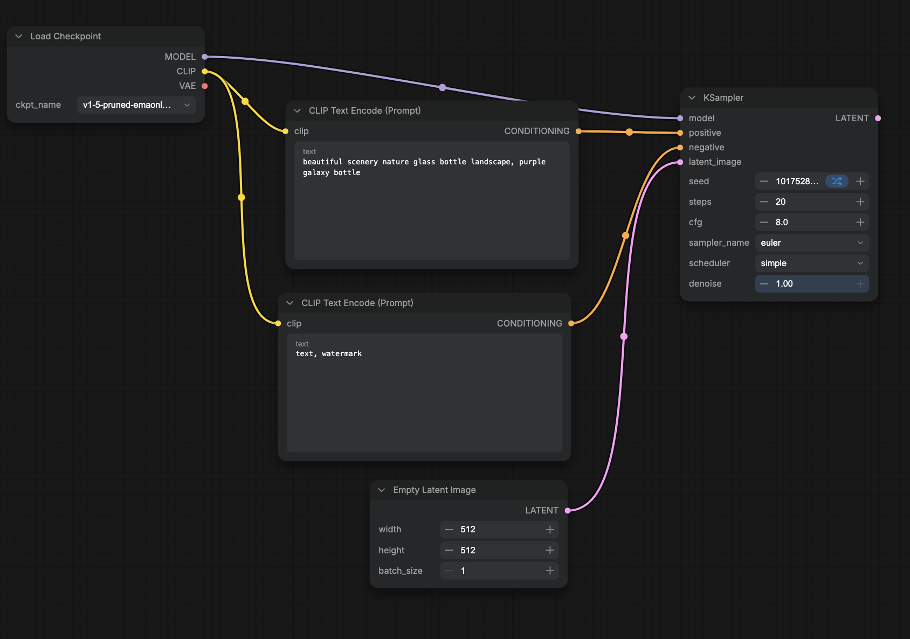

## 이미지 디코딩 및 저장

`KSampler`는 이미지가 아니라 잠재 데이터를 출력합니다. `VAE Decode`가 이를 이미지로 변환하고, `Save Image`가 저장합니다.

1. [**노드 라이브러리**](#search-the-node-library)에서 `VAE Decode` 노드를 추가하세요: `VAE Decode`를 검색합니다(메뉴에는 **VAE 디코드**로 표시됩니다).
2. `KSampler`의 `LATENT` 출력을 `VAE Decode`의 `samples` 입력에 [연결](#connect-two-nodes)하세요.
3. `Load Checkpoint`의 `VAE` 출력을 `VAE Decode`의 `vae` 입력에 연결하세요.
4. [빈 캔버스로 링크를 드래그](#drag-a-link-to-empty-canvas)하여 `Save Image` 노드를 추가하세요: `VAE Decode`의 `IMAGE` 출력에서 드래그를 시작해 빈 **캔버스** 위에서 놓은 뒤 `Save Image`를 선택합니다(메뉴에는 **이미지 저장**으로 표시됩니다). 그러면 `images` 입력이 `IMAGE`에 연결됩니다.

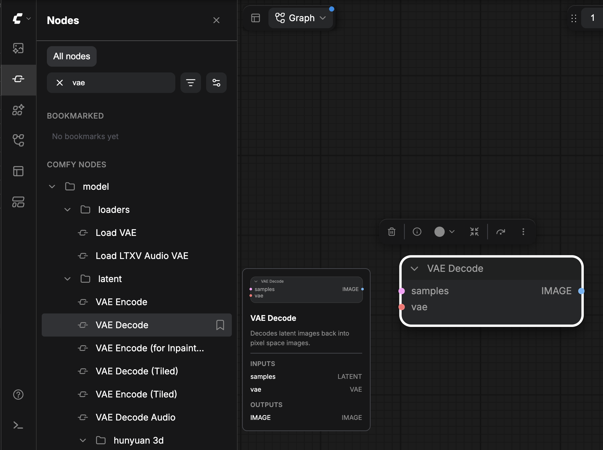

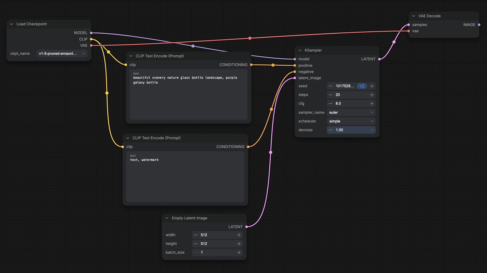

워크플로에는 7개의 노드와 9개의 링크가 있습니다.

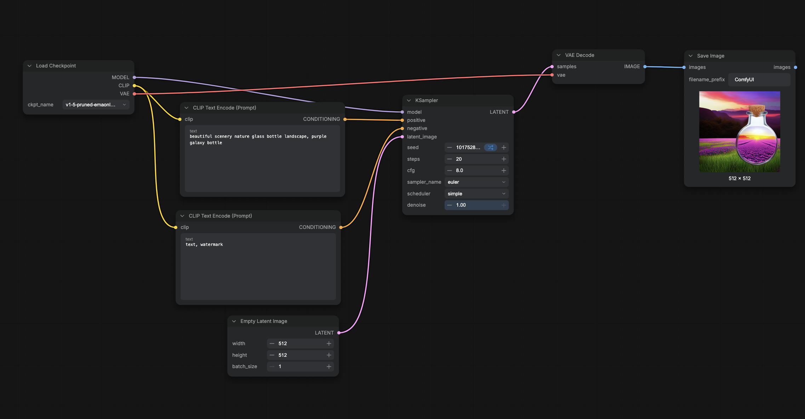

<Tip>
  아무 노드도 선택하지 않은 상태에서 `.`를 누르면 전체 워크플로가 화면에 맞춰집니다.
</Tip>

## 워크플로 실행

워크플로를 실행하면 작업이 대기열에 추가되고, ComfyUI가 이미지를 생성합니다.

- **실행**을 클릭하거나 `Ctrl+Enter` (macOS에서는 `Cmd+Enter`)를 누릅니다.

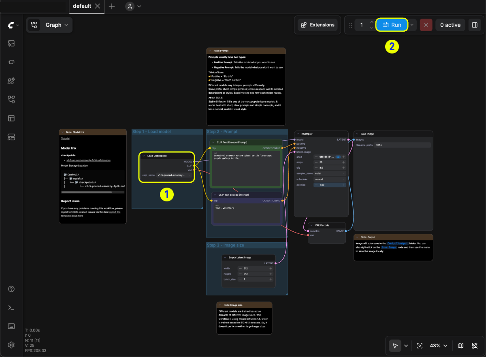

ComfyUI에 **필수 입력 누락**이 표시되면 [필수 입력 누락](#required-input-missing)을 참조하세요.

## 생성된 이미지 찾기

실행이 끝나면 이미지가 `Save Image` 노드에 나타납니다. **왼쪽 사이드바**에서 열려면:

- **에셋**을 클릭한 다음 **생성됨** 탭을 선택합니다.

`Save Image`는 또한 이미지를 `ComfyUI_00001_.png`라는 이름의 PNG 파일로 출력 폴더에 기록합니다. 새 이미지마다 숫자가 증가합니다. ComfyUI Portable 및 수동 설치에서 출력 폴더는 `ComfyUI/output`입니다.

## 이미지에서 워크플로 불러오기 {#load-a-workflow-from-an-image}

`Save Image`가 기록하는 모든 PNG 파일에는 기본적으로 해당 파일을 만든 워크플로가 포함되어 있습니다. 아래 예시 이미지를 불러와 해당 이미지의 워크플로를 경로 B에서 만든 워크플로와 비교해 보세요.

1. 이 이미지를 컴퓨터에 저장합니다:

   

2. PNG 파일을 **캔버스**로 드래그합니다. **왼쪽 사이드바**에서 ComfyUI 로고(**메뉴**)를 클릭하고 **파일** > **열기**를 선택한 다음 파일을 선택할 수도 있습니다.

이미지의 워크플로가 열립니다. 대신 `Load Image` 노드가 나타나면 드롭한 파일에 저장된 워크플로가 없는 것입니다.

</Tab>
</Tabs>

## 누락된 모델 해결 {#fix-a-missing-model}

모델 파일이 모델 폴더에 없는 워크플로를 불러오면 ComfyUI는 누락된 모델 이름을 알려주는 알림을 표시합니다. 예: `v1-5-pruned-emaonly-fp16.safetensors is missing`.

1. **자세히 보기**를 클릭합니다. **오른쪽 사이드 패널**이 **문제** 탭에서 열리고 파일이 **누락된 모델** 아래에 나열됩니다. 파일이 속한 폴더(예: `checkpoints`)가 파일 이름 아래에 표시됩니다.
2. 행에 **다운로드** 버튼이 있으면 클릭합니다.
   - **Comfy Desktop**: Comfy Desktop은 파일을 **DOWNLOADS** 모델 폴더의 `checkpoints` 폴더로 다운로드합니다.
   - **ComfyUI Portable 및 수동 설치**: 브라우저에서 파일을 다운로드합니다. 파일 이름 아래 폴더로 옮기세요. SD 1.5 체크포인트는 [모델을 checkpoints 폴더에 넣기](#put-the-model-in-the-checkpoints-folder)를 참고하세요.
3. 행에 **다운로드** 버튼이 없으면 파일을 직접 가져옵니다:
   1. 파일 이름 옆의 링크 아이콘을 클릭합니다. 링크 아이콘은 다운로드 링크(**URL 복사**)를 복사하거나, 워크플로에 링크가 없으면 파일 이름(**모델 이름 복사**)을 복사합니다.
   2. 파일을 다운로드합니다. 경로 B 모델은 [모델 다운로드](#download-the-model)를 따르고, 경로 A는 [Z-Image-Turbo 튜토리얼](/tutorials/image/z-image/z-image-turbo)의 링크를 사용하세요.
   3. 파일 이름 아래에 표시된 폴더(예: `checkpoints`, `diffusion_models`, `text_encoders`, `vae`)로 파일을 이동합니다.
4. **누락된 모델** 헤더에서 **새로고침**(원형 화살표)을 클릭하거나 `R`을 눌러 ComfyUI가 모델 폴더를 다시 확인하도록 합니다.

누락된 모델 행에 **다운로드** 버튼이 없는 경우는 다음 중 하나가 참일 때입니다:

- 워크플로에 해당 모델의 다운로드 링크가 없습니다. [이미지에서 워크플로 불러오기](#load-a-workflow-from-an-image)의 예제 이미지가 이러한 워크플로 중 하나입니다.
- 다운로드 링크가 Hugging Face 또는 Civitai 링크가 아닙니다.
- 파일 이름이 `.safetensors`, `.sft`, `.ckpt`, `.pth`, `.pt`로 끝나지 않습니다.
- 워크플로에 파일이 속한 모델 폴더가 명시되어 있지 않습니다.

<Note>
  Comfy Cloud는 누락된 모델에 대해 **다운로드**를 절대 표시하지 않습니다. 대신 **가져오기**를 표시하므로 모델을 Comfy Cloud로 가져올 수 있습니다. 가져온 모델을 지원하지 않는 노드에서 사용하는 모델은 **가져오기 지원되지 않음** 아래에 나열됩니다.
</Note>

## 문제 해결

실행이 실패하거나 모델 파일이 로드되지 않을 때 이 항목을 사용하세요.

### 필수 입력 누락 {#required-input-missing}

입력에 링크가 없습니다. 메시지에는 노드와 입력이 명시됩니다. 예: `KSampler is missing a required input: latent_image`. 메시지에 명시된 입력을 [연결](#connect-two-nodes)한 다음 워크플로를 다시 실행하세요.

### 모델이 체크포인트 목록에 없음 {#the-model-isnt-in-the-checkpoint-list}

파일이 ComfyUI가 읽는 `checkpoints` 폴더에 없습니다. [모델을 체크포인트 폴더에 넣기](#put-the-model-in-the-checkpoints-folder)에 설명된 대로 파일을 해당 폴더로 옮긴 다음 `R`을 누르세요.

## 다음 단계 {#next-steps}

- 최신 이미지 모델 이어가기: [Z-Image-Turbo](/tutorials/image/z-image/z-image-turbo), [FLUX.3 Klein](/tutorials/flux/flux-3-klein), [Qwen-Image-2.1](/tutorials/image/qwen/qwen-image-2-1)
- SD 1.5 스타일 기초 더 보기: [텍스트-이미지 튜토리얼](/tutorials/basic/text-to-image)
- 인터페이스 안내: [인터페이스 개요](/interface/overview)
