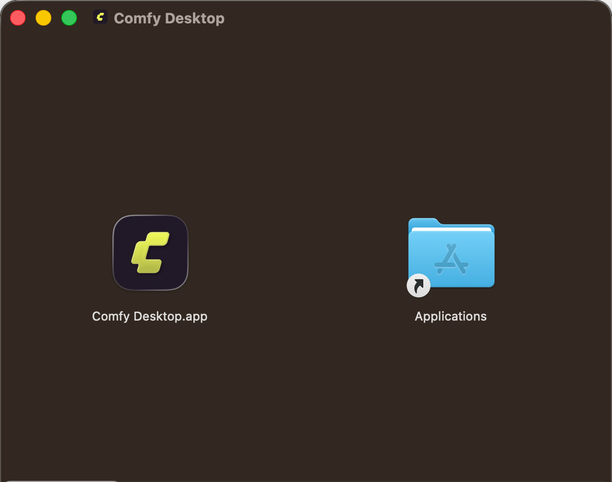
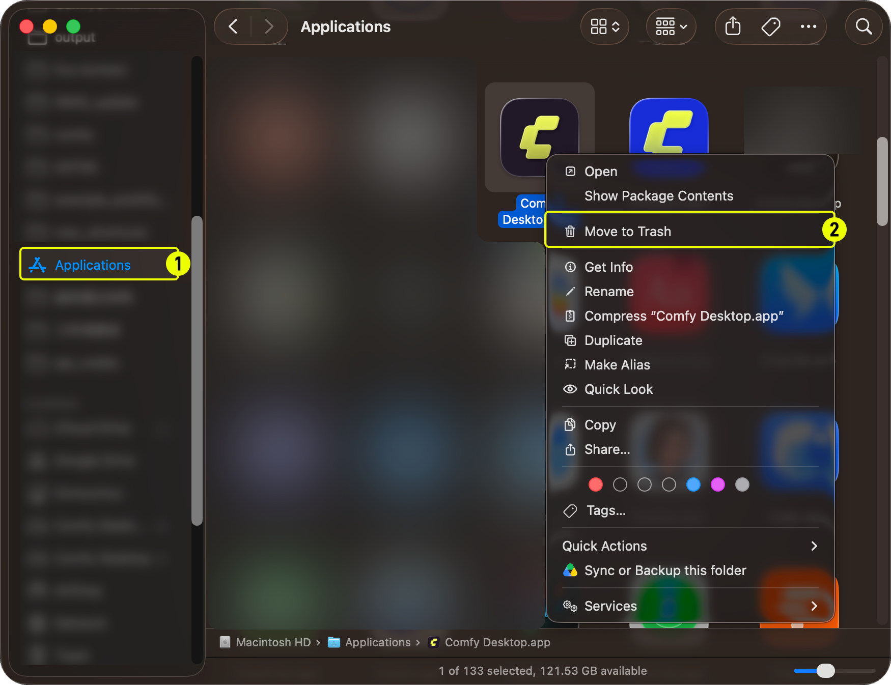

import MigrateTip from '/snippets/ko/desktop/migrate.mdx'
import UpdateGuide from '/snippets/ko/desktop/update.mdx'

**Comfy Desktop**은 하나의 런처로 여러 ComfyUI 인스턴스를 실행할 수 있는 다중 설치 관리자입니다. 이 가이드는 macOS에서 Comfy Desktop을 설치하고 제거하는 방법을 다룹니다.

## 시스템 요구 사항

- **OS:** macOS 13 (Ventura) 이상
- **하드웨어:** Apple Silicon (M1 이상)
- **디스크 공간:** 설치당 최소 4.85GB 권장

<Card title="Comfy Desktop 다운로드" icon="download" href="https://comfy.org/download">
    macOS용 최신 설치 프로그램을 다운로드하세요. 페이지가 자동으로 사용 중인 플랫폼을 감지합니다.
</Card>

## 설치

1. 다운로드한 `.dmg` 파일을 엽니다.
2. **Comfy Desktop**을 **응용 프로그램** 폴더로 드래그합니다.
3. Launchpad 또는 Spotlight에서 실행합니다.


처음 실행 시 macOS에서 보안 경고가 표시될 수 있습니다. **시스템 설정 → 개인정보 보호 및 보안**으로 이동하여 **그냥 열기**를 클릭해 허용하세요.

<MigrateTip />

<Card title="다음 단계: Comfy Desktop 사용하기" icon="book-open" href="/ko/installation/desktop/usage/overview">
  설치가 완료되면 인스턴스 생성, 설치 관리 및 설정 구성 방법을 알아보세요.
</Card>

## Comfy Desktop 업데이트

<UpdateGuide />

## 제거

### Comfy Desktop 제거

1. Finder에서 **응용 프로그램** 폴더를 엽니다.
2. **Comfy Desktop**을 마우스 오른쪽 버튼으로 클릭하고 **휴지통으로 이동**을 선택합니다.



### 앱을 제거해도 삭제되지 않는 항목

Comfy Desktop을 제거하면 런처 앱 자체만 제거됩니다. 다음 데이터는 **제거되지 않으며** 완전한 정리를 원할 경우 수동으로 삭제해야 합니다:

| 데이터 | 기본 위치 | 설명 |
|------|----------|-------------|
| 설치본 | `~/ComfyUI-Installs` | 생성한 각 ComfyUI 설치본 (앱 내에서도 삭제 가능). 사용자 지정 설치 경로도 제거되지 않습니다. |
| 공유 모델 및 출력 | `~/ComfyUI-Shared` | 공유 모델 라이브러리, 입력/출력 디렉토리 |
| 앱 설정 및 레지스트리 | `~/Library/Application Support/Comfy Desktop` | 설정 및 설치 기록 |
| 로그 | `~/Library/Logs/Comfy Desktop` | 데스크톱 앱 로그 (`app.log`) |

<Warning>위에 나열된 디렉토리에는 **개인 ComfyUI 데이터**(모델, 출력물, 설정 및 설치본)가 포함되어 있습니다. 이들은 Comfy Desktop 애플리케이션 파일이 **아닙니다**. 삭제하면 데이터가 영구적으로 제거됩니다.</Warning>

모든 것을 완전히 제거하려면:

1. **앱 데이터 폴더 삭제**: `~/Library/Application Support/Comfy Desktop`
2. **로그 폴더 삭제**: `~/Library/Logs/Comfy Desktop`
3. **개별 설치본 삭제**: 앱 내에서 삭제하거나 `~/ComfyUI-Installs`와 직접 설정한 사용자 지정 설치 디렉토리를 수동으로 삭제합니다.
4. **공유 모델 라이브러리 삭제**: `~/ComfyUI-Shared` (이 파일들이 더 이상 필요하지 않은 경우에만)

## 앱이 비정상적인 화면으로 시작될 때

수동 업데이트 후 Comfy Desktop이 스타일 없이 실행되거나, 번역이 빠지거나, 버튼과 드롭다운이 반응하지 않을 수 있습니다. 보통 이전 버전이 남긴 Chromium 프로필이나 캐시된 대기 중 업데이트가 원인입니다.

먼저 Comfy Desktop을 종료한 뒤 [Comfy-Desktop 저장소](https://github.com/Comfy-Org/Comfy-Desktop/blob/main/scripts/reset-mac.sh)의 초기화 스크립트를 실행합니다:

```bash
curl -fsSLO https://raw.githubusercontent.com/Comfy-Org/Comfy-Desktop/main/scripts/reset-mac.sh && bash reset-mac.sh
```

스크립트는 삭제할 경로를 모두 보여 주고 확인을 받은 뒤 삭제합니다. 현재 버전과 이전 앱 이름의 설정, 캐시, Chromium 프로필을 지우므로 예전 빌드의 프로필이 다시 적용되지 않습니다. Comfy Desktop이 실행 중이면 스크립트는 실행을 거부합니다. 로그 폴더도 삭제 대상이므로 문제를 보고할 생각이라면 먼저 로그를 복사하세요([앱 로그 위치](#앱-로그-위치)).

`~/ComfyUI-Installs`의 ComfyUI 설치본과 `~/ComfyUI-Shared`의 공유 모델은 그대로 남지만, 설치 목록을 기록한 파일은 다른 앱 데이터와 함께 삭제되므로 다음 실행 시 **Add Existing Instance**로 다시 추가해야 할 수 있습니다. 스크립트는 Mac에서 발견한 앱 사본도 삭제하지 않고 알려 줍니다. Dock에 예전 사본이 남아 있으면 초기화해도 달라지지 않은 것처럼 보이는 경우가 많기 때문입니다.

### 앱 로그 위치

초기화로 해결되지 않아 [Comfy-Desktop 이슈](https://github.com/Comfy-Org/Comfy-Desktop/issues)에 보고하려면 첨부할 파일은 `~/Library/Logs/Comfy Desktop`의 `app.log`입니다. 이 폴더도 초기화할 때 삭제되므로 스크립트를 실행하기 전에 다른 곳으로 복사하세요. Comfy Desktop은 실행할 때마다 새 `app.log`를 쓰고 최근 50개까지의 이전 파일을 `app.log_<timestamp>.log` 이름으로 같은 폴더에 보관하므로, 문제가 발생한 세션의 파일을 고르세요. 파일은 5 MB에 도달하면 교체되므로 긴 세션은 여러 파일로 나뉠 수 있습니다.
