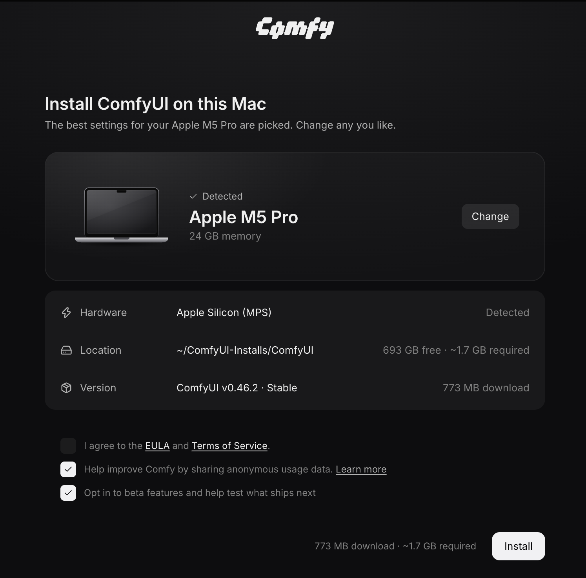
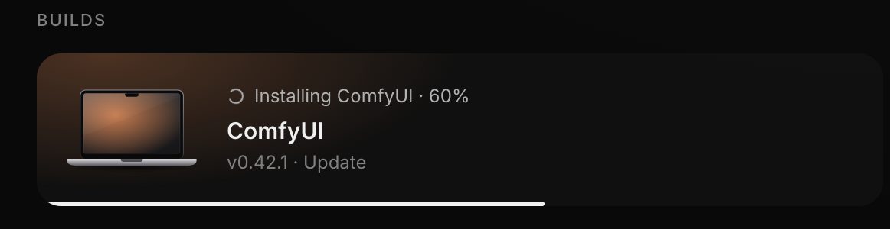
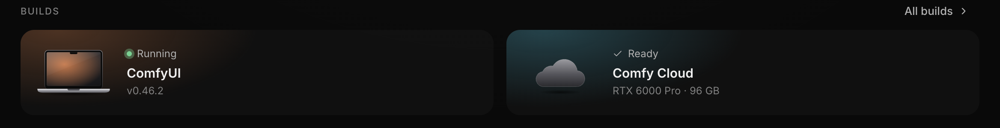

**Comfy Desktop**은 ComfyUI를 실행할 때 사용하는 앱입니다. 이 컴퓨터에 설치된 복사본(로컬 빌드)으로 실행하거나, 클라우드의 GPU에서 실행되어 어떤 컴퓨터에서든 작동하는 Comfy Cloud에서 실행할 수 있습니다. ComfyUI에 필요한 모든 것을 다운로드하고 설정하므로, 설치하는 앱은 Comfy Desktop 하나뿐입니다. 이 페이지에서는 Comfy Desktop을 다운로드하고, 첫 실행 시 열리는 설정 화면을 확인한 다음, ComfyUI를 엽니다.


<Note>
  Comfy Desktop은 각각의 ComfyUI 복사본을 빌드라고 부릅니다. 이전 버전의 Comfy Desktop을 사용했다면, 기존 인스턴스가 동일한 모델과 설정을 그대로 가진 빌드로 표시됩니다.
</Note>

## ComfyUI가 실행되는 위치 선택

Comfy Desktop은 ComfyUI를 두 곳에서 실행합니다: 이 컴퓨터에서 로컬 빌드로 실행하거나, [Comfy Cloud](https://comfy.org/cloud)에서 실행합니다. 첫 실행 시 설정 화면에서 로컬 빌드를 설치하므로 시작하기 전에 원하는 곳을 선택하세요.

| | 로컬 빌드 | Comfy Cloud |
| --- | --- | --- |
| 실행 위치 | 이 컴퓨터 | 클라우드의 GPU에서 실행되므로 모든 컴퓨터에서 작동합니다 |
| 설정 | 첫 실행 시 설정 화면에서 설치합니다 | 없음. **홈**에 **Comfy Cloud** 카드가 표시됩니다 |
| 비용 | 무료 | GPU가 실행되는 동안에만 사용되는 Comfy 크레딧 |
| 필요 사항 | 설치를 위한 디스크 여유 공간(설정 화면에 수량이 표시됨) | Comfy 계정 |

Comfy Cloud만 사용하려면 설정 화면이 열릴 때 설치를 건너뛰세요. [Comfy Desktop에서 Comfy Cloud 열기](#comfy-desktop에서-comfy-cloud-열기)에서 방법을 확인할 수 있습니다.

## Comfy Desktop 다운로드

다운로드 페이지에서는 Windows, macOS, Linux용 설치 프로그램을 제공합니다.

1. [comfy.org/download](https://comfy.org/download)로 이동합니다.
2. **DOWNLOAD DESKTOP**을 클릭합니다. 이 버튼은 페이지가 감지한 운영 체제용 설치 프로그램을 다운로드합니다. 설치 프로그램 이름은 버튼 텍스트 아래에 표시됩니다.
3. 다른 설치 프로그램을 선택하려면 버튼 옆의 화살표(**All installers**)를 클릭한 다음 설치 프로그램을 선택합니다. 목록에서 **Windows x64**, **Windows ARM64 (NVIDIA only)**, **macOS (Apple Silicon)**, **Linux x64 (AppImage)**를 선택할 수 있습니다.

   

## 사용 중인 OS에 맞게 Comfy Desktop 설치

사용 중인 운영체제의 탭을 선택하고 요구 사항을 확인한 다음, 다운로드한 파일을 설치하세요.

<Tabs>
  <Tab title="Windows">
    **시스템 요구 사항**

    - Windows 10 이상, x64 또는 ARM64.
    - 전용 NVIDIA 또는 AMD GPU를 권장하지만 필수는 아닙니다. ARM64에서는 로컬 빌드에 NVIDIA GPU가 필요합니다.
    - 빌드마다 최소 4.85 GB의 여유 디스크 공간.

    **설치**

    1. 다운로드한 `.exe` 설치 프로그램을 실행하고 안내에 따르세요.
    2. **시작** 메뉴 또는 바탕 화면 바로 가기에서 Comfy Desktop을 실행하세요.

    
  </Tab>
  <Tab title="macOS">
    **시스템 요구 사항**

    - macOS 13(Ventura) 이상.
    - Apple silicon(M1 이상)이 탑재된 Mac.
    - 빌드마다 최소 4.85 GB의 여유 디스크 공간.

    **설치**

    1. 다운로드한 `.dmg` 파일을 여세요.
    2. **Comfy Desktop**을 **Applications** 폴더로 드래그하세요.
    3. Launchpad 또는 Spotlight에서 Comfy Desktop을 실행하세요.

    

    처음 실행할 때 macOS가 보안 경고를 표시하면 **시스템 설정** > **개인정보 보호 및 보안**으로 이동하여 **확인 없이 열기**를 클릭하세요.
  </Tab>
  <Tab title="Linux">
    **시스템 요구 사항**

    - x64 기반 Linux. Ubuntu 22.04 이상을 권장합니다.
    - 전용 NVIDIA 또는 AMD GPU를 권장하지만 필수는 아닙니다.
    - 빌드마다 최소 4.85 GB의 여유 디스크 공간.

    다운로드 페이지에서는 AppImage를 제공합니다. Debian 및 Ubuntu용 `.deb` 패키지도 플랫폼을 자동으로 감지하는 [통합 다운로드 링크](https://dl.todesktop.com/241130tqe9q3y)에서 받을 수 있습니다.

    **.deb 패키지 설치**

    ```bash
    sudo apt install ./*.deb
    ```

    이 패키지는 Comfy Desktop을 `/opt/Comfy Desktop`에 설치하고 APT 소스를 추가하므로, 새 릴리스가 일반 시스템 업데이트(`sudo apt update` 및 `sudo apt upgrade`)와 함께 제공됩니다. Ubuntu 24.04 이상에서는 Electron 샌드박스가 작동하도록 AppArmor 프로필도 설치합니다. Ubuntu 22.04에서 패키지를 설치한 뒤 24.04로 업그레이드했다면 프로필을 추가하기 위해 `sudo apt reinstall comfyui-desktop-2`를 실행하세요.

    **AppImage 실행**

    1. AppImage에 필요한 FUSE 2를 설치합니다. Ubuntu 24.04 이상에서는 `sudo apt install libfuse2t64`를 실행하세요. Ubuntu 22.04에서는 `sudo apt install libfuse2`를 실행하세요.
    2. 파일을 실행 가능하게 만든 후 실행합니다.

       ```bash
       chmod +x ./*.AppImage
       ./*.AppImage
       ```

    AppImage는 실행한 파일을 교체하는 방식으로 자체 업데이트하므로, 사용자 계정이 쓰기 권한을 가진 폴더에 보관하세요. 배포판이 Electron 샌드박스를 차단하여 시작에 실패하면 `--no-sandbox`를 붙여 실행하세요. 이 플래그는 모든 프로세스에서 샌드박스를 끄므로, 노멀(normal) 실행이 실패할 때만 사용하세요.

    <Accordion title="소스에서 빌드 및 실행">
      개발 목적으로는 [저장소](https://github.com/Comfy-Org/Comfy-Desktop#development)에서 Comfy Desktop을 실행하세요. Node.js 24, Corepack을 통한 pnpm 10, `build-essential`, `git`이 필요합니다.

      ```bash
      sudo apt install build-essential git
      nvm install 24 && nvm use 24
      corepack enable
      git clone https://github.com/Comfy-Org/Comfy-Desktop.git
      cd Comfy-Desktop
      pnpm run init
      ./linux-dev.sh
      ```

      소스 체크아웃은 자체적으로 업데이트되지 않습니다. 업데이트하려면 `git pull`과 `pnpm run init`을 실행한 다음 `./linux-dev.sh`를 다시 시작하세요.
    </Accordion>
  </Tab>
</Tabs>

그런 다음 Comfy Desktop을 실행하세요. 첫 실행 시 설정 화면이 열립니다.

<Tip>
  중국어 다운로드 페이지인 [comfy.org/zh-CN/download](https://comfy.org/zh-CN/download)에서도 동일한 설치 프로그램을 제공합니다. 버튼에는 **下载桌面版**이라고 표시되어 있습니다. 중국 내 미러에서 ComfyUI 파일을 다운로드하려면 [설정 화면 확인](#설정-화면-확인)을 참고하세요.
</Tip>

## 설정 화면 확인

Comfy Desktop은 처음 실행할 때 설정 화면을 엽니다. 화면 제목은 macOS에서 **이 Mac에 ComfyUI 설치**, Windows에서 **이 PC에 ComfyUI 설치**, Linux에서 **이 컴퓨터에 ComfyUI 설치**입니다. **설치**를 클릭하기 전까지는 아무것도 다운로드되지 않습니다.



Comfy Desktop은 컴퓨터에 맞는 설정을 선택합니다. 설치하기 전에 확인하세요:

- **감지됨**: 상단 패널에는 Comfy Desktop이 찾은 GPU 또는 프로세서와 그 메모리가 표시됩니다.
- **하드웨어**: 빌드가 대상으로 하는 하드웨어입니다. **GPU 가속 없음**은 ComfyUI가 프로세서에서 실행된다는 뜻입니다.
- **버전**: ComfyUI 버전과 **Stable** 같은 릴리스 채널입니다.
- **위치**: 빌드가 설치되는 폴더와 해당 드라이브의 여유 공간입니다.

**설치** 옆에 설정 화면은 다운로드 크기를 표시합니다. 그 옆의 정보 아이콘에 마우스를 올리면 설치에 필요한 디스크 공간을 볼 수 있습니다.

다른 설정을 선택하려면 **변경**을 클릭하고 **설정 변경** 화면에서 수정한 다음 **변경 사항 저장**을 클릭합니다.

<Tip>
  처음 설치하는 경우에는 Comfy Desktop이 선택한 설정을 그대로 두세요. [빌드](/ko/installation/desktop/usage/instance-management)에서 변경할 수 있는 모든 설정을 설명합니다.
</Tip>

설치하려면:

1. **EULA 및 서비스 이용약관에 동의합니다.**를 선택합니다. **EULA** 또는 **서비스 이용약관**을 클릭하면 각각의 내용을 읽을 수 있습니다.
2. **설치**를 클릭합니다.

약관 상자를 선택하기 전에 **설치**를 클릭하면 그 옆에 **설치에 동의하세요.**가 표시됩니다.

<Note>
  Comfy Desktop이 중국어로 실행되는 경우, **설치**를 클릭한 뒤 **중국 미러를 활성화할까요?**라고 묻습니다. **미러 활성화**는 `gitcode.com`, `mirrors.aliyun.com`, `mirrors.cloud.tencent.com`에서 다운로드합니다. **나중에**는 `github.com`과 `pypi.org`를 유지합니다.
</Note>

### 기존 빌드 유지 또는 이전

- **내 빌드 사용**: 이 컴퓨터에 레거시 데스크톱 외의 로컬 빌드가 이미 있으면 **설치** 옆에 나타납니다. 약관 상자를 선택하고 이것을 클릭하면 설치를 건너뜁니다. **홈**이 해당 빌드와 함께 열립니다.
- **이전(migrate)**: Comfy Desktop이 레거시 데스크톱 설치를 찾으면 **설치**를 대체합니다. [레거시 데스크톱에서 이전](/ko/installation/desktop/usage/migrate)에서 이전되는 항목을 확인할 수 있습니다.

## Home에서 설치 진행 상황 보기

설정 화면이 닫히고 **Home**이 열립니다. Builds 행에 있는 빌드 카드에는 **ComfyUI 설치 중 · 60%**와 같은 진행 상황이 표시되고, 이어서 **ComfyUI 시작 중**이 표시됩니다.



설치가 진행되는 동안 카드에 이전 ComfyUI 버전이 표시될 수 있습니다. 마지막 설치 단계에서 빌드가 설정 화면에 표시된 버전으로 업데이트됩니다.

기본적으로 ComfyUI는 준비되면 자체 창에서 열리며, 카드에는 **실행 중**이 표시됩니다.

설치 또는 시작에 실패하면 [문제 해결](#문제-해결)을 참조하세요.

## Comfy Desktop에서 Comfy Cloud 열기

**Home**에는 Builds 행에 로컬 빌드 옆으로 **Comfy Cloud** 카드가 표시됩니다.



### 로컬 설치를 건너뛰고 Home으로 이동

이미 빌드가 있지 않은 한 설정 화면에는 건너뛰기 버튼이 없습니다. **Home**으로 이동해 Comfy Cloud만 사용하려면:

1. 설정 화면에서 이용약관 상자에 체크합니다.
2. **감지됨** 패널에서 **Change**를 클릭합니다.
3. **타이틀 바**에서 **메뉴**를 클릭한 다음 **Skip onboarding**을 선택합니다.

**Home**이 열리면 Builds 행에 **Comfy Cloud** 카드가 표시됩니다.

### 로그인하고 Comfy Cloud 열기

로그인하기 전까지 **Comfy Cloud** 카드에는 **Log in to use**가 표시됩니다.

<Warning>
  Comfy Cloud는 GPU가 실행되는 동안 Comfy 크레딧을 소모합니다. 열기 전에 **크레딧** 잔액을 확인하세요.
</Warning>

1. **사이드바**의 **Log in to Comfy** 카드에서 **Log in**을 클릭합니다. 그러면 카드에 **Continue in your browser**가 표시됩니다.

   

2. 브라우저에서 로그인을 완료합니다. **사이드바**에 **크레딧** 잔액이 표시되며, 이를 통해 계정이 정상 작동함을 확인할 수 있습니다.
3. **Home**에서 **Comfy Cloud** 카드를 클릭합니다.

Comfy Cloud가 자체 창에서 열립니다.

<Tip>
  대신 브라우저에서 Comfy Cloud를 사용하려면 [cloud.comfy.org](https://cloud.comfy.org/)를 여세요.
</Tip>

## ComfyUI 열기

첫 설치 후에는 **홈**에서 빌드를 시작하고 ComfyUI를 엽니다:

- 오른쪽 상단에서 **ComfyUI 열기**를 클릭하세요. 가장 최근 빌드가 열립니다. 다른 빌드를 열려면 버튼 오른쪽의 화살표(**열 빌드 선택**)를 클릭한 다음, 빌드를 선택하세요.
- 또는 빌드 행에 있는 빌드 카드를 클릭하세요.

**빌드** 페이지에서 빌드의 타일을 클릭하거나, 빌드 페이지에서 **시작**을 클릭해도 됩니다. **사이드바**에서 빌드를 클릭하면 해당 빌드의 페이지가 열릴 뿐, 빌드가 시작되지는 않습니다.

ComfyUI가 시작되는 동안 빌드에는 **시작 중…**이 표시됩니다. 준비되면 ComfyUI가 자체 창에서 열리고, 빌드에는 **실행 중**이 표시되며, **사이드바**에 초록색 점이 표시됩니다. 나중에 창을 다시 열려면 실행 중인 빌드를 다시 클릭하세요.

ComfyUI가 시작되지 않으면 [실패한 빌드 수정](/ko/installation/desktop/usage/instance-management#실패한-빌드-해결하기)을 참고하세요. **홈**과 **사이드바**의 나머지 기능을 알아보려면 [Comfy Desktop 둘러보기](/ko/installation/desktop/usage/overview)를 참고하세요. 첫 이미지를 생성하려면 [ComfyUI에서 첫 이미지 생성하기](/ko/get_started/first_generation)를 따르세요.

## Comfy Desktop 제거

Comfy Desktop을 제거하면 앱만 제거됩니다. 빌드, 공유 모델 및 출력, 설정, 로그는 직접 삭제할 때까지 컴퓨터에 남아 있습니다. 대신 빌드 하나만 제거하려면 [빌드 제거](/ko/installation/desktop/usage/instance-management#빌드-제거)를 참조하세요.

<Warning>
  아래 폴더에는 빌드, 모델, 출력, 설정 등 사용자 데이터가 들어 있습니다. 삭제하면 되돌릴 수 없습니다.
</Warning>

macOS 및 Linux에서는 먼저 [데스크탑 설정](/ko/installation/desktop/usage/settings#storage)의 **Comfy Desktop 데이터 제거**를 사용하여 앱의 로그, 캐시, 임시 파일을 지울 수 있습니다.

<Tabs>
  <Tab title="Windows">
    1. **설정** > **앱** > **설치된 앱**으로 이동합니다.
    2. **Comfy Desktop**을 찾아 **제거**를 클릭합니다.

    

    | 데이터 | 기본 위치 |
    | --- | --- |
    | 빌드 | `%LOCALAPPDATA%\Comfy-Desktop\ComfyUI-Installs` (이전 빌드: `%USERPROFILE%\ComfyUI-Installs`), 그리고 선택한 모든 폴더 |
    | 공유 모델, 입력 및 출력 | `%LOCALAPPDATA%\Comfy-Desktop\ComfyUI-Shared` (이전: `%USERPROFILE%\ComfyUI-Shared`) |
    | 설정 및 빌드 목록 | `%APPDATA%\Comfy Desktop` |
    | 로그 | `%APPDATA%\Comfy Desktop\logs` |

    모든 것을 제거하려면 해당 폴더를 삭제하세요. 공유 폴더는 해당 모델과 출력이 더 이상 필요하지 않은 경우에만 삭제하세요.
  </Tab>
  <Tab title="macOS">
    1. Finder에서 **응용 프로그램** 폴더를 엽니다.
    2. **Comfy Desktop**을 마우스 오른쪽 버튼으로 클릭하고 **휴지통으로 이동**을 선택합니다.

    

    | 데이터 | 기본 위치 |
    | --- | --- |
    | 빌드 | `~/ComfyUI-Installs`, 그리고 선택한 모든 폴더 |
    | 공유 모델, 입력 및 출력 | `~/ComfyUI-Shared` |
    | 설정 및 빌드 목록 | `~/Library/Application Support/Comfy Desktop` |
    | 로그 | `~/Library/Logs/Comfy Desktop` |

    모든 것을 제거하려면 해당 폴더를 삭제하세요. 공유 폴더는 해당 모델과 출력이 더 이상 필요하지 않은 경우에만 삭제하세요.
  </Tab>
  <Tab title="Linux">
    - **.deb**: `sudo apt remove comfyui-desktop-2`를 실행합니다. AppArmor 프로필도 제거합니다. APT 소스도 제거하려면 `sudo apt purge comfyui-desktop-2`를 사용하세요.
    - **AppImage**: `.AppImage` 파일을 삭제합니다.

    | 데이터 | 기본 위치 |
    | --- | --- |
    | 빌드 | `~/ComfyUI-Installs`, 그리고 선택한 모든 폴더 |
    | 공유 모델, 입력 및 출력 | `~/ComfyUI-Shared` |
    | 설정 | `~/.config/comfyui-desktop-2` |
    | 빌드 목록을 포함한 앱 데이터 | `~/.local/share/comfyui-desktop-2` |
    | 캐시 | `~/.cache/comfyui-desktop-2` |
    | 상태 | `~/.local/state/comfyui-desktop-2` |
    | 로그 | `~/.config/Comfy Desktop/logs` |

    모든 것을 제거하려면 해당 폴더를 삭제하거나 저장소의 [reset-linux.sh](https://github.com/Comfy-Org/Comfy-Desktop/blob/main/scripts/reset-linux.sh) 스크립트를 실행하세요. 이 스크립트는 앱의 폴더를 지우고 `~/ComfyUI-Installs` 및 `~/ComfyUI-Shared`는 그대로 둡니다. 공유 폴더는 해당 모델과 출력이 더 이상 필요하지 않은 경우에만 삭제하세요.
  </Tab>
</Tabs>

## 문제 해결

설정 화면이나 설치가 예상대로 진행되지 않을 때 다음 항목을 사용하세요.

<AccordionGroup>
  <Accordion title="아무 동작도 하지 않는 설치 버튼 해결">
    - **하드웨어** 행에 **지원되지 않음**이 표시됨: Comfy Cloud를 사용하세요. [로컬 설치를 건너뛰고 홈으로 이동](#로컬-설치를-건너뛰고-home으로-이동)한 다음, [로그인하고 Comfy Cloud 열기](#로그인하고-comfy-cloud-열기)를 따르세요.
    - **ComfyUI 다운로드 서버에 연결할 수 없음**: 인터넷 연결을 확인한 다음 **다시 시도하기**를 클릭하세요.
    - 이용약관 상자 옆의 **설치에 동의합니다.**: [설정 화면 확인](#설정-화면-확인)을 참고하세요.
  </Accordion>
  <Accordion title="디스크 공간 확보">
    드라이브 공간이 부족하면 **위치** 행에 **…만 남음, 설치에 약 … 필요**가 표시됩니다. 공간이 더 많은 드라이브로 [위치 변경](#설정-화면-확인)하거나 현재 드라이브의 공간을 확보하세요.
  </Accordion>
  <Accordion title="설치되지 않은 빌드 해결">
    설치가 완료되지 않으면 **홈**의 빌드 카드에 **설치 실패**가 표시됩니다.

    <Warning>
      제거하면 빌드와 해당 빌드의 모든 파일이 영구적으로 삭제됩니다. 다른 빌드는 영향을 받지 않습니다. 보관하려는 항목이 있다면 먼저 빌드 폴더 밖으로 복사하세요.
    </Warning>

    1. 빌드 카드를 클릭합니다. 빌드 페이지가 열립니다.
    2. **더보기**를 클릭한 다음 **제거**를 선택합니다. **제거**로 확인합니다.
    3. **홈**에서 **새 빌드**를 클릭해 새 빌드를 설치합니다.
  </Accordion>
  <Accordion title="설정을 닫은 후 복구">
    설정 중에 Comfy Desktop을 닫으면 **설정을 종료할까요?**라고 묻습니다. **설정 종료**를 클릭하면 Comfy Desktop은 선택 사항을 저장하지 않습니다. 다음에 Comfy Desktop을 실행하면 설정 화면이 다시 열립니다.
  </Accordion>
  <Accordion title="시작되지 않은 빌드 해결">
    ComfyUI가 시작되지 않으면 **홈**의 빌드 카드에 **시작되지 않음**이 표시됩니다.

    1. 빌드 카드를 클릭합니다. **ComfyUI가 시작되지 않았습니다**라는 제목의 대화 상자가 열립니다.
    2. **로그 보기**를 클릭해 무엇이 잘못되었는지 확인합니다.
    3. **다시 시도하기**를 클릭합니다.
  </Accordion>
  <Accordion title="macOS에서 Comfy Desktop이 깨진 상태로 시작됨">
    수동 업데이트 후 Comfy Desktop이 스타일 없이 열리거나, 텍스트가 누락되거나, 버튼이 아무 동작도 하지 않을 수 있습니다. 보통 이전 버전의 프로필이나 캐시된 업데이트가 원인입니다.

    1. 문제를 신고할 가능성이 있다면 `~/Library/Logs/Comfy Desktop`에서 `app.log`를 복사해 두세요. 재설정을 하면 해당 폴더가 삭제됩니다.
    2. Comfy Desktop을 종료합니다.
    3. [재설정 스크립트](https://github.com/Comfy-Org/Comfy-Desktop/blob/main/scripts/reset-mac.sh)를 실행합니다. 이 스크립트는 삭제할 모든 경로를 나열하고, 삭제하기 전에 확인을 요청합니다:

       ```bash
       curl -fsSLO https://raw.githubusercontent.com/Comfy-Org/Comfy-Desktop/main/scripts/reset-mac.sh && bash reset-mac.sh
       ```

    `~/ComfyUI-Installs`의 빌드와 `~/ComfyUI-Shared`의 모델은 유지되지만 빌드 목록은 삭제됩니다. [기존 빌드 추가](/ko/installation/desktop/usage/instance-management#이미-설치한-comfyui-추가)로 다시 추가하세요. 문제를 신고하려면 [Comfy Desktop 이슈 트래커](https://github.com/Comfy-Org/Comfy-Desktop/issues)에 `app.log`를 첨부하세요.
  </Accordion>
</AccordionGroup>

## 소스 코드 보기

Comfy Desktop의 소스 코드는 [GitHub](https://github.com/Comfy-Org/Comfy-Desktop)에 있습니다. 이중 라이선스로 제공됩니다: AGPL-3.0-or-later 또는 Comfy Org의 상용 라이선스입니다.
