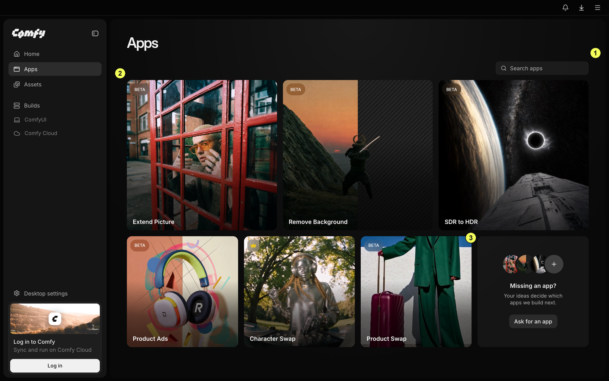
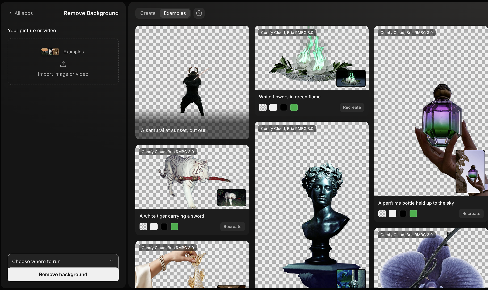
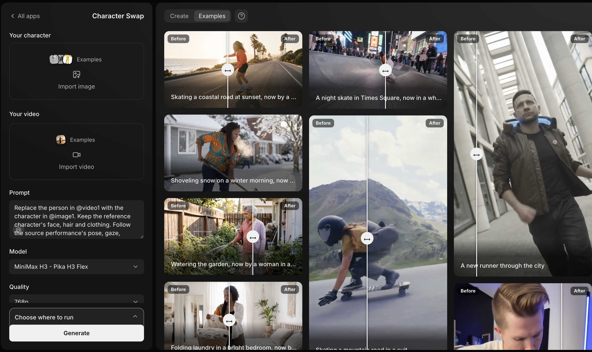

Comfy Desktop의 앱은 Comfy에서 만든 바로 사용할 수 있는 도구입니다. 각 앱은 간단한 인터페이스를 통해 하나의 작업을 수행합니다. 워크플로를 만들지 않고도 이미지, 비디오 또는 텍스트를 추가하고 실행하면 됩니다. 앱은 Comfy Desktop 안에서 열리며 Comfy Cloud 또는 사용자의 GPU에서 실행됩니다.

| 앱 | 수행하는 작업 |
| --- | --- |
| **Remove Background** | 모든 이미지나 비디오에서 깔끔한 컷아웃을 만듭니다. |
| **SDR to HDR** | 표준 이미지를 높은 다이내믹 레인지로 변환합니다. |
| **Product Ads** | 제품 사진을 광고에 바로 쓸 수 있는 비주얼로 바꿉니다. |
| **Extend Picture** | 원본 프레임 너머로 아웃페인팅합니다. |
| **Character Swap** | 장면 속 캐릭터를 교체합니다. |
| **Product Swap** | 장면 속 제품을 교체합니다. |

<Note>
  Desktop 앱은 사용자가 직접 저장한 앱 워크플로를 나열하는 ComfyUI 내부의 **Apps** 탭이나 [앱 모드](/ko/interface/app-mode)와는 다릅니다. [ComfyUI Apps 탭](/ko/interface/apps)을 참고하세요.
</Note>

## 앱 찾기

다음 방법 중 하나로 **앱** 페이지를 엽니다:

- **사이드바**에서 **앱**을 클릭합니다.
- **홈**에서 앱 행 아래의 **모든 앱 보기**를 클릭합니다.

각 앱은 이름이 표시된 카드입니다. 카드 위에 포인터를 올리면 해당 앱이 무엇을 하는지 확인할 수 있습니다. 앱을 찾으려면 오른쪽 위의 **앱 검색**에 입력합니다. 검색은 앱의 이름과 설명을 대상으로 합니다. 이 페이지에는 카테고리나 필터가 없습니다.

**홈**에서는 양쪽에 있는 카드를 클릭하면 앱 행이 회전합니다. 가운데에 있는 카드를 클릭하면 해당 앱이 열립니다.

## 앱 실행

1. 앱의 카드를 클릭합니다. 앱이 **사이드바** 옆의 Comfy Desktop 창에서 열립니다.
2. 왼쪽 패널에서 입력을 추가합니다. 샘플로 시작하려면 **Examples**를 클릭하거나, 직접 이미지나 비디오를 가져오세요. 일부 앱은 프롬프트나 모델도 요구합니다.
3. **Choose where to run**을 클릭한 다음 **Comfy Cloud** 또는 **This computer**를 선택합니다. [앱이 실행되는 위치](#앱이-실행되는-위치)를 참고하세요.
4. 패널 아래쪽의 버튼을 클릭합니다. 버튼 이름은 앱에 따라 **Generate** 또는 **Remove background**처럼 표시됩니다.

오른쪽의 **Examples** 탭에는 해당 앱의 샘플 결과가 표시됩니다. 직접 만든 결과를 보려면 **Create**를 클릭하세요.

**Character Swap**처럼 입력이 더 많은 앱은 캐릭터 이미지, 비디오, 프롬프트, 모델, 품질 설정을 받습니다:

## 앱 전환 또는 나가기

- 목록으로 돌아가려면 앱의 왼쪽 상단에 있는 **모든 앱**을 클릭하거나 **사이드바**의 **앱**을 클릭하세요.
- 앱이 열려 있는 동안 해당 앱의 이름이 **사이드바**의 **앱** 아래에 표시됩니다. 이름을 클릭하면 나가기 전에 있던 앱으로 돌아갑니다.

창에는 한 번에 하나의 앱만 표시됩니다. 다른 앱을 열면 열려 있는 앱이 대체됩니다. 앱 외부로 연결되는 링크는 브라우저에서 열립니다.

## 앱이 실행되는 위치

**실행 위치 선택**은 두 가지 위치를 제공합니다:

- **Comfy Cloud**: 앱이 Comfy의 클라우드 GPU에서 실행됩니다. Comfy 계정이 필요하며, 로그인하지 않았다면 앱이 로그인을 요청합니다. [로그인 및 Comfy Cloud 열기](/ko/installation/desktop/overview#로그인하고-comfy-cloud-열기)를 참고하세요.
- **This computer**: 앱이 로컬 빌드 중 하나를 사용해 사용자 자신의 GPU에서 실행됩니다. Comfy Desktop은 앱이 요청한 빌드를 선택하고, 없으면 실행 중인 빌드, 그다음으로 마지막으로 사용한 빌드를 선택하며, 앱이 필요로 하는 ComfyUI 버전보다 오래된 빌드는 건너뜁니다. 선택된 빌드는 ComfyUI 창 없이 백그라운드에서 시작됩니다. 앱만을 위해 시작된 빌드는 할 일이 없으면 10분 후 종료됩니다.

앱은 원격 빌드나 레거시 데스크톱 빌드에서는 실행되지 않습니다. 로컬 빌드를 추가하려면 [빌드](/ko/installation/desktop/usage/instance-management#새-빌드-설치)를 참고하세요.

## 크레딧

앱을 둘러보고 여는 것은 무료입니다. 실행 비용은 앱이 사용하는 모델과 어디에서 실행되는지에 따라 달라집니다:

- 오픈 모델로 만든 앱은 자체 GPU에서 무료로 실행할 수 있습니다.
- 파트너 모델을 사용하는 앱은 어디에서 실행되든 Comfy 크레딧을 사용합니다.
- Comfy Cloud에서의 실행은 다른 Comfy Cloud 실행과 마찬가지로 Comfy 크레딧을 사용합니다.

**사이드바** 하단에 표시되는 **크레딧** 잔액은 앱을 닫을 때 새로 고침됩니다. 요금제와 가격은 [Comfy Cloud](/ko/get_started/cloud)를 참고하세요.

## ComfyUI에서 앱의 워크플로 열기

앱은 ComfyUI에서 앱의 기반이 되는 워크플로를 열 수 있으므로 직접 변경할 수 있습니다. 이 작업에는 앱 자체의 컨트롤을 사용하세요. Comfy Desktop은 빌드가 실행 중이 아니면 시작하고, ComfyUI 창을 열고, 거기에 워크플로를 로드합니다. 워크플로는 앱이 실행된 위치에 따라 Comfy Cloud 또는 로컬 빌드에서 열립니다.

## 결과 저장 및 보기

앱이 결과를 표시하면 Comfy Desktop은 이를 뷰어에서 엽니다:

- **다운로드**는 파일이 아직 이 컴퓨터에 없을 때 사본을 저장합니다.
- **Finder에서 보기**, **탐색기에서 보기**, 또는 **폴더에서 보기**는 파일이 이 컴퓨터에 있을 때 해당 파일의 폴더를 엽니다.
- **워크플로우 열기**는 파일을 만든 워크플로를 엽니다.
- **에셋에서 보기**는 [에셋](/ko/installation/desktop/usage/assets) 페이지에서 Comfy Cloud 결과를 엽니다.

이 컴퓨터에서 실행 중인 앱에 모델이 필요하면 해당 다운로드가 [다운로드](/ko/installation/desktop/usage/downloads) 트레이에 나타납니다. Comfy Desktop은 앱을 위해 Hugging Face에서 `.safetensors` 모델만 다운로드합니다.

## 앱 요청하기

**앱** 페이지의 마지막 카드에는 **앱이 없나요?**라고 표시됩니다.

1. **앱 요청하기**를 클릭합니다.
2. **어떤 앱을 원하시나요?**에 500자 이내로 앱을 설명합니다.
3. **보내기**를 클릭합니다.

대화상자에 **감사합니다. 요청을 접수했습니다.**라고 표시됩니다. 요청은 Comfy가 다음에 어떤 앱을 만들지 결정하는 데 도움이 됩니다.

## 문제 해결

<AccordionGroup>
  <Accordion title="사이드바에 앱이 표시되지 않습니다">
    사용 중인 Comfy Desktop에서는 아직 앱을 사용할 수 없습니다. 앱은 Comfy에서 활성화하며, 이를 위한 별도의 설정은 없습니다. 대신 **홈**에 예시 워크플로가 표시됩니다.
  </Accordion>
  <Accordion title="앱을 불러오지 못했습니다">
    **앱** 페이지에 **앱을 불러오지 못했습니다**가 표시되거나, **홈**에 **앱을 불러올 수 없습니다. 연결을 확인한 후 다시 시도하세요.**가 표시됩니다. 인터넷 연결을 확인한 후 **다시 시도하기**를 클릭하세요.
  </Accordion>
  <Accordion title="앱 하나를 불러오지 못했습니다">
    앱에 **{app}**을 불러오지 못했습니다 및 **인터넷 연결을 확인한 후 다시 시도하세요.**가 표시됩니다. **다시 시도하기**를 클릭하거나 **모든 앱**을 클릭해 목록으로 돌아가세요.
  </Accordion>
  <Accordion title="이 컴퓨터에서 앱을 실행할 수 없습니다">
    앱에 다음 메시지 중 하나가 표시됩니다:

    - **이 컴퓨터에서 앱을 실행하려면 Comfy Desktop에 로컬 빌드를 추가하세요.** [빌드 설치](/ko/installation/desktop/usage/instance-management#새-빌드-설치)를 수행하거나 Comfy Cloud에서 앱을 실행하세요.
    - **이 앱에는 ComfyUI {version} 이상이 필요합니다. Comfy Desktop의 로컬 빌드를 업데이트하세요.** 빌드에서 [ComfyUI 업데이트](/ko/installation/desktop/usage/build-management#comfyui-업데이트)를 수행하세요.
    - **{name}**이(가) 아직 설치 중입니다. 설치가 끝난 후 다시 시도하세요.** **홈**에서 설치가 완료될 때까지 기다린 후 앱을 다시 실행하세요.
    - **Comfy Desktop에서 {name}**을(를) 시작하지 못했습니다.** [빌드 실패 해결](/ko/installation/desktop/usage/build-troubleshooting#빌드-실패-해결)을 참조하세요.
  </Accordion>
  <Accordion title="검색 결과가 없습니다">
    페이지에 **일치하는 항목이 없습니다**가 표시됩니다. 다른 단어를 입력하거나 **검색 지우기**를 클릭하세요. 아직 없는 앱을 요청하려면 **앱 요청하기**를 클릭하세요.
  </Accordion>
</AccordionGroup>
