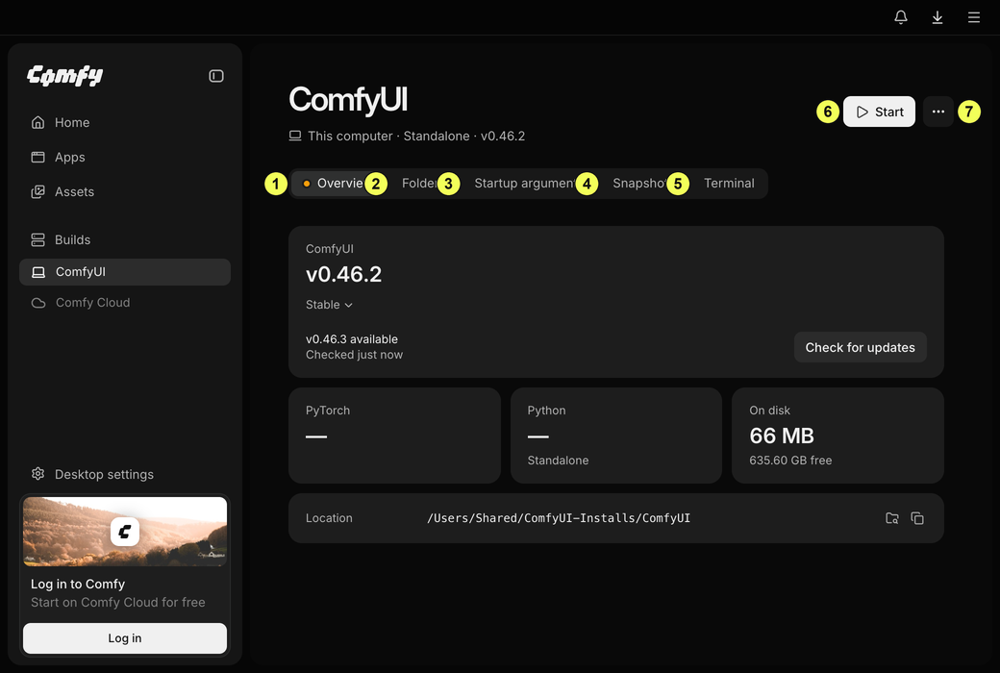

각 빌드에는 전용 페이지가 있으며, 이 페이지에서 빌드를 관리합니다. 빌드 설치, 추가, 연결 방법은 [빌드](/ko/installation/desktop/usage/instance-management)를 참고하세요.

빌드 페이지는 다음 방법 중 하나로 엽니다:

- **사이드바**에서 **Builds** 아래의 빌드를 클릭합니다.
- [빠른 작업](/ko/installation/desktop/usage/instance-management#빌드-목록의-빠른-작업)에서 **Manage**를 선택합니다.

1. **Overview**（개요）
2. **Folders**（폴더）
3. **Startup arguments**（시작 인수）
4. **Snapshots**（스냅샷）
5. **Terminal**（터미널）
6. **Start**: 실행 중에는 **Open** 입니다.
7. **More**（**⋯**）: 빌드 전체 작업.

## 빌드 페이지

헤더는 해당 빌드가 무엇인지, 실행 중인지 알려줍니다. 왼쪽에서 오른쪽으로:

- **Name**: 빌드 이름을 바꾸려면 이름을 클릭하거나 연필 아이콘(**Edit build name**)을 클릭합니다. 새 이름을 입력한 뒤 `Enter`를 누르고, 이전 이름을 유지하려면 `Esc`를 누릅니다. Standalone, Portable, git, 원격 빌드는 이름을 바꿀 수 있지만 Comfy Cloud 또는 레거시 데스크톱 빌드는 바꿀 수 없습니다. 각 빌드는 다른 빌드가 사용하지 않는 이름이어야 합니다.
- **상태 칩**: **Running**, **Starting…**, **Stopping…**, 또는 빌드가 중단되었거나 시작되지 않았을 때의 실패 레이블입니다. 실패 레이블을 클릭하면 오류를 볼 수 있습니다.
- **메타 라인**: 빌드가 실행되는 위치(**This computer**, **Cloud**, **Remote**), 유형, 버전이 점으로 구분되어 표시됩니다.
- **기본 버튼**: 로컬 빌드가 중지된 경우 **Start**, 실행 중일 때는 **Open**, Comfy Cloud는 **Open Cloud**, 원격 빌드는 **Open remote**입니다.
- **More**(**⋯**): 빌드 전체에 대한 작업입니다. [More 메뉴 사용](#more-메뉴-사용)을 참고하세요.

헤더 아래에서 각 탭은 한 종류의 설정을 담고 있습니다. 탭은 해당 빌드에 그 설정이 있을 때만 표시됩니다:

| 빌드 | 탭 |
| --- | --- |
| Standalone | **Overview**, **Folders**, **Startup arguments**, **Snapshots**, **Terminal** |
| 원격 | **Overview**, **Startup arguments** |
| Comfy Cloud | **Overview**, **Storage** |

Portable 및 git 빌드와 같은 다른 로컬 빌드는 해당 설정이 있는 탭과 함께 **Terminal** 탭을 표시합니다. 각 탭에는 해당 섹션이 있으며, 이 페이지 또는 섹션 열에 표시된 페이지에 있습니다:

| 탭 | 여기서 하는 일 | 섹션 |
| --- | --- | --- |
| **Overview** | 빌드가 실행하는 내용 보기, ComfyUI 업데이트, 업데이트 채널 전환, PyTorch 변경, 원격 빌드의 URL 변경 | [ComfyUI 업데이트](#comfyui-업데이트) |
| **Folders** | 모델, 입력, 출력 폴더 선택 | [빌드가 사용하는 폴더 선택](/ko/installation/desktop/usage/build-folders#빌드에서-사용할-폴더-선택) |
| **Startup arguments** | 플래그, ComfyUI 매니저 정책, 창, 포트, 환경 변수 설정 | [시작 인자 설정](/ko/installation/desktop/usage/build-startup-arguments#시작-인자-설정) |
| **Snapshots** | 빌드 설정 저장 및 복원 | [스냅샷 저장 및 복원](/ko/installation/desktop/usage/build-snapshots#스냅샷-저장-및-복원) |
| **Terminal** | 빌드의 Python 환경에서 명령 실행 | [터미널에서 명령 실행](/ko/installation/desktop/usage/build-terminal#터미널에서-명령-실행) |
| **Storage** (Comfy Cloud) | 브라우저 캐시 및 출력 다운로드 | [출력 옵션 설정](/ko/installation/desktop/usage/build-folders#원격-및-comfy-cloud-빌드의-출력-옵션-설정) |

## More 메뉴 사용

**Start** 또는 **Open** 옆에 있는 **More**(**⋯**) 버튼에는 빌드 전체에 대한 작업이 있습니다. Standalone 빌드에서는 다음이 나열됩니다:

- **Stop**: 빌드가 실행 중일 때.
- **Rename**: 헤더의 이름을 선택합니다.
- **Duplicate**. [빌드 복제](/ko/installation/desktop/usage/build-duplicate-and-remove#빌드-복제)를 참고하세요.
- 운영 체제에 맞는 이름으로 **Show in Finder**, **Show in Explorer** 또는 **Show in folder**.
- **Export snapshot**. [스냅샷](/ko/installation/desktop/usage/build-snapshots#스냅샷-저장-및-복원)을 참고하세요.
- **Forget** 및 **Uninstall**. [빌드 제거](/ko/installation/desktop/usage/build-duplicate-and-remove#빌드-제거)를 참고하세요.

원격 빌드에서는 **Rename**과 **Forget**이 나열되며, 실행 중일 때는 **Stop**도 표시됩니다. Comfy Cloud 빌드에서는 **More** 버튼이 회색으로 비활성화됩니다.

## ComfyUI 업데이트

**개요**에는 빌드가 실행하는 내용과 업데이트하는 위치가 표시됩니다. Standalone 빌드에서는 **ComfyUI** 카드와 타일 행이 표시됩니다:

- **PyTorch**: 설치된 PyTorch 버전, 대상 하드웨어, **변경** 메뉴. [PyTorch 변경](#pytorch-변경)을 참조하세요.
- **디스크**: 빌드가 사용하는 공간이며, 아래에 `{size} free`가 표시됩니다.
- **Python**: Python 버전과 빌드 유형.
- 세부 정보 타일: 빌드의 **위치**(폴더를 열고 **경로 복사**를 수행하는 버튼 포함)와 빌드 실행 중의 포트. 다른 빌드에서 복사한 빌드는 **복사 원본**처럼 출처도 표시됩니다.

다른 빌드에서는 **개요**에 빌드 정보가 그룹으로 나열됩니다: **빌드 세부 정보**, **실행 세부 정보**(빌드 실행 중), **위치 및 저장 공간**(로컬 빌드만), **계보**(다른 빌드에서 복사한 빌드).

업데이트하면 빌드가 해당 채널의 최신 ComfyUI로 올라갑니다. **개요** 탭의 점은 사용 가능한 업데이트가 있음을 의미합니다. **ComfyUI** 카드 하단의 행에는 빌드의 현재 상태가 표시됩니다:

| 행 표시 | 의미 | 버튼 |
| --- | --- | --- |
| **{version} 사용 가능**, **먼저 스냅샷 저장 · 확인 시각 {time}** 포함 | 이 채널에 더 새로운 버전이 있습니다. | **업데이트** |
| **최신 상태**, **확인 시각 {time}** 포함 | 빌드에 이 채널의 최신 버전이 있습니다. | **업데이트 확인** |
| **아직 확인하지 않음** | Comfy Desktop에 이 채널의 버전 정보가 없습니다. | **업데이트 확인** |

빌드를 업데이트하려면:

1. **개요**에서 **업데이트**를 클릭합니다. [빠른 작업 메뉴](/ko/installation/desktop/usage/instance-management#빌드-목록의-빠른-작업)에서 **업데이트**를 선택할 수도 있습니다.
2. **ComfyUI 업데이트** 대화상자에서 빌드가 이동하는 버전과 **릴리스 노트**를 확인한 다음 **지금 업데이트**를 클릭합니다.

업데이트가 실행되는 동안에는 탭 대신 진행률 카드가 표시됩니다. 실패하면 카드에서 **다시 시도하기**와 **닫기**를 제공합니다.

Comfy Desktop은 업데이트 전에 스냅샷을 저장합니다. 업데이트로 인해 커스텀 노드가 중단되면 **스냅샷** 탭에서 해당 스냅샷을 복원하세요. [스냅샷](/ko/installation/desktop/usage/build-snapshots#스냅샷-저장-및-복원)을 참조하세요.

이 빌드를 건드리지 않고 새 버전을 사용해 보려면 대신 복사본을 업데이트하세요:

1. **업데이트** 옆의 화살표(**추가 업데이트 옵션**)를 클릭하고 **복사 후 업데이트**를 선택합니다.
2. 복사본의 이름을 입력한 다음 **복사 후 업데이트**를 클릭합니다.

### 업데이트 채널 전환

채널은 업데이트를 어디에서 가져올지 결정합니다.

<Warning>
  안정판 릴리스보다 앞선 빌드에서 **안정판**을 선택하면 빌드가 롤백되고 더 새로운 커밋이 제거됩니다.
</Warning>

**ComfyUI** 카드에서 채널 이름을 클릭해 **업데이트 채널** 드롭다운을 열고, 다음 중 하나를 선택합니다:

- **안정판(Stable)**: 검증된 릴리스입니다. 대부분의 빌드에 사용하세요. 빌드는 기본적으로 이 채널을 사용합니다.
- **GitHub 최신(Latest on GitHub)**: master 브랜치의 최신 커밋입니다.

빌드가 사용하지 않는 채널을 선택하면 행에 **{channel}(으)로 전환**이 표시됩니다:

- 해당 채널에 더 새로운 버전이 있으면 **업데이트**를 클릭해 빌드를 해당 채널로 이동합니다.
- 더 새로운 버전이 없으면 **채널 전환**을 클릭해 업데이트 없이 빌드를 이동합니다.
- Comfy Desktop에 해당 채널의 버전 정보가 없으면 행에 **이 채널을 선택하고 업데이트를 확인하면 버전 정보를 볼 수 있습니다.**가 표시됩니다. **업데이트 확인**을 클릭합니다.

### PyTorch 변경

PyTorch를 변경하면 빌드가 다른 PyTorch 버전이나 백엔드(예: 더 새로운 CUDA 버전)를 사용할 수 있습니다. **변경** 메뉴는 Comfy Desktop이 해당 빌드에 설치할 수 있는 버전을 파악한 후 **PyTorch** 타일에 나타납니다. PyTorch를 변경하기 전에 빌드 환경의 전체 복사본을 담을 여유 공간이 디스크에 있는지 확인하세요.

<Warning>
  torchaudio가 없는 버전으로 변경하면 torchaudio가 제거되고, torchaudio가 필요한 커스텀 노드가 작동을 멈춥니다. 메뉴에 해당 버전이라고 표시되어 있습니다.
</Warning>

1. **개요**에서 **PyTorch** 타일의 **변경**을 클릭합니다.
2. 원하는 버전 위에 포인터를 올려 둡니다.
3. 다음 중 하나를 선택합니다:
   - **PyTorch 변경**: 이 빌드를 변경합니다. **PyTorch 변경** 대화상자에 변경 내용과, 번들인 경우 다운로드 크기가 표시됩니다. Comfy Desktop은 변경 중에 현재 환경을 백업하고 문제가 발생하면 복원합니다.
   - **복사 후 PyTorch 변경**: 이 빌드의 복사본에 변경을 적용하고 원본은 그대로 둡니다. 복사본의 이름을 입력한 다음 **복사 후 PyTorch 변경**을 클릭합니다.

**변경** 메뉴에서 버전은 백엔드별로 그룹화되며, 설치된 버전에는 **사용 중**이 표시됩니다. nightly 버전은 **Nightly (unstable)** 로 끝나는 제목 아래에 표시되며, 오래된 nightly 버전은 메뉴에서 사라집니다.

### 원격 빌드의 URL 변경

원격 빌드는 URL의 ComfyUI 서버에 연결됩니다. 다른 주소를 가리키게 하려면:

1. **개요**의 **빌드 세부 정보**에서 **URL**을 클릭하거나, 옆의 연필 아이콘(**연결 URL 편집**)을 클릭합니다.
2. 새 주소를 입력한 다음 `Enter`를 누르거나 다른 곳을 클릭합니다.

스킴을 생략하면 Comfy Desktop은 `http://`를 사용합니다. Comfy Desktop이 주소를 읽을 수 없으면 이전 주소를 유지합니다. 빌드가 연결된 동안 행에는 **재시작하여 적용**이 표시되며, 실행 중인 세션은 재시작할 때까지 이전 주소를 유지합니다.
