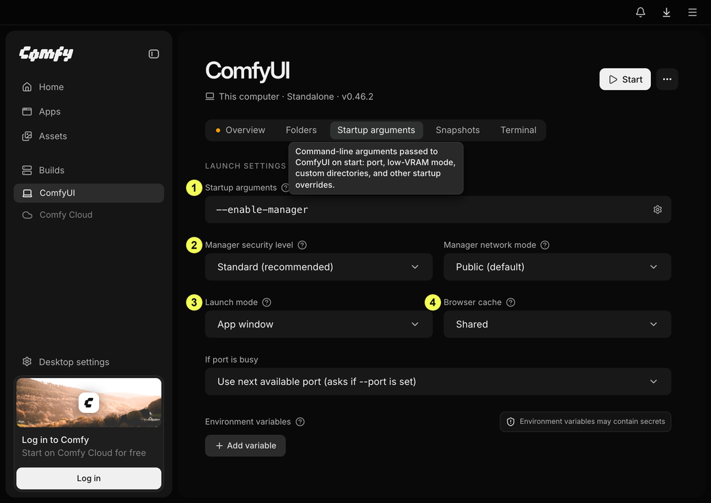

이 페이지에서는 빌드 페이지의 **시작 인자** 탭을 설명합니다. 빌드 설치, 추가, 연결 방법은 [빌드](/ko/installation/desktop/usage/instance-management)를 참고하세요.

## 시작 인자 설정

빌드 페이지의 **시작 인자** 탭은 이 빌드에 대해 ComfyUI가 시작되는 방식을 제어합니다: 명령줄 플래그, ComfyUI 매니저 정책, 창, 환경 등.

1. **Startup arguments**: ComfyUI 가 시작될 때 쓰는 명령줄 인수입니다.
2. **Manager security level**: ComfyUI-Manager 가 설치할 수 있는 범위입니다.
3. **Launch mode**: 자체 앱 창 또는 콘솔에서 실행합니다.
4. **Browser cache**: 다른 빌드와 공유하거나 이 빌드 전용으로 씁니다.

모든 변경사항은 다음에 빌드가 시작될 때 적용됩니다. 빌드가 실행 중일 때 필드를 변경하면 해당 필드에 **적용하려면 재시작**이 표시되고, 헤더 버튼은 **변경사항을 적용하려면 재시작**으로 표시됩니다. 이를 클릭하면 새 설정으로 빌드가 재시작됩니다.

### 목록에서 플래그 선택

**시작 인자** 필드에는 ComfyUI에 전달되는 명령줄 인자(예: `--listen`)가 들어갑니다. 직접 입력하거나 카테고리별로 정렬된 목록에서 선택할 수 있습니다. 베타 기능이 인자를 추가하는 경우 필드 옆의 **+N 베타** 배지에 해당 인자가 나열됩니다. 모든 플래그에 대해서는 [시작 플래그 참조](/ko/development/comfyui-server/startup-flags)를 참조하세요.

1. **시작 인자** 옆의 톱니바퀴(**인자 구성**)를 클릭합니다.
2. 카테고리에서 플래그를 토글하거나 **원시 인자**를 편집합니다. 둘 다 이 빌드에 대해 동일한 인자를 변경합니다.
3. **뒤로**를 클릭하여 탭으로 돌아갑니다.

### ComfyUI 매니저가 설치하는 항목 제어

두 가지 설정이 ComfyUI 매니저가 이 빌드에 대해 설치할 수 있는 노드 팩을 결정합니다. 먼저 **매니저 보안 수준**을 설정하세요:

- **엄격**: 모든 노드 팩 설치, 업데이트, 제거를 차단합니다. ComfyUI 매니저는 읽기 전용입니다.
- **표준 (권장)**: 등록된 노드 팩을 허용하고, 임의의 git URL과 같은 등록되지 않은 소스로부터의 설치를 차단합니다. 이것이 기본값입니다.
- **완화**: 표준과 같지만, ComfyUI가 이 컴퓨터에서만 접근 가능한 동안 등록되지 않은 소스 설치도 허용합니다. `--listen`은 이를 다시 차단합니다.
- **허용**: 모든 위험 등급을 허용합니다.

그런 다음 **매니저 네트워크 모드**를 설정하세요. 이는 ComfyUI 매니저가 노드 레지스트리에 도달하는 방식을 결정합니다.

<Warning>
  **개인 클라우드**는 `--listen` 설치 차단을 해제합니다. 제어하는 컴퓨터에서만 선택하세요.
</Warning>

- **공개 (기본값)**: 공개 레지스트리를 사용합니다. `--listen`을 사용하면 모든 보안 수준에서 노드 팩 설치가 차단됩니다.
- **비공개**: 직접 구성한 비공개 노드 데이터베이스를 사용합니다.
- **오프라인**: 외부 네트워크 연결을 만들지 않습니다. 다운로드가 필요한 설치 및 업데이트는 사용할 수 없습니다.
- **개인 클라우드**: 이 컴퓨터를 신뢰할 수 있는 원격 머신으로 취급하고 `--listen` 설치 차단을 해제합니다. 보안 수준은 여전히 적용됩니다.

### 창, 캐시, 포트 설정

이 설정은 빌드가 열리는 방식과 포트가 사용 중일 때 수행할 작업을 결정합니다:

- **실행 모드**: **앱 창**(기본값) 또는 **콘솔 전용**.
- **브라우저 캐시**: **이 빌드에 고유** 또는 다른 빌드와 **공유**. 새 스탠드얼론 빌드는 **이 빌드에 고유**로 시작합니다.
- **포트가 사용 중인 경우**: **수행할 작업 묻기** 또는 **다음 사용 가능한 포트 사용(--port가 설정된 경우 묻기)**. 스탠드얼론 및 포터블 빌드는 기본적으로 **다음 사용 가능한 포트 사용(--port가 설정된 경우 묻기)**을 사용하고, git 빌드는 **수행할 작업 묻기**를 사용합니다.

### 환경 변수 추가

환경 변수는 빌드가 시작될 때 ComfyUI에 추가 설정을 전달합니다.

<Warning>
  Comfy Desktop은 환경 변수 값을 디스크에 암호화하지 않고 저장합니다. API 키, 토큰 또는 비밀번호를 추가하지 마세요.
</Warning>

- **환경 변수** 아래에서 **변수 추가**를 클릭한 다음 이름과 값을 입력합니다.

`HF_TOKEN`과 같이 자격 증명처럼 보이는 이름의 값은 표시할 때까지 숨겨져 있습니다. 반복된 이름은 **중복 키**를 표시합니다.
