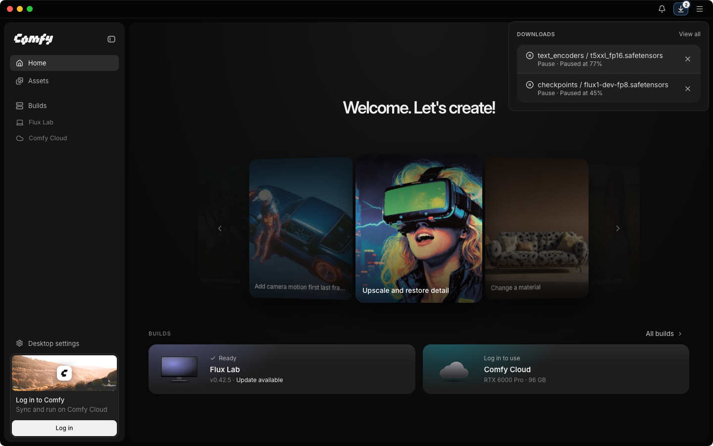

Comfy Desktop은 빌드에 필요한 모델을 다운로드하고 모든 전송을 한곳에서 추적합니다. 빌드가 디스크에 없는 모델을 요청하고 ComfyUI에 다운로드 링크가 있으면 데스크톱이 내려받아 모델 폴더에 저장하므로, 그 파일을 직접 배치할 필요가 없습니다.

제목 표시줄의 **Downloads** 아이콘을 누르면 진행 상황을 확인하고, 실패한 전송을 재시도하거나, 완료된 파일이 있는 폴더를 열 수 있습니다.

## 다운로드 목록에 표시되는 항목

- **누락된 모델**: ComfyUI가 다운로드 링크가 있는 누락 모델을 보고하면 다운로드가 Comfy Desktop을 통해 실행되고, 파일은 해당 모델 폴더(`checkpoints`, `diffusion_models`, `text_encoders`, `loras`, `vae` 등)에 저장됩니다. 지원 형식은 `.safetensors`, `.sft`, `.ckpt`, `.pth`, `.pt`입니다. 링크가 없는 모델은 폴더에 직접 넣어야 합니다.
- **예제 워크플로우 모델**: **Performance tests**에서 예제 워크플로우를 선택하면 필요한 모델이 백그라운드에서 다운로드되며, 다른 다운로드와 마찬가지로 트레이에 표시됩니다.
- **Cloud 및 원격 빌드의 출력**: Cloud 또는 원격 빌드에서 출력을 저장하면 데스크톱이 로컬 출력 폴더로 다운로드합니다. **Auto-download outputs**를 끄면 이 동작을 사용하지 않습니다.
- **직접 다운로드하는 에셋**: Cloud 빌드의 리소스를 **Assets** 페이지에서 저장한 것입니다. [에셋 다운로드](#에셋-다운로드)를 참조하세요.

## 에셋 다운로드

**Assets** 페이지에는 Cloud 빌드의 리소스와 이 컴퓨터에 있는 빌드의 리소스가 함께 표시됩니다. Cloud 에셋은 아직 디스크에 없으므로 선택한 폴더로 다운로드하고, 로컬 에셋은 이미 디스크에 있어 같은 메뉴에서 열 수 있습니다.

1. 사이드바에서 **Assets**를 열고 저장할 항목을 선택합니다.
2. Cloud 에셋은 세부 정보 패널이나 오른쪽 클릭 메뉴에서 **Download**를 선택합니다.
3. 저장 대화상자에서 폴더를 고릅니다. 마지막으로 저장한 폴더에서 시작하고, 처음에는 시스템의 다운로드 폴더에서 시작합니다.
4. **Downloads** 트레이에서 전송을 확인합니다. **✕**를 누르면 취소됩니다.

에셋은 하나씩 다운로드되므로 남기고 싶은 파일마다 반복하세요.

## Downloads 트레이

목록은 최신 순으로 정렬되고 모델 폴더와 파일 이름이 표시됩니다. 진행 중인 행에는 전송된 크기와 퍼센트가, 속도와 남은 시간은 확인되는 대로 표시됩니다.

아이콘의 배지는 아직 끝나지 않은 전송 수를 보여 줍니다(일시 중지된 전송 포함). 다운로드 중이 아닐 때는 끝난 뒤 아직 확인하지 않은 전송을 완료는 초록색, 실패는 빨간색으로 표시하며, 진행 중인 다운로드와 확인하지 않은 실패가 함께 있으면 빨간 점이 나타납니다.

행에 마우스를 올리면 작업이 나타납니다:

- **Try again**은 실패했거나 취소된 전송을 다시 시작합니다.
- 폴더 버튼은 완료된 파일이 있는 폴더를 엽니다. 완료된 행을 클릭해도 같습니다(Show in Finder, Show in Explorer, Show in folder).
- **✕**는 진행 중인 전송을 취소하거나 완료된 행을 목록에서 제거합니다.

트레이 상단의 **View all**을 누르면 전체 다운로드 보기가 열립니다.

## 전체 다운로드 보기

전체 보기는 다운로드 기록을 유지하고 트레이에 들어가지 않는 기능을 제공합니다:

- 상태로 필터링합니다. **All**과 함께 행이 있는 상태의 **Active**, **Completed**, **Failed**가 표시되며, 두 종류 미만이면 필터 바 자체가 나타나지 않습니다. 취소된 다운로드는 **Failed**에 포함됩니다.
- 기본 작업이 있는 행은 이를 버튼 하나로 표시합니다: **Pause**, **Resume**, **Try again**, 또는 폴더 열기.
- **✕**는 진행 중인 전송을 취소하거나 행을 제거합니다.
- 바닥글에는 목록의 진행 중, 완료, 실패, 취소 개수가 표시됩니다.
- **Clear finished**는 종료된 행을 한 번에 제거합니다.

## 다운로드 중에 종료하는 경우

모델 다운로드는 이어받기를 지원합니다. 이미 받은 바이트는 유지되고, 다음 실행 시 해당 전송이 일시 중지된 행으로 나타납니다. **View all**을 열고 **Resume**을 선택하세요. 취소하면 완료되지 않은 파일이 삭제됩니다.

출력과 에셋 다운로드는 다른 경로를 사용하므로 종료한 뒤에는 이어받지 않습니다.

예제 워크플로우 모델이 아직 다운로드 중이면 종료 전에 확인을 요청합니다:

- **Quit anyway**: 다운로드를 일시 중지하고 종료합니다. 다음 실행 시 일시 중지된 행으로 돌아옵니다.
- **Keep downloading**: 종료를 취소하고 Comfy Desktop을 계속 실행합니다. 기본 선택입니다.

Comfy Desktop이 스스로 시작하는 종료(업데이트 설치나 재시작)에서는 이 확인이 표시되지 않습니다. ☰ 메뉴의 **Quit Desktop**도 마찬가지입니다. 이 경로는 대신 **Quit Desktop** 대화상자를 열어 중지할 로컬 빌드와 진행 중인 다운로드를 나열합니다. Cloud나 원격 창만 열려 있으면 나타나지 않으며, Home에서 빌드 창을 열지 않은 상태라면 묻지 않고 종료합니다.

## 다운로드 저장 위치

모델 파일은 **Downloads** 태그가 붙은 공유 모델 폴더에 저장됩니다. 어느 폴더를 쓸지는 [Desktop settings](/ko/installation/desktop/usage/settings#저장소)의 **Use for downloads**로 지정합니다. 공유 모델 폴더를 사용하지 않는 빌드는 자체 `models` 폴더에 저장하며, **Manage** 패널에서 모델 폴더를 더 추가할 수 있습니다.

Cloud 또는 원격 빌드의 출력은 빌드가 공유 출력 폴더를 사용하면 그곳에, 아니면 해당 빌드의 출력 폴더에 저장되며, 그 항목이 비어 있으면 공유 출력 폴더에 저장됩니다. 원격 빌드는 **Startup arguments** 탭의 **Launch settings**에서 **Auto-download outputs**로 자동 다운로드를 끌 수 있습니다.

직접 다운로드하는 에셋은 저장 대화상자에서 지정한 위치에 저장되므로 빌드 밖에 둘 수도 있습니다.
