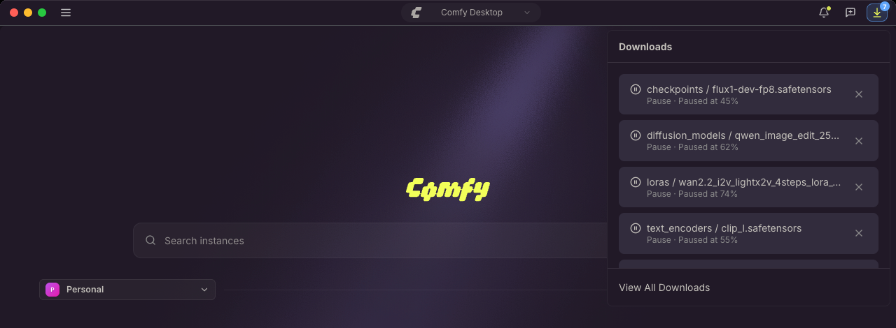
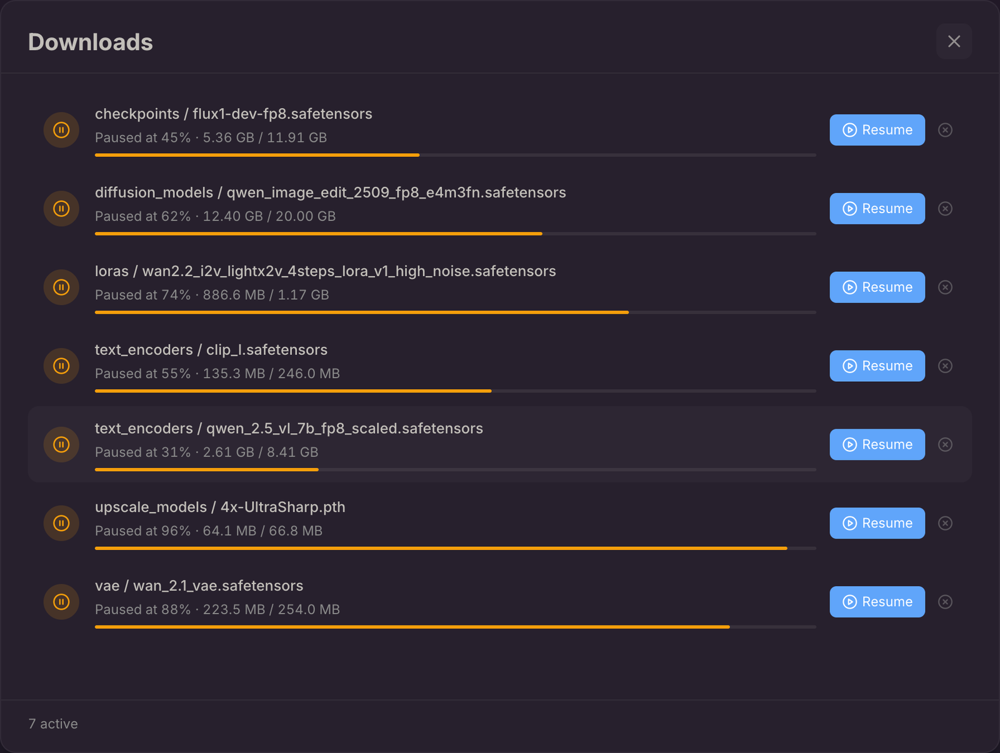

Comfy Desktop은 인스턴스용 모델을 다운로드하고 모든 전송을 한곳에서 추적합니다. 앱이 대신 받아오는 모델도, 직접 다운로드하는 생성 에셋도 마찬가지입니다. ComfyUI 인스턴스가 아직 디스크에 없는 모델을 요청하면 Comfy Desktop이 다운로드를 처리하고 해당 파일을 인스턴스의 모델 디렉토리에 저장합니다. 직접 배치할 필요가 없습니다.

제목 표시줄의 **Downloads** 트레이를 열면 진행 중인 다운로드를 확인하고, 실패한 다운로드를 재시도하거나, 완료된 파일이 있는 폴더를 열 수 있습니다.

## 다운로드 목록에 표시되는 항목

- **누락된 모델**: ComfyUI가 누락 모델 대화상자나 오른쪽 패널의 **Errors** 탭에서 누락된 모델을 보고하면 다운로드 작업이 Comfy Desktop을 통해 처리됩니다. 각 파일은 해당 모델 폴더(`checkpoints`, `diffusion_models`, `text_encoders`, `loras`, `vae` 등)에 저장됩니다. 지원되는 모델 파일 형식은 `.safetensors`, `.sft`, `.ckpt`, `.pth`, `.pt`입니다.
- **템플릿 모델**: 스타터 템플릿으로 인스턴스를 설정하면 템플릿에 필요한 모델이 백그라운드에서 다운로드되며, 다른 다운로드와 마찬가지로 트레이에 표시됩니다. 완료될 때까지 진행 화면은 모델 다운로드 단계를 계속 표시합니다. 바로 시작하고 싶다면 해당 화면의 **Skip & open ComfyUI**로 ComfyUI를 즉시 열 수 있으며, 다운로드는 트레이에서 계속됩니다.
- **원격 인스턴스의 출력**: 원격 또는 Cloud 인스턴스에서 워크플로우를 실행하면 완료된 출력이 자동으로 로컬 출력 디렉토리로 다운로드됩니다.
- **직접 다운로드하는 생성 에셋**: **Assets** 패널에서 저장하는 이미지, 동영상, 오디오입니다. [생성 에셋 다운로드](#생성-에셋-다운로드)를 참조하세요.

## 생성 에셋 다운로드

출력은 기본적으로 인스턴스 안에 남습니다. 원하는 폴더에 저장하는 것은 위의 자동 다운로드와 별개의 작업입니다.

1. 왼쪽 사이드바에서 **Assets**를 열고 저장할 항목을 선택합니다. 한 번에 여러 개를 저장하려면 먼저 여러 개를 선택하세요.
2. **Download**를 클릭합니다(여러 개를 선택한 경우 **Download all**). 에셋 미리보기와 오른쪽 클릭 메뉴에도 같은 작업이 있습니다.
3. 저장 대화상자가 열리고, 마지막으로 저장한 폴더(처음에는 시스템의 "다운로드" 폴더)에서 시작합니다. 위치를 확인하면 전송이 시작됩니다.
4. **Downloads** 트레이에서 진행 상황을 확인하거나 취소할 수 있습니다. 일시 중지하려면 **View All Downloads**를 열고 **Pause**를 선택하세요.

같은 이름의 파일이 이미 있으면 덮어쓰기 전에 확인합니다. Cloud 인스턴스에서 여러 에셋을 한꺼번에 다운로드하면 하나의 zip 파일로 전달됩니다.

## Downloads 트레이

제목 표시줄 오른쪽의 다운로드 버튼을 클릭하면 트레이가 열립니다. 다운로드는 최신 순으로 나열되며 모델 폴더와 파일 이름이 표시됩니다. 진행 중인 항목에는 전송된 크기, 퍼센트, 속도, 남은 시간이 표시됩니다.

다운로드가 진행 중이면 버튼에 진행 중인 개수가 표시됩니다. 진행 중인 다운로드가 없으면 대신 실패했지만 아직 확인하지 않은 다운로드나 완료했지만 아직 열지 않은 다운로드를 표시하는 배지가 나타납니다.

각 항목의 작업:

- **완료된 항목을 클릭**하면 파일이 있는 폴더가 열립니다(시스템에 따라 Show in Finder, Show in Explorer, Show in Folder).
- **Retry**로 실패했거나 취소된 다운로드를 재시도합니다.
- **✕**로 진행 중인 다운로드를 취소하거나 완료된 항목을 목록에서 제거합니다.

트레이 하단의 **View All Downloads**를 누르면 전체 다운로드 보기가 열립니다.

## 전체 다운로드 보기

전체 보기는 앱의 다운로드 기록을 유지하고 트레이에 들어가지 않는 제어 기능을 제공합니다:

- 상태로 목록을 필터링합니다. **All** 뒤에 항목이 있는 **Active**, **Completed**, **Failed**만 표시되며, 한 종류만 있으면 필터 바 자체가 나타나지 않습니다.
- 진행 중인 다운로드는 **Pause**, 일시 중지된 다운로드는 **Resume**으로 재개합니다.
- **Retry**로 실패했거나 취소된 다운로드를 재시도합니다.
- 파일이 있는 폴더를 열거나 항목 하나를 제거합니다.
- **Clear finished**로 완료된 항목을 한 번에 제거합니다.

바닥글의 개수는 필터와 관계없이 목록 전체의 진행 중 및 완료된 다운로드를 센 것입니다. 실패와 취소된 항목은 포함되지 않습니다.

## 다운로드 중에 종료하는 경우

모델 다운로드는 이어받기를 지원합니다. 모델 전송 중에 Comfy Desktop을 종료해도 이미 받은 바이트는 유지되며, 다음 실행 시 해당 전송이 Downloads 트레이에 일시 중지된 항목으로 돌아옵니다. **View All Downloads**를 열어 **Resume**하면 중단된 지점부터 이어받고, 취소하면 완료되지 않은 파일이 삭제됩니다.

원격 인스턴스의 출력 다운로드는 다른 경로로 전송되므로 종료한 뒤에는 이어받지 않습니다.

템플릿 모델이 아직 다운로드 중이면 템플릿 설정이 이 파일들을 기다리기 때문에 Comfy Desktop이 종료 전에 확인을 요청합니다:

- **Quit Anyway**: 다운로드를 일시 중지하고 종료합니다. 다음 실행 시에도 항목이 남아 있습니다.
- **Keep Downloading**: 종료를 취소하고 Comfy Desktop을 계속 실행합니다. 기본 선택입니다.

Comfy Desktop이 스스로 시작하는 종료(업데이트 설치 또는 재시작)에서는 이 확인이 표시되지 않습니다. 제목 표시줄 메뉴의 **Quit Desktop**도 마찬가지입니다. 모든 창을 한 번에 닫기 때문에 로컬 인스턴스 창이 열려 있으면 **Quit Desktop** 확인 창이 열린 인스턴스와 진행 중인 다운로드를 나열하고, 대시보드만 있으면 묻지 않고 종료합니다. 어느 경우든 전송은 일시 중지되고 다음 실행 시 일시 중지 상태로 돌아옵니다.

## 다운로드 저장 위치

모델 파일은 인스턴스의 모델 다운로드 디렉토리에 기록됩니다. 인스턴스가 공유 모델 디렉토리를 포함하면 **DOWNLOADS** 배지(**Use for Model Downloads**로 설정)가 붙은 공유 모델 디렉토리에, 포함하지 않으면 인스턴스 자체의 `models` 폴더에 저장됩니다. 공유 디렉토리는 [Desktop Settings](/ko/installation/desktop/usage/settings#저장소)에서 설정하며, 각 인스턴스는 **Manage** 패널의[저장소 탭](/ko/installation/desktop/usage/manage#저장소-탭)에서 공유 디렉토리를 포함하지 않도록 선택할 수 있습니다.

리모트 인스턴스에서 다운로드한 출력은 인스턴스가 공유 출력 폴더를 사용하면 그곳에, 아니면 해당 인스턴스에 설정된 출력 폴더에 저장됩니다. 그 항목이 비어 있으면 공유 출력 폴더에 저장됩니다. 리모트 인스턴스는 스토리지 설정의 **Auto-Download Outputs**로 출력 자동 다운로드를 끌 수 있습니다.

직접 다운로드하는 생성 에셋은 예외로, 저장 대화상자에서 지정한 위치에 저장되므로 인스턴스 밖에 둘 수도 있습니다.
