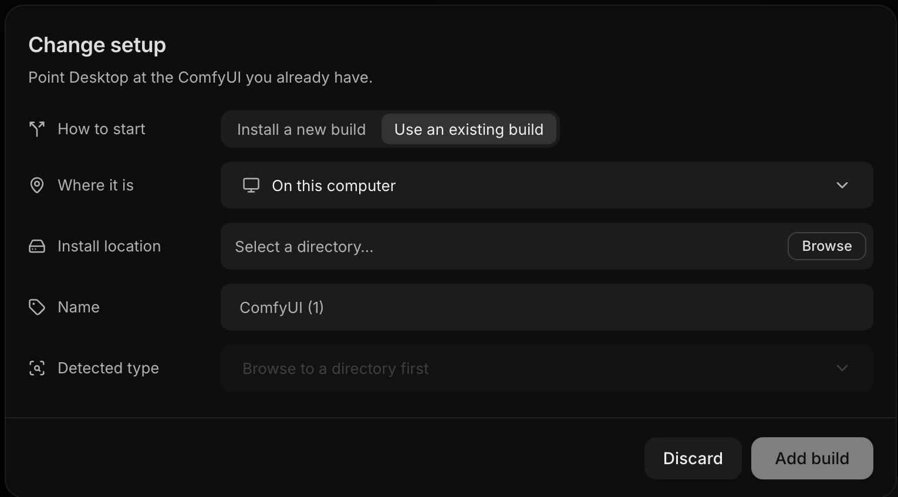
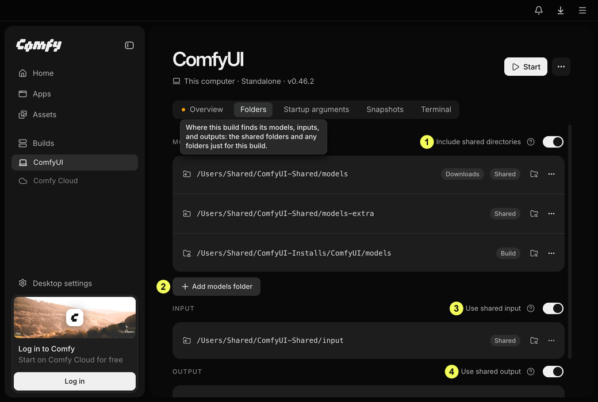
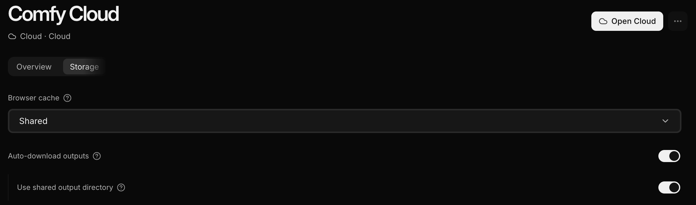

Comfy Desktop에서는 이 컴퓨터에서, Comfy Cloud에서, 또는 다른 머신의 ComfyUI 서버에서 ComfyUI를 실행할 수 있습니다. 이 각각을 빌드라고 합니다. Comfy Desktop은 Comfy Cloud를 목록에 표시해 주며, 그 밖의 빌드는 열기 이전에 설치, 추가 또는 연결해야 합니다. 이 페이지에서는 빌드를 설정하고 실행하며, 빌드 페이지에서 업데이트와 구성을 수행하고, 더 이상 필요하지 않으면 제거합니다.

## Comfy 빌드 유형

빌드가 실행되는 위치에 따라 해당 빌드로 할 수 있는 작업이 결정됩니다. **빌드** 페이지는 빌드를 실행 위치에 따라 그룹화합니다:

| 실행 위치 | 무엇인지 | 얻는 방법 |
| --- | --- | --- |
| **이 컴퓨터** | 이 컴퓨터에 설치된 ComfyUI입니다. 유형은 **독립 실행형**, **Git clone**, **포터블**, **레거시 데스크톱**, 또는 **빌드**(팀 워크스페이스의 Developer Platform 빌드)입니다. | [새 빌드 설치](#install-a-new-build) 또는 [이미 보유한 ComfyUI 추가](#add-a-comfyui-you-already-have). |
| **클라우드** | Comfy Cloud입니다. 클라우드의 GPU에서 실행되며 Comfy 계정이 필요합니다. | Comfy Desktop에서 **Comfy Cloud**로 표시합니다. |
| **원격** | 다른 머신에서 실행되는 ComfyUI 서버로, 해당 URL로 접속합니다. | [ComfyUI 서버에 연결](#connect-to-a-comfyui-server). |

<Note>
  Comfy Cloud는 [로그인](/ko/installation/desktop/overview#log-in-and-open-comfy-cloud)하기 전까지 **사용하려면 로그인**으로 표시됩니다. 빠른 작업 메뉴에는 **중지**, **자동 시작**, **제거**가 없으며, 이름은 **Comfy Cloud**로 유지됩니다.
</Note>

## 빌드 찾기

**빌드** 페이지에는 워크스페이스의 모든 빌드가 나열됩니다. 페이지를 열려면 **사이드바**에서 **빌드**를 클릭하세요.

페이지 상단에는 다음 항목이 있습니다:

- **새 빌드**: 새 빌드를 시작합니다. 옆의 화살표(**빌드 옵션 더 보기**)를 클릭하면 **기존 빌드 추가**와 **스냅샷 불러오기**가 나타납니다.
- **실행 위치**: 목록을 필터링합니다. **모두**와 **이 컴퓨터**는 항상 표시됩니다. **클라우드**와 **원격**은 해당 종류의 빌드가 있을 때 나타납니다.
- **정렬**: 빌드를 **마지막 사용** 또는 **이름** 기준으로 정렬합니다. 설치 중인 빌드는 항상 맨 위에 유지됩니다.
- **빌드 검색**: 이름으로 빌드를 찾습니다. 일치하는 항목이 없으면 **필터 지우기**를 클릭하세요.

각 빌드는 타일로 표시됩니다. 타일에는 **실행 중**, **시작 중…**, **자동 시작**, **오류** 같은 빌드 상태가 표시됩니다. 타일 위에 포인터를 올려 두면 클릭했을 때의 동작을 확인할 수 있습니다: **클릭하여 시작**, **클릭하여 열기**, **클릭하여 로그 보기**.

빌드가 없으면 페이지에 **아직 빌드가 없습니다**와 **이 컴퓨터에 ComfyUI를 설치하거나 Comfy Cloud에서 실행하세요.**가 표시됩니다.

**사이드바**에서도 **빌드** 아래에 각 빌드가 나열됩니다:

- 회전 표시와 퍼센트는 빌드가 설치 중임을 의미합니다.
- 초록색 점은 빌드가 실행 중임을 의미합니다.
- 빨간색 점은 빌드가 충돌했거나 시작되지 않았음을 의미합니다. 빌드 위에 포인터를 올려 두면 이유를 확인할 수 있습니다.
- 빌드를 클릭하면 [빌드 페이지](#manage-builds)가 열립니다.
- 빌드를 마우스 오른쪽 버튼으로 클릭하면 [빠른 작업 메뉴](#quick-actions-from-the-build-list)가 열립니다.

**홈**과 나머지 **사이드바**에 대해서는 [Comfy Desktop 둘러보기](/ko/installation/desktop/usage/overview)를 참고하세요.

#

### 빌드 목록의 빠른 작업

**사이드바**에서 빌드를 마우스 오른쪽 버튼으로 클릭하거나, **빌드** 페이지의 타일 또는 **홈**의 카드를 마우스 오른쪽 버튼으로 클릭하면 간단한 작업 메뉴가 열립니다. 타일이나 카드에서는 포인터를 올려 두어 오른쪽에 **⋯** 버튼이 나타나면 그것을 클릭할 수도 있습니다.

메뉴에는 현재 해당 빌드에 적용되는 작업만 표시됩니다:

- **시작**, 또는 빌드가 실행 중일 때는 **로그 보기**, **재시작**, **중지**. 설치 또는 시작 중에는 **로그 보기**와 **취소**. 충돌 후에는 **오류 보기**.
- **자동 시작** 또는 **자동 시작 끄기**. [Comfy Desktop을 열 때 빌드 시작](#start-a-build-when-comfy-desktop-opens)을 참고하세요.
- **관리**: [빌드 페이지](#manage-builds)를 엽니다.
- **업데이트**(업데이트가 있을 때)와 **Standalone으로 이전**(빌드를 Standalone 빌드로 옮길 수 있을 때). [나중에 이전](/ko/installation/desktop/usage/migrate#나중에-마이그레이션)을 참고하세요.
- **복제**, 그리고 **Finder에서 보기**, **Explorer에서 보기**, 또는 **폴더에서 보기**.
- **스냅샷 내보내기**와 **스냅샷 복원**. [스냅샷](#save-and-restore-snapshots)을 참고하세요.
- **빌드 업로드**(워크스페이스에 로그인한 경우). [팀 빌드](/ko/installation/desktop/usage/workspaces-and-builds)를 참고하세요.
- **제거**. [빌드 제거](#remove-a-build)를 참고하세요.

**자동 시작**, **재시작**, **로그 보기**, **빌드 업로드**는 이 메뉴에만 있습니다. 나머지는 모두 빌드 페이지에도 있습니다. 항목이 회색으로 표시되어 있으면 그 위에 포인터를 올려 두어 이유를 확인할 수 있습니다. 예: **먼저 실행 중인 빌드를 중지하세요.**

## 새 빌드 설치

새 빌드는 Comfy Desktop이 대신 설치해 주는 ComfyUI입니다. **Standalone** 빌드 형태의 공식 릴리스이거나 팀 워크스페이스의 Developer Platform 빌드입니다. **새 빌드** 대화상자에서 이 컴퓨터에 맞는 설정을 선택합니다. 설치 과정에서 ComfyUI를 다운로드하고 Python 환경을 설정하므로, **설치**를 클릭하기 전에 요약을 확인하세요.

<Steps>
  <Step title="새 빌드 대화상자 열기">
    다음 방법 중 하나로 대화상자를 엽니다.

    - **사이드바**에서 포인터를 **빌드** 위에 올린 다음, 더하기(**+**) 버튼(**새 빌드**)을 클릭합니다.
    - **빌드** 페이지에서 **새 빌드**를 클릭합니다.
    - **홈**에 **새 빌드** 타일이 표시되면 해당 타일을 클릭합니다.

    **새 빌드** 대화상자가 열리면 **새 ComfyUI 설치를 설정하세요.**라는 안내 문구가 표시됩니다.
  </Step>
  <Step title="요약 확인">
    로그인한 상태이고 워크스페이스에 빌드가 있으면 대화상자가 **팀 빌드**에서 열립니다. **릴리스** 행에 해당 빌드가 나열되고 자리 표시자는 **빌드 선택**입니다. 대신 공식 릴리스를 설치하려면 다음 단계에서 **소스**를 **공식 릴리스**로 설정합니다.

    공식 릴리스인 경우 대화상자에 설치할 내용이 표시됩니다.

    

    - **이름**: **사이드바**와 **빌드** 페이지에서 빌드에 표시되는 이름입니다. 상자에는 제안된 이름이 표시됩니다. 그 이름을 사용하려면 비워 두고, 다른 이름을 사용하려면 직접 입력합니다.
    - **감지됨**: Comfy Desktop이 찾은 컴퓨터 또는 GPU이며, 메모리는 GB 단위로 표시됩니다. 옆의 **변경**을 클릭하면 설정을 변경할 수 있습니다.
    - **릴리스**: 테스트된 릴리스는 **Stable**, 또는 **Latest on GitHub**입니다.
    - **하드웨어**: 빌드가 대상으로 하는 GPU 유형입니다(예: **NVIDIA**, **AMD**, **Intel Arc (XPU)**, **Apple Silicon (MPS)**, **CPU**). 참고 문구는 다음과 같습니다.
      - **감지됨**: GPU 유형이 Comfy Desktop이 찾은 GPU와 일치합니다.
      - **GPU 가속 없음**: 빌드가 **CPU**용입니다.
      - **지원되지 않음**: 이 컴퓨터는 선택한 GPU 유형을 지원하지 않습니다.
    - **버전**: 설치되는 ComfyUI 버전과 해당 릴리스(예: **Stable**)입니다.
    - **위치**: 빌드가 설치되는 폴더이며, 해당 드라이브의 여유 공간과 설치에 필요한 공간이 표시됩니다. 다른 폴더를 선택하려면 **찾아보기**를 클릭합니다.

    **하드웨어** 설명이 **감지됨**이고 **위치** 아래에 경고 없이 여유 공간이 표시되면, 이 설정은 이 컴퓨터에 적합합니다.

  </Step>
  <Step title="설정 변경(선택 사항)">
    **변경**을 클릭하면 **설정 변경**이 열립니다. **여기의 모든 항목은 이미 이 컴퓨터에 맞게 설정되어 있습니다.**라는 문구가 표시됩니다.

    

    - **시작 방법**: **새 빌드 설치**를 유지합니다.
    - **소스**: **공식 릴리스**는 ComfyUI를 설치합니다. **팀 빌드**는 워크스페이스의 Developer Platform 빌드를 설치합니다. [팀 빌드](/ko/installation/desktop/usage/workspaces-and-builds)를 참고하세요.
    - **릴리스**: **Stable**은 테스트된 릴리스를 설치합니다. **Stable** 옆 목록에서 버전을 선택합니다. **Latest on GitHub**는 master 브랜치의 최신 커밋을 설치합니다.
    - **위치**: 설치 폴더입니다. Comfy Desktop 폴더, OneDrive, 공유된 모델, 입력 또는 출력 폴더, 다른 빌드 내부에 있는 폴더는 선택하지 마세요. 다른 폴더를 선택하려면 **찾아보기**를 클릭합니다.
    - **하드웨어**: 빌드가 대상으로 하는 GPU 유형입니다. 각 옵션에는 해당 ComfyUI 버전, Python 버전, 다운로드 크기가 표시됩니다.

    요약으로 돌아가려면 **변경 사항 저장**을 클릭하고, 변경 사항을 버리려면 **버리기**를 클릭합니다.

  </Step>
  <Step title="설치 클릭">
    **설치**를 클릭합니다. 설치가 시작되기 전에 Comfy Desktop이 진행을 막을 수 있습니다.

    - **위치** 아래에 문제가 표시되고 폴더가 빌드를 저장할 수 없으면 **설치**가 회색으로 비활성화된 상태로 유지됩니다. **찾아보기**를 클릭하고 다른 폴더를 선택합니다.
    - **디스크 공간 부족**은 드라이브의 여유 공간이 설치에 필요한 공간보다 적거나 1 GB 미만일 때 열립니다. 설치하려면 **계속 진행**을 클릭하고, 그렇지 않으면 대화상자를 닫고 다른 폴더를 선택합니다.
    - **NVIDIA 드라이버 업데이트**는 드라이버가 버전 580보다 오래된 경우 **NVIDIA** 빌드에서 열립니다. 현재 드라이버 버전과 권장 최소 버전이 표시됩니다. 현재 드라이버로 설치하려면 **계속 진행**을 클릭하거나, 먼저 드라이버를 업데이트합니다.
  </Step>
  <Step title="설치 진행 상황 확인">
    Comfy Desktop은 **홈**으로 돌아가고, 설치는 백그라운드에서 실행됩니다. 빌드는 **홈**과 **빌드** 페이지에 **ComfyUI 설치 중**과 진행률을 표시하고, **사이드바**에는 스피너와 진행률을 표시합니다.

    각 단계를 보려면 빌드의 타일을 클릭하거나 [빠른 작업 메뉴](#quick-actions-from-the-build-list)에서 **로그 보기**를 선택합니다. **ComfyUI 설치 중** 대화상자에 단계가 나열됩니다.

    1. **다운로드**
    2. **압축 해제**
    3. **환경 설정**
    4. **최신 ComfyUI 가져오기**, 또는 **ComfyUI 가져오기**와 선택한 버전

    대화상자에서 **로그 보기**를 클릭하면 설치 출력을 볼 수 있습니다.

    설치를 중지하려면:

    1. 빠른 작업 메뉴에서 **취소**를 선택합니다.
    2. **설치 취소**를 클릭합니다.

    설치가 중지되고 Comfy Desktop이 다운로드한 파일을 삭제합니다.
  </Step>
</Steps>

설치가 끝나면 **사이드바**의 스피너가 사라지고 빌드에 노트북 아이콘이 표시됩니다. **자동 시작**은 [Comfy Desktop을 열 때 빌드 시작](#start-a-build-when-comfy-desktop-opens)을 참고하세요. 설치에 실패하면 [실패한 빌드 해결](#fix-a-build-that-fails)을 참고하세요.

## 이미 보유한 ComfyUI 추가

ComfyUI를 직접 Git clone이나 포터블 다운로드로 설정했다면 Comfy Desktop에 추가할 수 있습니다. Comfy Desktop은 해당 폴더에서 실행하며 파일을 이동하거나 복사하지 않습니다.

1. **Builds** 페이지에서 **New build** 옆의 화살표(**More build options**)를 클릭한 다음 **Add existing build**를 선택합니다. 또는 **New build**를 열고 **Change**를 클릭한 뒤 **How to start**를 **Use an existing build**로, **Where it is**를 **On this computer**로 설정할 수도 있습니다. 이때 시트에는 **Point Desktop at the ComfyUI you already have.**라고 표시됩니다.

   

2. **Install location** 옆에 있는 **Browse**를 클릭한 다음 ComfyUI 폴더를 선택합니다.
3. **Detected type**을 확인합니다. **Standalone**, **Portable**, **Git clone**, **Legacy Desktop** 중 하나로 표시됩니다. **Legacy Desktop**이라고 표시되면 중단하고 대화상자를 닫으세요. 여기서 추가하면 Comfy Desktop이 해당 설치를 이전(migrate)하지 못하게 됩니다. 대신 [레거시 데스크톱에서 이전](/ko/installation/desktop/usage/migrate)을 따르세요. **No known install detected**라고 표시되면 상위 폴더가 아니라 ComfyUI 자체가 들어 있는 폴더를 선택합니다.
4. **Name**에서 제안된 이름을 그대로 두거나 직접 입력합니다.
5. **Git clone**의 경우 **Version**, **Repository**, **Branch**를 확인합니다. **Virtual environment**에는 Comfy Desktop이 찾은 `.venv`, `venv`, `.env`, `env` 폴더가 표시됩니다. 옆의 **Browse**를 클릭하면 다른 폴더를 선택할 수 있습니다.
6. **Add build**를 클릭합니다.

빌드가 **사이드바**와 **Builds** 페이지에 표시됩니다. 입력한 이름을 가진 빌드가 이미 있으면 **Name**에 **A build named "…" already exists. Please choose a different name.**라고 표시됩니다.

스냅샷 파일에서 빌드를 생성하려면 **More build options**에서 **Load snapshot**을 선택합니다. [스냅샷 파일에서 빌드 생성](#create-a-build-from-a-snapshot-file)을 참조하세요.

## ComfyUI 서버에 연결

원격 빌드는 네트워크의 GPU 서버처럼 다른 머신에서 실행되는 ComfyUI 서버를 엽니다. 서버의 URL이 필요합니다.

1. [새 빌드 설치](#install-a-new-build)에서처럼 **새 빌드** 대화 상자를 연 다음 **변경**을 클릭합니다.
2. **시작 방법**을 **기존 빌드 사용**으로 설정합니다.
3. **위치**를 **서버**로 설정합니다.

   

4. **이름**에는 제안된 이름을 유지하거나 원하는 이름을 입력합니다.
5. **ComfyUI URL**에 서버 주소를 입력합니다. 상자에는 예시로 `http://localhost:8188`이 표시됩니다.
6. **연결**을 클릭합니다.

빌드는 **사이드바**와 **빌드** 페이지에 나타나며, **실행 위치** 필터에 **원격**이 추가됩니다. 주소가 URL이 아니면 대화 상자에 **유효한 URL을 입력하세요(예: http://localhost:8188).**가 표시됩니다. 나중에 주소를 변경하려면 [원격 빌드의 URL 변경](#change-a-remote-builds-url)을 참조하세요.

## 빌드 시작, 중지 및 재시작

빌드를 시작하고 ComfyUI를 열려면 [ComfyUI 열기](/ko/installation/desktop/overview#open-comfyui)를 참조하세요. Comfy Cloud 빌드는 해당 페이지에서 **클라우드 열기**로 열리고, 원격 빌드는 **원격 열기**로 엽니다.

#

### 빌드 두 개 이상 실행

이 컴퓨터에서 다른 빌드가 실행 중이거나 시작 중일 때 빌드를 시작하면 Comfy Desktop이 **빌드가 이미 실행 중입니다** 대화상자를 엽니다. **중지될 빌드** 아래에 중지될 빌드가 나열됩니다.

<Warning>
  **닫고 시작**은 나열된 빌드를 중지하고 해당 빌드에서 저장하지 않은 작업을 잃게 됩니다. 먼저 워크플로를 저장하세요.
</Warning>

- **닫고 시작**: 나열된 빌드를 중지한 다음 선택한 빌드를 시작합니다.
- **모두 실행**: 빌드를 시작하고 다른 빌드는 계속 실행합니다.

시작을 취소하려면 대화상자를 닫으세요. 이 대화상자를 더 이상 보지 않으려면 **사이드바**에서 **데스크탑 설정**을 열고 **환경설정**에서 **여러 빌드를 실행하기 전에 경고**를 끄세요.

#

### 중지 또는 재시작

빌드를 제거하기 전에 중지하세요. 시작 인자에 대한 변경사항을 적용하려면 빌드를 재시작하세요.

<Warning>
  빌드를 중지하거나 재시작하면 ComfyUI에서 저장하지 않은 작업을 잃게 됩니다. 먼저 워크플로를 저장하세요.
</Warning>

실행 중인 빌드를 중지하려면:

1. [빌드 페이지](#manage-builds)에서 **더 보기**(**⋯**)를 클릭한 다음 **중지**를 선택합니다. [빠른 작업](#quick-actions-from-the-build-list)에서도 **중지**를 선택할 수 있습니다.
2. **ComfyUI 중지**에서 **중지**를 클릭합니다.

ComfyUI가 중지되고 창이 닫힙니다.

실행 중인 빌드를 재시작하려면:

1. [빠른 작업](#quick-actions-from-the-build-list)에서 **재시작**을 선택합니다.
2. **ComfyUI 재시작**에서 **재시작**을 클릭합니다.

타일에 **시작 중…**이 표시된 다음 **실행 중**이 표시됩니다. 재시작할 때는 **빌드가 이미 실행 중입니다** 대화상자가 열리지 않습니다.

## Comfy Desktop이 열릴 때 빌드 시작

**자동 시작**은 Comfy Desktop이 열릴 때마다 빌드 하나를 시작합니다. 한 번에 하나의 빌드만 **자동 시작**을 가질 수 있습니다.

- 이 컴퓨터의 빌드 또는 원격 빌드의 [빠른 작업 메뉴](#quick-actions-from-the-build-list)에서 **자동 시작**을 선택합니다.

빌드 타일에는 **자동 시작**이 표시됩니다. 다른 빌드에 **자동 시작**이 설정되어 있었다면 해당 빌드에서는 **자동 시작**이 해제됩니다. 끄려면 같은 메뉴에서 **자동 시작 끄기**를 선택합니다.

이 컴퓨터에 첫 빌드를 설치할 때 다른 빌드에 **자동 시작**이 설정되어 있지 않으면 새 빌드에 **자동 시작**이 설정됩니다. 해당 빌드가 처음 시작되지 않으면 Comfy Desktop은 해당 빌드의 **자동 시작**을 끕니다.

## 빌드 관리

각 빌드에는 자체 페이지가 있습니다. 이 페이지에서 하나의 빌드를 관리합니다. 빌드를 시작하고, ComfyUI를 업데이트하고, PyTorch를 변경하고, 폴더를 선택하고, 시작 인자를 설정하고, 이름을 바꾸거나 복사하거나 제거할 수 있습니다. 다음 방법 중 하나로 페이지를 엽니다:

- **사이드바**에서 **Builds** 아래의 빌드를 클릭합니다.
- [빠른 작업](#quick-actions-from-the-build-list)에서 **Manage**를 선택합니다.

헤더는 해당 빌드가 무엇인지, 실행 중인지 알려줍니다. 왼쪽에서 오른쪽으로:

- **Name**: 빌드 이름을 바꾸려면 이름을 클릭하거나 연필 아이콘(**Edit build name**)을 클릭합니다. 새 이름을 입력한 뒤 `Enter`를 누르고, 이전 이름을 유지하려면 `Esc`를 누릅니다. Standalone, Portable, git, 원격 빌드는 이름을 바꿀 수 있지만 Comfy Cloud 또는 레거시 데스크톱 빌드는 바꿀 수 없습니다. 각 빌드는 다른 빌드가 사용하지 않는 이름이어야 합니다.
- **상태 칩**: **Running**, **Starting…**, **Stopping…**, 또는 빌드가 중단되었거나 시작되지 않았을 때의 실패 레이블입니다. 실패 레이블을 클릭하면 오류를 볼 수 있습니다.
- **메타 라인**: 빌드가 실행되는 위치(**This computer**, **Cloud**, **Remote**), 유형, 버전이 점으로 구분되어 표시됩니다.
- **기본 버튼**: 로컬 빌드가 중지된 경우 **Start**, 실행 중일 때는 **Open**, Comfy Cloud는 **Open Cloud**, 원격 빌드는 **Open remote**입니다.
- **More**(**⋯**): 빌드 전체에 대한 작업입니다. [More 메뉴 사용](#use-the-more-menu)을 참고하세요.

헤더 아래에서 각 탭은 한 종류의 설정을 담고 있습니다. 탭은 해당 빌드에 그 설정이 있을 때만 표시됩니다:

| 빌드 | 탭 |
| --- | --- |
| Standalone | **Overview**, **Folders**, **Startup arguments**, **Snapshots**, **Terminal** |
| 원격 | **Overview**, **Startup arguments** |
| Comfy Cloud | **Overview**, **Storage** |

Portable 및 git 빌드와 같은 다른 로컬 빌드는 해당 설정이 있는 탭과 함께 **Terminal** 탭을 표시합니다. 각 탭에는 이 페이지에 자체 섹션이 있습니다:

| 탭 | 여기서 하는 일 | 섹션 |
| --- | --- | --- |
| **Overview** | 빌드가 실행하는 내용 보기, ComfyUI 업데이트, 업데이트 채널 전환, PyTorch 변경, 원격 빌드의 URL 변경 | [ComfyUI 업데이트](#update-comfyui) |
| **Folders** | 모델, 입력, 출력 폴더 선택 | [빌드가 사용하는 폴더 선택](#choose-which-folders-the-build-uses) |
| **Startup arguments** | 플래그, ComfyUI 매니저 정책, 창, 포트, 환경 변수 설정 | [시작 인자 설정](#set-startup-arguments) |
| **Snapshots** | 빌드 설정 저장 및 복원 | [스냅샷 저장 및 복원](#save-and-restore-snapshots) |
| **Terminal** | 빌드의 Python 환경에서 명령 실행 | [터미널에서 명령 실행](#run-commands-in-the-terminal) |
| **Storage** (Comfy Cloud) | 브라우저 캐시 및 출력 다운로드 | [출력 옵션 설정](#set-output-options-for-remote-and-comfy-cloud-builds) |

#

### More 메뉴 사용

**Start** 또는 **Open** 옆에 있는 **More**(**⋯**) 버튼에는 빌드 전체에 대한 작업이 있습니다. Standalone 빌드에서는 다음이 나열됩니다:

- **Stop**: 빌드가 실행 중일 때.
- **Rename**: 헤더의 이름을 선택합니다.
- **Duplicate**. [빌드 복제](#duplicate-a-build)를 참고하세요.
- 운영 체제에 맞는 이름으로 **Show in Finder**, **Show in Explorer** 또는 **Show in folder**.
- **Export snapshot**. [스냅샷](#save-and-restore-snapshots)을 참고하세요.
- **Forget** 및 **Uninstall**. [빌드 제거](#remove-a-build)를 참고하세요.

원격 빌드에서는 **Rename**과 **Forget**이 나열되며, 실행 중일 때는 **Stop**도 표시됩니다. Comfy Cloud 빌드에서는 **More** 버튼이 회색으로 비활성화됩니다.

### ComfyUI 업데이트

**개요**에는 빌드가 실행하는 내용과 업데이트하는 위치가 표시됩니다. Standalone 빌드에서는 **ComfyUI** 카드와 타일 행이 표시됩니다:

- **PyTorch**: 설치된 PyTorch 버전, 대상 하드웨어, **변경** 메뉴. [PyTorch 변경](#change-pytorch)을 참조하세요.
- **디스크**: 빌드가 사용하는 공간이며, 아래에 `{size} free`가 표시됩니다.
- **Python**: Python 버전과 빌드 유형.
- 세부 정보 타일: 빌드의 **위치**(폴더를 열고 **경로 복사**를 수행하는 버튼 포함)와 빌드 실행 중의 포트. 다른 빌드에서 복사한 빌드는 **복사 원본**처럼 출처도 표시됩니다.

다른 빌드에서는 **개요**에 빌드 정보가 그룹으로 나열됩니다: **빌드 세부 정보**, **실행 세부 정보**(빌드 실행 중), **위치 및 저장 공간**(로컬 빌드만), **계보**(다른 빌드에서 복사한 빌드).

업데이트하면 빌드가 해당 채널의 최신 ComfyUI로 올라갑니다. **개요** 탭의 점은 사용 가능한 업데이트가 있음을 의미합니다. **ComfyUI** 카드 하단의 행에는 빌드의 현재 상태가 표시됩니다:

| 행 표시 | 의미 | 버튼 |
| --- | --- | --- |
| **{version} 사용 가능**, **먼저 스냅샷 저장 · 확인 시각 {time}** 포함 | 이 채널에 더 새로운 버전이 있습니다. | **업데이트** |
| **최신 상태**, **확인 시각 {time}** 포함 | 빌드에 이 채널의 최신 버전이 있습니다. | **업데이트 확인** |
| **아직 확인하지 않음** | Comfy Desktop에 이 채널의 버전 정보가 없습니다. | **업데이트 확인** |

빌드를 업데이트하려면:

1. **개요**에서 **업데이트**를 클릭합니다. [빠른 작업 메뉴](#quick-actions-from-the-build-list)에서 **업데이트**를 선택할 수도 있습니다.
2. **ComfyUI 업데이트** 대화상자에서 빌드가 이동하는 버전과 **릴리스 노트**를 확인한 다음 **지금 업데이트**를 클릭합니다.

업데이트가 실행되는 동안에는 탭 대신 진행률 카드가 표시됩니다. 실패하면 카드에서 **다시 시도하기**와 **닫기**를 제공합니다.

Comfy Desktop은 업데이트 전에 스냅샷을 저장합니다. 업데이트로 인해 커스텀 노드가 중단되면 **스냅샷** 탭에서 해당 스냅샷을 복원하세요. [스냅샷](#save-and-restore-snapshots)을 참조하세요.

이 빌드를 건드리지 않고 새 버전을 사용해 보려면 대신 복사본을 업데이트하세요:

1. **업데이트** 옆의 화살표(**추가 업데이트 옵션**)를 클릭하고 **복사 후 업데이트**를 선택합니다.
2. 복사본의 이름을 입력한 다음 **복사 후 업데이트**를 클릭합니다.

#

#### 업데이트 채널 전환

채널은 업데이트를 어디에서 가져올지 결정합니다.

<Warning>
  안정판 릴리스보다 앞선 빌드에서 **안정판**을 선택하면 빌드가 롤백되고 더 새로운 커밋이 제거됩니다.
</Warning>

**ComfyUI** 카드에서 채널 이름을 클릭해 **업데이트 채널** 드롭다운을 열고, 다음 중 하나를 선택합니다:

- **안정판(Stable)**: 검증된 릴리스입니다. 대부분의 빌드에 사용하세요. 빌드는 기본적으로 이 채널을 사용합니다.
- **GitHub 최신(Latest on GitHub)**: master 브랜치의 최신 커밋입니다.

빌드가 사용하지 않는 채널을 선택하면 행에 **{channel}(으)로 전환**이 표시됩니다:

- 해당 채널에 더 새로운 버전이 있으면 **업데이트**를 클릭해 빌드를 해당 채널로 이동합니다.
- 더 새로운 버전이 없으면 **채널 전환**을 클릭해 업데이트 없이 빌드를 이동합니다.
- Comfy Desktop에 해당 채널의 버전 정보가 없으면 행에 **이 채널을 선택하고 업데이트를 확인하면 버전 정보를 볼 수 있습니다.**가 표시됩니다. **업데이트 확인**을 클릭합니다.

#

#### PyTorch 변경

PyTorch를 변경하면 빌드가 다른 PyTorch 버전이나 백엔드(예: 더 새로운 CUDA 버전)를 사용할 수 있습니다. **변경** 메뉴는 Comfy Desktop이 해당 빌드에 설치할 수 있는 버전을 파악한 후 **PyTorch** 타일에 나타납니다. PyTorch를 변경하기 전에 빌드 환경의 전체 복사본을 담을 여유 공간이 디스크에 있는지 확인하세요.

<Warning>
  torchaudio가 없는 버전으로 변경하면 torchaudio가 제거되고, torchaudio가 필요한 커스텀 노드가 작동을 멈춥니다. 메뉴에 해당 버전이라고 표시되어 있습니다.
</Warning>

1. **개요**에서 **PyTorch** 타일의 **변경**을 클릭합니다.
2. 원하는 버전 위에 포인터를 올려 둡니다.
3. 다음 중 하나를 선택합니다:
   - **PyTorch 변경**: 이 빌드를 변경합니다. **PyTorch 변경** 대화상자에 변경 내용과, 번들인 경우 다운로드 크기가 표시됩니다. Comfy Desktop은 변경 중에 현재 환경을 백업하고 문제가 발생하면 복원합니다.
   - **복사 후 PyTorch 변경**: 이 빌드의 복사본에 변경을 적용하고 원본은 그대로 둡니다. 복사본의 이름을 입력한 다음 **복사 후 PyTorch 변경**을 클릭합니다.

**변경** 메뉴에서 버전은 백엔드별로 그룹화되며, 설치된 버전에는 **사용 중**이 표시됩니다. nightly 버전은 **Nightly (unstable)** 로 끝나는 제목 아래에 표시되며, 오래된 nightly 버전은 메뉴에서 사라집니다.

#

#### 원격 빌드의 URL 변경

원격 빌드는 URL의 ComfyUI 서버에 연결됩니다. 다른 주소를 가리키게 하려면:

1. **개요**의 **빌드 세부 정보**에서 **URL**을 클릭하거나, 옆의 연필 아이콘(**연결 URL 편집**)을 클릭합니다.
2. 새 주소를 입력한 다음 `Enter`를 누르거나 다른 곳을 클릭합니다.

스킴을 생략하면 Comfy Desktop은 `http://`를 사용합니다. Comfy Desktop이 주소를 읽을 수 없으면 이전 주소를 유지합니다. 빌드가 연결된 동안 행에는 **재시작하여 적용**이 표시되며, 실행 중인 세션은 재시작할 때까지 이전 주소를 유지합니다.

### 빌드에서 사용할 폴더 선택

빌드 페이지의 **폴더** 탭에서는 빌드가 모델을 찾는 위치와 입력을 읽고 출력을 저장하는 위치를 설정합니다. 이 탭에는 **모델**, **입력**, **출력**의 세 섹션이 있습니다. 기본적으로 세 섹션 모두 **데스크탑 설정**의 공유 폴더를 사용합니다.

- **모델**: **공유 디렉토리 포함**은 이 빌드에 대해 공유 모델 폴더를 켜거나 끕니다. 목록에는 다음이 표시됩니다.
  - **Shared** 태그가 붙은 공유 폴더.
  - **Build** 태그가 붙은 빌드 자체의 모델 폴더. 빌드는 항상 이 폴더를 사용합니다.
  - **Add models folder**로 이 빌드에서만 사용하도록 추가한 폴더.
  - 빌드에 `extra_model_paths.yaml` 파일이 있을 때 **YAML** 태그가 붙은 행.
- **입력**: **Use shared input**이 켜져 있으면 빌드가 공유 입력 폴더에서 입력을 읽습니다. 끄면 빌드 자체의 입력 폴더를 사용합니다.
- **출력**: **Use shared output**이 켜져 있으면 빌드가 출력을 공유 출력 폴더에 저장합니다. 끄면 빌드 자체의 출력 폴더를 사용합니다.

**모델** 목록에서:

- **Downloads** 태그가 붙은 폴더가 새 모델 다운로드를 받습니다.
- 폴더의 메뉴에는 해당 폴더에서 허용되는 작업이 있으며, 예를 들어 **Use for model downloads**, **Change folder**, **Remove** 등이 있습니다.
- 공유 폴더에서 **Manage shared directories in Desktop settings**를 선택하면 공유 폴더를 변경할 수 있습니다.

**YAML** 행을 클릭하면 `extra_model_paths.yaml`이 추가하는 폴더의 읽기 전용 목록인 **Custom model paths**가 열립니다. 해당 폴더를 변경하려면:

1. **Custom model paths**에서 **Show extra_model_paths.yaml**을 클릭해 파일을 찾습니다.
2. 파일을 편집하고 저장합니다.
3. **Refresh status**를 클릭합니다.

변경한 후에는 탭에 **Restart the application (or close and reopen) for these changes to take effect.**가 표시됩니다.

#

#### 원격 및 Comfy Cloud 빌드의 출력 옵션 설정

원격 빌드의 **Startup arguments** 탭과 Comfy Cloud 빌드의 **Storage** 탭에 다음 설정이 있습니다.

- **Browser cache**: 기본값은 **Shared**이며, **Unique to this build**로 설정할 수도 있습니다.
- **Auto-download outputs**: 기본적으로 켜져 있습니다. 각 실행의 출력을 이 컴퓨터로 다운로드합니다.
- **Use shared output directory**: **Auto-download outputs**이 켜져 있을 때 표시되며, 출력을 공유 출력 폴더에 저장합니다. 이 빌드에 사용할 폴더를 선택하려면 이 옵션을 끕니다.

### 시작 인자 설정

빌드 페이지의 **시작 인자** 탭은 이 빌드에 대해 ComfyUI가 시작되는 방식을 제어합니다: 명령줄 플래그, ComfyUI 매니저 정책, 창, 환경 등.

모든 변경사항은 다음에 빌드가 시작될 때 적용됩니다. 빌드가 실행 중일 때 필드를 변경하면 해당 필드에 **적용하려면 재시작**이 표시되고, 헤더 버튼은 **변경사항을 적용하려면 재시작**으로 표시됩니다. 이를 클릭하면 새 설정으로 빌드가 재시작됩니다.

#

#### 목록에서 플래그 선택

**시작 인자** 필드에는 ComfyUI에 전달되는 명령줄 인자(예: `--listen`)가 들어갑니다. 직접 입력하거나 카테고리별로 정렬된 목록에서 선택할 수 있습니다. 베타 기능이 인자를 추가하는 경우 필드 옆의 **+N 베타** 배지에 해당 인자가 나열됩니다. 모든 플래그에 대해서는 [시작 플래그 참조](/ko/development/comfyui-server/startup-flags)를 참조하세요.

1. **시작 인자** 옆의 톱니바퀴(**인자 구성**)를 클릭합니다.
2. 카테고리에서 플래그를 토글하거나 **원시 인자**를 편집합니다. 둘 다 이 빌드에 대해 동일한 인자를 변경합니다.
3. **뒤로**를 클릭하여 탭으로 돌아갑니다.

#

#### ComfyUI 매니저가 설치하는 항목 제어

두 가지 설정이 ComfyUI 매니저가 이 빌드에 대해 설치할 수 있는 노드 팩을 결정합니다. 먼저 **매니저 보안 수준**을 설정하세요:

- **엄격**: 모든 노드 팩 설치, 업데이트, 제거를 차단합니다. ComfyUI 매니저는 읽기 전용입니다.
- **표준 (권장)**: 등록된 노드 팩을 허용하고, 임의의 git URL과 같은 등록되지 않은 소스로부터의 설치를 차단합니다. 이것이 기본값입니다.
- **완화**: 표준과 같지만, ComfyUI가 이 컴퓨터에서만 접근 가능한 동안 등록되지 않은 소스 설치도 허용합니다. `--listen`은 이를 다시 차단합니다.
- **허용**: 모든 위험 등급을 허용합니다.

그런 다음 **매니저 네트워크 모드**를 설정하세요. 이는 ComfyUI 매니저가 노드 레지스트리에 도달하는 방식을 결정합니다.

<Warning>
  **개인 클라우드**는 `--listen` 설치 차단을 해제합니다. 제어하는 컴퓨터에서만 선택하세요.
</Warning>

- **공개 (기본값)**: 공개 레지스트리를 사용합니다. `--listen`을 사용하면 모든 보안 수준에서 노드 팩 설치가 차단됩니다.
- **비공개**: 직접 구성한 비공개 노드 데이터베이스를 사용합니다.
- **오프라인**: 외부 네트워크 연결을 만들지 않습니다. 다운로드가 필요한 설치 및 업데이트는 사용할 수 없습니다.
- **개인 클라우드**: 이 컴퓨터를 신뢰할 수 있는 원격 머신으로 취급하고 `--listen` 설치 차단을 해제합니다. 보안 수준은 여전히 적용됩니다.

#

#### 창, 캐시, 포트 설정

이 설정은 빌드가 열리는 방식과 포트가 사용 중일 때 수행할 작업을 결정합니다:

- **실행 모드**: **앱 창**(기본값) 또는 **콘솔 전용**.
- **브라우저 캐시**: **이 빌드에 고유** 또는 다른 빌드와 **공유**. 새 스탠드얼론 빌드는 **이 빌드에 고유**로 시작합니다.
- **포트가 사용 중인 경우**: **수행할 작업 묻기** 또는 **다음 사용 가능한 포트 사용(--port가 설정된 경우 묻기)**. 스탠드얼론 및 포터블 빌드는 기본적으로 **다음 사용 가능한 포트 사용(--port가 설정된 경우 묻기)**을 사용하고, git 빌드는 **수행할 작업 묻기**를 사용합니다.

#

#### 환경 변수 추가

환경 변수는 빌드가 시작될 때 ComfyUI에 추가 설정을 전달합니다.

<Warning>
  Comfy Desktop은 환경 변수 값을 디스크에 암호화하지 않고 저장합니다. API 키, 토큰 또는 비밀번호를 추가하지 마세요.
</Warning>

- **환경 변수** 아래에서 **변수 추가**를 클릭한 다음 이름과 값을 입력합니다.

`HF_TOKEN`과 같이 자격 증명처럼 보이는 이름의 값은 표시할 때까지 숨겨져 있습니다. 반복된 이름은 **중복 키**를 표시합니다.

### 스냅샷 저장 및 복원

스냅샷은 빌드의 ComfyUI 버전, 커스텀 노드, Python 패키지를 기록하므로, 업데이트 이후나 커스텀 노드 때문에 빌드가 망가졌을 때 빌드를 원래 상태로 되돌릴 수 있습니다. 모델, 입력, 출력은 스냅샷에 포함되지 않습니다. **스냅샷** 탭은 설치된 Standalone 빌드에서 표시됩니다.

#

#### Comfy Desktop이 스냅샷을 저장하는 시점

Comfy Desktop은 스냅샷을 자동으로 저장하며, 각 스냅샷에 저장된 이유를 태그로 표시합니다:

| 태그 | 저장 시점 |
| --- | --- |
| **부팅** | ComfyUI가 시작되고 마지막 스냅샷 이후 설정이 변경된 경우, 그리고 최초 설치 후 한 번 |
| **매니저** | ComfyUI 매니저가 ComfyUI를 재시작할 때 |
| **업데이트**, **업데이트 됨** | ComfyUI 업데이트 또는 PyTorch 변경 전후 |
| **복원됨** | 스냅샷을 복원한 이후 |
| **수동** | **스냅샷 생성**을 클릭할 때 |

Comfy Desktop은 **부팅** 및 **매니저** 스냅샷을 최대 200개까지 보관하고, 그를 초과하면 가장 오래된 것부터 삭제합니다. 레이블이 있는 스냅샷은 절대 삭제하지 않습니다.

#

#### 타임라인 읽기

**스냅샷** 탭은 **최신:** 아래에 스냅샷을 최신순으로 나열하며, 마지막 스냅샷이 얼마나 전에 저장되었는지도 보여줍니다. 최신 스냅샷은 자동으로 열립니다. 다른 스냅샷을 클릭하면 열리며, **이 스냅샷에서 변경된 사항**을 클릭하면 추가, 제거 또는 변경된 커스텀 노드와 패키지를 확인할 수 있습니다. 스냅샷에 레이블이 있으면 함께 표시되고, 업데이트 이후에는 **v0.42.1 → v0.46.2** 같은 버전 변경도 표시됩니다.

#

#### 스냅샷 생성

새로운 커스텀 노드처럼 위험한 시도를 하기 전에 스냅샷을 저장하세요.

1. **스냅샷 생성**을 클릭합니다.
2. **스냅샷 생성**에서 원한다면 `before-experiment` 같은 레이블을 입력합니다. 레이블이 있는 스냅샷은 공간을 확보하기 위해 삭제되지 않습니다.
3. **스냅샷 생성**을 클릭합니다.

#

#### 스냅샷 복원

1. 스냅샷에서 **복원**을 클릭합니다. 최신 스냅샷에는 **복원**이 없습니다. 빌드가 이미 해당 스냅샷과 일치하기 때문입니다.
2. **이 스냅샷을 복원할까요?**에서 변경되는 내용을 확인한 뒤 확인합니다.

Comfy Desktop은 먼저 빌드를 백업합니다. 빌드가 실행 중이면 Comfy Desktop은 빌드를 중지하고 스냅샷을 복원한 뒤 다시 시작합니다. 스냅샷이 다른 PyTorch를 사용했다면 복원 시 PyTorch도 변경됩니다. 해당 PyTorch를 사용할 수 없으면 Comfy Desktop은 현재 PyTorch를 유지하거나 아무것도 변경하지 않고 중단합니다.

복원이 완료되면 빌드에 **스냅샷 복원됨**이 표시됩니다. 실패하면 **다시 시도하기** 또는 **닫기**를 클릭합니다.

[빠른 작업 메뉴](#quick-actions-from-the-build-list)에서도 빌드의 스냅샷을 열 수 있습니다: **스냅샷 복원**을 선택합니다.

#

#### 스냅샷 내보내기, 가져오기, 삭제

- **스냅샷 하나 내보내기**: 스냅샷에서 **추가 작업**(**⋯**)을 클릭한 다음 **내보내기**를 선택합니다. 탭을 열지 않고 최신 스냅샷을 내보내려면 빠른 작업 메뉴 또는 빌드 페이지의 [**더 보기** 메뉴](#use-the-more-menu)에서 **스냅샷 내보내기**를 선택합니다.
- **모두 내보내기**: 빌드의 모든 스냅샷을 파일로 저장합니다.
- **가져오기**: 스냅샷 파일을 선택합니다. **스냅샷을 가져올까요?**에서 확인을 요청하면 Comfy Desktop이 즉시 빌드를 해당 스냅샷으로 복원합니다. 스냅샷이 다른 PyTorch를 사용하면 대화상자에 **스냅샷이 다른 PyTorch를 사용합니다**라는 경고가 표시됩니다.
- **삭제**: 스냅샷에서 **추가 작업**(**⋯**)을 클릭하고 **삭제**를 선택한 뒤 확인합니다. 빌드와 다른 스냅샷은 변경되지 않습니다.

Comfy Desktop은 빌드의 스냅샷을 빌드 폴더 안의 `.launcher/snapshots` 폴더에 저장합니다.

#

#### 스냅샷 파일로 빌드 생성

스냅샷 파일로 동료가 내보낸 것과 같이 동일한 ComfyUI 버전, 커스텀 노드, 패키지를 갖춘 새 빌드를 구성할 수 있습니다.

1. **빌드** 페이지에서 **새 빌드** 옆의 화살표(**추가 빌드 옵션**)를 클릭한 다음 **스냅샷 불러오기**를 선택합니다. 페이지에 **스냅샷 파일을 불러와 빌드를 설치하세요.**가 표시됩니다.
2. `.json` 파일을 페이지에 끌어다 놓거나 **찾아보기**를 클릭하여 선택합니다.
3. **이름**, **릴리스**, **하드웨어**를 확인합니다. 스냅샷이 다른 하드웨어용으로 만들어졌다면 페이지에 경고가 표시됩니다.
4. **빌드 생성**을 클릭합니다.

새 Standalone 빌드가 설치되며, 설치가 끝나면 시작됩니다.

### 터미널에서 명령 실행

빌드 페이지의 **터미널** 탭은 빌드 폴더 안의 `ComfyUI` 폴더에서 셸을 엽니다. 빌드의 Python 환경이 활성화되어 있으므로 `pip`와 같은 명령은 이 빌드에 적용됩니다.

- 터미널은 ComfyUI가 실행 중이든 중지되어 있든 작동합니다.
- 터미널을 마우스 오른쪽 버튼으로 클릭하면 **복사**, **붙여넣기**, **모두 선택**을 할 수 있습니다.

### 빌드 복제

복제본은 원본을 건드리지 않고 변경할 수 있는 빌드의 복사본입니다. 팀의 워크스페이스에서 **Standalone** 빌드 또는 Developer Platform Build를 복제할 수 있습니다.

1. [빠른 작업 메뉴](#quick-actions-from-the-build-list) 또는 **더 보기** 메뉴에서 **복제**를 선택합니다.
2. **빌드 복제**에서 복사본의 이름을 입력합니다.
3. **복제**를 클릭합니다.

Comfy Desktop은 원본 옆에 복사본을 만듭니다. 복사본이 준비되면 Comfy Desktop은 복사본의 빌드 페이지를 엽니다. 빌드를 복사하고 한 단계로 변경하려면 [ComfyUI 업데이트](#update-comfyui)에서 **복사 및 업데이트**를 사용하거나 [PyTorch 변경](#change-pytorch)에서 **PyTorch 복사 및 변경**을 사용합니다.

### 빌드 제거

빌드를 제거하는 작업은 두 가지입니다. **잊기**는 디스크의 파일을 그대로 유지합니다. **제거**는 파일을 삭제합니다.

**잊기**는 Comfy Desktop에서 빌드를 제거합니다. 폴더는 컴퓨터에 그대로 남으며, [**기존 빌드 추가**](#add-a-comfyui-you-already-have)로 다시 추가할 수 있습니다.

1. [빌드 페이지](#manage-builds)를 연 다음 **더 보기**를 클릭합니다.
2. **잊기**를 선택한 다음 **빌드 잊기**에서 확인합니다.

원격 빌드의 경우 **잊기**는 연결을 제거합니다. 서버는 변경되지 않습니다. Comfy Desktop이 레거시 데스크톱에서 만든 **독립 실행형** 빌드에는 **잊기**가 없습니다.

**제거**는 이 컴퓨터에서 빌드를 제거합니다. 원격 빌드의 경우 Comfy Desktop에서 빌드를 제거하며 서버는 변경하지 않습니다.

<Warning>
  **제거**는 빌드와 모든 파일을 영구적으로 삭제하며 실행 취소할 수 없습니다. 다른 빌드는 영향을 받지 않습니다. 제거를 취소하더라도 Comfy Desktop이 이미 삭제한 파일은 복원할 수 없습니다.
</Warning>

1. 빌드가 실행 중이면 중지합니다.
2. [빠른 작업 메뉴](#quick-actions-from-the-build-list) 또는 **더 보기** 메뉴에서 **제거**를 선택합니다.
3. 대화 상자에 표시된 폴더를 확인한 다음 **제거**를 클릭합니다.

빌드에 **제거 중**과 퍼센트가 표시됩니다. 완료되면 빌드가 **사이드바**와 **빌드** 페이지에서 사라집니다.

제거를 중지하려면:

1. 빠른 작업 메뉴에서 **취소**를 선택합니다.
2. **제거 중지**를 클릭합니다.

빌드는 빌드 목록에 그대로 남습니다. Comfy Desktop이 이미 삭제한 파일은 복원할 수 없으므로, 마무리하려면 빌드를 다시 제거해야 합니다. 제거가 실패하면 [실패한 빌드 해결](#fix-a-build-that-fails)을 참고하세요.

## 빌드 실패 해결

빌드가 실패하면 Comfy Desktop은 여러 위치에 이를 표시합니다:

- **사이드바**: 빨간 점. 툴팁에는 예를 들어 **충돌함 (종료 코드 1)** 또는 **시작되지 않음:**과 그 이유가 표시됩니다.
- **Builds 페이지**: 타일 위의 상태 칩. 예: **시작되지 않음**, **충돌함**, **오류**.
- **빠른 작업 메뉴**: **오류 보기**. 세부 정보를 엽니다.
- **빌드 페이지**: 이름 옆의 빨간 칩. 클릭하면 세부 정보가 열립니다.
- **홈**: 빌드 카드에 **시작되지 않음**이 표시되거나, **설치 실패** 또는 **폴더를 찾을 수 없음**처럼 빌드의 문제가 표시됩니다. 충돌은 카드에 표시되지 않습니다.

아래에서 표시되는 메시지를 찾으세요.

<AccordionGroup>
  <Accordion title="ComfyUI가 설치되지 않음">
    설치가 완료되기 전에 중단되었습니다. **ComfyUI 설치 중** 대화상자에 **ComfyUI가 설치되지 않음**이 표시되고 실패한 단계가 나옵니다. 대화상자에서 **로그 보기**를 클릭하면 출력을 확인할 수 있습니다.

    그러면 빌드에 **설치 실패**가 표시됩니다: **이 빌드의 설치가 완료되지 않았습니다. 제거한 후 재설치하세요.** 빌드를 [**제거**](#remove-a-build)한 다음 [다시 설치](#install-a-new-build)하세요.
  </Accordion>
  <Accordion title="ComfyUI가 시작되지 않음">
    빌드가 시작되지 않았습니다. 빌드 페이지에 **ComfyUI가 시작되지 않음**이 그 이유와 함께 표시됩니다.

    1. 빌드 페이지에서 **로그 보기**를 클릭하거나 빠른 작업 메뉴에서 **오류 보기**를 선택해 무엇이 잘못되었는지 확인합니다.
    2. 원인을 해결합니다. 열린 대화상자에서 **다시 시도하기**를 클릭합니다.
  </Accordion>
  <Accordion title="ComfyUI가 예기치 않게 종료됨">
    실행 중이던 ComfyUI가 중지되었습니다. **사이드바** 툴팁에는 종료 코드나 시그널과 함께 **충돌함**이 표시되고, 빌드 페이지에는 **ComfyUI가 예기치 않게 종료됨**이 표시됩니다.

    - 빠른 작업 메뉴에서 **오류 보기**를 선택하면 메시지와 ComfyUI가 출력한 마지막 줄을 확인할 수 있습니다.
    - ComfyUI 창에서 **ComfyUI 재시작**을 클릭해 다시 시작하거나 **홈으로 돌아가기**를 클릭합니다.

    Windows에서는 충돌 시 메모리 액세스 위반이 보고될 수 있습니다. 메시지에 일부 Microsoft Visual C++ 재배포 가능 패키지 파일이 누락된 것으로 보인다고 나오면, 최신 재배포 가능 패키지를 복구하거나 설치한 다음 빌드를 다시 시작하세요.
  </Accordion>
  <Accordion title="폴더를 찾을 수 없음 또는 폴더 접근 거부됨">
    Comfy Desktop이 빌드의 폴더에 접근할 수 없습니다.

    - **폴더를 찾을 수 없음**: **빌드 폴더를 찾을 수 없습니다. 드라이브를 다시 연결하거나 폴더를 복원한 후 다시 시도하세요.**
    - **폴더 접근 거부됨**: **빌드 폴더에 접근할 수 없습니다. 해당 폴더를 읽을 권한이 있는지(또는 드라이브가 온라인 상태인지) 확인한 후 다시 시도하세요.**

    빠른 작업 메뉴에서 **오류 보기**를 선택하면 메시지와 폴더 경로를 확인할 수 있습니다.
  </Accordion>
  <Accordion title="제거가 완료되지 않음">
    빌드 페이지에 **제거가 완료되지 않음**이 그 이유와 함께 표시됩니다. 파일이 사용 중이면 그 이유에 해당 파일을 점유한 프로그램이 표시되거나, Comfy Desktop이 이를 식별할 수 없다고 나옵니다. 해당 프로그램을 종료한 후 **다시 시도하기**를 클릭하세요. 메시지를 닫으려면 **닫기**를 클릭합니다.

    이전 제거가 중단되었다면 빌드에 **제거 중단됨**이 표시됩니다: **이 빌드의 이전 제거가 중단되었습니다. 빌드를 열어 제거를 계속하거나 다시 시도하세요.** 빌드 페이지를 연 다음 다시 [제거](#remove-a-build)하세요.
  </Accordion>
  <Accordion title="포트가 이미 사용 중">
    ComfyUI는 포트에서 수신 대기하며, 빌드의 시작 인자에서 `--port`를 설정하지 않으면 `8188`을 사용합니다. 다른 프로그램이 해당 포트를 사용 중일 때 어떻게 동작할지는 [창, 캐시 및 포트 설정](#set-the-window-cache-and-port)의 **포트가 사용 중인 경우** 설정이 결정합니다:

    - **다음 사용 가능한 포트 사용(--port가 설정되어 있으면 확인)**: **Standalone** 및 **Portable** 빌드의 기본값입니다. Comfy Desktop은 다음 사용 가능한 포트에서 빌드를 시작하며, 시작 진행률에 사용 중인 포트와 대신 사용하는 포트가 표시됩니다.
    - **수행할 작업 확인**: 다른 빌드 유형의 기본값입니다.

    **포트가 사용 중인 경우**가 **수행할 작업 확인**일 때, 시작 인자에서 `--port`를 설정했을 때, 또는 Comfy Desktop이 사용 가능한 포트를 찾지 못했을 때 Comfy Desktop은 **포트가 이미 사용 중** 대화상자를 열고 해당 포트를 점유한 프로그램을 표시합니다.

    <Warning>
      **프로세스 중지 후 다시 시도**는 다른 ComfyUI를 중지하고 저장하지 않은 작업을 잃게 됩니다.
    </Warning>

    - **다음 사용 가능한 포트 사용**: 다음 사용 가능한 포트에서 이 빌드를 시작합니다.
    - **프로세스 중지 후 다시 시도**: 포트를 점유한 프로그램을 중지한 다음 빌드를 다시 시작합니다. 해당 프로그램이 ComfyUI로 보일 때만 표시됩니다.

    시작을 취소하려면 대화상자를 닫으세요.

    빌드의 시작 인자에 `--enable-assets`가 포함된 경우, Comfy Desktop은 해당 포트가 동일한 빌드를 실행하는 다른 ComfyUI에 의해 점유되어 있는지도 확인합니다. 그렇다면 두 ComfyUI 사본이 같은 데이터베이스를 사용하게 되므로 Comfy Desktop은 다른 포트를 제안하지 않습니다. 먼저 다른 사본을 중지하거나, 이를 시작한 앱을 종료하세요.
  </Accordion>
  <Accordion title="이전 ComfyUI가 아직 실행 중">
    이전 Comfy Desktop 세션에서 이 빌드의 ComfyUI가 실행된 채로 남아 있습니다. 해당 ComfyUI가 빌드의 데이터베이스를 점유하고 있어 이 빌드의 새 ComfyUI는 시작할 수 없습니다.

    <Warning>
      **중지하고 이 빌드 시작**은 이전 ComfyUI가 처리 중인 프롬프트를 취소합니다.
    </Warning>

    - **ComfyUI가 아직 프롬프트를 실행 중**: **중지하고 이 빌드 시작**을 클릭해 해당 ComfyUI를 중지하고 프롬프트를 취소하거나, 계속 실행하고 이번 시작을 취소합니다.
    - **이전 ComfyUI의 프로세스가 아직 실행 중**: 메시지에 해당 프로세스 ID가 나열됩니다. **중지하고 이 빌드 시작**을 클릭하세요.
    - 이전 ComfyUI가 종료되지 않으면 직접 프로세스를 종료한 후 빌드를 다시 시작하세요.
  </Accordion>
  <Accordion title="다른 ComfyUI가 이 빌드의 데이터베이스를 사용 중">
    다른 ComfyUI가 이 빌드의 데이터베이스를 사용하고 있어 이 빌드의 ComfyUI를 시작할 수 없습니다. 다른 ComfyUI 또는 이를 시작한 앱을 종료한 다음 빌드를 다시 시작하세요. 둘을 동시에 실행하려면 `--database-url` 시작 인자로 둘 중 하나에 별도의 데이터베이스 위치를 지정하세요.
  </Accordion>
</AccordionGroup>
