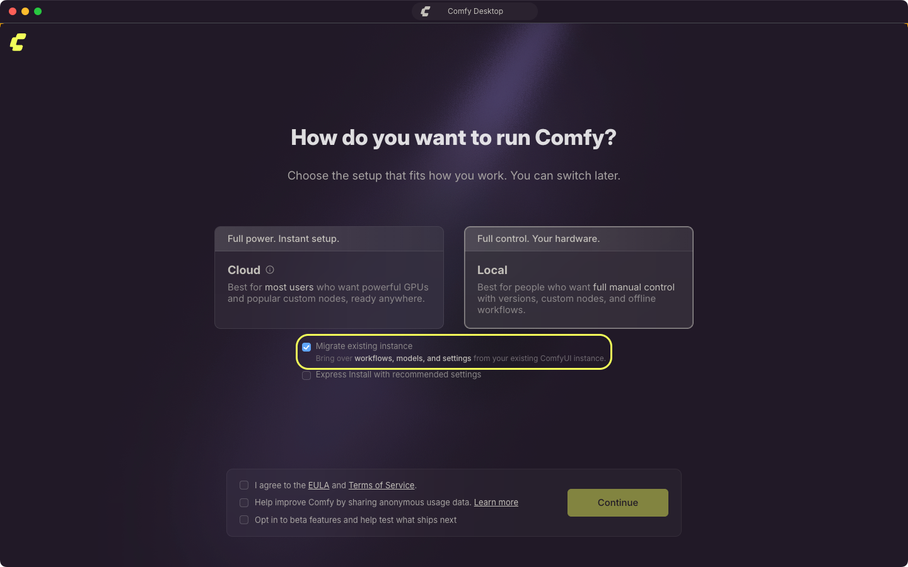
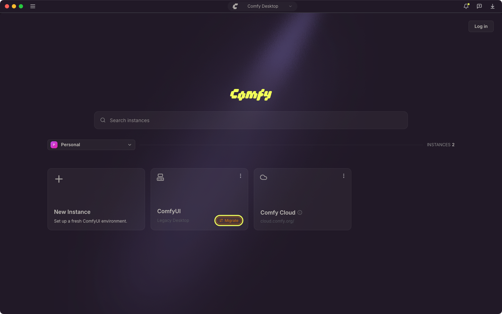
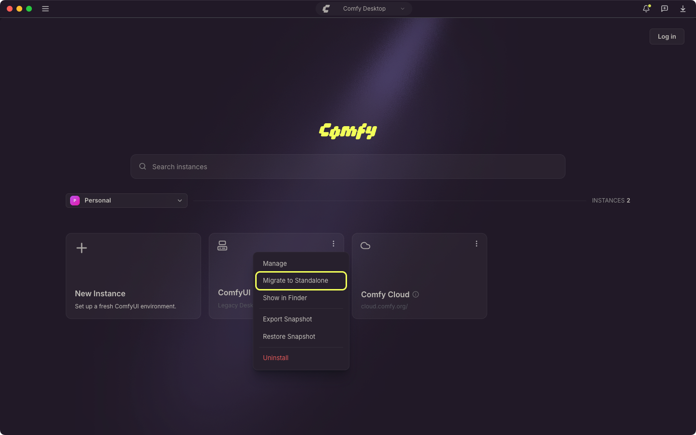
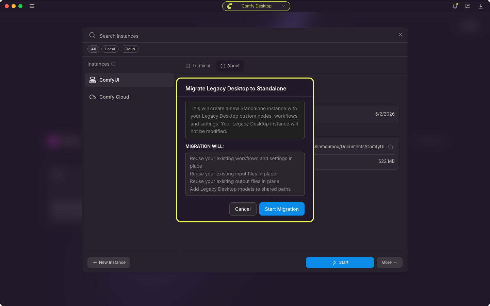

<Info>
이 페이지는 **Legacy Desktop**(이전 단일 설치 데스크톱 앱)에서 마이그레이션하는 방법을 다룹니다. 처음 사용자라면 건너뛰셔도 됩니다.
</Info>

<CardGroup cols={1}>
  <Card title="다른 설치 방법을 찾고 계신가요?" icon="compass" href="/ko/installation/desktop/usage/instance-management#기존-설치-추적하기">
    이미 ComfyUI 설치(포터블, 수동 git clone 등)가 있고 이를 Comfy Desktop에 추가하려면 인스턴스 관리의 **기존 설치 추적**을 참조하세요.
  </Card>
</CardGroup>

Legacy Desktop이 이미 설치되어 있다면 Comfy Desktop이 이를 감지하고 마이그레이션하여 Chooser 뷰에 새로운 Standalone 설치를 만듭니다.

## 마이그레이션되는 항목

Legacy Desktop은 단일 설치 앱이었습니다. Comfy Desktop은 다중 설치 관리자입니다. 마이그레이션하면:

- **워크플로와 설정**: 기존 위치에서 그대로 재사용되어 새 인스턴스가 같은 사용자 데이터를 이어받습니다.
- **커스텀 노드**: 기존 `custom_nodes` 폴더에 그대로 남습니다. 마이그레이션된 설치는 Legacy Desktop 데이터 폴더를 기본 디렉터리로 실행되므로 같은 노드가 로드되고, 그 패키지도 재사용되는 Python 환경에 남습니다.
- **모델**: 기존 모델 폴더가 공유 모델 디렉터리에 추가되어 모든 설치가 원래 위치에 있는 파일을 읽을 수 있습니다.
- **입력 파일 및 출력**: 기존 폴더에서 그대로 재사용됩니다.
- **Python 환경**: 기존 환경을 검증한 뒤 재사용합니다. Comfy Desktop은 torch를 임포트할 수 있는지 확인하고, 그다음 ComfyUI 자체의 요구 사항을 그 환경에 설치합니다. 기존 PyTorch 패키지는 교체하지 않습니다.
- **ComfyUI 버전**: ComfyUI 소스가 새 관리 디렉터리에 스테이징되며, 이후 업데이트는 Comfy Desktop이 관리합니다.

마이그레이션은 Legacy Desktop 데이터 폴더와 Python 환경을 복사하지 않고 그대로 재사용하므로, 두 번째 사본이 아니라 하나의 작동 중인 환경이 남습니다. 온전한 사본이 필요하다면 마이그레이션 전에 직접 백업하세요.

## 마이그레이션 시 백업되는 항목

변경을 시작하기 전에 Comfy Desktop은 Legacy Desktop 설정 파일을 레거시 구성 폴더 안의 날짜가 붙은 폴더로 복사합니다:

- macOS: `~/Library/Application Support/ComfyUI/legacy-backup/<timestamp>/`
- Windows: `%APPDATA%\ComfyUI\legacy-backup\<timestamp>\`

존재하는 파일만 복사됩니다:

- `config.json`: 사용하던 데이터 폴더를 포함한 Legacy Desktop 앱 설정.
- `comfy.settings.json`: 레거시 사용자 폴더에 저장된 ComfyUI 프런트엔드 설정.
- `extra_models_config.yaml`: Legacy Desktop에서 구성한 추가 모델 경로.
- `window.json`: 저장된 창 크기와 위치.

이 백업에는 설정만 들어갑니다. 모델, 워크플로, 커스텀 노드, 입력 파일, 출력은 복사되지 않습니다. 마이그레이션된 설치가 원래 위치에서 계속 사용하기 때문입니다. 마이그레이션은 또한 레거시 환경의 스냅샷(커스텀 노드와 설치된 패키지)을 레거시 데이터 폴더의 `.snapshots/`에 기록합니다.

파일을 복사할 수 없으면 마이그레이션은 로그에 남기고 계속 진행하므로, 백업 실패로 마이그레이션이 중단되지는 않습니다.

## 마이그레이션 중 진행 과정

마이그레이션은 자체 진행 화면을 표시하며 다음 단계를 순서대로 진행합니다:

1. **Back up legacy state**
2. **Check folder access** (macOS만 해당)
3. **Validate Python environment**
4. **Capture snapshot**
5. **Allocate install folder**
6. **Stage ComfyUI source code**
7. **Install requirements**
8. **Carry over settings**
9. **Register installation**

중간에 확인을 요청하며 멈출 수 있습니다:

- **Folder access needed**(macOS): macOS가 Legacy Desktop 폴더 접근을 차단했습니다. 시스템 설정 → 개인정보 보호 및 보안에서 Comfy Desktop에 전체 디스크 접근 권한을 부여한 뒤 마이그레이션을 다시 시작하세요.
- **Python environment looks broken**: 레거시 환경이 torch를 임포트하지 못했습니다. 해당 환경을 그대로 사용하려면 **Adopt anyway**, 중단하려면 **Cancel**을 선택합니다.
- **ComfyUI source code unavailable**: 새 설치에 필요한 ComfyUI 소스를 가져오지 못했습니다. **Retry**를 선택하거나, **Cancel**을 선택하고 대시보드에서 새 설치를 만드세요.

진행 화면은 모든 단계의 출력을 **View logs** 패널에 유지하며, 단계가 실패하면 이 패널이 자동으로 열립니다. 패널의 복사 버튼으로 텍스트를 복사할 수 있고, 같은 출력은 Desktop 앱 로그에도 기록됩니다. 요구 사항 설치가 실패하면 경고로 기록될 뿐 마이그레이션은 중단되지 않습니다.

## 마이그레이션 후 변경 사항

마이그레이션이 완료되면 새 Standalone 설치는 다른 Comfy Desktop 설치와 동일하게 작동합니다.

- **실행** — Chooser 뷰에서 새 설치 카드의 재생 버튼을 클릭하여 ComfyUI를 시작합니다.
- **포트** — 레거시 구성의 포트와 기타 커스텀 시작 인자가 이어집니다.
- **관리** — Manage 패널을 사용하여 설치를 업데이트, 스냅샷, 구성합니다.
- **업데이트** — Standalone 설치는 Manage 패널을 통해 독립적으로 업데이트할 수 있습니다. Legacy Desktop과 달리 업데이트할 때마다 새 빌드를 다운로드할 필요가 없습니다.
- **다중 인스턴스** — 각각 고유한 ComfyUI 버전과 구성으로 여러 개의 Standalone 설치를 나란히 운영할 수 있습니다.
- **공유 저장소** — 기본적으로 모델은 모든 Standalone 설치에서 공유됩니다. 입력 및 출력 디렉터리는 기존 legacy 작업 공간을 가리키도록 고정되어 기존 파일이 그대로 유지됩니다.

마이그레이션된 인스턴스에서는 ComfyUI가 자동으로 업데이트되지 않습니다. 새 ComfyUI 버전이 필요하면 Manage 패널의 [업데이트 탭](/ko/installation/desktop/usage/manage#업데이트-탭)을 사용하세요.

## 이전 링크가 여전히 작동하나요?

Legacy Desktop은 기본적으로 `8000` 포트에서 실행되었습니다. 새 설치도 legacy 구성에서 **포트를 이어받기** 때문에 `http://localhost:8000`이 여전히 작동할 것입니다. `--port 8188`과 같은 커스텀 CLI 인자가 구성되어 있었다면 이것도 이어받습니다.

URL 단축기, 북마크, 또는 다른 주소로 Legacy Desktop 앱을 참조하는 외부 통합을 사용 중이라면 새 설치의 Startup Args 탭을 확인하여 적절히 업데이트해야 할 수 있습니다.

## 단계별 마이그레이션

<Steps>
<Step title="Comfy Desktop 설치">
[공식 다운로드 페이지](https://comfy.org/download)에서 Comfy Desktop을 다운로드하여 설치합니다.
</Step>

<Step title="Comfy Desktop 시작">
Comfy Desktop을 처음 열면 초기 설정이 시스템의 Legacy Desktop 설치를 자동으로 감지합니다. **Local**을 선택하면 **Migrate existing instance**가 기본 선택된 상태로 표시되며, 계속하면 기존 환경이 이전됩니다.

</Step>

<Step title="마이그레이션 확인">
**Continue**를 선택한 뒤 확인 대화상자에서 **Start Migration**을 선택합니다. Comfy Desktop이 다음을 수행합니다:

1. 워크플로, 설정, 커스텀 노드, 입력 파일, 출력을 그대로 재사용합니다
2. Python 환경을 재사용하고 ComfyUI 소스를 새 관리 디렉터리에 스테이징하여 업데이트가 정상 동작하도록 합니다
3. 모델 폴더를 공유 디렉터리로 추가하고 ComfyUI 요구 사항을 재사용하는 환경에 설치합니다

완료 후 Chooser 뷰에 새 Standalone 설치 카드가 나타납니다.
</Step>

<Step title="확인">
새 설치를 시작하고 다음을 확인합니다:
- 워크플로가 사용 가능한지
- 커스텀 노드가 설치되었는지
- 모델에 접근할 수 있는지
- 서버가 이어받은 URL에서 실행 중인지(기본값 `http://localhost:8000`)
</Step>
</Steps>

## Chooser에서 마이그레이션하기

초기 설정을 이미 완료했거나 Legacy Desktop 설치가 Chooser에 이미 표시되어 있다면 인스턴스 카드에서 마이그레이션을 시작할 수 있습니다:

1. Legacy Desktop 인스턴스 카드를 찾습니다. 카드에 **Migrate** 알약이 표시됩니다.

   

2. 알약을 클릭하거나 카드의 **⋮** 메뉴에서 **Migrate to Standalone**을 선택합니다.

   

3. 확인 대화상자의 내용을 검토한 뒤 **Start Migration**을 선택합니다.

   

Legacy Desktop 설치는 기존 위치에서 그대로 인수되며, Chooser에 표시되는 인스턴스는 기존 환경을 Comfy Desktop에서 관리하는 형태가 됩니다. 추적 중인 Git 및 portable 인스턴스는 대신 새 Standalone 설치가 만들어지고 추적 대상 설치는 그대로 남습니다.

업데이트가 대기 중이면 업데이트 알약이 우선 표시되며 **Migrate**는 표시되지 않습니다.

## 문제 해결

### Legacy Desktop이 자동으로 감지되지 않는 경우

Legacy Desktop 소스는 마이그레이션 전용이며 **새 인스턴스** 선택기에 표시되지 않으므로 직접 추가할 수 없습니다. Comfy Desktop이 Legacy Desktop 설치를 감지하지 못한 경우:

1. 해당 설치를 추적 인스턴스로 추가합니다. 자세한 내용은 [**기존 설치 추적**](/ko/installation/desktop/usage/instance-management#기존-설치-추적하기)을 참조하세요.
2. Chooser에 표시되면 카드의 **Migrate** 알약 또는 **⋮** 메뉴의 **Migrate to Standalone**으로 마이그레이션합니다.

### 마이그레이션 실패

- **로그 확인**: 마이그레이션 화면에서 **View logs**를 선택하거나 Desktop 앱 로그(`app.log`)를 엽니다. macOS는 `~/Library/Logs/Comfy Desktop`, Windows는 `%APPDATA%\Comfy Desktop\logs`에 있습니다.
- **Legacy 설치가 온전한지 확인**: 마이그레이션은 기존 폴더에서 모델, 워크플로, 커스텀 노드를 읽으므로 폴더가 이동되거나 삭제되면 중단됩니다.
- **다시 시도**: 네트워크 문제로 소스 스테이징 단계가 실패할 수 있으며, 두 번째 시도에서 성공할 수 있습니다.

### 마이그레이션이 중간에 멈춘 경우

프롬프트에서 **Cancel**을 선택하면 실행이 중지되며, 단계가 확실히 실패한 경우에도 마찬가지입니다(요구 사항 설치 경고로는 중지되지 않습니다). 중지된 실행은 Chooser에 인스턴스를 추가하지 않으므로 카드의 **Migrate** 알약에서 마이그레이션을 다시 시작하세요. Legacy Desktop 폴더는 삭제되지 않습니다.

### 마이그레이션 후 모델이 누락된 경우

모델은 공유 모델 디렉터리에 추가되는 것이며 복사되지 않습니다. 모델이 나타나지 않으면:

1. [Desktop Settings → Storage](/ko/installation/desktop/usage/settings#저장소)를 엽니다.
2. 기존 모델 폴더와 Legacy Desktop의 `extra_models_config.yaml`에 나열된 추가 모델 경로가 공유 디렉터리에 있는지 확인합니다. 빠진 항목이 있으면 **+ Add Shared Directory**를 선택해 해당 폴더를 지정합니다.
3. 마이그레이션된 설치의 Manage 패널에서 **저장소 탭**을 열고 **Include Shared Directories**가 켜져 있는지 확인합니다.
