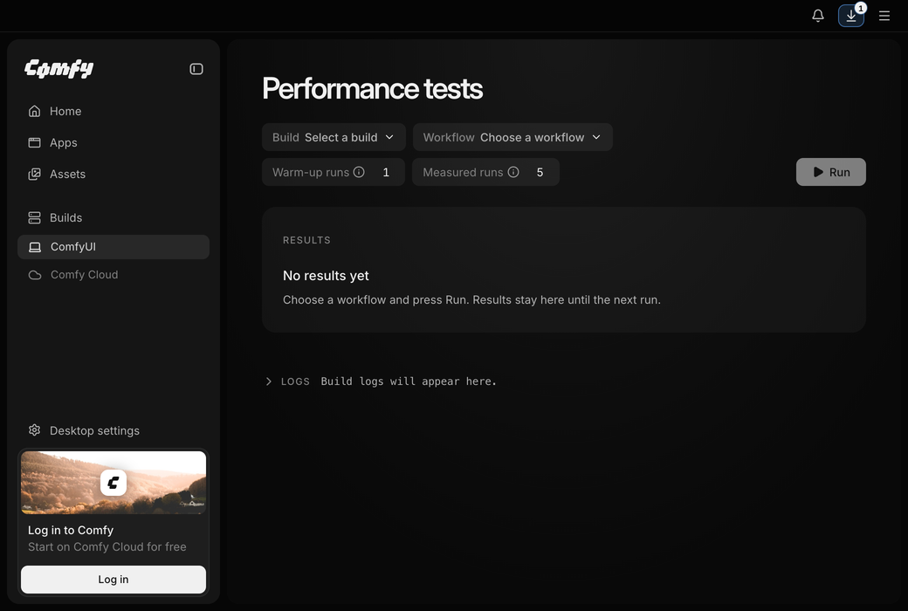

Comfy Desktop에서는 예제 비디오 워크플로나 직접 만든 이미지 워크플로처럼 사용자의 빌드 중 하나에서 워크플로가 실행되는 데 걸리는 시간을 측정하고, 그 결과를 다른 GPU나 다른 빌드에서의 실행과 비교할 수 있습니다. 측정값은 GPU를 두고 다른 작업이 경쟁하지 않고 어떤 하드웨어에서 나온 것인지 알 때에만 의미가 있으므로, 성능 테스트는 해당 빌드에서 워크플로를 단독으로 실행하고 이를 반복하며, 각 결과를 시스템 정보와 함께 저장합니다. **Performance tests**에서 테스트를 실행하고 결과를 확인하며, **Benchmarks**에서 저장된 실행을 비교합니다.

## 성능 테스트 또는 벤치마크 열기

두 페이지 모두 **제목 표시줄**에 있는 **메뉴**에서 열립니다. 그곳의 다른 버튼에 대해서는 [제목 표시줄 사용](/ko/installation/desktop/usage/overview#타이틀-바-사용)을 참조하세요.

1. **홈**에서 **제목 표시줄** 오른쪽 끝의 **메뉴**를 클릭합니다.
2. **성능 테스트** 또는 **벤치마크**를 선택합니다.

페이지는 **홈** 창에서 **사이드바** 옆에 열립니다. ComfyUI가 실행 중인 창에서는 동일한 **메뉴** 항목이 새 Comfy Desktop 창에서 해당 페이지를 엽니다.


## 성능 테스트 실행

성능 테스트는 빌드를 별도의 세션에서 시작하고, 워크플로를 여러 번 실행한 뒤, 완료되면 빌드를 중지합니다. **Performance tests** 상단의 툴바에서 왼쪽부터 **Build**, **Workflow**, **Warm-up runs**, **Measured runs**, **Run** 순서로 설정합니다.

아무것도 선택하기 전에는 **Build**에 **Select a build**, **Workflow**에 **Choose a workflow**, **Results**에 **No results yet**이 표시됩니다.



### 빌드 선택

선택한 빌드는 테스트가 시작하고 시간을 측정하는 빌드이며, 그 이름은 결과와 함께 저장됩니다.

- **Build**를 클릭한 다음(빌드를 선택하기 전까지는 **Select a build**로 표시됩니다) 빌드를 선택합니다.

목록의 각 빌드는 이름을 표시하고 그 아래에 유형과 버전이 나타납니다. 목록에는 **사이드바**에서 선택한 워크스페이스의 빌드가 포함됩니다. 다른 워크스페이스의 빌드를 테스트하려면 [워크스페이스 메뉴 사용](/ko/installation/desktop/usage/overview#워크스페이스-메뉴-사용하기)에 설명된 대로 먼저 워크스페이스를 전환하세요. 워크스페이스를 전환하면 선택한 빌드가 지워집니다.

<Note>
  Comfy Cloud 빌드는 목록에 표시되지 않습니다. 테스트에는 Comfy Desktop이 시작하는 빌드가 필요하기 때문입니다. 로그아웃 상태에서는 설치된 빌드만 목록에 표시됩니다.
</Note>

### 워크플로 선택

빌드를 선택한 후 시간을 측정할 워크플로를 선택하세요. Comfy Desktop에 포함된 예제 워크플로를 사용하거나 직접 가져올 수 있습니다.

#### 예제 워크플로 사용

예제 워크플로는 바로 실행할 수 있습니다. Comfy Desktop이 각 워크플로에 필요한 모델을 다운로드합니다.

1. **워크플로**를 클릭한 다음 **예제 워크플로 선택**을 선택하세요.
2. **예제 워크플로 선택**에서 **비디오**, **이미지**, 또는 **오디오** 탭을 선택한 다음 카드를 선택하세요. 각 카드에는 워크플로 이름, 작업, 다운로드하는 모델의 대략적인 크기가 표시됩니다. 크기 대신 하드 드라이브 아이콘이 표시되면 모델이 이미 디스크에 있다는 뜻입니다. 포인터를 아이콘 위에 올리면 **다운로드됨**과 크기를 볼 수 있습니다.
3. **워크플로 사용**을 클릭하세요.

Comfy Desktop은 디스크에 없는 모델을 다운로드합니다. 도구 모음 아래의 상태 줄에 **워크플로 준비 및 필수 모델 다운로드 중…**이 표시된 다음, 진행률 표시줄과 **다운로드 취소**와 함께 다운로드가 표시됩니다. 다운로드는 **타이틀 바**의 **다운로드** 트레이에도 나타납니다. 해당 위치에서 다운로드를 확인하려면 [Comfy Desktop의 다운로드](/ko/installation/desktop/usage/downloads)를 참조하세요. 다운로드가 완료되면 **워크플로**에 **예제** 태그가 있는 예제 이름이 표시됩니다.

예제 로딩을 막는 문제가 있으면 도구 모음 아래 또는 대화 상자에 빨간색 줄이 표시됩니다:

| 메시지 | 수행할 작업 |
| --- | --- |
| **이 빌드 설치를 완료해야 예제 워크플로를 사용할 수 있습니다.** | 설치된 빌드를 선택하거나 이 빌드의 설치를 완료하세요. |
| **예제 워크플로를 다운로드하려면 인터넷에 연결되어 있어야 합니다.** | 인터넷에 연결한 후 다시 시도하세요. |
| **~X 필요, Y만 여유 있음. 공간을 확보하거나 더 가벼운 워크플로를 선택하세요.** (대화 상자에서 **워크플로 사용**을 사용할 수 없음) | 디스크 공간을 확보하거나 더 작은 모델이 있는 카드를 선택하세요. |
| **이 워크플로에 필요한 모든 모델을 다운로드할 수 없습니다.** | 예제를 다시 선택하세요. Comfy Desktop은 다운로드에 실패한 예제를 제거합니다. |

예제는 선택한 빌드에 속합니다. 다른 빌드를 선택하면 Comfy Desktop이 **성능 테스트**에서 해당 예제를 제거합니다. 테스트에서 이미 사용한 경우 해당 파일은 디스크에 남아 있습니다.

#### 직접 워크플로 가져오기

가져올 워크플로는 [API 형식](/ko/development/api-development/workflow-api-format)이어야 합니다. 먼저 ComfyUI에서 해당 형식으로 내보내세요.

- **워크플로**를 클릭하고 **API 워크플로 가져오기**를 선택한 다음 `.json` 파일을 선택하세요. `.json` 파일을 **워크플로** 위로 끌어다 놓을 수도 있습니다.

**워크플로**에 **API** 태그가 있는 파일 이름이 표시됩니다. 파일이 API 형식이 아니면 도구 모음 아래의 빨간색 줄에 **선택된 파일은 ComfyUI API 형식 워크플로가 아닙니다.**가 표시됩니다. `jobs.json` 또는 `results.json`이라는 파일은 결과용으로 예약된 이름이므로 거부됩니다.

Comfy Desktop은 파일을 새 세션 폴더에 복사하므로(참조: [결과 저장 위치](#결과가-저장되는-위치)), 원본을 이동하거나 편집한 이후에도 테스트는 복사본을 실행합니다.

#### 워크플로 제거

- **워크플로**를 클릭하고 **워크플로 삭제**를 선택한 다음 **워크플로 삭제**를 클릭하여 확인하세요.

이렇게 하면 **성능 테스트**에서 워크플로가 제거됩니다. 아직 실행에서 사용되지 않았다면 Comfy Desktop이 해당 복사본을 삭제합니다. 원본 파일과 이전 실행 결과는 유지됩니다. 예제를 다운로드하는 동안 같은 메뉴 항목은 **다운로드 취소**로 표시됩니다.

### 실행 횟수 설정

워밍업 실행은 시간 측정이 시작되기 전에 모델을 로드하므로, 첫 번째 느린 실행이 결과를 왜곡하지 않습니다.

| 설정 | 범위 | 기본값 | 기능 |
| --- | --- | --- | --- |
| **워밍업 실행** | 0~5 | 1 | 모델을 로드하고 캐시를 예열하기 위해 먼저 실행됩니다. 결과에는 포함되지 않습니다. 워밍업을 건너뛰려면 0으로 설정하세요. |
| **측정 실행** | 1~100 | 5 | 워밍업 실행 이후에 시간을 측정하는 실행입니다. 이 실행들의 소요 시간이 결과를 구성합니다. |

**Run**을 클릭하면 범위를 벗어난 값은 가장 가까운 범위 한계로 변경됩니다. 각 실행은 워크플로의 모든 시드 입력에 1을 더하므로 ComfyUI가 캐시된 결과를 반환하지 않습니다.

### 테스트 시작

게임이나 비디오 내보내기처럼 GPU를 사용 중인 다른 작업은 측정값에 계속 영향을 주므로, 테스트를 실행하기 전에 중지하세요.

1. **실행**을 클릭합니다.

   **실행**을 사용할 수 없으면 포인터를 그 위에 올려 이유를 확인합니다: **먼저 빌드를 선택하세요.**, **먼저 워크플로를 선택하세요.**, **워크플로가 준비될 때까지 기다리세요.** 또는 **빌드 시작이 완료될 때까지 기다리세요.**

2. **결과**에서 테스트를 확인합니다. **빌드 시작 중…**으로 표시된 다음, 진행률 표시줄 아래에 **워밍업 실행** 또는 **측정 실행 X/Y**와 함께 **N/M 실행**이 표시됩니다. **로그**가 열려 빌드의 출력을 표시합니다.

테스트가 실행되는 동안 **실행** 대신 **중지**가 표시됩니다. 테스트를 취소하려면 **중지**를 클릭합니다. 빌드가 중지될 때까지 **중지 중…**으로 표시됩니다.

모든 실행이 완료되면 Comfy Desktop이 빌드를 중지하고 결과를 표시합니다. Comfy Desktop이 실행을 전송한 후 4시간이 지나도 실행이 완료되지 않으면 **성능 테스트 작업을 기다리는 동안 시간이 초과되었습니다.**라는 메시지와 함께 테스트가 중지됩니다.

### 테스트를 차단하는 빌드 중지

테스트는 단독으로 실행되므로 GPU와 메모리를 두고 다른 작업과 경쟁하지 않습니다. 이 컴퓨터의 다른 빌드가 실행 중이거나 시작 중이거나 중지 중이면 테스트가 시작되지 않습니다. 여기에는 ComfyUI에서 열려 있는 테스트 대상 빌드와 다른 빌드에서 실행 중인 성능 테스트가 포함됩니다. 원격 빌드와 Comfy Cloud 빌드는 다른 곳에서 실행되며 테스트를 차단하지 않습니다.

그러면 **Results**에 **The performance test did not start**가 표시되고, 방해가 되는 각 빌드가 나열됩니다. 목록에 있는 성능 테스트 항목은 **Performance test:** 뒤에 빌드 이름이 표시됩니다.

<Warning>
  빌드를 중지하면 해당 빌드의 ComfyUI 창에 있는 저장되지 않은 작업이 모두 손실됩니다. 먼저 워크플로를 저장하세요.
</Warning>

1. 목록에서 빌드 옆의 **Stop**을 클릭합니다.
2. **Stop ComfyUI**에서 **Stop**을 클릭합니다. 행에 **Stopped**가 표시됩니다.
3. 목록에 있는 각 빌드에 대해 반복한 다음 **Run**을 다시 클릭합니다.

빌드 페이지에서도 빌드를 중지할 수 있습니다. [중지 또는 재시작](/ko/installation/desktop/usage/instance-management#중지-또는-재시작)을 참조하세요.

### 결과 읽기

결과는 이 빌드에서 워크플로가 얼마나 오래 걸렸는지 보여 주므로, 다른 빌드 및 GPU와 비교할 수 있습니다.

- 헤더에는 워크플로와 테스트가 실행된 빌드가 표시됩니다.
- 큰 숫자는 중앙값 실행 시간(초)입니다. 그 아래의 **중앙값 실행 · N회 측정 · N회 실패**는 소요 시간을 산출한 실행 횟수와 실패한 실행 횟수를 나타냅니다.
- **실행 소요 시간**은 **가장 빠른 실행**, **중앙값 실행**, **평균 실행**, **가장 느린 실행**을 막대로 비교합니다.
- **시스템 정보**에는 **연산 장치**, **VRAM**, **RAM**, **PyTorch 버전**, **xFormers 버전**, **CPU**, **CPU 코어**, **운영 체제**, **아키텍처**가 나열됩니다.

실행의 소요 시간은 ComfyUI가 작업을 실행하는 데 걸린 시간, 즉 실행 시작부터 종료까지의 시간이며, 사용자가 기다린 시간이 아닙니다. 실패한 실행은 소요 시간에서 제외됩니다.

결과 헤더 오른쪽에 두 개의 버튼이 있습니다:

- macOS의 **Finder에서 보기**, Windows의 **Explorer에서 보기**, Linux의 **폴더에서 보기**는 세션 폴더를 엽니다.
- **결과 내보내기**는 폴더를 묻습니다. **여기에 내보내기**를 클릭하면 결과를 `performance-test-results-<timestamp>.png`로 저장합니다.

테스트가 실패하면 **결과**에 오류와 함께 **테스트가 완료되지 않았습니다**가 표시되고, 이어서 **자세한 내용은 아래 로그를 참조하세요.**가 나타납니다. **로그**를 확장하면 빌드의 출력을 읽을 수 있습니다. 빌드에 없는 노드나 모델이 필요한 워크플로는 이런 방식으로 실패합니다.

결과는 다음 실행까지 페이지에 남아 있습니다. 나중에 다시 보려면 **벤치마크**를 여세요.

## Benchmarks에서 실행 비교

Benchmarks는 결과 폴더에 저장된 모든 테스트를 읽어 하나의 테이블에 나열하므로, 어떤 GPU, 워크플로, 빌드가 다른 것보다 얼마나 빠른지 확인할 수 있습니다. 테스트가 끝날 때까지는 **아직 성능 테스트 결과가 없습니다**라고 표시됩니다. 하나를 실행하려면 **성능 테스트 열기**를 클릭하고, 테스트가 끝난 후에는 **세션 새로 고침**을 클릭하세요.


### 실행 필터링 및 정렬

툴바를 사용하여 비교하려는 실행만 표시하도록 테이블 범위를 좁힙니다.

- **워크스페이스**, **빌드**, **하드웨어**, **워크플로**: 일치하는 실행만 표시합니다. 각 항목은 기본적으로 **전체**로 표시됩니다.
- **비교 기준**: 테이블에서 비교할 소요 시간으로, **가장 빠름**, **평균**, **중앙값**, **가장 느림** 중에서 선택합니다. 기본값은 **중앙값**입니다.
- **세션 새로 고침**(원형 화살표): 테스트가 끝난 후 결과 폴더를 다시 불러옵니다.
- **실행 검색…**: 세션, 워크플로, 빌드, 워크스페이스, 하드웨어와 일치하는 항목을 찾습니다.
- **열**: 테이블에 표시할 항목을 선택합니다. **측정값**은 소요 시간 열을 추가하고, **표시할 열**은 **워크스페이스**, **날짜 / 시간**, **실행**, **GPU / 하드웨어**와 같은 열을 추가합니다.

기본적으로 테이블에는 **세션**, **워크플로**, **빌드**, **중앙값 및 범위**, **중앙값**, **기준 대비**가 표시됩니다. 두 **중앙값** 열은 **비교 기준**을 따릅니다. 실행은 **비교 기준** 소요 시간을 기준으로 정렬되며, 가장 빠른 실행이 먼저 표시됩니다.

- 열을 기준으로 정렬하려면 해당 열의 머리글을 클릭합니다. 다시 클릭하면 순서가 반전됩니다.
- 실행을 이동하려면 행 왼쪽의 그립을 드래그하거나, 그립에 포커스한 후 `Alt+Up` 또는 `Alt+Down`을 누릅니다.
- 추가한 열을 이동하려면 해당 열의 머리글을 드래그하거나, 머리글에 포커스한 후 `Alt+Left` 또는 `Alt+Right`를 누릅니다.

일치하는 실행이 없으면 페이지에 **일치하는 항목 없음**이 표시됩니다. **필터 지우기**를 클릭하면 모든 실행을 볼 수 있습니다.

### 기준과 비교

각 실행은 하나의 참조 실행과 비교됩니다. 기본적으로 **비교 기준** 소요 시간이 가장 짧은 실행이며, **가장 빠름**으로 표시됩니다.

**기준 대비** 열에는 다른 각 실행에 대해 다음이 표시됩니다.

- **N× 빠름**: 해당 실행은 기준 시간의 1/N이 걸렸습니다.
- **N× 느림**: 해당 실행은 기준보다 N배 오래 걸렸습니다.
- **동일한 속도**: 해당 실행은 기준과 0.5% 이내 차이입니다.
- **사용할 수 없음**: 해당 실행에는 비교할 소요 시간이 없습니다.

원하는 실행과 비교하려면:

- 포인터를 행 위에 올린 상태에서 깃발(**기준으로 설정**)을 클릭합니다. 행 끝의 **⋯**를 클릭하고 **기준으로 설정**을 선택할 수도 있습니다.

해당 실행은 **기준**으로 표시됩니다. 가장 빠른 실행으로 돌아가려면 깃발을 다시 클릭합니다(**기준 초기화**). 필터로 인해 기준이 숨겨지면 테이블 아래에 **필터에서 숨긴 세션 N과 비교 중입니다.**라는 메모가 표시됩니다.

### 비교 결과 내보내기

비교 결과를 이미지로 공유하려면 내보냅니다.

1. 내보낼 각 실행의 왼쪽에 있는 체크박스를 선택합니다. 하단의 막대에 선택한 실행 수가 표시됩니다.
2. 막대에서 **결과 내보내기**를 클릭합니다.
3. 폴더를 선택한 다음 **여기에 내보내기**를 클릭합니다.

Comfy Desktop은 해당 폴더에 `benchmark-comparison-<timestamp>.png`를 저장합니다. 이미지에는 기준을 설정한 경우에만 상대 속도 차트가 포함됩니다. 최대 20개 실행을 내보낼 수 있습니다. 20개를 초과해 선택하면 **결과 내보내기**를 사용할 수 없으며, 포인터를 올리면 **최대 20개 실행**이 표시됩니다. 선택을 해제하려면 막대에서 **선택 해제**(**✕**)를 클릭합니다.

### 세션 이름 바꾸기 또는 삭제

각 테스트는 세션으로 저장되며, 기본적으로 해당 워크플로를 추가한 시간으로 이름이 지정됩니다. 알아보기 쉬운 이름을 지정하거나 더 이상 필요 없는 세션을 삭제하세요.

세션 이름을 바꾸려면:

1. **세션** 열에서 세션 이름을 클릭합니다. 포인터를 올리면 연필 아이콘이 표시됩니다. 행 끝의 **⋯**를 클릭하고 **세션 이름 바꾸기**를 선택할 수도 있습니다.
2. 새 이름을 입력한 다음 `Enter`를 누릅니다. 취소하려면 `Escape`를 누릅니다.

세션 이름을 바꾸면 해당 세션의 폴더 이름도 바뀝니다. 다른 세션에 이미 같은 이름이 있으면 세션 이름이 바뀌지 않습니다.

세션을 삭제하려면:

1. 행 끝의 **⋯**를 클릭한 다음 **파일 삭제**를 선택합니다.
2. 확인하려면 **파일 삭제**를 클릭합니다.

삭제하면 세션 폴더의 모든 파일이 제거됩니다. 실행 취소할 수 없습니다.

### 다른 컴퓨터의 결과 비교

벤치마크는 찾은 각 세션 폴더에서 `results.json` 파일을 읽습니다. 다른 컴퓨터의 실행을 비교하려면 해당 세션 폴더를 하나의 폴더로 복사합니다.

1. **벤치마크** 상단의 **폴더 선택**을 클릭합니다.
2. 세션 폴더가 들어 있는 폴더를 선택합니다.

## 결과가 저장되는 위치

Performance Tests는 워크플로를 추가할 때 세션 폴더를 만들며, 그 시점의 타임스탬프(`YYYYMMDDHHMMSS`)를 이름으로 사용합니다:

```text
ComfyUI-Shared/
└── benchmarks/
    ├── 20260930141522/
    │   ├── my_workflow.json
    │   ├── jobs.json
    │   ├── results.json
    │   └── logs.txt
    └── 20260930163005/
        └── ...
```

| 플랫폼 | 기본 결과 폴더 |
| --- | --- |
| Windows | `%LOCALAPPDATA%\Comfy-Desktop\ComfyUI-Shared\benchmarks` |
| macOS 및 Linux | `~/ComfyUI-Shared/benchmarks` |

각 세션 폴더에는 다음 항목이 들어 있습니다:

- `my_workflow.json`(사용자 파일 이름): 테스트에서 실행하는 워크플로의 복사본
- `jobs.json`: ComfyUI가 실행에 대해 반환한 작업 세부 정보
- `results.json`: Benchmarks가 읽는 요약
- `logs.txt`: 테스트 중 빌드의 출력

같은 워크플로를 다시 실행하면 같은 세션 폴더에 기록되고, 그 폴더에 저장된 결과를 덮어씁니다. 비교를 위해 결과를 보관하려면 다음 테스트 전에 워크플로를 다시 선택하거나 가져오세요. 그러면 새 세션 폴더가 만들어집니다.
