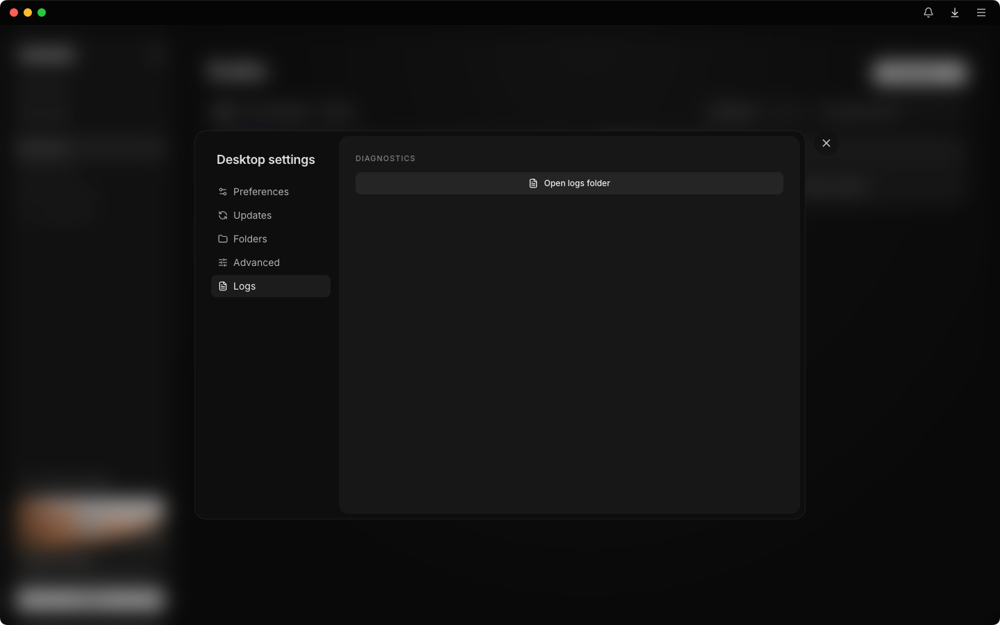

Comfy Desktop은 ComfyUI 빌드를 실행하며, **데스크탑 설정**에는 모든 빌드에 한 번에 적용되는 옵션이 있습니다. 예를 들어 모든 빌드가 모델용으로 공유하는 폴더나 패키지 다운로드에 사용하는 미러가 있습니다. 단일 빌드에 대한 설정(해당 빌드의 폴더나 시작 인자 등)은 대신 해당 빌드의 페이지에 있습니다. **데스크탑 설정**을 사용하여 Comfy Desktop을 업데이트하고, 공유 폴더와 기본 설치 위치를 선택하고, 미러와 다운로드 캐시를 설정하고, 베타 기능을 켜고, 앱 로그를 찾을 수 있습니다.

## 데스크탑 설정 열기

- **사이드바** 하단에서 **Desktop settings**를 클릭합니다. ComfyUI가 실행 중인 창에서는 **제목 표시줄**의 **메뉴**를 열고 **Desktop settings**를 선택할 수도 있습니다. **사이드바**와 **제목 표시줄**에 대해서는 [Comfy Desktop 둘러보기](/ko/installation/desktop/usage/overview#사이드바-살펴보기)를 참고하세요.

**Desktop settings** 창의 왼쪽에는 **Preferences**, **Updates**, **Folders**, **Advanced**, **Logs**의 다섯 개 탭이 있습니다. 탭을 클릭하면 해당 탭으로 전환됩니다.

## 기본 설정 지정하기 {#preferences}

**Preferences** 탭에서는 앱 언어와 창을 닫거나 빌드를 시작할 때 Comfy Desktop이 어떻게 동작할지 설정합니다.

- **Language**: Comfy Desktop의 언어입니다. **English** 또는 **简体中文** 중에서 선택합니다.

**App behavior** 항목:

| 설정 | 기본값 | 기능 |
| --- | --- | --- |
| **Confirm before closing a window** | 꺼짐 | 창을 닫으면 ComfyUI가 중지되거나 Comfy Desktop이 종료되는 경우, 닫기 전에 확인을 요청합니다. |
| **Warn before running multiple builds** | 켜짐 | 로컬 ComfyUI 빌드가 실행 중이거나 시작 중일 때 다른 빌드를 시작하기 전에 경고를 표시합니다. |
| **Hide Cloud from the build picker** | 꺼짐 | **Home**에서 Comfy Cloud 행을 숨깁니다. Comfy Cloud는 계속 작동하며, 언제든지 전환을 다시 끌 수 있습니다. |

**Privacy** 항목:

- **Share anonymous usage telemetry**: 익명 사용 데이터를 전송합니다. 이 전환은 직접 끌 때까지 켜진 상태로 표시됩니다.
- **Opt in to beta features**: Comfy Desktop이 빌드에서 출시 전 ComfyUI 기능을 켤 수 있도록 합니다. [베타 기능 켜기](#베타-기능-켜기)를 참고하세요.

**Community** 항목에서 **Comfy Desktop** 카드를 클릭하면 [Comfy Desktop GitHub 저장소](https://github.com/Comfy-Org/Comfy-Desktop)가 열립니다.

#

### 베타 기능 켜기

**Opt in to beta features**를 켜면 출시 전 ComfyUI 기능을 테스트하는 데 참여하게 됩니다. 전환이 켜져 있으면 Comfy Desktop은 이 컴퓨터에서 빌드를 시작할 때 다음 시작 인자 중 하나를 추가할 수 있습니다: `--enable-asset-hashing`, `--disable-assets`, `--enable-agent`. 인자는 해당 빌드의 ComfyUI 버전이 지원할 때만 추가됩니다. 빌드의 시작 인자에 이미 해당 인자나 그 반대 인자를 설정해 두었다면 Comfy Desktop은 사용자가 설정한 값을 그대로 둡니다.

전환을 한 번도 변경한 적이 없다면, 설정 과정에서 **Help improve Comfy by sharing anonymous usage data.**에 답한 내용을 따릅니다. 켜는 방법:

1. **Preferences** 탭에서 **Opt in to beta features**를 켭니다.
2. 전환이 켜지지 않으면 먼저 데이터 공유를 확인합니다. **Share anonymous usage telemetry**를 껐다가 다시 켠 다음, **Opt in to beta features**를 켭니다.

빌드가 베타 기능과 함께 시작되면 **제목 표시줄**에 **A beta feature is on** 또는 **The {feature} beta is on** 알림이 표시됩니다. **Got it**을 클릭하면 알림이 닫히고, **Settings**를 클릭하면 베타 전환이 있는 위치에서 이 탭이 열립니다. 빌드에서 베타 기능이 꺼지면 알림은 **A beta feature is off** 또는 **The {feature} beta is off**로 표시됩니다.

베타 기능이 어떤 인자를 추가했는지 확인하려면 해당 빌드의 [**Startup arguments** 탭](/ko/installation/desktop/usage/instance-management#시작-인자-설정)을 열고 **+N beta** 알약 모양 버튼을 클릭합니다. **Added for this session** 또는 **Eligible for next launch** 아래에 인자가 나열되며, **Manage beta features**를 클릭하면 베타 전환이 있는 위치에서 이 탭이 열립니다.

## Comfy Desktop 업데이트 {#updates}

Comfy Desktop은 시작하고 2초 후에 자체 업데이트를 확인한 뒤, 이후 10분마다 확인합니다. Comfy Desktop에는 선택할 수 있는 업데이트 채널이 없습니다. 빌드 페이지의 업데이트 채널은 해당 빌드의 ComfyUI를 위한 것입니다: [ComfyUI 업데이트](/ko/installation/desktop/usage/instance-management#comfyui-업데이트)를 참고하세요.

<Note>
  Linux에서 Comfy Desktop이 업데이트되는 방식은 `.deb` 패키지, AppImage, 소스 체크아웃 중 무엇을 설치했는지에 따라 다릅니다. [Linux에서 업데이트](/ko/installation/desktop/overview#운영-체제별-comfy-desktop-설치)를 참고하세요.
</Note>

#

### 업데이트를 자동으로 설치하도록 두기

**업데이트** 탭의 **데스크탑 업데이트 자동 설치**는 기본적으로 켜져 있습니다. 확인 결과 업데이트가 있으면 Comfy Desktop이 이를 다운로드하고 설치합니다:

- macOS와 Linux에서는 Comfy Desktop을 종료할 때.
- Windows에서는 다음 번에 Comfy Desktop을 시작할 때.

전환이 꺼져 있으면 **재시작 및 업데이트**를 클릭할 때만 업데이트가 설치됩니다.

#

### 사이드바에서 업데이트

업데이트가 있으면 **사이드바** 하단의 항목에 상태가 표시됩니다:

| 항목 표시 | 클릭 시 동작 |
| --- | --- |
| **데스크탑 업데이트** | **데스크탑 업데이트 가능** 대화상자를 엽니다. **다운로드**를 클릭합니다. |
| **업데이트 다운로드 중…** | **업데이트** 탭의 **데스크탑 설정**을 엽니다. 여기에 다운로드 진행률이 표시됩니다. |
| **데스크탑 업데이트 준비됨** | **데스크탑 업데이트 준비됨** 대화상자를 엽니다. **재시작 및 업데이트**를 클릭하면 업데이트로 재시작합니다. |

#

### 직접 업데이트 확인

1. **데스크탑 설정**을 열고 **업데이트** 탭을 클릭합니다.
2. **업데이트 확인**을 클릭합니다.
3. 탭에 **업데이트 {version} 사용 가능**이 표시되면 **다운로드**를 클릭합니다.
4. 탭에 **업데이트 {version} 설치 준비됨**이 표시되면 **재시작 및 업데이트**를 클릭합니다.

Comfy Desktop이 업데이트로 재시작합니다. **업데이트** 탭에 **Comfy Desktop이 최신 상태입니다**가 표시되고 **설치됨**에 다운로드한 버전이 표시되면 업데이트가 완료된 것입니다.

## 공유 폴더와 설치 위치 선택 {#storage}

공유 폴더를 사용하면 모든 빌드가 동일한 모델, 입력, 출력을 사용하므로 빌드마다 한 번씩 받는 대신 모델을 한 번만 다운로드하면 됩니다. **폴더** 탭에서는 이러한 폴더와 함께, 생성한 빌드를 Comfy Desktop이 저장할 위치로 제안하는 폴더를 설정합니다.

각 폴더 행에서 경로를 클릭하면 해당 폴더가 열리고, 폴더 아이콘을 클릭하면 다른 폴더를 선택할 수 있습니다.

- **기본 설치 위치**: 빌드를 생성할 때 Comfy Desktop이 제안하는 상위 폴더입니다. 이 값을 변경해도 기존 빌드는 이동하지 않습니다.
- **공유 폴더**: **모델**, **입력**, **출력** 폴더의 단일 목록입니다. 모든 빌드가 기본적으로 이 폴더들을 사용합니다. 특정 빌드에서 이를 변경하려면 [빌드에서 사용할 폴더 선택](/ko/installation/desktop/usage/instance-management#빌드에서-사용할-폴더-선택)을 참고하세요.

공유 모델 폴더를 관리하는 방법은 다음과 같습니다.

- **모델 폴더 추가하기**: **모델 폴더 추가**를 클릭하고 폴더를 선택합니다.
- **모델 다운로드 위치 선택하기**: **모델** 행에서 **다운로드에 사용**을 클릭합니다. 그러면 해당 행에 **다운로드** 태그가 표시됩니다. 빌드에서 자체 다운로드 폴더를 선택할 수도 있습니다. [다운로드가 저장되는 위치](/ko/installation/desktop/usage/downloads#다운로드-저장-위치)를 참고하세요.
- **모델 폴더 제거하기**: 행의 **⋯** 메뉴에서 **제거**를 선택하고 확인합니다. 파일은 디스크에 그대로 남습니다. **다운로드** 태그가 지정된 폴더에는 **⋯** 메뉴가 없으므로 먼저 다른 다운로드 폴더를 선택해야 합니다. **입력** 및 **출력** 행은 제거할 수 없습니다.

기본적으로 폴더는 다음과 같습니다.

| 폴더 | macOS 및 Linux | Windows |
| --- | --- | --- |
| **기본 설치 위치** | `~/ComfyUI-Installs` | `%LOCALAPPDATA%\Comfy-Desktop\ComfyUI-Installs` |
| 공유 **모델**, **입력**, **출력** | `~/ComfyUI-Shared/models`, `input`, `output` | `%LOCALAPPDATA%\Comfy-Desktop\ComfyUI-Shared\models`, `input`, `output` |

<Note>
  Windows에서 사용자 폴더에 이미 `ComfyUI-Installs` 또는 `ComfyUI-Shared`가 있었다면 Comfy Desktop은 계속 해당 폴더를 사용합니다. 시스템 드라이브가 아닌 다른 드라이브에 Comfy Desktop을 설치한 경우에는 폴더가 `<drive>:\Comfy-Desktop` 아래에 있습니다.
</Note>

macOS와 Linux에서 **폴더** 탭에는 **Comfy Desktop 데이터 제거**도 있으며, 이 기능은 앱을 제거하기 전에 앱의 로그, 캐시, 임시 파일을 삭제합니다. [macOS에서 Comfy Desktop 제거](/ko/installation/desktop/overview#comfy-desktop-제거) 또는 [Linux에서 남은 데이터 제거](/ko/installation/desktop/overview#comfy-desktop-제거)를 참고하세요.

## 미러 및 하드웨어 가속 설정 {#advanced}

사용 중인 지역에서 pypi.org 또는 github.com으로부터의 다운로드가 느리다면, **고급** 탭에서 Comfy Desktop이 사용할 미러를 지정할 수 있습니다.

- **PyPI 미러 URL**: `https://mirrors.aliyun.com/pypi/simple/`와 같은 Python 패키지 인덱스입니다. Comfy Desktop은 이 인덱스에서 Python 패키지를 설치하고 pypi.org를 추가 인덱스로 사용합니다. 기본값은 비어 있습니다.
- **중국 미러 사용(Git 및 PyPI)**: 기본적으로 꺼져 있습니다. 켜면 Git 저장소를 github.com 대신 gitcode.com에서 복제하고, Python 패키지를 pypi.org 대신 mirrors.aliyun.com 및 mirrors.cloud.tencent.com에서 가져옵니다. 앱 언어가 중국어인 경우에는 이 전환이 **환경 설정** 탭의 **앱 동작** 아래에 대신 표시됩니다. 시스템 언어가 중국어이면 설정 과정에서 **중국 미러를 사용하시겠습니까?**도 묻습니다.
- **하드웨어 가속 사용**: 기본적으로 켜져 있습니다. GPU를 사용해 Comfy Desktop을 렌더링합니다. 변경 사항을 적용하려면 Comfy Desktop을 재시작하세요.

#

### 다운로드 캐시 유지

Standalone 빌드를 설치하면 Comfy Desktop은 **고급** 탭의 **캐시** 아래에 표시된 캐시 폴더로 ComfyUI 번들을 다운로드합니다. 기본적으로 이 폴더의 이름은 `download-cache`입니다. 동일한 번들을 다시 설치하면 설치 화면에 **캐시된 다운로드 사용**이 표시되고 다운로드를 건너뜁니다.

Comfy Desktop은 이 폴더에 가장 최근 번들만 보관합니다. 다운로드가 완료되면 캐시 폴더 안의 다른 하위 폴더를 삭제하므로, 이곳에 다른 파일을 저장하지 마세요. 폴더 아이콘을 클릭하면 다른 폴더를 선택할 수 있습니다.

## 앱 로그 찾기 {#logs}

앱 로그는 빌드가 설치되거나 시작될 때의 출력을 비롯해 Comfy Desktop이 수행하는 작업을 기록합니다. [Comfy Desktop 이슈 트래커](https://github.com/Comfy-Org/Comfy-Desktop/issues)에 문제를 신고할 때 이 로그를 첨부하세요.

- **로그** 탭의 **진단** 아래에서 **로그 폴더 열기**를 클릭합니다.

이 폴더에는 현재 세션의 `app.log`가 있습니다. Comfy Desktop은 시작할 때마다, 그리고 `app.log`가 5 MB를 넘으면 이전 파일의 이름을 `app.log_<timestamp>.log`로 바꾸어 최대 50개까지 보관합니다. 문제가 발생한 세션의 파일을 선택하세요.
