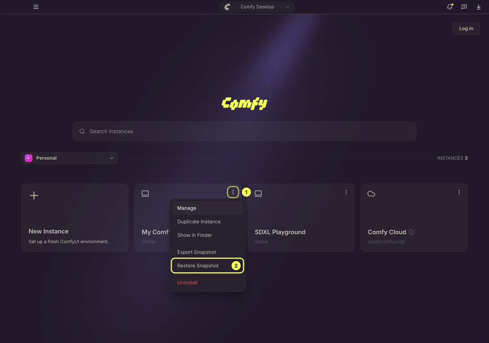
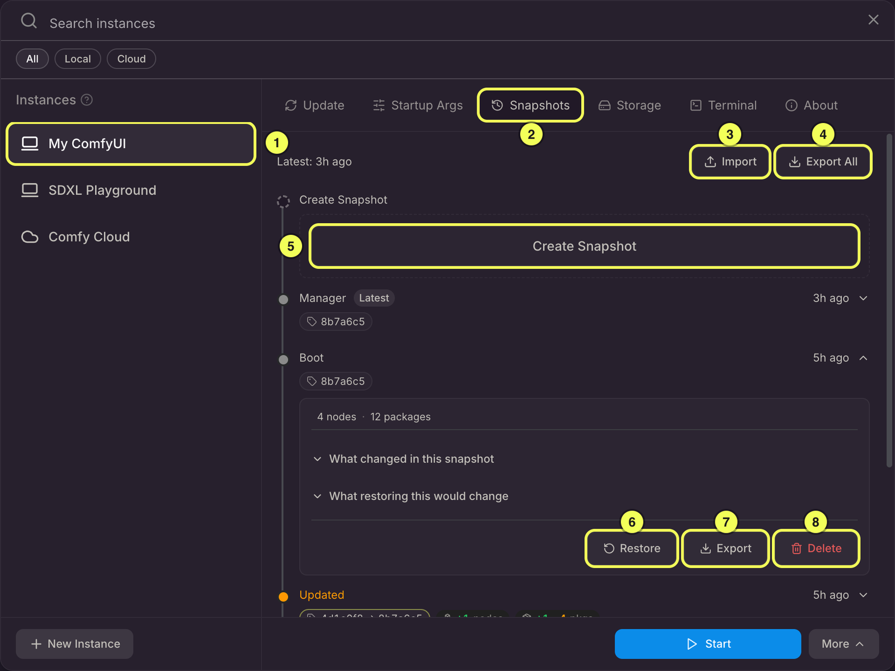
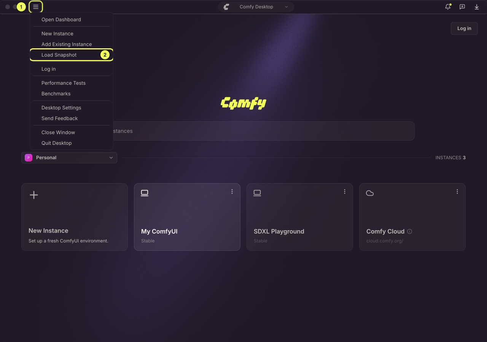
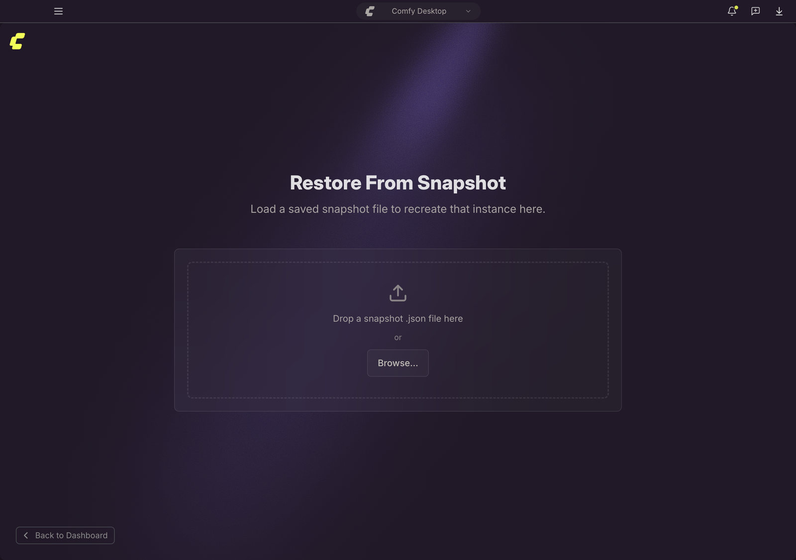
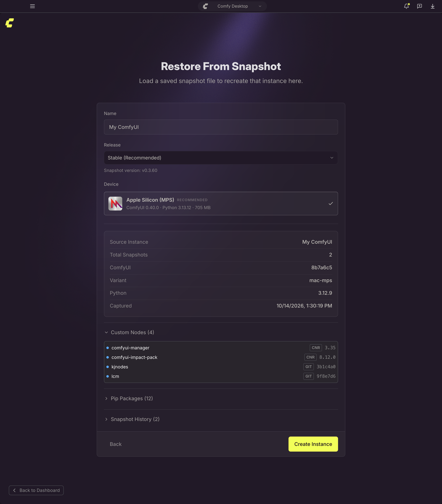

스냅샷은 인스턴스의 소프트웨어 구성을 기록하며, 파일은 기록하지 않습니다:

- **ComfyUI 버전**: 설치된 ComfyUI 빌드 정보
- **커스텀 노드**: 모든 커스텀 노드와 버전 또는 커밋 해시
- **pip 패키지**: `pip freeze`가 출력하는 환경의 모든 파이썬 패키지
- **Python 및 PyTorch**: 파이썬 버전과, 식별할 수 있는 경우 PyTorch 구성

스냅샷은 복원 지점 역할을 합니다: 업데이트 실패 후 되돌리기, 설치 환경 복제, 작업 구성을 팀과 공유하기 등에 사용할 수 있습니다.

Comfy Desktop은 Standalone 인스턴스의 스냅샷을 주요 시점에 자동으로 만듭니다: 부팅할 때와 재시작할 때, 업데이트 전후, 복원 후입니다. 언제든지 직접 만들 수도 있습니다.

## 스냅샷에 포함되지 않는 것

스냅샷은 파일 백업이 아닙니다. 모델, 워크플로우, 생성된 출력, 입력 파일, ComfyUI 설정은 기록되지 않으며 복원해도 되돌아오지 않습니다.

복원이 다시 만드는 것은 소프트웨어 구성입니다: 기록된 ComfyUI 버전으로 체크아웃하고, 커스텀 노드를 기록된 구성으로 되돌리고, 파이썬 및 PyTorch 패키지를 동기화하며, 변경한 노드의 설치 스크립트를 실행합니다. 이 스크립트가 ComfyUI 설정을 쓰기도 합니다.

다음 두 가지를 알아 두세요.

- **삭제한 모델은 돌아오지 않습니다.** 오래된 스냅샷을 복원해도 이미 삭제한 모델은 복구되지 않습니다. 그 모델을 쓰는 워크플로우를 다음에 열 때 ComfyUI가 누락 모델로 알려 줍니다. 누락 모델 대화상자에 그 모델의 **Download**가 있으면 Comfy Desktop이 내려받아 주고([다운로드](/ko/installation/desktop/usage/downloads) 참고), 없으면 해당 모델 폴더에 파일을 직접 넣어야 합니다.
- **스냅샷은 인스턴스 폴더 안에 있습니다.** 인스턴스를 제거하면 스냅샷 기록도 함께 삭제됩니다. **Forget**은 목록에서만 빼고 폴더와 스냅샷은 그대로 둡니다. 어느 쪽이든 남기려는 스냅샷은 스냅샷 탭의 **Export All**로 먼저 내보내세요. [스냅샷 공유](#스냅샷-공유)를 참고하세요.

## 스냅샷 접근

인스턴스 카드에서 **⋮ 메뉴** (1)를 클릭하고 **스냅샷 복원** (2)을 선택하면 스냅샷 탭이 바로 열립니다.

또는 인스턴스 카드에서 **관리** 패널을 열고 **스냅샷** 탭으로 이동할 수 있습니다.

## 스냅샷 탭 개요

스냅샷 탭은 모든 스냅샷 작업을 관리하는 허브입니다. 타임라인에는 인스턴스의 스냅샷이 최신순으로 표시되며, 각 항목에는 생성 방식(**Boot**, **Manager**, **Update**, **Updated**, **Restored**, **Manual**)이 함께 표시됩니다. 인스턴스를 다른 인스턴스로 복사했거나 다른 인스턴스에서 복사해 온 경우에는 그 복사 기록도 타임라인에 표시됩니다. 주요 작업은 다음과 같습니다:

1. **선택된 인스턴스**: 타임라인에 스냅샷이 표시되는 인스턴스입니다.
2. **스냅샷 탭**: 관리 패널에서 현재 활성화된 탭입니다.
3. **가져오기**: 다른 사용자나 인스턴스에서 내보낸 스냅샷 파일을 가져옵니다.
4. **전체 내보내기**: 이 인스턴스의 모든 스냅샷을 하나의 `.json` 파일로 내보냅니다.
5. **스냅샷 생성**: 현재 인스턴스 상태의 수동 스냅샷을 만듭니다.
6. **복원**: 인스턴스를 특정 스냅샷의 상태로 되돌립니다.
7. **내보내기**: 타임라인에서 단일 스냅샷을 내보냅니다.
8. **삭제**: 타임라인에서 스냅샷 하나를 삭제합니다.

### 수동 스냅샷 만들기

스냅샷 탭 헤더에서 **스냅샷 생성** (5)을 클릭합니다. 나중에 식별할 수 있도록 라벨을 선택적으로 추가할 수 있습니다 (예: "LCM LoRA 추가 전"). 스냅샷은 다음 정보를 캡처합니다:

- 현재 ComfyUI Git 커밋
- 활성화된 모든 커스텀 노드 (git 클론 URL + 커밋, 또는 CNR ID + 버전)
- `pip freeze`의 모든 pip 패키지

수동 스냅샷은 자동 스냅샷 제한에 포함되지 않으며 개별 삭제할 수 있습니다.

### 스냅샷 세부 정보 보기

행을 클릭하면 펼칠 수 있습니다. 접힌 상태에서도 스냅샷의 생성 방식, 생성 시각, ComfyUI 버전, 그리고 직전 스냅샷 대비 노드와 패키지의 증감(추가, 제거, 변경) 개수가 알약 형태로 표시됩니다. 가장 최신 스냅샷에는 **Latest** 배지가 붙습니다.

펼치면 해당 스냅샷의 전체 노드 수와 패키지 수, 라벨(있는 경우), 그리고 두 개의 접이식 비교가 표시됩니다:

- **What changed in this snapshot**：바로 이전 스냅샷과 비교합니다. 타임라인에서 가장 오래된 스냅샷에는 표시되지 않습니다.
- **What restoring this would change**：인스턴스의 현재 상태와 비교합니다. 타임라인에서 가장 최신 스냅샷에는 표시되지 않습니다.

해당 스냅샷의 **Restore**, **Export**, **Delete** 버튼도 이 펼친 영역에 있습니다. 타임라인에서 가장 최신 스냅샷에는 **Restore** 버튼이 없습니다.

### 스냅샷으로 복원

1. 스냅샷 탭에서 복원하려는 스냅샷을 찾습니다.
2. **Restore**를 클릭하면 변경 사항 미리보기가 표시됩니다.
3. 변경 사항을 검토하고 확인 대화상자에서 **Restore**를 클릭하여 복원을 시작합니다.

복원하려면 인스턴스가 중지되어 있어야 합니다. 복원을 시작할 때 ComfyUI가 실행 중이면 대화상자에 인스턴스를 먼저 중지한다는 안내가 표시됩니다. Comfy Desktop은 인스턴스를 중지하고 종료를 기다린 뒤 복원을 실행하고, 복원이 성공하면 다시 시작합니다.

복원 중에 Comfy Desktop은 다음을 수행합니다:

1. **기록된 ComfyUI 버전으로 체크아웃** (Git 커밋)
2. **누락된 커스텀 노드 설치**, 버전 전환 및 필요에 따라 노드 활성화/비활성화
3. **pip 패키지 복원**: 누락된 패키지 설치, 기록된 버전으로 업그레이드/다운그레이드, 추가 패키지 제거
4. 새로 설치되거나 버전이 전환된 커스텀 노드에 대해 **설치 후 스크립트** 실행

Comfy Desktop은 커스텀 노드를 먼저 복원하고(노드 설치 과정에서 Python 패키지가 추가될 수 있습니다) 그다음 Python 패키지를 동기화합니다. 동기화 전에 덮어쓰거나 제거할 패키지를 백업합니다. 이 시점 이후에 취소하거나 패키지 설치에 실패하면 백업한 패키지를 원래대로 되돌리고 ComfyUI를 복원 전 커밋으로 되돌립니다. 되돌릴 수 없는 패키지가 있으면 완전히 되돌렸다고 보고하지 않고 그 사실을 알립니다. 노드 복원 중에 취소하면 커밋은 되돌아가지만 이미 설치된 노드 폴더와 그 노드가 추가한 패키지는 남습니다. 환경이 이미 스냅샷과 일치하면 **No changes needed**가 표시되고 환경은 그대로 유지됩니다.

커스텀 노드는 최선 노력 방식으로 처리됩니다. 설치 또는 버전 전환에 실패한 노드가 있어도 나머지 복원은 계속됩니다. 복원은 실패 항목을 나열하며 완료되고, 기록되는 타임라인 항목에는 **Restore did not complete** 레이블이 **Restored** 태그와 함께 표시됩니다. 해당 노드를 수정하거나 제거한 뒤 다시 복원하세요.

타임라인 상단의 카드에는 마지막 복원 결과가 **Snapshot restored** 또는 **Restore failed**로 표시됩니다. 복원을 취소하면 결과 없이 카드가 닫힙니다. 복원에 성공하면 **Restored** 태그가 붙은 새 항목도 추가되며, 복원 후의 상태를 기록합니다.

### 스냅샷을 인스턴스로 가져오기

Snapshots 탭에서 **Import** 를 사용하면 스냅샷 파일을 해당 인스턴스 자체의 기록으로 가져올 수 있습니다. 파일에서 **가장 최신 스냅샷 하나만 적용**됩니다. 환경을 정확히 재현할 수 있으면 그 스냅샷이 타임라인에 추가되고, 재현할 수 없으면 가져온 뒤의 상태를 담은 스냅샷이 대신 저장되며 파일 안의 더 오래된 스냅샷은 무시됩니다. 이 스냅샷의 PyTorch 빌드를 이 컴퓨터에 적용할 수 없으면 Comfy Desktop이 적용 전에 경고합니다.

### 스냅샷 삭제

아무 스냅샷이나 펼친 뒤 **Delete** 를 클릭하면 삭제됩니다. Comfy Desktop은 설치마다 라벨이 없는 Boot 및 Manager 스냅샷을 최신 200개까지 보관하고, 새 스냅샷이 기록될 때 오래된 것부터 자동으로 제거하므로 직접 정리할 필요가 없습니다. 수동으로 만든 스냅샷과 업데이트 전후, 복원 후에 만들어진 스냅샷은 자동으로 제거되지 않으므로 더 이상 필요하지 않으면 직접 삭제하세요.

## 스냅샷 공유

스냅샷 파일은 휴대할 수 있습니다. `.json` 파일 하나에 전체 구성이 담기므로 동료에게 건네거나 다른 컴퓨터로 옮길 수 있습니다.

Snapshots 탭을 열지 않고 인스턴스의 **최신** 스냅샷을 내보내는 두 가지 지름길이 있습니다:

- Dashboard의 인스턴스 카드에서 **⋮** 메뉴를 열고 **Export Snapshot** 을 선택합니다.
- **인스턴스 선택기** 하단에서 **More** 메뉴를 열고 **Share** 를 선택합니다.

둘 다 저장 대화상자를 열고 `.json` 파일 하나를 기록합니다. 인스턴스에 아직 스냅샷이 없으면 Comfy Desktop이 공유할 스냅샷이 없다고 알려줍니다. 특정 스냅샷 하나만, 또는 모든 스냅샷을 한 번에 내보내려면 Snapshots 탭의 **Export** 와 **Export All** 을 사용하세요.

파일을 받은 사람은 그것으로 새 인스턴스를 만들 수도 있고, 이미 가지고 있는 인스턴스로 가져올 수도 있습니다.

## 스냅샷 파일로 인스턴스 생성

누군가 스냅샷 파일을 공유하면, 이를 사용하여 동일한 구성으로 새 ComfyUI 인스턴스를 만들 수 있습니다.

1. 선택기 뷰의 좌측 상단 **☰ 메뉴** (1)를 클릭하고 **스냅샷 로드** (2)를 선택합니다.

2. 파일 시스템에서 `.json` 스냅샷 파일을 선택합니다.

3. 스냅샷 내용 미리보기가 표시됩니다: 원본 인스턴스 이름, ComfyUI 버전, 커스텀 노드, pip 패키지. 세부 정보를 검토한 후 **인스턴스 생성**을 클릭하여 스냅샷으로 새 인스턴스를 빌드합니다.

이렇게 하면 완전히 새로운 독립 인스턴스가 생성되며, 원본 인스턴스는 변경되지 않습니다. 선택기 뷰에서 다른 인스턴스와 함께 새 인스턴스를 확인할 수 있습니다.
