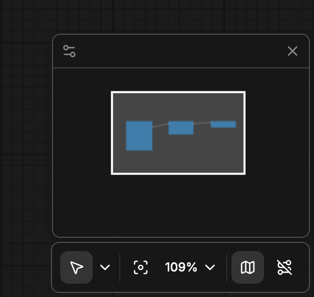

캔버스 오른쪽 아래의 **캔버스 툴바**와 **View** 메뉴는 그래프 안에서 이동하는 방식을 제어합니다. 핵심 View 명령에는 하단 패널 전환, 템플릿 탐색, **Focus Mode**, 캔버스 성능 정보, 미니맵, 링크 표시, 확대/축소, 보기 맞춤이 포함됩니다.

## 캔버스 툴바

**그래프 캔버스 메뉴 표시**(`Comfy.Graph.CanvasMenu`)가 켜져 있으면(기본값) 캔버스 오른쪽 아래에 플로팅 툴바가 표시됩니다.

<Frame caption="오른쪽 아래 모서리에 있는 캔버스 툴바와 그 위에 열린 미니맵 패널.">
  
</Frame>

| 컨트롤 | 기능 |
| --- | --- |
| **캔버스 모드** | **Select**(선택, 노드 편집)와 **Hand**(손, 팬 전용 / 읽기 전용 캔버스) 사이를 전환하는 메뉴입니다. 기본값: `v`는 Select 잠금 해제, `h`는 Hand 잠금. |
| **보기 맞춤** | 뷰포트에 그래프를 맞춥니다(`Comfy.Canvas.FitView`, 기본 `.`). |
| **확대/축소** | 확대, 축소, 화면에 맞추기, 퍼센트 입력 필드(1-1000%)가 있는 팝오버를 엽니다. 기본 단축키에는 확대/축소용 `Alt` + `=` / `Alt` + `-`가 포함됩니다. |
| **미니맵** | 전체 개요 맵을 표시하거나 숨깁니다(`Comfy.Canvas.ToggleMinimap`, 기본 `Alt` + `Shift` + `M`). `Comfy.Minimap.Visible`로 유지됩니다. |
| **링크 표시 여부** | 숨김 링크 렌더 모드를 전환해 연결선을 숨기거나 표시합니다(`Comfy.Canvas.ToggleLinkVisibility`). |

LiteGraph / Canvas 설정의 **그래프 캔버스 메뉴 표시**로 툴바 전체를 숨길 수 있습니다.

## View 메뉴

**View** 메뉴에 같은 탐색 명령이 등록되어 메뉴 바나 명령 팔레트에서 실행할 수 있습니다.

- Toggle Bottom Panel
- Browse Templates
- Focus Mode
- Canvas Performance(`Comfy.ToggleCanvasInfo`, `Comfy.Graph.CanvasInfo` 전환)
- Toggle Minimap
- Toggle Link Visibility
- Zoom In / Zoom Out / Fit View

## 집중 모드

**집중 모드**(`Workspace.ToggleFocusMode`)는 워크스페이스 크롬을 숨겨 그래프에 집중할 수 있도록 합니다. 켜져 있는 동안:

- 상단 메뉴 구역이 숨겨집니다(새 메뉴).
- 좌우 사이드바 패널과 하단 패널은 스플리터 레이아웃에 렌더링되지 않습니다.
- 햄버거 컨트롤이 나타나 집중 모드를 종료할 수 있습니다(**메뉴 표시**).

집중 모드를 다시 토글하거나 햄버거 컨트롤을 사용하면 전체 워크스페이스가 복원됩니다.

## 미니맵 옵션

표시/숨김 외에 Settings의 Minimap에서 맵에 그릴 내용(노드 색, 링크, 그룹, bypass, 오류 상태)을 제어합니다. [Lite Graph 설정](/ko/interface/settings/lite-graph)과 있으면 관련 Appearance 항목을 참고하세요.

## 링크와 캔버스 전역 설정

링크 모양과 연결된 링크의 표시 여부는 선택된 항목이 없을 때 [오른쪽 패널](/ko/interface/right-side-panel)의 **글로벌 설정**에서 빠른 토글로 제공되며, LiteGraph 설정(`Comfy.LinkRenderMode` 및 관련 옵션)에서 전체 옵션을 확인할 수 있습니다. 그리드 간격과 그리드 스냅도 같은 글로벌 설정 / LiteGraph 영역에 있습니다.

### 링크 가시성

**링크 가시성**은 캔버스의 모든 링크 선을 한 번에 숨깁니다. [캔버스 툴바](#캔버스-툴바)의 눈 모양 버튼이나 **보기** > **링크 가시성 전환**(`Comfy.Canvas.ToggleLinkVisibility`)을 사용하세요. 어떤 링크도 제거되지 않고 그래프는 계속 실행됩니다. 소켓은 점을 그대로 유지하고 링크 선만 그리기를 멈추므로, 너무 빽빽해서 읽기 어려운 그래프에서 유용합니다.

이 명령은 `Comfy.LinkRenderMode`를 **숨김**으로 설정하고, 다음 번에 사용할 때 이전 모드(직선, 선형 또는 스플라인)를 되돌려 놓습니다.

<Frame caption="같은 그래프에서 링크 가시성을 켠 경우(위)와 끈 경우(아래). 링크 선만 바뀌고 소켓은 점을 그대로 유지합니다.">
  
</Frame>

이 섹션의 나머지 부분에서는 개별 링크를 숨기는 방법을 다룹니다. 이렇게 하면 소켓에 배지가 남아 연결에 라벨을 붙이고 개별적으로 다시 표시할 수 있습니다.

### 링크 선택

ComfyUI 프론트엔드 1.58.0 이상이 필요합니다. 프레임으로 링크를 선택하는 동작은 선택 모드의 기본 캔버스 동작이며 설정 토글이 아닙니다.

작업하려는 연결 링크 선 위로 프레임을 드래그합니다. 노드, 그룹, 리라우트를 하나도 포함하지 않는 프레임은 지나가는 모든 보이는 링크를 선택하며, 선택 도구 상자의 노드 버튼이 두 가지 링크 작업으로 바뀝니다. **숨기기**는 연결을 유지하고 링크 선을 숨기며, **삭제**는 링크를 그래프에서 제거합니다. 각 작업은 한 단계의 실행 취소로 기록되며, `Delete` 또는 `Backspace`를 눌러도 링크 선택이 제거됩니다.

`Shift`와 `Alt`를 사용한 프레임은 노드와 그룹만 선택하며, 손 캔버스 모드에서는 링크가 절대 선택되지 않습니다.

### 노드 입력이나 출력을 클릭해 링크 작업하기

ComfyUI 프론트엔드 1.60.0 이상이 필요합니다. 노드의 입력 또는 출력 지점에서 드래그하는 대신 해당 지점을 클릭합니다. 캔버스가 그 지점에 연결된 모든 링크를 선택하고(입력은 링크 하나, 출력은 모든 링크), 선택 도구 상자에 프레임 선택과 같은 **숨기기**와 **삭제** 작업이 나타납니다.

- 선택한 링크가 모두 이미 숨김 상태이면 도구 상자에 **숨기기** 대신 **표시**가 나타납니다.
- **숨기기**는 보이는 링크에만, **표시**는 숨김 링크에만 적용되므로 어느 쪽도 빈 실행 취소 단계를 추가하지 않습니다.
- **삭제**는 숨김 링크를 포함해 그 지점의 모든 링크를 제거합니다.
- 클릭하는 동안 `Shift`, `Ctrl`, `Cmd`, `Alt` 중 하나를 누르고 있으면 현재 선택이 유지됩니다.
- `Ctrl` + `Alt` 클릭은 대신 링크를 끊으며, 이는 캔버스의 다른 위치에서도 마찬가지입니다.
- 링크가 없는 지점은 클릭을 무시하며, 링크 표시가 꺼진 캔버스도 클릭을 무시합니다. 그런 캔버스에서는 모든 링크 선이 숨겨져 있기 때문입니다. 지점에서 드래그하면 여전히 새 링크가 시작됩니다.

### 링크 숨기기와 배지 라벨 지정

링크는 두 가지 방법으로 숨길 수 있습니다:

- 프레임으로 링크를 선택한 뒤 선택 도구 상자에서 사선이 그어진 눈 모양(**숨기기**)을 클릭합니다. 프레임 선택은 선택 모드에서 일반 드래그 또는 `Ctrl`을 누른 상태로 작동합니다.
- 링크 선의 중간을 마우스 오른쪽 버튼으로 클릭하고 **링크 숨기기**를 선택합니다.

어느 방법이든 링크 선은 더 이상 그려지지 않고, 각 소켓에는 링크의 데이터 타입이나 라벨이 담긴 배지가 표시됩니다. 배지를 마우스 오른쪽 버튼으로 클릭해 **이름 바꾸기**를 실행합니다. 프론트엔드 1.59.1 이상에서는 한 소켓의 라벨들을 `IMAGE ×3`처럼 하나의 배지로 묶어 표시하고, 이전 버전에서는 링크마다 배지 하나를 그립니다. 숨긴 링크 선을 다시 그리려면 해당 배지를 마우스 오른쪽 버튼으로 클릭하고 **링크 표시**를 선택합니다.

아래 녹화에서는 링크 하나를 숨기고, 배지 이름을 바꾼 뒤, 링크를 다시 표시합니다:

<video controls className="w-full">
  <source src="/images/interface/canvas-controls/hide-link.mp4" type="video/mp4" />
</video>

## 관련 페이지

- [인터페이스 개요](/ko/interface/overview)
- [단축키](/ko/interface/shortcuts)
- [Lite Graph 설정](/ko/interface/settings/lite-graph)
- [오른쪽 패널](/ko/interface/right-side-panel)(Global Settings 빠른 전환)
- [하단 패널](/ko/interface/bottom-panel)
