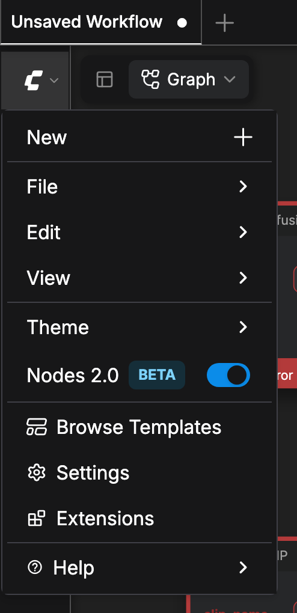
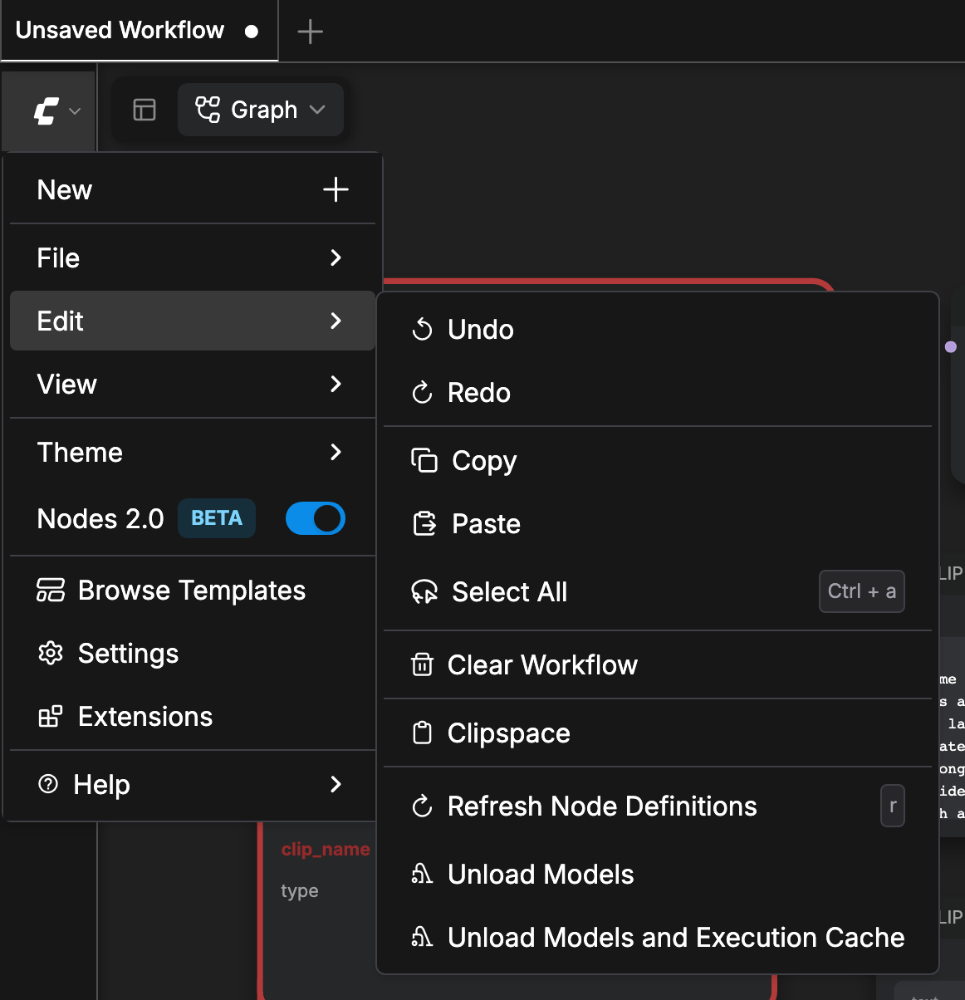

Comfy 메뉴는 왼쪽 사이드바 상단의 Comfy 로고에서 열립니다. 이 메뉴에는 캔버스에 별도의 컨트롤이 없는 명령, 즉 워크플로 시작 및 저장, 클립보드 편집, 보기 토글, GPU 메모리 정리, 도움말 링크가 있습니다.

로고 또는 옆의 셰브론을 클릭하여 메뉴를 엽니다. 오른쪽에 셰브론이 있는 항목에는 하위 메뉴가 있습니다. 마우스를 올리면 하위 메뉴가 열립니다.

## 항목

| 항목 | 기능 |
| --- | --- |
| **새로 만들기** | 빈 워크플로를 시작합니다 |
| **파일** | 워크플로를 열고, 저장하고, 내보냅니다 |
| **편집** | 실행 취소 및 다시 실행, 클립보드, 클립스페이스, 노드 정의, GPU 메모리 |
| **보기** | 하단 패널, 집중 모드, 미니맵, 노드 링크, 확대/축소 |
| **테마** | 기본 테마와 사용자 지정 테마의 하위 메뉴이며, 활성 테마에 체크 표시가 있습니다 |
| **Nodes 2.0** | Nodes 2.0 렌더러를 켜고 끄는 스위치입니다. [Nodes 2.0](/ko/interface/nodes-2) 참고 |
| **템플릿 탐색** | 템플릿 브라우저를 엽니다. [템플릿](/ko/interface/features/template) 참고 |
| **설정** | 설정 대화 상자를 엽니다. `Ctrl + ,`와 같습니다 |
| **확장 프로그램 관리** | 커스텀 노드와 프런트엔드 확장 프로그램을 관리하는 매니저를 엽니다 |
| **도움말** | 이슈 트래커, 문서, 디스코드, 포럼, 정보, 지원 |

### 파일

| 항목 | 단축키 | 기능 |
| --- | --- | --- |
| **열기** | `Ctrl + O` | 디스크에서 워크플로를 엽니다 |
| **저장** | `Ctrl + S` | 현재 워크플로를 저장합니다 |
| **다른 이름으로 저장** | | 새 이름으로 저장합니다 |
| **내보내기** | | 워크플로를 JSON으로 다운로드합니다 |
| **내보내기 (API)** | | API 형식의 프롬프트를 다운로드합니다. [워크플로 API 형식](/ko/development/api-development/workflow-api-format) 참고 |
| **내보내기(워크플로 이미지)** | | 워크플로가 내장된 캔버스 PNG를 다운로드합니다. ComfyUI 프런트엔드 1.61.4 이상이 필요합니다. [워크플로](/ko/basic-concepts/workflow) 참고 |

### 편집

| 항목 | 단축키 | 기능 |
| --- | --- | --- |
| **실행 취소** / **다시 실행** | | 캔버스의 변경 사항을 앞뒤로 이동합니다 |
| **복사** / **붙여넣기** | | 선택한 노드를 복제합니다 |
| **모두 선택** | `Ctrl + A` | 캔버스의 모든 노드를 선택합니다 |
| **워크플로 지우기** | | 캔버스를 비웁니다. 저장된 워크플로는 저장된 상태로 유지됩니다 |
| **클립스페이스** | | 이미지와 복사한 노드를 위한 클립보드 공간을 엽니다 |
| **노드 정의 새로 고침** | `R` | ComfyUI를 다시 시작하지 않고 노드 정의를 다시 로드합니다 |
| **모델 언로드** | | 로드된 모델이 점유한 GPU 메모리를 해제합니다 |
| **모델 및 실행 캐시 언로드** | | 캐시된 결과도 함께 삭제하므로 다음 실행에서 다시 계산합니다 |

### 보기

| 항목 | 단축키 | 기능 |
| --- | --- | --- |
| **하단 패널** | | [하단 패널](/ko/interface/bottom-panel)을 표시하거나 숨깁니다 |
| **템플릿 탐색** | | 템플릿 브라우저를 엽니다 |
| **집중 모드** | | 캔버스 외의 모든 요소를 숨깁니다. [캔버스 컨트롤](/ko/interface/canvas-controls) 참고 |
| **캔버스 성능** | | 캔버스 성능 표시를 표시하거나 숨깁니다 |
| **미니맵** | `Alt + Shift + M` | 미니맵을 표시하거나 숨깁니다 |
| **노드 링크** | | 링크 렌더링을 표시하거나 숨깁니다 |
| **확대** / **축소** | `Alt + =` / `Alt + -` | 캔버스를 확대하거나 축소합니다 |
| **화면에 맞추기** | `.` | 선택한 노드를 화면에 맞추고, 선택이 없으면 전체 워크플로를 맞춥니다 |

### 도움말

| 항목 | 열리는 곳 |
| --- | --- |
| **ComfyUI 이슈 페이지** | GitHub의 ComfyUI 이슈 트래커 |
| **ComfyUI 문서** | docs.comfy.org |
| **Comfy-Org 디스코드** | 커뮤니티 디스코드 서버 |
| **ComfyUI 포럼** | ComfyUI 포럼 |
| **ComfyUI에 대하여** | 버전 및 시스템 정보입니다. [정보](/ko/interface/settings/about) 참고 |
| **고객 지원 문의** | 지원 양식 |

## 재시작 없이 메모리 확보

편집 메뉴에는 세션 중에 메모리를 해제하는 두 가지 항목이 있습니다:

- **모델 언로드**는 로드된 모든 checkpoint, LoRA, VAE를 GPU 메모리에서 해제합니다.
- **모델 및 실행 캐시 언로드**는 캐시된 실행 결과까지 함께 지우므로, 다음 실행 시 결과를 재사용하지 않고 다시 계산합니다.

다른 모델을 로드하려면 첫 번째를, 디스크의 모델 파일을 변경한 뒤에는 두 번째를 사용하세요. 둘 다 로컬 전용입니다. Comfy Cloud는 서버가 모델 메모리를 관리하기 때문에 이 항목들을 표시하지 않습니다.

## 메뉴가 다른 부분

- **Comfy Cloud**는 두 개의 언로드 항목을 숨깁니다. 다른 모든 항목은 여기에서 설명한 대로 동작합니다.
- **Comfy Desktop**은 **도움말** 하위 메뉴에 항목을 추가합니다: 데스크톱 사용자 가이드, DevTools, 폴더 열기 하위 메뉴, 업데이트 확인, 재설치.

## 관련 페이지

- [인터페이스 개요](/ko/interface/overview)
- [키보드 단축키](/ko/interface/shortcuts)
- [Comfy 설정](/ko/interface/settings/comfy)
