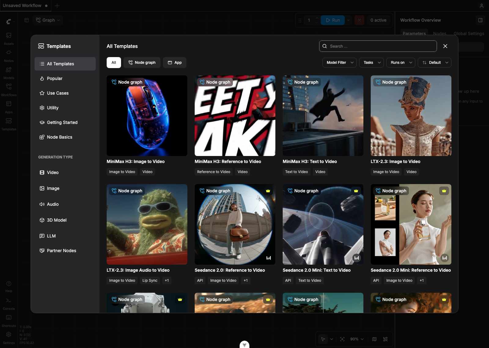
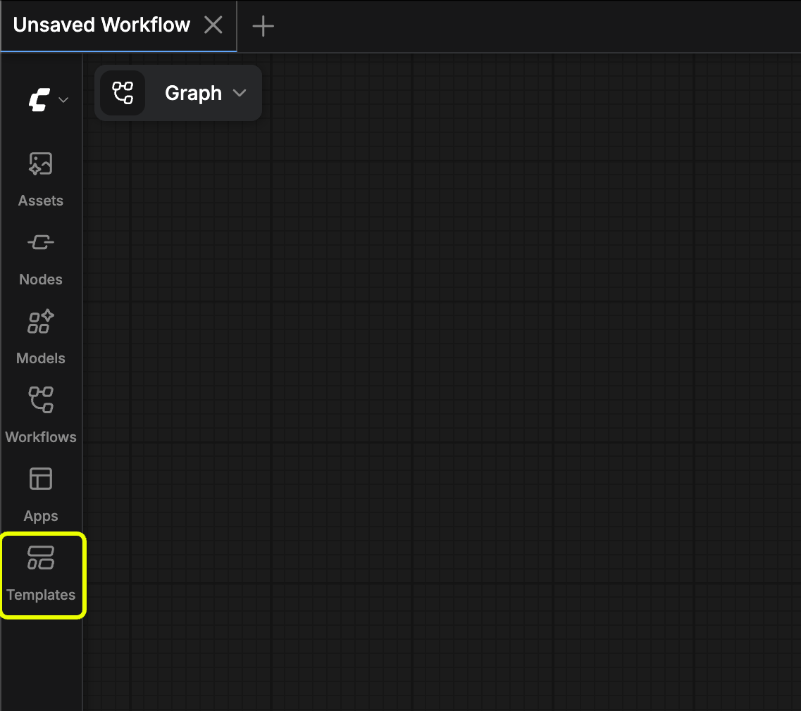
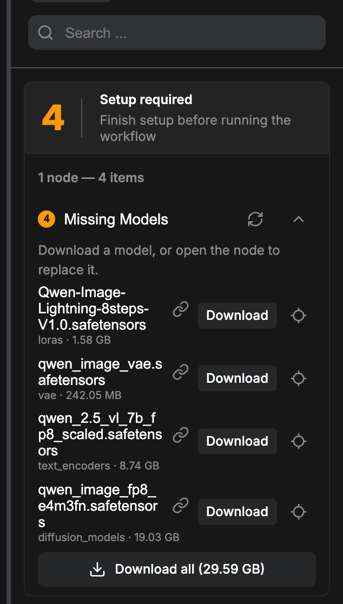

워크플로우 템플릿은 ComfyUI에서 기본적으로 지원하는 모델 워크플로우와 커스텀 노드의 일부 예시 워크플로우를 위한 브라우저입니다.

ComfyUI의 워크플로우 템플릿에서는 다음을 찾을 수 있습니다:

- 기본적으로 지원되는 모델 워크플로우
- 커스텀 노드의 예시 워크플로우



## ComfyUI에서 템플릿 열기 방법

사이드바의 **템플릿** 아이콘을 클릭해 워크플로우 템플릿을 열어보세요. 메뉴 **워크플로우** → **워크플로우 템플릿 둘러보기**에서도 열 수 있습니다.


## 템플릿 사용 방법

1. 템플릿 로드하기: 로드하고 싶은 템플릿을 클릭해 워크플로우를 불러오세요.
2. 모델 다운로드하기: 템플릿을 로드할 때 ComfyUI는 필요한 모든 모델 파일이 있는지 자동으로 확인합니다. 누락된 것이 있으면 모델을 다운로드하라는 알림이 표시됩니다.
3. 워크플로우 실행하기: 모델, 입력 이미지, 프롬프트 등 모든 요구사항이 준비되면, 실행 버튼을 클릭해 워크플로우를 시작하세요.

### 모델 저장 위치

각 워크플로 템플릿에는 필요한 모델 링크가 포함되어 있습니다. 처음 사용할 때 파일이 없으면 예전처럼 단독 Missing Models 대화 상자가 뜨지 않습니다. 대신 다음처럼 동작합니다.

1. 관련 로더 노드가 캔버스에서 빨간색으로 강조됩니다.
2. **N errors found** 같은 배너와 **View details**가 나타납니다.
3. 자세한 목록은 [오른쪽 패널](/ko/interface/right-side-panel) **오류** 탭의 **Setup required** 아래 **Missing Models**에 열립니다.



목록에서 파일별 **Download**, **Download all**, **Refresh**, 또는 해당 노드로 이동할 수 있습니다. 작업 중에도 오류 탭의 **Missing models** 그룹은 그대로 남아 있습니다.

누락된 모델만 문제로 보고되면 오류 오버레이에도 **모두 다운로드**가 표시됩니다. 이 버튼은 Comfy Cloud가 아닌 환경에서 다운로드 가능한 누락 모델이 하나 이상 있고 Hugging Face 액세스 승인이 필요한 모델이 없을 때 나타납니다. 해당 다운로드를 시작하고, 오버레이를 닫고, 사이드 패널의 누락된 모델 그룹을 엽니다. 그 밖의 경우에는 **자세히 보기**에서 오류 탭의 파일을 직접 해결하세요.

일치하는 후보가 있는 행에는 대신 사용할 수 있는 설치된 파일이 **Available instead** 아래에 표시됩니다. 후보가 없는 행과 클라우드 에셋을 쓰는 로더에는 표시되지 않습니다. **Use**를 누르면 그 파일이 누락된 파일을 참조하는 모든 노드에 설정되고 해당 행은 목록에서 사라집니다. 후보는 다른 폴더의 같은 파일이거나 같은 모델의 다른 정밀도 파일입니다(워크플로가 `bf16`을 요구할 때의 `fp8` 등).

1. **데스크톱**: **Download** / **Download all**로 올바른 `ComfyUI/models/…` 폴더에 저장합니다.
2. **셀프 호스트 브라우저**: URL이 있으면 브라우저 다운로드가 시작됩니다. 각 파일을 해당 폴더에 두세요. 스크린샷의 Qwen Image 예:

```
📂 ComfyUI/
├── 📂 models/
│   ├── 📂 loras/
│   │   └── Qwen-Image-Lightning-8steps-V1.0.safetensors
│   ├── 📂 diffusion_models/
│   │   └── qwen_image_fp8_e4m3fn.safetensors
│   ├── 📂 vae/
│   │   └── qwen_image_vae.safetensors
│   └── 📂 text_encoders/
│       └── qwen_2.5_vl_7b_fp8_scaled.safetensors
```

누락 검사는 각 로더에서 선택된 값이 그 로더의 파일 목록에 있는지로 판단합니다. `wan_video/model.safetensors`처럼 하위 폴더를 가리키는 값도 일치합니다.

모델 링크가 어떻게 내장되는지 궁금하시다면, 노드의 `properties` 아래에 `models` 필드를 추가합니다. 다음은 모델 정보가 내장된 `DualCLIPLoader` 노드의 전체 코드 조각입니다:
```json
    {
      "id": 40,
      "type": "DualCLIPLoader",
      "pos": [
        -320,
        290
      ],
      "size": [
        270,
        130
      ],
      "flags": {},
      "order": 0,
      "mode": 0,
      "inputs": [],
      "outputs": [
        {
          "name": "CLIP",
          "type": "CLIP",
          "links": [
            64
          ]
        }
      ],
      "properties": {
        "Node name for S&R": "DualCLIPLoader",
        "cnr_id": "comfy-core",
        "ver": "0.3.40",
        "models": [
          {
            "name": "clip_l.safetensors",
            "url": "https://huggingface.co/comfyanonymous/flux_text_encoders/resolve/main/clip_l.safetensors",
            "directory": "text_encoders"
          },
          {
            "name": "t5xxl_fp16.safetensors",
            "url": "https://huggingface.co/comfyanonymous/flux_text_encoders/resolve/main/t5xxl_fp16.safetensors",
            "directory": "text_encoders"
          }
        ]
      },
      "widgets_values": [
        "clip_l.safetensors",
        "t5xxl_fp16.safetensors",
        "flux",
        "default"
      ]
    }
```

`properties` 내부의 `models` 필드에는 `name`, `url`, `directory`가 포함됩니다.

- `name`: 모델 파일 이름
- `url`: 파일의 직접 다운로드 링크 (저장소 페이지가 아님)
- `directory`: `ComfyUI/models` 아래의 어느 하위 폴더에 파일을 저장할지, 예를 들어 `vae`는 `ComfyUI/models/vae`를 의미함

현재 Hugging Face와 Civitai의 링크만 지원됩니다. 모델 형식은 `.safetensors`나 `.sft`와 같은 안전한 형식이어야 합니다. `.gguf` 같은 파일은 자동 다운로드 대상이 아니지만, 누락된 모델 행에 링크 복사 버튼이 남아 있어 직접 받을 수 있습니다.

[이 도구](https://comfyui-wiki.github.io/ComfyUI-Workflow-JSON-Editor/)를 사용해 워크플로우 템플릿의 모델 정보를 편집할 수 있습니다. 현재 [@ComfyUI-Wiki](https://github.com/ComfyUI-Wiki)는 기본 노드에만 지원을 추가하고 있습니다.

## 템플릿을 업데이트하려면?

템플릿은 별도의 종속성인 [`comfyui-workflow-templates`](https://pypi.org/project/comfyui-workflow-templates/)로 관리되고 업데이트됩니다.

ComfyUI를 업데이트한 후 문서나 새로 발표된 템플릿이 보이지 않는다면, 해당 종속성을 업데이트해야 할 수 있습니다. 버전은 [`ComfyUI/requirements.txt`](https://github.com/Comfy-Org/ComfyUI/blob/master/requirements.txt)에서 확인할 수 있습니다.

일반적으로 ComfyUI를 업데이트할 때 다음 세 가지 종속성을 함께 업그레이드할 수 있습니다:

```
comfyui-frontend-package==1.24.4
comfyui-workflow-templates==0.1.52
comfyui-embedded-docs==0.2.4
```

정확히 어떻게 업데이트해야 하는지 잘 모르겠다면 [ComfyUI 업데이트](/ko/installation/update_comfyui)를 참고해 ComfyUI와 그 종속성을 업데이트하세요.

## ComfyUI 리포지토리에 템플릿을 기여하려면?

모든 템플릿은 [workflow_templates](https://github.com/Comfy-Org/workflow_templates/) 리포지토리에 호스팅됩니다. PR을 제출해 템플릿을 기여할 수 있습니다. 공식 템플릿의 경우 다음 사항을 요구합니다:

1. 제3자 노드를 사용하지 마세요 (노드가 없는 사용자를 위해 추가 설치를 피하기 위함).
2. 템플릿은 기존 템플릿과 중복되지 않고 지원되는 모델 기능을 타겟으로 해야 합니다.
3. 리포지토리에 이슈를 열어 질문을 남길 수 있습니다.

## 커스텀 노드 템플릿

커스텀 노드 작성자가 템플릿과 예시 워크플로우를 제공한다면, 템플릿 브라우저에서도 이를 찾을 수 있습니다. 일반적으로 노드 이름을 따온 카테고리를 찾아 모든 템플릿을 찾을 수 있습니다.

커스텀 노드 작성자라면, 현재 `templates` 폴더 아래 한 단계의 디렉터리만 지원되고(중첩된 하위 디렉터리는 지원되지 않음), JSON 형식의 템플릿만 지원된다는 점을 유의하세요.

## 커스텀 노드용 템플릿을 추가하려면?

[커스텀 노드 템플릿](/ko/custom-nodes/workflow_templates)을 참고해 커스텀 노드용 워크플로우 템플릿을 추가하는 방법을 알아보세요.
