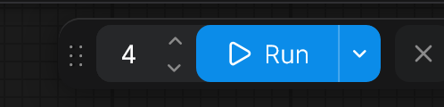
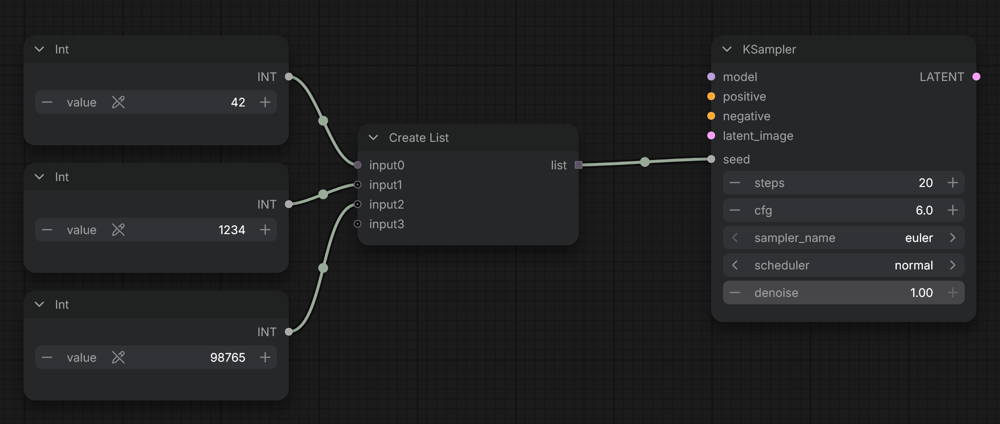
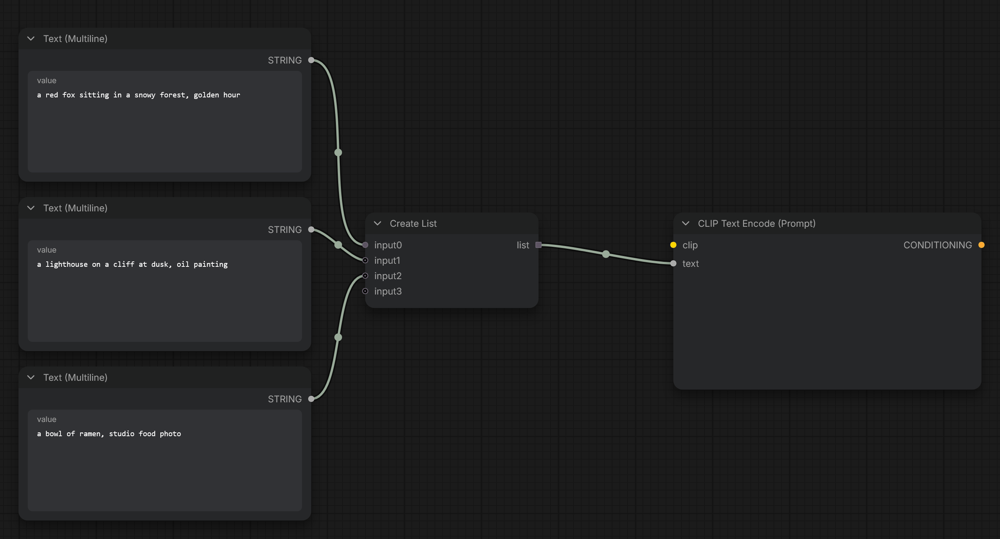
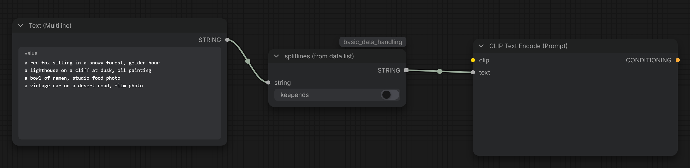
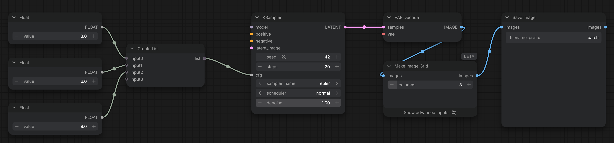
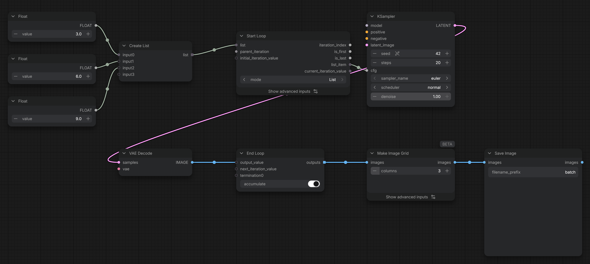
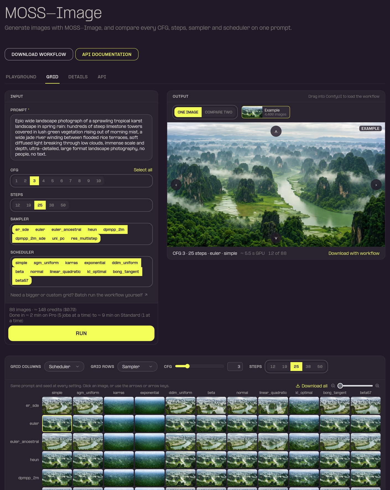
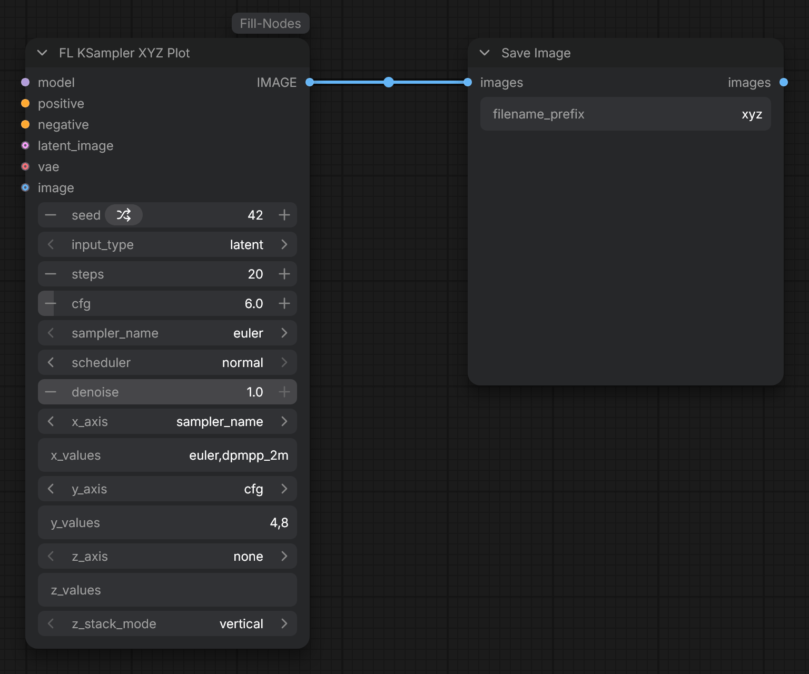
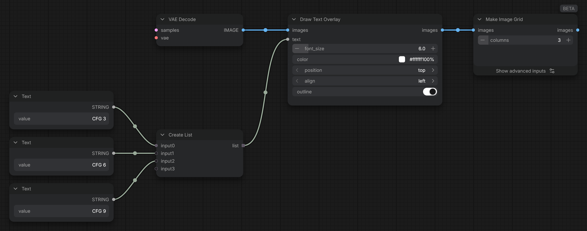

**배치 생성**은 하나의 워크플로를 여러 번 실행하면서 각 실행 사이에 무언가를 변경하는 것을 의미합니다: 시드, 프롬프트, CFG, 샘플러, 모델 또는 이들 중 여러 항목을 한 번에 변경할 수 있습니다. **설정 그리드**는 그 활용 방법 중 하나입니다: 동일한 프롬프트와 시드를 사용하되 셀마다 한두 개의 설정을 변경하여 각 설정이 어떤 역할을 하는지 확인할 수 있습니다.

이 가이드는 가장 단순한 사례부터 시작하여 한 번에 한 단계씩 추가합니다:

1. [시드 배치](#batch-seeds): 하나의 프롬프트로 여러 변형 생성
2. [프롬프트 배치](#batch-prompts): 프롬프트마다 한 번 실행
3. [모든 설정 배치](#batch-any-setting): CFG, 스텝 또는 기타 모든 입력의 값마다 한 번 실행
4. [루프](#loops): Start Loop 및 End Loop
5. [설정 그리드](#settings-grids): 두 개 이상의 설정을 교차하고 결과를 배치
6. [Comfy API로 스크립팅](#scripting-with-the-comfy-api): 모든 조합, 모든 규모


| 방법 | 실행 간에 변경되는 항목 | 섹션 |
|--------|---------------------------|---------|
| 배치 수 | 시드, 또는 `increment`나 `randomize`로 설정된 모든 위젯 | [시드 배치](#batch-seeds) |
| `batch_size` | 한 번의 샘플링 패스에서 각 이미지의 노이즈 | [시드 배치](#batch-seeds) |
| 목록 | 목록에서 제공하는 모든 입력: 시드, 프롬프트, CFG, 스텝 | [프롬프트 배치](#batch-prompts), [모든 설정 배치](#batch-any-setting) |
| Start Loop / End Loop | 모든 입력, 한 번에 한 반복씩 | [루프](#loops) |
| XY 플롯 노드 | 두세 개의 샘플러 설정을 교차 | [설정 그리드](#settings-grids) |
| 스크립트 | 모든 항목을 모든 조합으로 | [스크립팅](#scripting-with-the-comfy-api) |

<Tip>
간단한 설정 그리드만 필요하거나, 직접 만들기 전에 그리드가 무엇을 보여주는지 먼저 확인하고 싶으신가요? [Comfy Hub](https://comfy.org/hub/workflows)의 오픈 모델 텍스트 기반 이미지 생성 페이지에는 하나의 시드에서 CFG, 스텝, 샘플러, 스케줄러를 나란히 보여주는 **그리드** 탭이 있어 별도 설정 없이 사용할 수 있습니다. [MOSS-Image 그리드 탭](https://comfy.org/hub/workflows/moss-image-text-to-image/)을 사용해 보세요. 자세한 내용은 [설정 그리드](#settings-grids)를 참고하세요.
</Tip>

<Note>
일부 단계에서는 커스텀 노드를 사용합니다. 이 페이지에 언급된 모든 커스텀 노드는 [Comfy Cloud](https://cloud.comfy.org)에 설치되어 있으며, Comfy Cloud에서는 커스텀 노드가 추가되기 전에 검토됩니다. 자체 ComfyUI에서는 먼저 [노드 팩을 설치](/ko/installation/install_custom_node)하세요.
</Note>

## 배치 시드 {#batch-seeds}

시드는 시작 노이즈를 결정하므로, 새 시드는 같은 프롬프트로 새로운 구성을 만들어 냅니다. 시드를 바꾸는 것이 가장 간단한 배치 방법입니다.

### 배치 수

**배치 수**는 **실행** 버튼 옆의 실행 바에 있습니다. 한 번 클릭할 때 워크플로가 몇 번 대기열에 등록되는지를 설정합니다. 위치는 [실행 바](/ko/interface/overview)를 참고하세요.

1. `KSampler` 시드의 `control after generate`를 `randomize` 또는 `increment`로 설정합니다.
2. **배치 수**를 원하는 이미지 개수로 설정합니다.
3. **실행**을 클릭합니다. 대기 중인 각 실행은 다음 시드를 받습니다.



`control after generate`는 시드뿐 아니라 이 옵션이 있는 모든 숫자 위젯에서 동작합니다. 모든 위젯이 `fixed`로 설정되어 있으면 대기 중인 모든 실행이 동일해져 같은 이미지를 생성합니다.

### 잠재 데이터의 batch_size

`Empty Latent Image` 노드의 `batch_size`는 잠재 데이터를 한 번에 여러 개 생성하고, `KSampler`가 이를 한 번의 패스로 함께 디노이즈합니다. 배치에 속한 각 이미지는 서로 다른 노이즈를 받습니다.

1. `Empty Latent Image`에서 `batch_size`를 이미지 개수(예: `4`)로 설정합니다.
2. **실행**을 클릭합니다. `Save Image`가 모든 이미지를 저장합니다.

배치 크기가 클수록 모든 이미지를 동시에 샘플링하므로 더 많은 VRAM을 사용합니다.

### 특정 시드

이미 마음에 든 시드를 다시 실행하려면, 예를 들어 새 설정에서 비교하기 위해 목록으로 시드를 공급합니다.

1. 각 시드마다 [Int](/ko/built-in-nodes/PrimitiveInt) 노드를 추가합니다.
2. [Create List](/ko/built-in-nodes/CreateList) 노드를 추가하고 각 `Int`를 다음 비어 있는 입력에 연결합니다. 연결할 때마다 새 입력이 나타납니다.
3. `Create List`의 `list` 출력을 `KSampler`의 `seed` 입력에 연결합니다.
4. **실행**을 클릭합니다. `KSampler`가 시드마다 한 번씩 실행됩니다.



다음 섹션에서는 목록이 동작하는 방식을 설명합니다.

## 배치 프롬프트 {#batch-prompts}

노드가 **목록**을 받으면 ComfyUI는 각 항목마다 한 번씩 실행하고 모든 결과를 다운스트림으로 전달합니다. 프롬프트 목록을 `CLIP Text Encode`에 연결하면 프롬프트마다 이미지 하나가 생성됩니다.

### 프롬프트마다 텍스트 노드 하나

1. 프롬프트마다 [Text (Multiline)](/ko/built-in-nodes/PrimitiveStringMultiline) 노드를 추가합니다.
2. `Create List`로 이들을 결합합니다.
3. `list` 출력을 positive `CLIP Text Encode`의 `text` 입력에 연결합니다.
4. **Run**을 클릭합니다. 각 프롬프트는 자체 실행으로 인코딩되고 샘플링됩니다.



### 한 줄에 프롬프트 하나

프롬프트가 여러 개라면 하나의 텍스트 상자에 한 줄에 하나씩 넣고, [Basic data handling](https://github.com/StableLlama/ComfyUI-basic_data_handling) 팩의 **splitlines (from data list)** 노드로 목록으로 분할하세요.

1. `Text (Multiline)` 노드를 추가하고 한 줄에 프롬프트 하나씩 작성합니다.
2. **splitlines (from data list)** 노드를 추가하고(`splitlines`로 검색) 텍스트를 `string` 입력에 연결합니다. `keepends`는 꺼 두어 줄바꿈이 프롬프트에 포함되지 않게 합니다.
3. 출력을 positive `CLIP Text Encode`의 `text` 입력에 연결합니다.
4. **Run**을 클릭합니다. 각 줄이 자체 실행이 됩니다.



이렇게 하면 프롬프트 파일 전체를 텍스트 상자에 붙여넣을 수 있습니다. 빈 줄은 빈 프롬프트가 되므로 먼저 제거하세요.

## 모든 설정 배치 {#batch-any-setting}

목록은 시드와 프롬프트뿐만 아니라 거의 모든 입력에 공급할 수 있습니다. `cfg`와 같은 위젯에 목록을 연결하려면 링크를 위젯으로 드래그하세요. CFG를 스윕하려면:

1. 각 CFG 값에 대해 [실수](/ko/built-in-nodes/PrimitiveFloat) 노드를 추가하세요. 예: `3`, `6`, `9`.
2. `Create List`로 이들을 결합하고 목록을 `KSampler`의 `cfg` 입력에 연결하세요.
3. 시드를 고정하세요: 시드의 `control after generate`를 `fixed`로 설정하세요.
4. `VAE Decode`를 [이미지 그리드](/ko/built-in-nodes/ImageGrid) 노드에 연결한 다음 `Save Image`에 연결하세요.
5. **실행**을 클릭하세요. `KSampler`와 `VAE Decode`는 각 CFG 값에 대해 한 번씩 실행되고, `Make Image Grid`는 모든 이미지를 받습니다.



`steps`, `denoise`, 이미지 크기 및 LoRA 강도도 `Int` 또는 `Float` 노드로 동일하게 작동합니다.

<Warning>
노드에 **목록이 두 개 이상** 있는 경우, ComfyUI는 항목을 위치별로 쌍으로 묶습니다: 첫 번째는 첫 번째와, 두 번째는 두 번째와, 더 짧은 목록의 마지막 항목은 반복됩니다. 모든 조합을 만들지는 않습니다. 프롬프트 세 개와 시드 세 개는 아홉 개가 아닌 세 개의 이미지를 제공합니다. 두 설정을 교차하려면 [설정 그리드](#settings-grids) 또는 [스크립팅](#scripting-with-the-comfy-api)을 참조하세요.
</Warning>

**드롭다운.** `sampler_name`, `scheduler` 및 모델 파일은 드롭다운이므로 텍스트 값 목록을 직접 공급할 수 없습니다. 몇 가지를 비교하려면 각 값에 대해 `KSampler` 및 `VAE Decode` 노드를 한 번씩 복사하고, 동일한 모델, 프롬프트 및 잠재 데이터에 연결하고, 각 복사본을 다르게 설정한 다음 `Make Image Grid`로 이미지를 수집하세요. 샘플러와 스케줄러의 경우 [설정 그리드](#settings-grids)의 XY 플롯 노드가 더 빠릅니다.

## 루프 {#loops}

[Start Loop](/ko/built-in-nodes/StartLoop)와 [End Loop](/ko/built-in-nodes/EndLoop) 노드는 두 노드 사이에 있는 노드들을 반복마다 한 번씩 실행합니다. `Start Loop`에는 세 가지 모드가 있습니다:

| 모드 | 반복 횟수 |
|------|------------|
| `simple` | `num_iterations`번, `iteration_index`는 0부터 시작 |
| `For` | `start_iteration_index`부터 `max_iteration` 전까지, `step` 간격으로 |
| `List` | 연결된 `list`의 항목마다 한 번; 현재 항목은 `list_item`으로 출력됩니다 |

값 목록(예: CFG)을 반복하려면:

1. 위와 같이 `Float` 노드와 `Create List`로 목록을 만듭니다. 프롬프트나 seed 목록도 같은 방식으로 동작합니다.
2. `Start Loop` 노드를 추가하고 `mode`를 `List`로 설정한 다음, 목록을 `list` 입력에 연결합니다.
3. `Start Loop`의 `list_item`을 변경하려는 입력, 여기서는 `KSampler`의 `cfg` 입력에 연결합니다.
4. `End Loop` 노드를 추가합니다. `VAE Decode`의 `IMAGE` 출력을 `output_value`에 연결하고, `accumulate`를 켜서 End Loop가 마지막 이미지뿐 아니라 모든 반복의 이미지를 반환하도록 합니다.
5. `End Loop`의 `outputs`를 `Make Image Grid`에 연결한 다음 `Save Image`에 연결합니다.
6. **Run**을 클릭합니다.



하나의 목록에 대해서는 루프와 단순 목록이 같은 이미지를 만듭니다. 루프를 사용하면 한 반복이 다음 반복으로 값을 전달할 수도 있고(End Loop의 `next_iteration_value`, Start Loop의 `current_iteration_value`), 외부 루프의 `iteration_index`를 내부 루프의 `parent_iteration`에 연결하여 루프를 다른 루프 안에 중첩할 수도 있습니다.

<Note>
Start Loop와 End Loop는 최근 코어 노드입니다. 찾을 수 없다면 [ComfyUI를 업데이트](/ko/installation/update_comfyui)하세요. Comfy Cloud는 각 ComfyUI 안정 버전 릴리스 이후에 업데이트됩니다.
</Note>

## 설정 그리드 {#settings-grids}

설정 그리드는 프롬프트, 모델, 시드를 일정하게 유지하고 샘플러 설정만 변경하므로, 두 셀 사이의 어떤 차이라도 변경한 설정에서 비롯됩니다. 시드를 무작위로 두면 각 셀의 구도도 달라져, 변화가 설정 때문인지 노이즈 때문인지 더 이상 구분할 수 없습니다.

프롬프트와 모델을 제외하고 이미지를 가장 크게 바꾸는 `KSampler` 설정 네 가지는 다음과 같습니다:

| 설정 | 변경되는 항목 |
|---------|-----------------|
| `cfg` | 모델이 프롬프트를 얼마나 엄격하게 따르는지. 값이 낮으면 느슨하고 부드럽게 보이고, 값이 높으면 채도가 높고 과도하게 선명해 보입니다. |
| `steps` | 샘플러가 수행하는 디노이징 단계 수. 단계가 많을수록 어느 지점까지는 디테일이 추가되지만, 그 이후에는 시간만 늘어납니다. |
| `sampler_name` | 각 단계에서 노이즈를 제거하는 알고리즘(`euler`, `dpmpp_2m` 등). |
| `scheduler` | 단계마다 노이즈 수준이 얼마나 떨어지는지(`normal`, `karras`, `simple` 등). |

전체 조합은 금방 늘어납니다: 4개의 CFG 값 × 3개의 단계 수 × 3개의 샘플러 × 2개의 스케줄러는 72개의 이미지가 됩니다. 설정 하나 또는 둘로 시작해 보기 좋은 범위를 찾은 다음, 범위를 좁히세요.

### Comfy Hub의 그리드 탭

간단한 설정 그리드만 필요하다면 직접 만들 필요가 없습니다. [Comfy Hub](https://comfy.org/hub/workflows)의 오픈 모델 텍스트 기반 이미지 생성 페이지에는 하나의 시드로 미리 렌더링된 CFG × 단계 수 × 샘플러 × 스케줄러 조합이 있는 **그리드** 탭이 있습니다. 예를 들어 [MOSS-Image](https://comfy.org/hub/workflows/moss-image-text-to-image/)가 그렇습니다.

- 어떤 설정을 열과 행에 배치할지 선택하고, 아무 셀이나 클릭하면 전체 크기로 볼 수 있습니다.
- 직접 프롬프트를 입력하고 비교할 값을 선택한 뒤 **실행**을 클릭하면 Comfy Cloud에서 배치로 실행됩니다. 이 탭은 실행하기 전에 이미지가 몇 장인지와 비용이 얼마인지 보여줍니다.
- **워크플로와 함께 다운로드**는 ComfyUI로 끌어다 놓으면 정확한 설정을 불러올 수 있는 이미지를 저장합니다.



더 많은 설정, 다른 모델, 또는 자신의 워크플로가 필요하다면 아래 설명대로 그리드를 직접 만드세요.

### XY 플롯 노드로 설정 교차하기

[Fill-Nodes](https://github.com/filliptm/ComfyUI_Fill-Nodes) 팩의 **FL KSampler XYZ Plot** 노드는 `KSampler`를 대체하고 최대 세 가지 설정을 교차합니다. 모든 조합을 렌더링하고 축을 따라 값이 적힌 이미지 하나를 반환합니다.

1. `KSampler`를 **FL KSampler XYZ Plot**로 교체합니다. `model`, `positive`, `negative`, `latent_image`와 체크포인트 로더의 `vae`를 연결합니다.
2. 시드와 변경하지 않는 설정의 기준값을 설정합니다.
3. `x_axis`와 `y_axis`를 `steps`, `cfg`, `denoise`, `sampler_name`, `scheduler` 중 두 개로 설정합니다.
4. 각 축의 값을 `x_values`와 `y_values`에 쉼표로 구분해 입력합니다. 예: `euler,dpmpp_2m`, `4,8`.
5. 세 번째 설정을 교차하려면 `z_axis`와 `z_values`를 설정합니다. `z_stack_mode`는 추가 그리드를 서로 아래나 옆에 배치합니다.
6. `IMAGE` 출력을 `Save Image`에 연결하고 **실행**을 클릭합니다.




프롬프트 × 시드나 LoRA 강도 × CFG 같은 다른 입력을 교차하려면 [중첩 루프](#loops) 또는 [스크립트](#scripting-with-the-comfy-api)를 사용하세요.

### 직접 그리드 배치하기

이미지가 목록이나 루프에서 나올 때, [이미지 그리드](/ko/built-in-nodes/ImageGrid) 노드는 이미지를 행 단위로, 왼쪽에서 오른쪽으로, 위에서 아래로 배치합니다.

| 입력 | 설명 |
|-------|--------------|
| `columns` | 행당 이미지 수. 수평 축의 값 개수로 설정합니다. |
| `cell_width`, `cell_height` | 각 이미지가 조정될 크기. |
| `padding` | 셀 사이의 픽셀. |

각 셀에 레이블을 지정하려면 `VAE Decode`와 `Make Image Grid` 사이에 [텍스트 오버레이 그리기](/ko/built-in-nodes/TextOverlay) 노드를 넣습니다. `Text` 노드와 `Create List`로 `CFG 3`, `CFG 6`, `CFG 9` 같은 레이블의 두 번째 목록을 만들고, 이를 `text` 입력에 연결합니다. 이미지와 레이블이 모두 목록이므로 각 이미지는 같은 위치의 레이블을 받습니다. 이 페이지 상단의 그리드가 이렇게 만들어졌습니다.



## Comfy API로 스크립팅하기 {#scripting-with-the-comfy-api}

설정이 두세 개를 넘어가거나 프롬프트, 시드, 모델을 조합해야 한다면 그래프보다 스크립트가 더 간단합니다. 스크립트는 모든 조합을 만들고, 각 조합을 별도의 작업으로 제출하며, 각 실행에서 무엇이 바뀌었는지에 대한 기록과 함께 결과를 저장합니다.

### 1. 워크플로를 API 형식으로 내보내기

1. ComfyUI에서 한 번 실행할 워크플로를 만들고 테스트합니다.
2. 워크플로 메뉴를 열고 **Export (API)**를 선택합니다. 그러면 모든 노드가 해당 ID를 키로 갖는 [API 형식](/ko/development/api-development/workflow-api-format)으로 그래프가 저장됩니다.
3. JSON을 열고 변경하려는 각 노드의 ID를 확인합니다. 기본 텍스트 기반 이미지 생성 워크플로에서 `KSampler`는 `"3"`이고 긍정 `CLIP Text Encode`는 `"6"`입니다.

### 2. 조합마다 작업 하나씩 대기열에 넣기

[Comfy API v2](/ko/api-reference/v2/overview)는 `POST /api/v2/jobs`에서 API 형식 그래프를 받아들이고, `GET /api/v2/jobs/{id}`에서 폴링할 수 있는 작업을 반환합니다. 같은 API가 Comfy Cloud에서 실행되며, [comfy-api-proxy](https://github.com/Comfy-Org/comfy-api-proxy)를 통해 자체 ComfyUI에서도 실행되므로, 아래 스크립트는 `BASE_URL`만 바꾸면 두 환경 모두에서 동작합니다.

Comfy Cloud는 요금제별로 정해진 수의 작업을 동시에 실행하고 나머지는 실행 대기열에 보관합니다:

| 요금제 | 동시 실행 작업 수 |
|------|------------------------|
| Standard | 1 |
| Creator | 3 |
| Pro | 5 |

최대 100개의 작업을 대기열에 넣을 수 있습니다. 한 번에 두 개 이상의 작업을 실행하려면 API와 유료 요금제가 필요합니다. 자세한 내용은 [클라우드 동시 실행 한도](/ko/development/deploy/cloud-usage#동시성-제한)를 참고하세요.

`AXES`에서 각 키는 `<node ID>.<input name>`이고, 각 값은 시도할 값의 목록입니다. 스크립트는 모든 조합을 실행합니다. 한 번에 최대 `MAX_IN_FLIGHT`개의 작업만 제출된 상태로 유지하므로 아무리 큰 배치라도 실행 대기열을 가득 채우지 않으며, 서버가 `429`로 응답하면 백오프합니다. Python 3.9 이상과 `pip install requests`가 필요합니다. 먼저 `COMFY_API_KEY`를 [API 키](/ko/development/api-development/getting-an-api-key)로 설정하세요.

```python batch.py
import itertools, json, os, time
import requests

BASE_URL = "https://cloud.comfy.org"  # comfy-api-proxy를 통한 자체 ComfyUI: "http://127.0.0.1:8189"
API_KEY = os.environ.get("COMFY_API_KEY", "")
HEADERS = {"Authorization": f"Bearer {API_KEY}"} if API_KEY else {}

WORKFLOW_FILE = "workflow_api.json"  # Export (API)에서 내보낸 파일
MAX_IN_FLIGHT = 5                    # 요금제의 동시 실행 한도에 맞추세요. 100을 넘지 않아야 합니다
OUT_DIR = "batch"

# "<node ID>.<input name>": 시도할 값. 모든 조합이 실행됩니다.
AXES = {
    "3.seed": [42],
    "3.cfg": [3.0, 5.0, 7.0],
    "3.sampler_name": ["euler", "dpmpp_2m"],
    "6.text": ["a red fox in snow, photo", "a lighthouse at dusk, oil painting"],
}

def apply(graph, cell):
    for key, value in cell.items():
        node_id, name = key.split(".", 1)
        graph[node_id]["inputs"][name] = value

def submit(graph):
    while True:
        r = requests.post(f"{BASE_URL}/api/v2/jobs", headers=HEADERS, json={"workflow": graph})
        if r.status_code == 429:  # 실행 대기열이 가득 찼거나 속도 제한됨: 기다렸다가 재시도
            time.sleep(int(r.headers.get("Retry-After", "10")))
            continue
        r.raise_for_status()
        return r.json()["id"]

def save_outputs(job, name):
    files = []
    for i, output in enumerate(o for o in job["outputs"] if o["type"] == "image"):
        data = requests.get(output["url"], headers=HEADERS).content  # 스토리지로의 리다이렉트를 따라감
        ext = os.path.splitext(output["name"])[1] or ".png"
        path = os.path.join(OUT_DIR, f"{name}_{i}{ext}")
        with open(path, "wb") as f:
            f.write(data)
        files.append(path)
    return files

def main():
    os.makedirs(OUT_DIR, exist_ok=True)
    with open(WORKFLOW_FILE) as f:
        base = json.load(f)

    cells = [dict(zip(AXES, values)) for values in itertools.product(*AXES.values())]
    pending = [(f"{n:04d}", cell) for n, cell in enumerate(cells)]
    in_flight = {}  # 작업 ID -> (이름, 셀)
    manifest = {}   # 이름 -> 해당 실행이 변경한 내용과 그 파일들

    while pending or in_flight:
        while pending and len(in_flight) < MAX_IN_FLIGHT:
            name, cell = pending.pop(0)
            graph = json.loads(json.dumps(base))
            apply(graph, cell)
            in_flight[submit(graph)] = (name, cell)

        time.sleep(3)
        for job_id, (name, cell) in list(in_flight.items()):
            r = requests.get(f"{BASE_URL}/api/v2/jobs/{job_id}", headers=HEADERS)
            if r.status_code != 200:
                continue  # 속도 제한 또는 일시적 오류: 다음 라운드에 다시 확인
            job = r.json()
            if job["status"] == "succeeded":
                manifest[name] = {"settings": cell, "files": save_outputs(job, name)}
                with open(os.path.join(OUT_DIR, "manifest.json"), "w", encoding="utf-8") as f:
                    json.dump(manifest, f, indent=2, ensure_ascii=False)
            elif job["status"] not in ("failed", "canceled", "expired"):
                continue  # 아직 대기 중이거나 실행 중
            else:
                print(f"{name} {cell}: {job['status']} {job.get('error')}")
            del in_flight[job_id]
            print(f"{len(cells) - len(pending) - len(in_flight)}/{len(cells)} done")

if __name__ == "__main__":
    main()
```

파일 이름에는 번호가 매겨지며(`0000_0.png`, `0001_0.png` 등), `batch/manifest.json`에 각 파일의 설정이 기록됩니다.

자주 쓰는 `AXES` 항목:

```python
"3.seed": list(range(1, 9)),             # 시드 여덟 개
"3.seed": [42],                          # 설정 그리드용 고정 시드 하나
"3.scheduler": ["normal", "karras"],     # 모든 드롭다운, 옵션 이름으로 지정
"6.text": [line.strip() for line in open("prompts.txt", encoding="utf-8") if line.strip()],  # 한 줄에 프롬프트 하나
```

<Tip>
Python 및 TypeScript용 [Comfy SDK](/ko/development/api-development/sdks)는 업로드, 작업 대기, 실행 대기열이 가득 찼을 때의 재시도를 포함해 이러한 엔드포인트를 감싸줍니다.
</Tip>

### 3. 결과 배치하기

스크립트로 만든 배치를 그리드로 바꾸려면 [Pillow](https://pillow.readthedocs.io/) (`pip install pillow`)의 몇 줄을 사용해 저장된 파일을 모으면 됩니다. 이 예제는 한 설정을 열에, 다른 설정을 행에 배치하고 나머지는 고정한 뒤 가장자리를 따라 값을 씁니다:

```python make_grid.py
import json
from PIL import Image, ImageDraw

COLS = ("3.cfg", [3.0, 5.0, 7.0])
ROWS = ("3.sampler_name", ["euler", "dpmpp_2m"])
FIXED = {"3.seed": 42, "6.text": "a red fox in snow, photo"}
CELL, LABEL = 384, 100

with open("batch/manifest.json", encoding="utf-8") as f:
    runs = list(json.load(f).values())

def path(col, row):
    want = {COLS[0]: col, ROWS[0]: row, **FIXED}
    for run in runs:
        if all(run["settings"].get(k) == v for k, v in want.items()):
            return run["files"][0]
    raise KeyError(f"no run with {want}")

sheet = Image.new("RGB", (LABEL + CELL * len(COLS[1]), LABEL + CELL * len(ROWS[1])), "white")
draw = ImageDraw.Draw(sheet)
for x, col in enumerate(COLS[1]):
    draw.text((LABEL + x * CELL + 8, 12), f"{COLS[0]} {col}", fill="black")
for y, row in enumerate(ROWS[1]):
    draw.text((6, LABEL + y * CELL + 8), f"{row}", fill="black")
    for x, col in enumerate(COLS[1]):
        img = Image.open(path(col, row)).convert("RGB").resize((CELL, CELL))
        sheet.paste(img, (LABEL + x * CELL, LABEL + y * CELL))
sheet.save("grid.png")
```

남은 설정의 조합마다 시트를 하나씩 만드세요. 예를 들어 각 프롬프트에 대해 CFG × 샘플러 시트를 하나씩 만듭니다.

## 직접 해 보기

1. 이 페이지 상단의 그리드 이미지를 다운로드하고 ComfyUI로 끌어다 놓습니다. 그러면 CFG 스윕 워크플로가 로드됩니다(`sd_xl_base_1.0.safetensors` 사용).
2. `Float` 노드를 `Int` 노드로 바꾸고 목록을 대신 `seed`에 연결하거나, 해당 노드를 **splitlines (from data list)** 노드로 바꾸고 프롬프트에 연결합니다.
3. 여러 설정의 모든 조합이 필요할 때는 **Export (API)** 로 워크플로를 내보내고 스크립트로 실행합니다.
