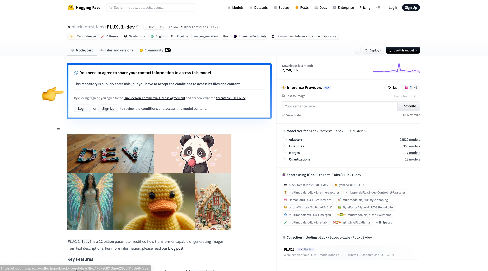
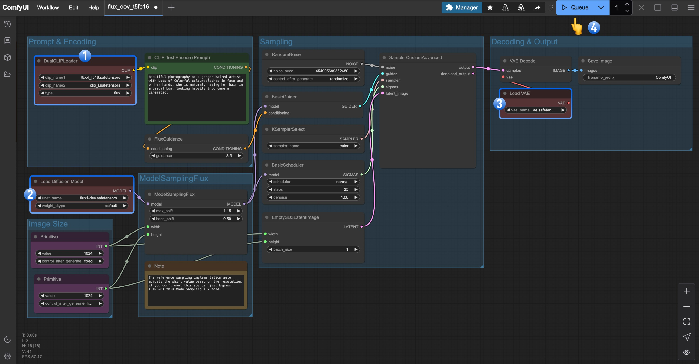
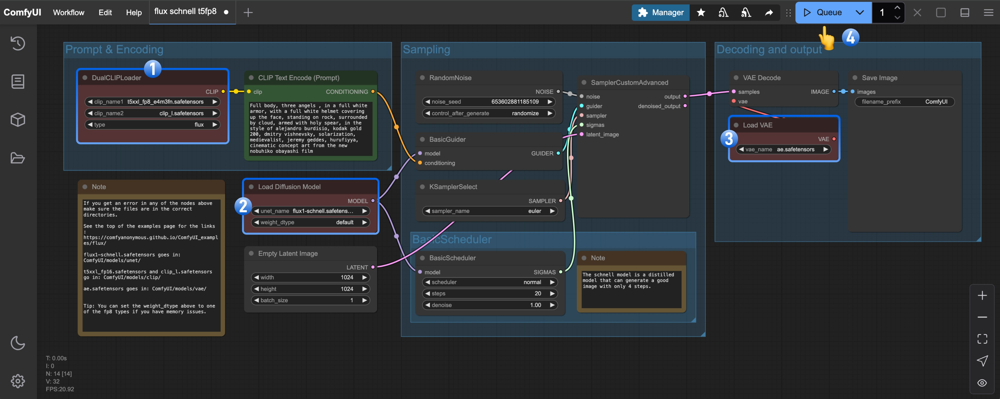

Flux는 120억 개의 파라미터를 가진 오픈소스 텍스트 기반 이미지 생성 모델 중 가장 큰 모델 중 하나이며, 원본 파일 크기는 약 23GB입니다. 이 모델은 전직 Stable Diffusion 팀 멤버들이 설립한 [Black Forest Labs](https://blackforestlabs.ai/)에서 개발했습니다.
Flux는 뛰어난 이미지 품질과 유연성으로 유명하며, 고품질의 다양한 이미지를 생성할 수 있습니다.

현재 Flux.1 모델에는 몇 가지 주요 버전이 있습니다:
- **Flux.1 Pro:** 최고 성능의 모델이며, 클로즈드 소스로 API 호출을 통해서만 사용할 수 있습니다.
- **[Flux.1 [dev]：](https://huggingface.co/black-forest-labs/FLUX.1-dev)** 오픈소스이지만 비상업적 용도로 제한되며, Pro 버전에서 증류된 모델로 성능은 Pro 버전에 근접합니다.
- **[Flux.1 [schnell]：](https://huggingface.co/black-forest-labs/FLUX.1-schnell)** Apache2.0 라이선스를 사용하며, 이미지 생성에 4단계만 필요해 저사양 하드웨어에 적합합니다.

**Flux.1 모델 특징**
- **하이브리드 아키텍처:** Transformer 네트워크와 diffusion 모델의 장점을 결합해 텍스트와 이미지 정보를 효과적으로 통합하고, 생성된 이미지와 프롬프트 간의 정렬 정확도를 높이며 복잡한 프롬프트에 대한 충실도가 뛰어납니다.
- **파라미터 규모:** Flux는 120억 개의 파라미터를 보유해 더 복잡한 패턴 관계를 포착하고 더 사실적이고 다양한 이미지를 생성합니다.
- **다양한 스타일 지원:** 다양한 스타일을 지원하며, 여러 유형의 이미지에서 뛰어난 성능을 발휘합니다.

이 예시에서는 Flux.1 Dev와 Flux.1 Schnell 버전을 모두 사용한 텍스트 기반 이미지 생성 예시를 소개하며, 전체 버전 모델과 간소화된 FP8 체크포인트 버전을 포함합니다.

- **Flux 전체 버전:** 최고의 성능을 제공하지만 더 많은 VRAM 리소스와 여러 모델 파일의 설치가 필요합니다.
- **Flux FP8 체크포인트:** fp8 버전 모델 하나만 필요하지만 전체 버전에 비해 품질이 약간 떨어집니다.

<Tip>
모든 워크플로 이미지의 메타데이터에는 해당 모델의 다운로드 정보가 포함되어 있습니다. 다음 방법으로 워크플로를 로드할 수 있습니다:
- ComfyUI에 직접 드래그하기
- 또는 `Workflows` -> `Open（ctrl+o）` 메뉴 사용하기

데스크톱 버전을 사용하지 않거나 일부 모델을 자동으로 다운로드할 수 없는 경우, 수동 설치 섹션을 참고해 모델 파일을 해당 폴더에 저장하세요.
시작하기 전에 ComfyUI가 최신 버전으로 업데이트되었는지 확인하세요.
</Tip>

## Flux.1 전체 버전 텍스트 기반 이미지 생성 예시

<Note>
[black-forest-labs/FLUX.1-dev](https://huggingface.co/black-forest-labs/FLUX.1-dev)에서 모델을 다운로드할 수 없다면, Huggingface에 로그인하고 해당 저장소의 라이선스 계약에 동의했는지 확인하세요.

</Note>

### Flux.1 Dev

### Flux.1 Dev fp8: 텍스트 기반 이미지 생성 {#flux_dev_checkpoint_example}

Flux.1 Dev fp8 양자화 버전을 사용해 이미지를 생성합니다. VRAM이 제한된 장치에 적합하며, 모델 파일이 하나만 필요하지만 이미지 품질은 전체 버전에 비해 약간 낮아집니다.


<CardGroup cols={2}>
  <Card title="Comfy Cloud에서 실행" icon="cloud" href="https://cloud.comfy.org/?template=flux_dev_checkpoint_example&utm_source=docs&utm_medium=referral&utm_campaign=flux-1-text-to-image">
    이 워크플로를 Comfy Cloud에서 실행하세요
  </Card>
  <Card title="워크플로 다운로드" icon="download" href="https://github.com/Comfy-Org/workflow_templates/blob/main/templates/flux_dev_checkpoint_example.json">
    JSON을 다운로드하거나 템플릿 라이브러리에서 &quot;Flux.1 Dev fp8&quot;을 검색하세요
  </Card>
</CardGroup>

**예시 출력**


#### 1. 워크플로 파일

#### 2. 수동 모델 설치

<Note>
- `flux1-dev.safetensors` 파일은 브라우저를 통한 다운로드 전에 [black-forest-labs/FLUX.1-dev](https://huggingface.co/black-forest-labs/FLUX.1-dev) 계약에 동의해야 합니다.
- VRAM이 부족하다면 [t5xxl_fp8_e4m3fn.safetensors](https://huggingface.co/comfyanonymous/flux_text_encoders/blob/main/t5xxl_fp8_e4m3fn.safetensors?download=true)를 사용해 `t5xxl_fp16.safetensors` 파일을 대체해 볼 수 있습니다.
</Note>

다음 모델 파일을 다운로드하세요:
- [clip_l.safetensors](https://huggingface.co/comfyanonymous/flux_text_encoders/blob/main/clip_l.safetensors?download=true)
- [t5xxl_fp16.safetensors](https://huggingface.co/comfyanonymous/flux_text_encoders/blob/main/t5xxl_fp16.safetensors?download=true) VRAM이 32GB보다 클 때 권장됩니다.
- [ae.safetensors](https://huggingface.co/black-forest-labs/FLUX.1-schnell/blob/main/ae.safetensors?download=true)
- [flux1-dev.safetensors](https://huggingface.co/black-forest-labs/FLUX.1-dev/blob/main/flux1-dev.safetensors) 

저장 위치:
```
ComfyUI/
├── models/
│   ├── text_encoders/
│   │   ├── clip_l.safetensors
│   │   └── t5xxl_fp16.safetensors
│   ├── vae/
│   │   └── ae.safetensors
│   └── diffusion_models/
│       └── flux1-dev.safetensors
```

#### 3. 워크플로 실행 단계

모든 모델 파일이 올바르게 로드되었는지 확인하려면 아래 이미지를 참조하세요.



1. `DualCLIPLoader` 노드에 다음 모델이 로드되었는지 확인하세요:
   - clip_name1: t5xxl_fp16.safetensors
   - clip_name2: clip_l.safetensors
2. `Load Diffusion Model` 노드에 `flux1-dev.safetensors`가 로드되었는지 확인하세요
3. `Load VAE` 노드에 `ae.safetensors`가 로드되었는지 확인하세요
4. `Queue` 버튼을 클릭하거나 단축키 `Ctrl(cmd) + Enter`를 사용해 워크플로를 실행하세요

<Tip>
Flux의 뛰어난 프롬프트 추종 능력 덕분에 네거티브 프롬프트는 필요하지 않습니다
</Tip>
### Flux.1 Schnell

### Flux.1 Schnell FP8 {#flux_schnell}

Flux.1 Schnell fp8 양자화 버전으로 이미지를 빠르게 생성합니다. 저사양 하드웨어에 이상적이며, 이미지 생성에 4단계만 필요합니다.


<CardGroup cols={2}>
  <Card title="Comfy Cloud에서 실행" icon="cloud" href="https://cloud.comfy.org/?template=flux_schnell&utm_source=docs&utm_medium=referral&utm_campaign=flux-1-text-to-image">
    이 워크플로를 Comfy Cloud에서 실행하세요
  </Card>
  <Card title="워크플로 다운로드" icon="download" href="https://github.com/Comfy-Org/workflow_templates/blob/main/templates/flux_schnell_full_text_to_image.json">
    JSON을 다운로드하거나 템플릿 라이브러리에서 &quot;Flux.1 Schnell&quot;을 검색하세요
  </Card>
</CardGroup>

#### 1. 워크플로 파일

#### 2. 수동 모델 설치

<Note>
이 워크플로에서는 두 모델 파일만 Flux1 Dev 버전 워크플로와 다릅니다. t5xxl의 경우, 더 나은 결과를 위해 여전히 fp16 버전을 사용할 수 있습니다.
- **t5xxl_fp16.safetensors** -> **t5xxl_fp8.safetensors**
- **flux1-dev.safetensors** -> **flux1-schnell.safetensors** 
</Note>

전체 모델 파일 목록:
- [clip_l.safetensors](https://huggingface.co/comfyanonymous/flux_text_encoders/blob/main/clip_l.safetensors?download=true)
- [t5xxl_fp8_e4m3fn.safetensors](https://huggingface.co/comfyanonymous/flux_text_encoders/blob/main/t5xxl_fp8_e4m3fn.safetensors?download=true)
- [ae.safetensors](https://huggingface.co/black-forest-labs/FLUX.1-schnell/blob/main/ae.safetensors?download=true)
- [flux1-schnell.safetensors](https://huggingface.co/black-forest-labs/FLUX.1-schnell/blob/main/flux1-schnell.safetensors) 

파일 저장 위치:
```
ComfyUI/
├── models/
│   ├── text_encoders/
│   │   ├── clip_l.safetensors
│   │   └── t5xxl_fp8_e4m3fn.safetensors
│   ├── vae/
│   │   └── ae.safetensors
│   └── diffusion_models/
│       └── flux1-schnell.safetensors
```

#### 3. 워크플로 실행 단계



1. `DualCLIPLoader` 노드에 다음 모델이 로드되었는지 확인하세요:
   - clip_name1: t5xxl_fp8_e4m3fn.safetensors
   - clip_name2: clip_l.safetensors
2. `Load Diffusion Model` 노드에 `flux1-schnell.safetensors`가 로드되었는지 확인하세요
3. `Load VAE` 노드에 `ae.safetensors`가 로드되었는지 확인하세요
4. `Queue` 버튼을 클릭하거나 단축키 `Ctrl(cmd) + Enter`를 사용해 워크플로를 실행하세요

## Flux.1 FP8 체크포인트 버전 텍스트 기반 이미지 생성 예시

fp8 버전은 원본 Flux.1 fp16 버전을 양자화한 버전입니다.
이 버전의 품질은 어느 정도 fp16 버전보다 낮아지지만, VRAM 요구량도 줄어들고 모델 파일을 하나만 설치하면 바로 실행해볼 수 있습니다.

### Flux.1 Dev

### Flux.1 Dev: 텍스트 기반 이미지 생성 {#flux_dev_full_text_to_image}

Flux Dev 전체 버전으로 고품질 이미지를 생성하세요. 더 큰 VRAM과 여러 개의 모델 파일이 필요하지만, 최고의 프롬프트 추종 능력을 제공합니다.


<CardGroup cols={2}>
  <Card title="Comfy Cloud에서 실행" icon="cloud" href="https://cloud.comfy.org/?template=flux_dev_full_text_to_image&utm_source=docs&utm_medium=referral&utm_campaign=flux-1-text-to-image">
    Comfy Cloud에서 이 워크플로 실행
  </Card>
  <Card title="워크플로 다운로드" icon="download" href="https://github.com/Comfy-Org/workflow_templates/blob/main/templates/flux_dev_full_text_to_image.json">
    JSON 다운로드 또는 템플릿 라이브러리에서 &quot;Flux.1 Dev FP8&quot; 검색
  </Card>
</CardGroup>

**예시 출력**


아래 이미지를 다운로드해 ComfyUI로 드래그하면 워크플로를 로드할 수 있습니다.

[flux1-dev-fp8.safetensors](https://huggingface.co/Comfy-Org/flux1-dev/blob/main/flux1-dev-fp8.safetensors?download=true)를 다운로드해 `ComfyUI/models/checkpoints/` 디렉토리에 저장하세요.

해당 `Load Checkpoint` 노드가 `flux1-dev-fp8.safetensors`를 로드하는지 확인한 뒤, 워크플로를 실행해보세요.

### Flux.1 Schnell

### Flux.1 Schnell FP8 {#flux_schnell}

Flux.1 Schnell fp8 양자화 버전으로 이미지를 빠르게 생성하세요. 저사양 하드웨어에 이상적이며, 단 4단계만으로 이미지를 생성할 수 있습니다.


<CardGroup cols={2}>
  <Card title="Comfy Cloud에서 실행" icon="cloud" href="https://cloud.comfy.org/?template=flux_schnell&utm_source=docs&utm_medium=referral&utm_campaign=flux-1-text-to-image">
    Comfy Cloud에서 이 워크플로 실행
  </Card>
  <Card title="워크플로 다운로드" icon="download" href="https://github.com/Comfy-Org/workflow_templates/blob/main/templates/flux_schnell.json">
    JSON 다운로드 또는 템플릿 라이브러리에서 &quot;Flux.1 Schnell FP8&quot; 검색
  </Card>
</CardGroup>

아래 이미지를 다운로드해 ComfyUI로 드래그하면 워크플로를 로드할 수 있습니다.

[flux1-schnell-fp8.safetensors](https://huggingface.co/Comfy-Org/flux1-schnell/blob/main/flux1-schnell-fp8.safetensors?download=true)를 다운로드해 `ComfyUI/models/checkpoints/` 디렉토리에 저장하세요.

해당 `Load Checkpoint` 노드가 `flux1-schnell-fp8.safetensors`를 로드하는지 확인한 뒤, 워크플로를 실행해보세요.
