import UpdateReminder from '/snippets/ko/tutorials/update-reminder.mdx'

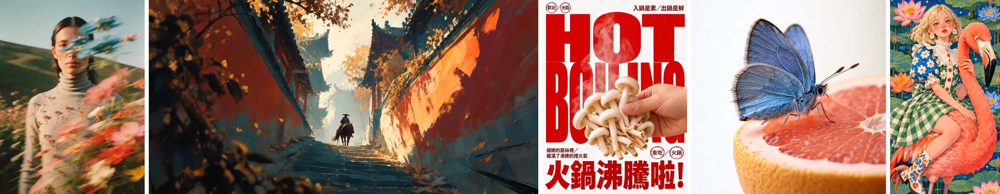

**SenseNova-U1.6**은 통합 멀티모달 모델입니다. 시각 이해와 이미지 생성이 하나의 8B `mot` 백본에서 동작하므로, 같은 모델이 프롬프트와 참조 이미지를 모두 읽고 결과를 반환합니다. 인물 사진, 포스터, 일러스트, 인포그래픽처럼 정확성과 완성도가 모두 중요한 작업을 대상으로 합니다.

자율 자체 교정 패스도 수행합니다. 결과가 나온 뒤 모델이 자신의 출력을 프롬프트와 비교하고, 맞지 않는 부분이 있으면 다시 생성합니다. 최대 5회까지 반복합니다.

**주요 특징**:
- **하나의 백본, 두 방향**: 같은 8B `mot` 모델이 이해와 렌더링을 모두 담당해 텍스트 기반 이미지 생성과 참조 이미지 기반 편집을 지원합니다.
- **자율 자체 교정**: 모델이 자신의 출력을 프롬프트와 비교하고 최대 5회까지 다시 생성합니다.
- **두 가지 샘플링 모드**: Turbo는 8단계 LoRA로 8단계, CFG 1.0을 사용합니다. Quality는 LoRA 없이 50단계, CFG 4.0을 사용합니다.
- **정교한 미학, 풍부한 표현**: 주관 평가에서 전반적 미학 품질이 U1.5 대비 **10% 향상**. 인물·실사, 예술 작품, 인포그래픽에 맞춰 미학 보상 모델을 따로 학습했습니다.
- **자율적 성찰**: UltraTextBench 의 밀집 인포그래픽에서 자기 교정 루프가 단일 생성 대비 평균 **7% 상대 개선**을 냅니다.
- **선택적 PE 프롬프트 재작성**: Qwen Image 2.1 PE 텍스트 인코더가 짧은 프롬프트를 완전한 시각 묘사로 확장하고, 이미지에 들어갈 문구를 그대로 채워 넣습니다.

**공식 링크**:
- [Hugging Face: Comfy-Org/SenseNova-U1](https://huggingface.co/Comfy-Org/SenseNova-U1) (체크포인트와 8단계 LoRA)
- [GitHub: OpenSenseNova/SenseNova-U1](https://github.com/OpenSenseNova/SenseNova-U1)
- [Hugging Face: sensenova/SenseNova-U1.6-8B-MoT](https://huggingface.co/sensenova/SenseNova-U1.6-8B-MoT) (공식 모델 가중치)
- [Hugging Face: sensenova/SenseNova-U1.6-8B-MoT-LoRAs](https://huggingface.co/sensenova/SenseNova-U1.6-8B-MoT-LoRAs) (공식 8스텝 LoRA)

두 템플릿 모두 ComfyUI 0.46.0 이상이 필요합니다.

## 예시

SenseNova의 공식 예시 6장으로, 모델이 겨냥하는 창작 방향을 보여줍니다. 이 예시들은 SenseNova 팀이 공개한 것이며 이 워크플로에서 생성한 결과물이 아닙니다. 팀은 '창의적 시각 표현'과 '네이티브 자기 교정'이라는 두 가지 목표를 동시에 내세우므로, 정확성과 아름다움은 함께 가도록 설계되었습니다.

### 사진, 일러스트, 포스터

<Columns cols={2}>
  <Frame caption="슬로 셔터: 피사체는 선명하게 남고 군중은 흐르듯 번집니다.">
    
  </Frame>
  <Frame caption="고속 제품 촬영: 공중에 멈춘 유리 머그잔과 물보라.">
    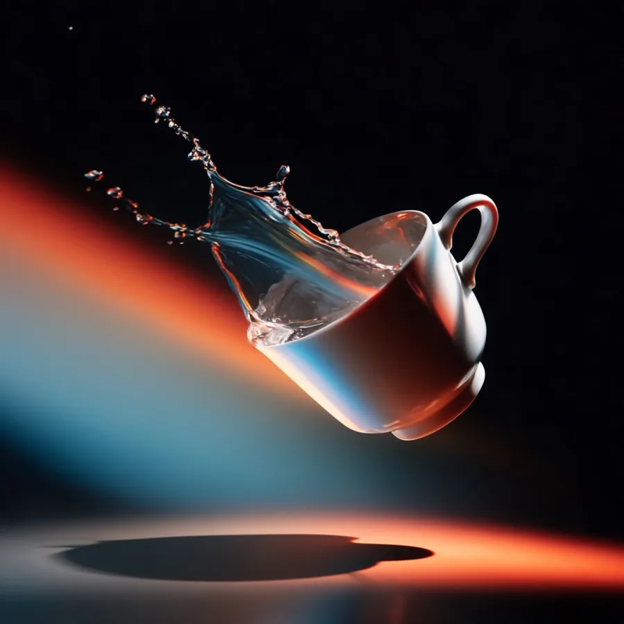
  </Frame>
  <Frame caption="일러스트: 꽃과 고양이들 사이에 있는 파란색 옷을 입은 소녀.">
    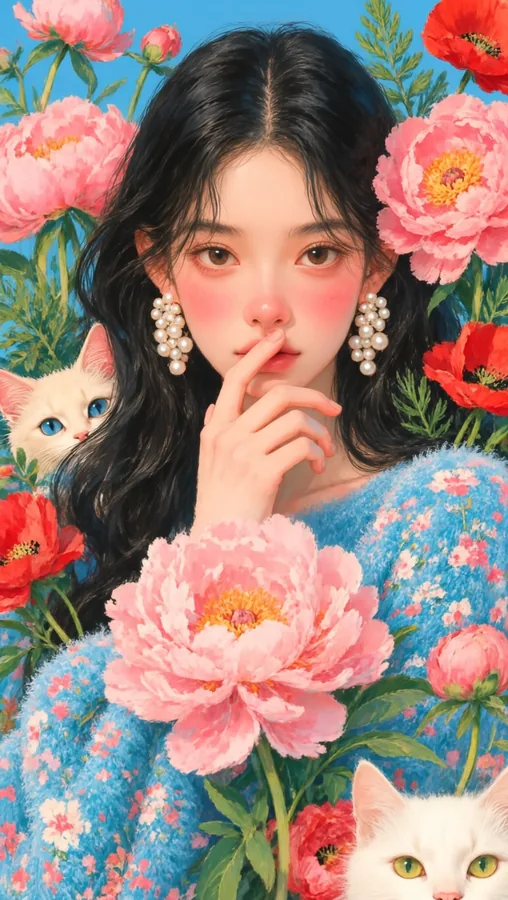
  </Frame>
  <Frame caption="일러스트: 주황빛 아래 안개 낀 산맥.">
    
  </Frame>
  <Frame caption="헤드라인 타이포그래피가 있는 포스터: “Tasty ideas. Fresh design.”">
    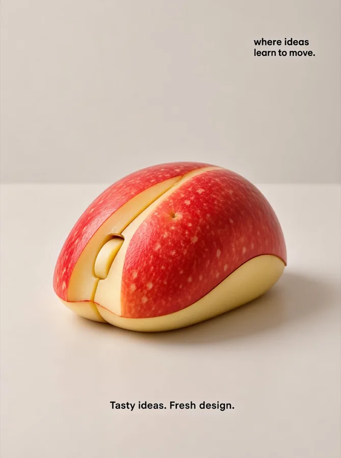
  </Frame>
  <Frame caption="포스터: Y2K 패션 페스티벌, 평면 스튜디오 장면 위의 픽셀 블록 서체.">
    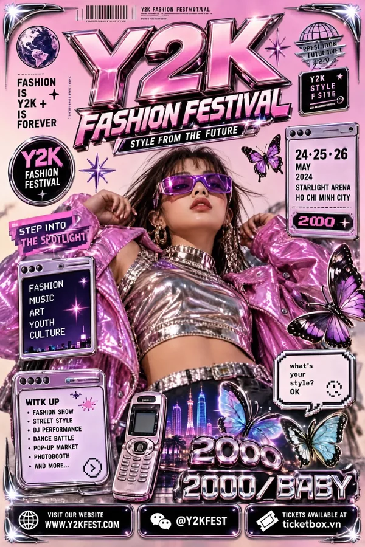
  </Frame>
</Columns>

## 자기 교정 실제 예

각 쌍은 같은 프롬프트와 같은 시드로, 한 번 생성한 결과와 '생성 / 검토 / 수정' 루프를 거친 결과입니다. 세 번째 이미지는 수정된 글자의 확대 컷입니다.

<Columns cols={3}>
  <Frame caption="빨간 반려동물 포스터 · 수정 전">
    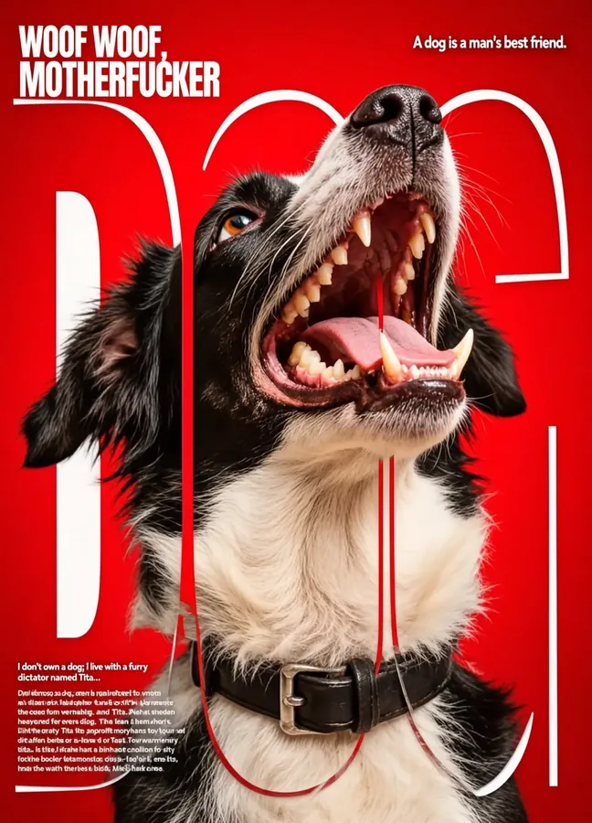
  </Frame>
  <Frame caption="빨간 반려동물 포스터 · 수정 후">
    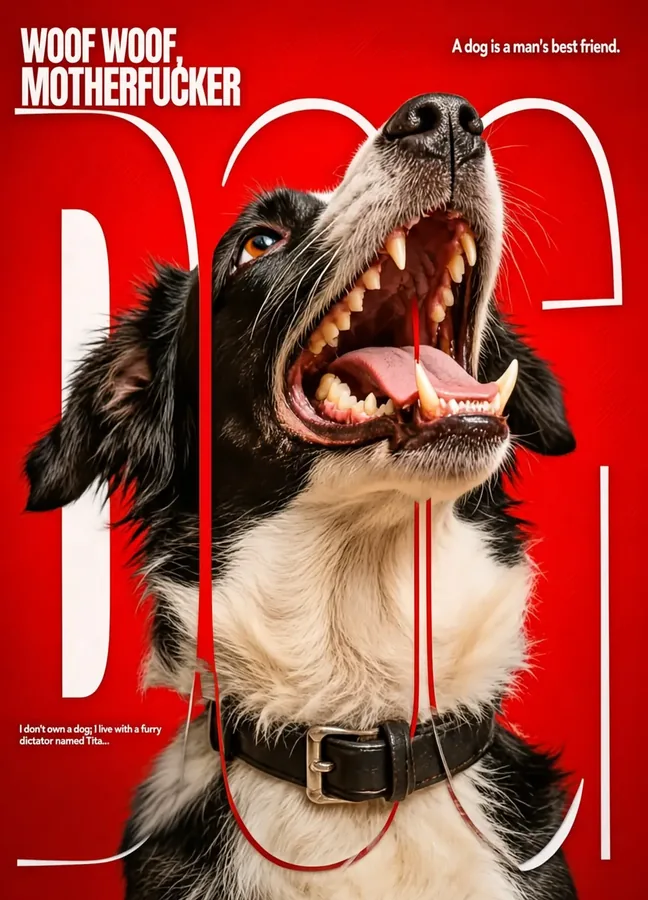
  </Frame>
  <Frame caption="빨간 반려동물 포스터 · 부분 비교">
    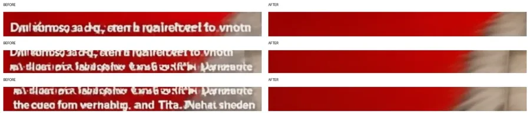
  </Frame>
</Columns>

<Columns cols={3}>
  <Frame caption="쇼와 시대 음료 포스터 · 수정 전">
    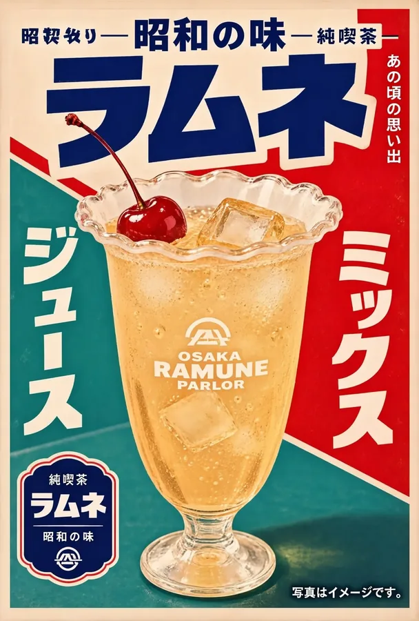
  </Frame>
  <Frame caption="쇼와 시대 음료 포스터 · 수정 후">
    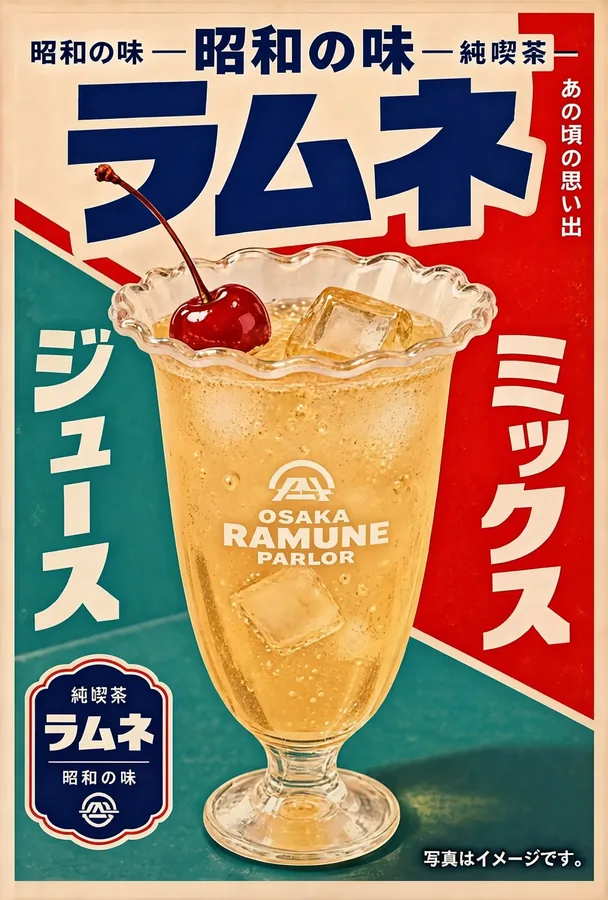
  </Frame>
  <Frame caption="쇼와 시대 음료 포스터 · 부분 비교">
    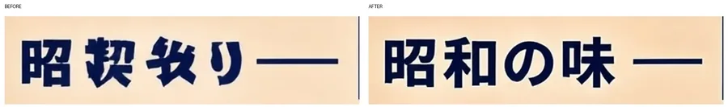
  </Frame>
</Columns>

## 텍스트 기반 이미지 생성 워크플로

<UpdateReminder />

### SenseNova U1.6: 텍스트 기반 이미지 생성 {#image_sensenova_u16_t2i}

작성한 장면을 완성된 이미지로 만듭니다. 모델이 프롬프트를 읽고 시각적 디테일을 채운 뒤, 선택한 화면 비율로 4메가픽셀 이미지를 반환합니다.


<CardGroup cols={2}>
  <Card title="Comfy Cloud에서 실행" icon="cloud" href="https://cloud.comfy.org/?template=image_sensenova_u16_t2i&utm_source=docs&utm_medium=referral&utm_campaign=sensenova-u1-6">
    Comfy Cloud에서 열기
  </Card>
  <Card title="워크플로 다운로드" icon="download" href="https://github.com/Comfy-Org/workflow_templates/blob/main/templates/image_sensenova_u16_t2i.json">
    JSON 다운로드 또는 템플릿 라이브러리에서 &quot;SenseNova U1.6: Text to Image&quot; 검색
  </Card>
</CardGroup>

**출력 예시**


#### 워크플로 파일

ComfyUI를 업데이트한 뒤 템플릿 라이브러리에서 템플릿을 열거나, 위 미리보기를 ComfyUI로 끌어다 놓아 불러옵니다.

워크플로에는 두 개의 파이프라인이 있습니다:
- **Base 파이프라인**: 한 번의 생성 패스. 인물 사진, 사진 표현, 포스터, 일반 일러스트에 적합합니다.
- **자체 교정 파이프라인**: 생성, 검토, 보정을 최대 5회 반복한 뒤 디코딩합니다. 인포그래픽, 밀집한 텍스트, 차트, 단계 도식에 가장 적합합니다.

캔버스의 스위치로 파이프라인, Turbo LoRA, 단계 수와 CFG 값을 선택합니다.

#### 모델 다운로드

**체크포인트**

- [sensenova_u1.6_8b_mot_int8_convrot.safetensors](https://huggingface.co/Comfy-Org/SenseNova-U1/resolve/main/checkpoints/sensenova_u1.6_8b_mot_int8_convrot.safetensors)

**LoRA (Turbo 모드)**

- [sensenova_u1.6_8b_mot_8step_lora_bf16.safetensors](https://huggingface.co/Comfy-Org/SenseNova-U1/resolve/main/loras/sensenova_u1.6_8b_mot_8step_lora_bf16.safetensors)

**텍스트 인코더 (PE)**

- [qwen3.5_9b_qwen_image_2.1_pe_t2i.int8_convrot.safetensors](https://huggingface.co/Comfy-Org/Qwen-Image-2.1/resolve/main/text_encoders/qwen3.5_9b_qwen_image_2.1_pe_t2i.int8_convrot.safetensors) (8.82 GB)

**모델 저장 위치**

```
📂 ComfyUI/
├── 📂 models/
│   ├── 📂 checkpoints/
│   │   └── sensenova_u1.6_8b_mot_int8_convrot.safetensors
│   ├── 📂 loras/
│   │   └── sensenova_u1.6_8b_mot_8step_lora_bf16.safetensors
│   └── 📂 text_encoders/
│       └── qwen3.5_9b_qwen_image_2.1_pe_t2i.int8_convrot.safetensors
```

#### 샘플링 설정

| 모드 | 단계 수 | CFG |
| --- | --- | --- |
| **Turbo** (8단계 LoRA) | 8 | 1.0 |
| **Quality** (LoRA 없음) | 50 | 4.0 |

- **Turbo Mode?**는 8단계 LoRA를 불러올지 결정합니다. 반복 작업 중에는 켜 두고, 최대한의 텍스트 정확도와 세부 묘사가 필요하면 끕니다.
- **Self-Correction**은 생성, 검토, 보정 루프를 추가합니다. 텍스트가 많은 레이아웃에는 켜고, 단순한 인물 사진에는 끕니다. 패스마다 샘플링이 한 번 더 실행되기 때문입니다.
- **Enable PE**는 위에서 설명한 프롬프트 재작성을 켭니다.
- **Resolution**은 총 메가픽셀 예산으로 캔버스를 정하며, 프리셋은 1:1부터 21:9까지입니다. 기본값은 4:3 (Standard) 4메가픽셀로 2368 × 1760입니다.

#### 프롬프트 팁

- 이미지에 들어가야 하는 모든 단어를 따옴표로 묶으세요. 따옴표 안의 문구는 그대로 렌더링되며, 오류는 따옴표 밖 텍스트에서 생깁니다.
- PE를 끄면 시각 묘사를 직접 작성해야 합니다. 한 줄짜리 요청으로는 이 모델의 타이포그래피와 레이아웃 강점을 끌어내기 어렵습니다.

## 이미지 편집 워크플로

### SenseNova U1.6: 이미지 편집 {#image_sensenova_u16_image_edit}

사진을 참조 이미지로 첨부하고 변경할 내용을 설명해 편집합니다. 같은 8B 백본이 원본 이미지를 읽고 다시 작업해, 원본 자체의 해상도와 화면 비율로 결과를 반환합니다.


<CardGroup cols={2}>
  <Card title="Comfy Cloud에서 실행" icon="cloud" href="https://cloud.comfy.org/?template=image_sensenova_u16_image_edit&utm_source=docs&utm_medium=referral&utm_campaign=sensenova-u1-6">
    Comfy Cloud에서 열기
  </Card>
  <Card title="워크플로 다운로드" icon="download" href="https://github.com/Comfy-Org/workflow_templates/blob/main/templates/image_sensenova_u16_image_edit.json">
    JSON 다운로드 또는 템플릿 라이브러리에서 &quot;SenseNova U1.6: Image Edit&quot; 검색
  </Card>
</CardGroup>

**입력 자료**

이 파일을 해당 `LoadImage` 노드에 업로드하세요:

<CardGroup cols={2}>
  <Card title="sensenova_u16_edit_women_in_car.png" icon="image" href="https://raw.githubusercontent.com/Comfy-Org/workflow_templates/main/input/sensenova_u16_edit_women_in_car.png">
    `LoadImage` 노드 79 · `sensenova_u16_edit_women_in_car.png`
  </Card>
</CardGroup>

<div style={{display: 'grid', gridTemplateColumns: 'repeat(2, minmax(0, 1fr))', gap: '1rem', alignItems: 'start'}}>
  
</div>

**출력 예시**

<div style={{display: 'grid', gridTemplateColumns: 'repeat(2, minmax(0, 1fr))', gap: '1rem', alignItems: 'start'}}>
  
  
</div>

#### 워크플로 파일

ComfyUI를 업데이트한 뒤 템플릿 라이브러리에서 템플릿을 찾거나, 위 미리보기를 ComfyUI로 끌어다 놓아 불러옵니다.

원본 이미지는 모델이 학습한 범위인 4메가픽셀로 조정된 뒤 32의 배수로 패딩됩니다. 출력은 원본의 해상도와 화면 비율을 따르므로 편집 후에도 원래 구도가 유지됩니다.

모델은 최대 5장의 참조 이미지를 지원합니다. 실제로 유용한 범위는 1~4장이며, 한 장 늘어날 때마다 비전 토큰과 메모리를 사용합니다.

`ImageCompare`는 원본과 결과를 나란히 보여 줍니다.

#### 모델 다운로드

**체크포인트**

- [sensenova_u1.6_8b_mot_int8_convrot.safetensors](https://huggingface.co/Comfy-Org/SenseNova-U1/resolve/main/checkpoints/sensenova_u1.6_8b_mot_int8_convrot.safetensors)

**LoRA (Turbo 모드)**

- [sensenova_u1.6_8b_mot_8step_lora_bf16.safetensors](https://huggingface.co/Comfy-Org/SenseNova-U1/resolve/main/loras/sensenova_u1.6_8b_mot_8step_lora_bf16.safetensors)

**텍스트 인코더 (선택 사항 PE, 이미지 편집)**

- [qwen3.5_9b_qwen_image_2.1_pe_i2i.int8_convrot.safetensors](https://huggingface.co/Comfy-Org/Qwen-Image-2.1/resolve/main/text_encoders/qwen3.5_9b_qwen_image_2.1_pe_i2i.int8_convrot.safetensors) (8.82 GB)

**모델 저장 위치**

```
📂 ComfyUI/
├── 📂 models/
│   ├── 📂 checkpoints/
│   │   └── sensenova_u1.6_8b_mot_int8_convrot.safetensors
│   ├── 📂 loras/
│   │   └── sensenova_u1.6_8b_mot_8step_lora_bf16.safetensors
│   └── 📂 text_encoders/
│       └── qwen3.5_9b_qwen_image_2.1_pe_i2i.int8_convrot.safetensors
```

#### 샘플링 설정

| 모드 | 단계 수 | CFG |
| --- | --- | --- |
| **Turbo** (8단계 LoRA) | 8 | 1.0 |
| **Quality** (LoRA 없음) | 50 | 4.0 |

- **Turbo Mode?**는 8단계 LoRA를 불러올지 건너뛸지 결정합니다. 반복 작업 중에는 켜 두고, 최대한의 텍스트 정확도와 세부 묘사가 필요하면 끕니다.
- **Self-Correction**은 편집, 검토, 보정 루프를 추가하며, 레이아웃에 텍스트가 있을 때 효과가 큽니다.
- **Enable PE**는 원본 이미지와 지시를 함께 읽고 완전한 편집 프롬프트로 확장합니다.
- **참조 이미지**가 구도를 결정합니다. 출력 크기는 원본을 따르므로 다른 형태가 필요하면 큐에 넣기 전에 참조 이미지를 자르거나 크기를 조정하세요.

#### 프롬프트 팁

- 무엇을 바꿀지 말하고, 반드시 유지해야 할 항목을 나열하세요. 인물의 동일성, 구도, 조명, 배경은 이름을 짚어 줄 가치가 있는 세부 정보입니다.
- 편집된 이미지에 반드시 들어가야 하는 모든 단어를 따옴표로 묶으세요. 따옴표 안의 문구는 그대로 렌더링됩니다.
- PE를 끄면 변경 내용과 유지 목록을 모두 포함한 완전한 편집 지시를 직접 작성해야 합니다.


#### 멀티턴 편집

이번 릴리스에는 멀티턴 편집 기능이 없습니다. 한 번의 실행은 불러온 참조 이미지에 적용되는 하나의 지시이며, 모델은 실행 사이에 대화 기록을 유지하지 않습니다. 멀티턴 편집을 위한 LoRA나 전용 브랜치가 이후에 나올 수 있습니다. 지금은 직접 편집을 이어가세요. 결과를 저장해 다음 참조 이미지로 불러오고, 다음 변경을 설명하면 됩니다.

## 프롬프트 확장(PE) 안내

SenseNova U1.6 전용 프롬프트 확장 모델은 없습니다. 두 템플릿은 선택적으로 **Qwen Image 2.1** 의 PE 텍스트 인코더를 불러옵니다(텍스트 기반 이미지 생성은 `qwen3.5_9b_qwen_image_2.1_pe_t2i`, 이미지 편집은 `..._pe_i2i`). 짧은 프롬프트를 완전한 시각 묘사로 확장하고 이미지에 들어갈 문구를 그대로 채워 넣습니다. **Enable PE** 를 끄면 원래 프롬프트로 생성합니다.
