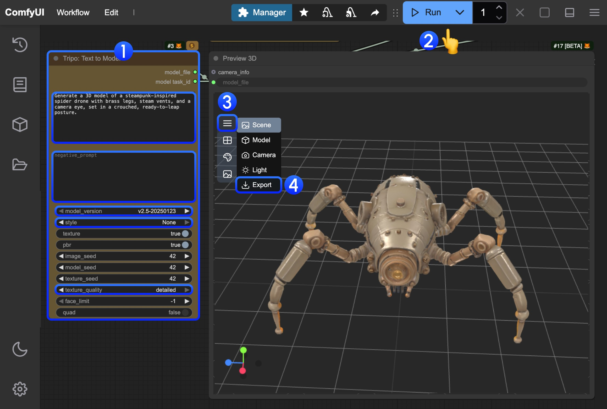
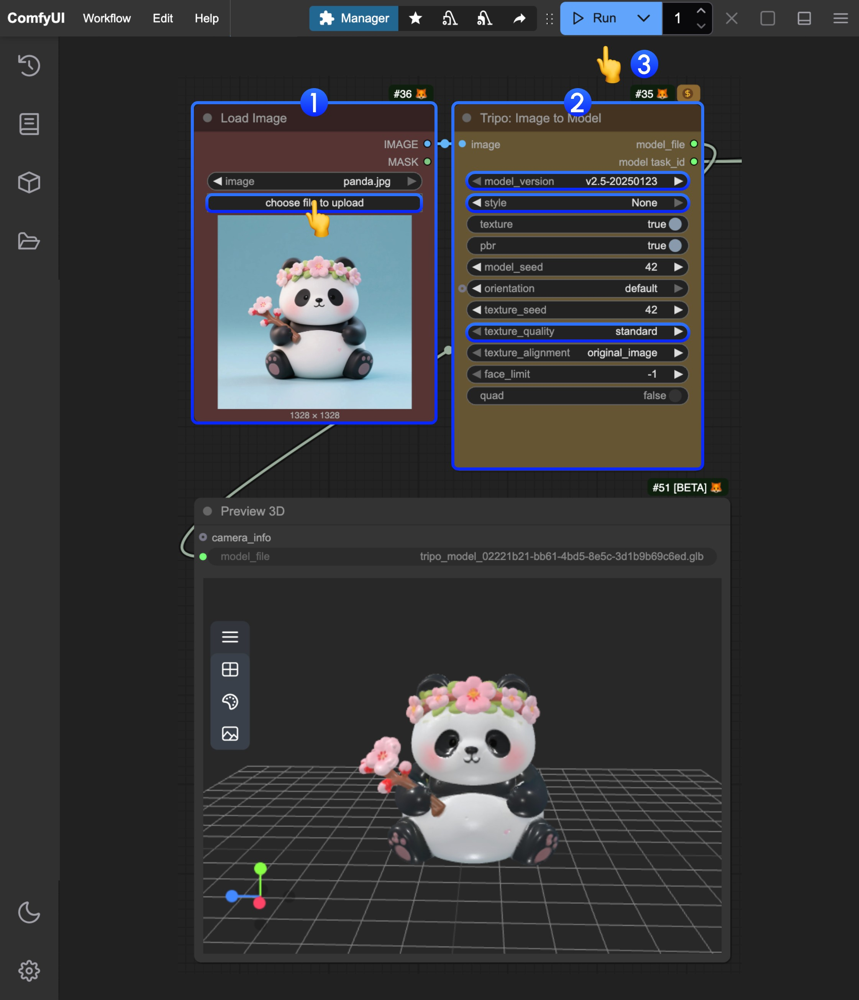
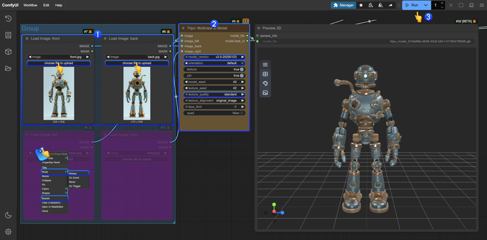
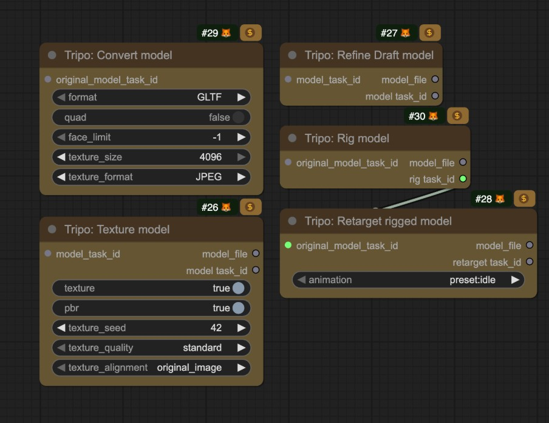

import ReqHint from "/snippets/ko/tutorials/partner-nodes/req-hint.mdx";
import UpdateReminder from "/snippets/ko/tutorials/update-reminder.mdx";

Tripo AI는 생성형 AI 3D 모델링에 중점을 둔 기업입니다. 사용자 친화적인 플랫폼과 API 서비스를 제공하여 텍스트 프롬프트나 2D 이미지(단일 또는 다중)를 빠르게 고품질 3D 모델로 변환할 수 있습니다.
이제 ComfyUI는 해당 Tripo API를 기본적으로 통합하여, 관련 노드를 편리하게 사용해 모델을 생성할 수 있도록 지원합니다.

## Tripo 모델 생성의 강점

현재 ComfyUI의 파트너 노드는 다음과 같은 Tripo 모델 생성 기능을 지원합니다:
- 텍스트 기반 3D 모델 생성
- 이미지 기반 3D 모델 생성
- 멀티뷰 기반 3D 모델 생성
- 모델 리깅
- 리깅된 모델 리타겟팅

<ReqHint/>
<UpdateReminder/>

## 텍스트 기반 3D 모델 생성 워크플로우

Tripo의 텍스트 기반 3D 모델 생성 기능을 사용해 텍스트 프롬프트에서 3D 모델을 생성합니다.

<CardGroup cols={2}>
  <Card title="Text-to-Model을 Comfy Cloud에서 실행" icon="cloud" href="https://cloud.comfy.org/?template=api_tripo_text_to_model&utm_source=docs&utm_medium=referral&utm_campaign=model-generation">
    Text-to-Model 워크플로를 Comfy Cloud에서 바로 사용해 보세요.
  </Card>
  <Card title="Text-to-Model 워크플로 다운로드" icon="download" href="https://raw.githubusercontent.com/Comfy-Org/example_workflows/refs/heads/main/api_nodes/tripo/api_tripo_text_to_model.json">
    JSON을 다운로드하여 ComfyUI에서 로컬로 실행하세요.
  </Card>
</CardGroup>

### 2. 워크플로우를 단계별로 완료하세요

이미지의 숫자를 참고해 기본적인 텍스트 기반 3D 모델 생성 워크플로우를 완료하세요:  
1. `Tripo: Text to Model` 노드에서 `prompt` 필드에 프롬프트를 입력하세요.
   - 모델: 다양한 모델을 선택할 수 있습니다.
   - 스타일: 다양한 스타일을 설정할 수 있습니다.
   - 텍스처 품질: 다양한 텍스처 품질을 설정할 수 있습니다.
2. `Run` 버튼을 클릭하거나 단축키 `Ctrl(cmd) + Enter`를 사용해 모델 생성을 실행하세요. 워크플로우가 완료된 후 해당 모델은 자동으로 `ComfyUI/output/` 디렉토리에 저장됩니다.
3. `Preview 3D` 노드에서 메뉴를 확장하세요.
4. `Export`를 선택해 해당 모델을 바로 내보내세요.

## 이미지 기반 3D 모델 생성 워크플로우

### 1. 워크플로우 파일 다운로드

<CardGroup cols={2}>
  <Card title="Comfy Cloud에서 실행" icon="cloud" href="https://cloud.comfy.org/?template=api_tripo_image_to_model&utm_source=docs&utm_medium=referral&utm_campaign=model-generation">
    아무것도 설치하지 않고 Comfy Cloud에서 이 워크플로우를 실행합니다.
  </Card>
  <Card title="이미지 기반 3D 모델 워크플로우 다운로드" icon="download" href="https://raw.githubusercontent.com/Comfy-Org/example_workflows/refs/heads/main/api_nodes/tripo/image_to_model/api_tripo_image_to_model.json">
    ComfyUI에서 로컬로 실행할 JSON을 다운로드하세요.
  </Card>
</CardGroup>

입력 자료

아래 샘플 입력 이미지를 다운로드해 워크플로우를 사용해 보세요:

<CardGroup cols={1}>
  <Card title="입력 이미지" icon="image" href="https://raw.githubusercontent.com/Comfy-Org/workflow_templates/main/input/api_tripo_image_to_model_input_image.jpg">
    샘플 입력 이미지 다운로드
  </Card>
</CardGroup>

### 2. 워크플로우를 단계별로 완료하세요

이미지의 숫자를 참고해 기본적인 이미지 기반 3D 모델 생성 워크플로우를 완료하세요:  
1. `Load Image` 노드에서 제공된 입력 이미지를 로드하세요.
2. `Tripo: Image to Model` 노드에서 해당 매개변수 설정을 수정하세요.
   - 모델: 다양한 모델을 선택할 수 있습니다.
   - 스타일: 다양한 스타일을 설정할 수 있습니다.
   - 텍스처 품질: 다양한 텍스처 품질을 설정할 수 있습니다.
3. `Run` 버튼을 클릭하거나 단축키 `Ctrl(cmd) + Enter`를 사용해 모델 생성을 실행하세요. 워크플로우가 완료된 후 해당 모델은 자동으로 `ComfyUI/output/` 디렉토리에 저장됩니다.
4. 모델 다운로드는 텍스트 기반 3D 모델 생성 섹션의 지침을 참조하세요.

## 단일 이미지 모델 생성 워크플로우(뷰 자동 생성)

이 템플릿은 사진 한 장에서 시작합니다. Nano Banana 2가 배경을 제거하고 측면과 후면 뷰를 생성하며, 세 이미지가 모두 저장됩니다. Tripo 이미지-모델 노드가 배경이 제거된 사진으로 모델을 만듭니다.

<CardGroup cols={2}>
  <Card title="Comfy Cloud에서 실행" icon="cloud" href="https://cloud.comfy.org/?template=templates_mjm_image_to_3d&utm_source=docs&utm_medium=referral&utm_campaign=model-generation">
    아무것도 설치하지 않고 Comfy Cloud에서 이 워크플로우를 실행합니다.
  </Card>
  <Card title="워크플로우 다운로드" icon="download" href="https://github.com/Comfy-Org/workflow_templates/blob/main/templates/templates_mjm_image_to_3d.json">
    워크플로우 JSON을 다운로드하거나 템플릿 라이브러리에서 'Generate 3D Model From Single Image'를 검색하세요.
  </Card>
</CardGroup>

<CardGroup cols={1}>
  <Card title="입력 이미지" icon="image" href="https://raw.githubusercontent.com/Comfy-Org/workflow_templates/main/input/templates_mjm_image_to_3d.png">
    피사체 하나가 단순한 배경에 놓인 샘플 사진입니다.
  </Card>
</CardGroup>

사진을 `Load Image` 노드에 넣고 워크플로우를 실행하세요. 한 번 실행에 API 호출이 네 번(이미지 3회, 모델 1회) 발생하며, 만들어진 모델은 GLB 파일로 `ComfyUI/output/3d/` 아래에 저장됩니다. 피사체가 하나이고 배경이 깔끔한 사진일수록 결과가 좋습니다.

메시는 배경이 제거된 사진만으로 만들어집니다. 이미지-모델 노드가 이미지 한 장을 받고 배치의 첫 프레임을 사용하기 때문입니다. 측면과 후면 뷰는 PNG 출력으로 저장됩니다. 여러 뷰로 모델을 만들려면 아래의 멀티뷰 워크플로우를 사용하세요.

## 멀티뷰 모델 생성 워크플로우

여러 뷰 이미지에서 3D 모델을 생성하여 정확도를 높일 수 있습니다.

<CardGroup cols={2}>
  <Card title="클라우드에서 멀티뷰 기반 3D 모델 생성 실행" icon="cloud" href="https://cloud.comfy.org/?template=api_tripo_multiview_to_model&utm_source=docs&utm_medium=referral&utm_campaign=model-generation">
    멀티뷰 기반 3D 모델 생성 워크플로우를 Comfy Cloud에서 즉시 사용해 보세요.
  </Card>
  <Card title="멀티뷰 기반 3D 모델 생성 워크플로우 다운로드" icon="download" href="https://raw.githubusercontent.com/Comfy-Org/example_workflows/refs/heads/main/api_nodes/tripo/multiview_to_image/api_tripo_multiview_to_model.json">
    ComfyUI에서 로컬로 실행할 수 있도록 JSON을 다운로드하세요.
  </Card>
</CardGroup>

입력 자료

워크플로우를 실행해 보려면 다음 샘플 입력 이미지를 다운로드하세요:

<CardGroup cols={2}>
  <Card title="전면 뷰" icon="image" href="https://raw.githubusercontent.com/Comfy-Org/workflow_templates/main/input/api_tripo_multiview_to_model_front_image.jpg">
    전면 뷰 입력 다운로드
  </Card>
  <Card title="후면 뷰" icon="image" href="https://raw.githubusercontent.com/Comfy-Org/workflow_templates/main/input/api_tripo_multiview_to_model_back_image.jpg">
    후면 뷰 입력 다운로드
  </Card>
</CardGroup>

### 2. 워크플로우 실행을 단계별로 완료하세요

이미지의 숫자를 참고하여 기본적인 멀티뷰 기반 3D 모델 생성 워크플로우 실행을 완료할 수 있습니다:  
1. `Load Image` 노드에서 제공된 입력 이미지를 각각 로드하세요.
2. `Tripo: Image to Model` 노드에서 해당 매개변수 설정을 수정하세요.
   - 모델: 다양한 모델을 선택할 수 있습니다.
   - 스타일: 다양한 스타일을 설정할 수 있습니다.
   - 텍스처 품질: 다양한 텍스처 품질을 설정할 수 있습니다.
3. `Run` 버튼을 클릭하거나 단축키 `Ctrl(cmd) + Enter`를 사용해 모델 생성을 실행하세요. 워크플로우가 완료된 후 해당 모델은 자동으로 `ComfyUI/output/` 디렉토리에 저장됩니다.
4. 다른 뷰 입력에 대해서는 단계 도표를 참고하고 해당 노드 모드를 `Always`로 설정해 활성화하세요.
5. 모델 다운로드는 텍스트 기반 3D 모델 생성 섹션의 지침을 참조하세요.

## 동일 작업에 대한 후속 작업 처리

Tripo의 해당 노드들은 동일 작업에 대한 후속 처리를 제공하며, 관련 노드에 해당 `model_task_id`를 입력하기만 하면 됩니다. 또한 관련 템플릿에도 해당 노드를 제공했으므로 필요에 따라 해당 노드 모드를 수정해 활성화할 수 있습니다.

