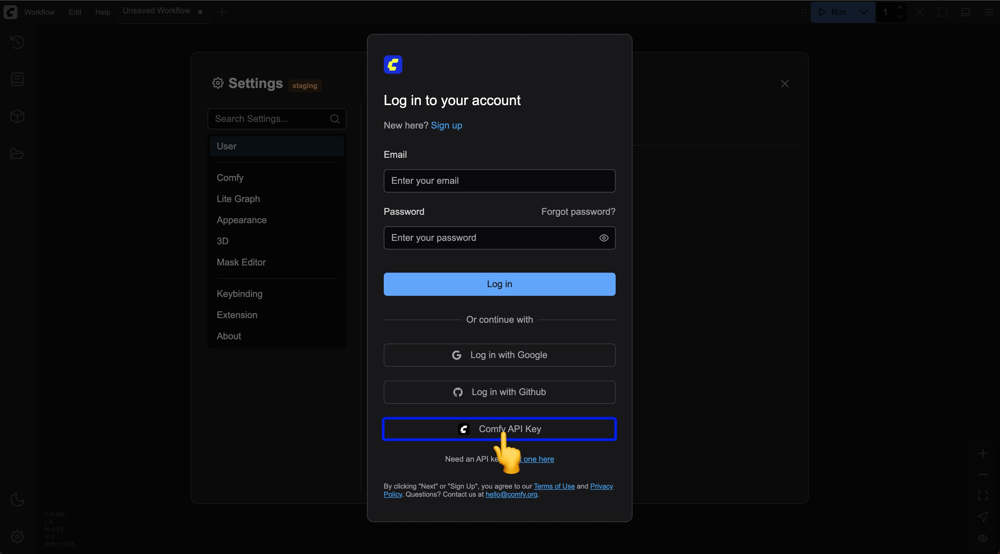
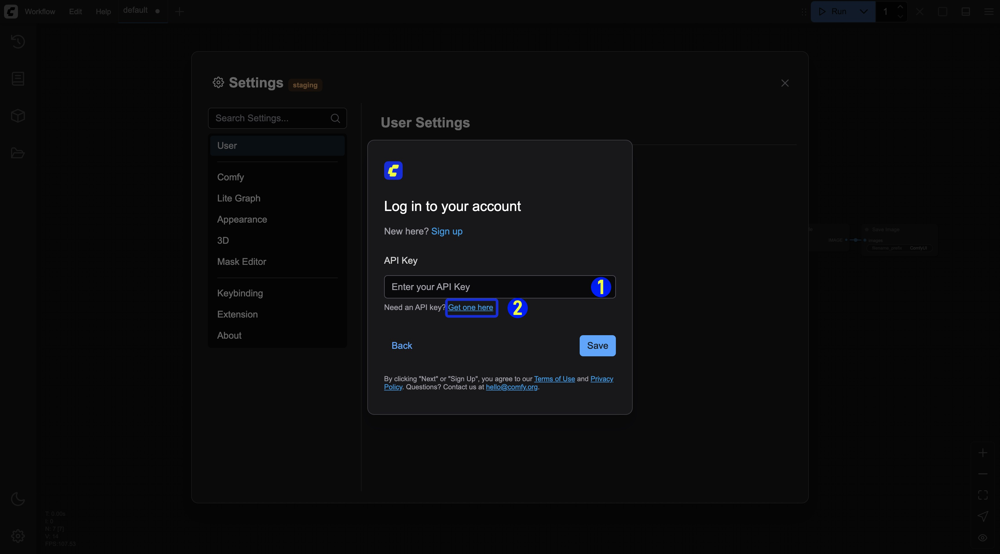
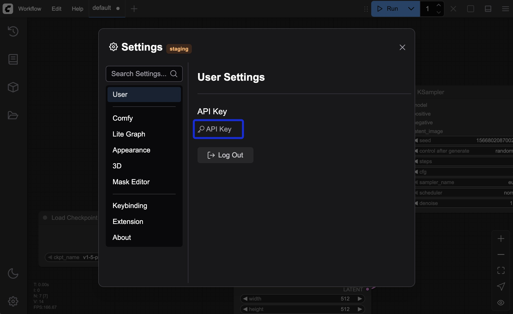
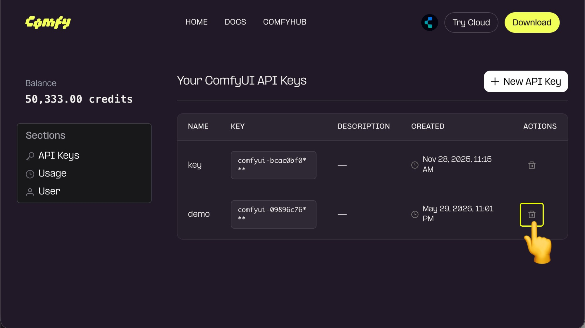
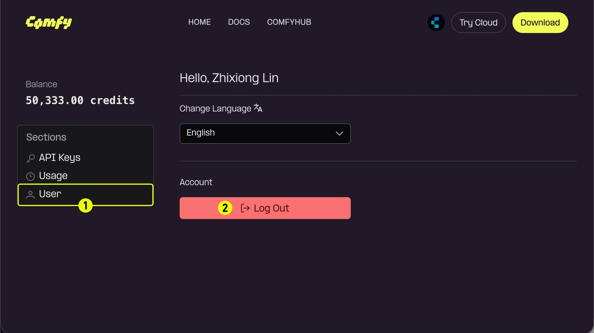

import GetApiKey from "/snippets/ru/get-api-key.mdx"

Ваша учётная запись Comfy даёт доступ к [партнёрским узлам (Partner Node)](/ru/tutorials/partner-nodes/overview) и [облачным подпискам](https://www.comfy.org/cloud), позволяя использовать премиальные функции и сервисы на платформе ComfyUI.

## Поддерживаемые способы входа

ComfyUI поддерживает следующие способы входа:
- **Электронная почта**: вход с помощью адреса электронной почты и пароля
- **Google**: вход с помощью аккаунта Google
- **GitHub**: вход с помощью аккаунта GitHub
- **Единый вход (SSO)**: вход через провайдера идентификации вашей организации

## Вход с помощью единого входа (SSO)

Если ваша организация управляет аккаунтами Comfy через провайдера идентификации, вы входите с помощью **Continue with SSO**, а не с помощью адреса электронной почты и пароля, Google или GitHub.

Единый вход доступен после того, как ваша организация включит его. До этого используйте электронную почту, Google или GitHub.

1. На странице входа введите адрес электронной почты или сначала нажмите **Continue with SSO**.
2. Если появится запрос, нажмите **Continue with SSO**.
3. Завершите вход на странице вашего провайдера идентификации. Вы вернётесь в Comfy Cloud с выполненным входом.

Если единый вход не настроен или администратор отключил его для вашей организации, обратитесь к администратору.

<Note>
Аккаунты SSO пока не могут входить в настольное приложение ComfyUI. Используйте браузер. Ссылки-приглашения в рабочее пространство также пока нельзя принять из аккаунта SSO, поэтому попросите администратора рабочего пространства добавить вас напрямую.
</Note>

## Вход в Comfy Cloud

Чтобы получить доступ к своей учетной записи Comfy для ComfyUI на Comfy Cloud:

1. Перейдите на [Comfy Cloud](https://www.comfy.org)
2. Нажмите **Log in** или **Sign in**
3. Выберите метод входа:
   - **Email**: Введите адрес электронной почты и пароль, затем нажмите **Log in**
   - **Google**: Нажмите кнопку входа через Google и пройдите аутентификацию
   - **GitHub**: Нажмите кнопку входа через GitHub и пройдите аутентификацию
   - **SSO**: Нажмите **Continue with SSO** (сначала введите электронную почту или перейдите сразу к SSO) и завершите вход у своего провайдера идентификации

## Локальный вход

Если ComfyUI установлен локально:

1. Откройте ComfyUI на вашем локальном компьютере
2. Перейдите в **Настройки** в интерфейсе
3. Откройте раздел **Пользователь** (подробности см. в разделе [Настройки пользователя](/ru/interface/user))
4. Выберите метод входа:
   - **Электронная почта**: введите вашу электронную почту и пароль
   - **Google**: нажмите кнопку входа через Google и пройдите авторизацию
   - **GitHub**: нажмите кнопку входа через GitHub и пройдите авторизацию
   - **API-ключ**: используйте API-ключ для развёртываний вне белого списка (см. ниже)

### Вход с помощью API-ключа {#logging-in-with-an-api-key}

Поскольку не все развёртывания ComfyUI входят в белый список авторизации нашего домена, в недавнем обновлении (2025-05-10) мы добавили вход по API-ключу для сайтов вне этого списка. Ниже приведены шаги для входа с помощью API-ключа:

<video
<video
  controls
  className="w-full aspect-video"
  src="/images/interface/setting/user/api_login.mp4"
></video>

<Tabs>

  <Tab title="Eсть API-ключ">

  <Steps>
  <Step title="Выберите вход по `Comfy API Key` на экране входа">
    Выберите вход по `Comfy API Key` во всплывающем окне входа
    
  </Step>

  <Step title="Введите ваш API-ключ">
    
    1. Введите ваш API-ключ и сохраните его
    2. Если у вас нет API-ключа, нажмите ссылку `Get one here`, чтобы перейти на [страницу входа Comfy Platform](https://platform.comfy.org/login) и войти, чтобы получить его.
  </Step>
  <Step title="Вход выполнен успешно">
  После успешного входа соответствующая информация о входе по API-ключу отображается в меню настроек
    
  </Step>
</Steps>

  </Tab>
  <Tab title="Нет API-ключа: сначала подайте заявку на API-ключ">
О том, как подать заявку и получить API-ключ, см. следующие шаги:

<GetApiKey />

<Steps>
  <Step title="Управление API-ключами">
    
    Для неиспользуемых API-ключей или ключей, которые могут быть скомпрометированы, можно нажать `Delete`, чтобы удалить их и избежать ненужных потерь.
  </Step>
  <Step title="(Необязательно) Выйти">
    
    Если вы получили API-ключ и вошли в систему на общедоступном устройстве, своевременно выйдите из неё.
  </Step>
</Steps>

  </Tab>
</Tabs>

## Забыли пароль

Если вы не помните пароль (для входа по электронной почте):

1. Нажмите ссылку **Forgot password?** на странице входа
2. Введите адрес электронной почты, указанный при регистрации
3. Проверьте почту: там будут инструкции по сбросу пароля
4. Перейдите по ссылке для сброса в письме
5. Создайте новый пароль
6. Войдите с новым паролем

## Устранение проблем при входе

Если у вас возникли проблемы при входе:

- Убедитесь, что адрес электронной почты указан верно
- Проверьте, что Caps Lock выключен при вводе пароля
- Очистите файлы cookie и кэш браузера
- Попробуйте использовать другой браузер или режим инкогнито
- Убедитесь, что электронная почта вашей учётной записи подтверждена
- Обратитесь в [поддержку](/ru/support/contact-support), если проблемы не исчезли

## Советы по безопасности

Чтобы защитить свой аккаунт:
- Используйте надёжный уникальный пароль
- Не передавайте свои учётные данные для входа
- Выходите из аккаунта при использовании общих устройств
- Регулярно обновляйте пароль
