## Обзор

**Comfy MCP** подключает ИИ-агентов к ComfyUI через [Model Context Protocol](https://modelcontextprotocol.io). После подключения вы можете генерировать изображения, видео, аудио и 3D, искать модели, узлы и шаблоны, а также запускать настоящие рабочие процессы ComfyUI прямо из чата с вашим агентом.

Он включает два подключения: подключение к **Comfy Cloud** и подключение к **локальному ComfyUI**, причём локальное полностью открытое.

<Tip>
  **Застряли на чём-то из описанного ниже? Лучший способ: передать эту страницу вашему агенту и попросить помощи.**
</Tip>

### Какое подключение выбрать?

**Новым пользователям мы рекомендуем начать с облачного подключения**: это самый простой вариант настройки. Если вы используете claude.ai, ChatGPT или приложение Claude Desktop, облачное подключение также будет более совместимым выбором.

**Если вы уже запускаете ComfyUI локально или в собственной развёрнутой среде либо работаете в основном в агенте для программирования**, таком как Claude Code, Cursor или Codex, начните с **локального** подключения.

<Info>
  **Пользователям Mac: если вы планируете запускать модели с открытым исходным кодом, мы рекомендуем облачное подключение.** Сегодняшние модели с открытыми весами (локальные версии MiniMax H3, LTX-2.3 и подобные) очень большие и не будут работать с приемлемой скоростью на Apple GPU.
</Info>

Использовать оба подключения одновременно это обычная практика, и большинство клиентов спокойно работают с двумя MCP-серверами. Они входят в одну и ту же учётную запись Comfy, но **по отдельности**: один вход не покрывает другой.

## Подключение Comfy Cloud MCP

Облачное подключение, связывающее вашего агента с аккаунтом **Comfy Cloud**. Ничего устанавливать не нужно, а рабочие процессы выполняются на облачных GPU Comfy Cloud. Узнать больше о Comfy Cloud можно на странице [Comfy Cloud](/ru/get_started/cloud).

### Настроить облачное подключение

<Info>
  Перед подключением вам нужен аккаунт [Comfy Cloud](https://cloud.comfy.org). [Зарегистрируйтесь](https://cloud.comfy.org), если его у вас ещё нет; новые пользователи получают **5 бесплатных запусков**, чтобы попробовать. Вход через OAuth во время настройки использует ваш аккаунт Comfy.
</Info>

Comfy Cloud MCP работает по адресу:

```
https://cloud.comfy.org/mcp
```

Выберите свой клиент:

<Tabs><Tab title="Claude Desktop">
    Claude Desktop добавляет Comfy Cloud как **пользовательский коннектор** через свой интерфейс, а затем запускает вход по OAuth.

    <video
      controls
      className="w-full aspect-video rounded-xl"
      src="/images/agent_tools/Claude_desktop.mp4"
    ></video>

    <Steps>
      <Step title="Открыть Customize">
        В боковой панели нажмите **Customize** (обозначено **1**).

        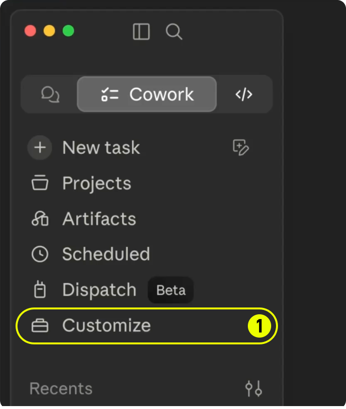
      </Step>
      <Step title="Открыть Connectors">
        Нажмите **Connectors** (обозначено **2**).

        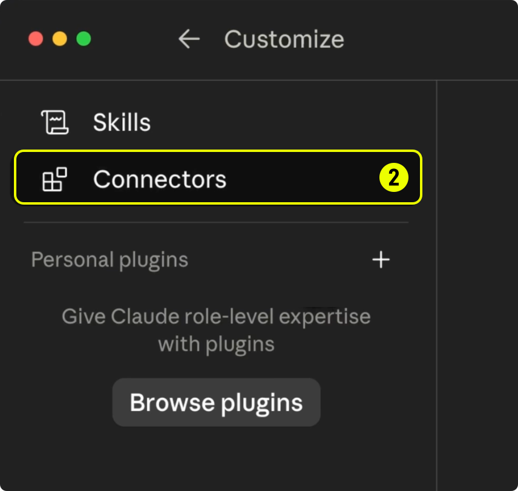
      </Step>
      <Step title="Добавить пользовательский коннектор">
        1. Нажмите кнопку **+** (обозначено **3**) в заголовке Connectors.
        2. Выберите **Add custom connector** (обозначено **4**).

        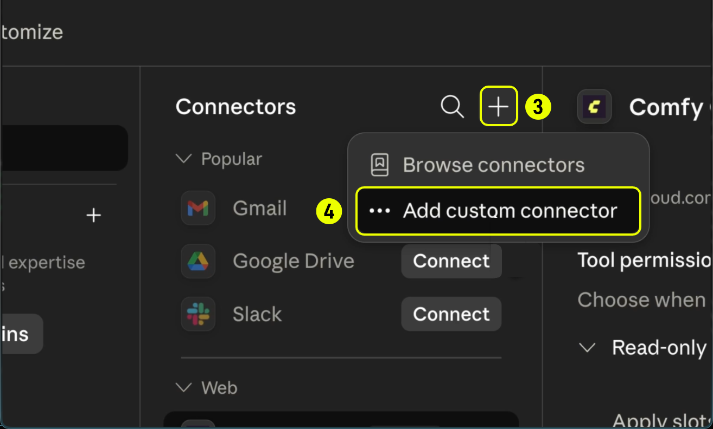
      </Step>
      <Step title="Ввести данные сервера">
        1. Введите имя, например **Comfy Cloud MCP**, в поле **Name** (обозначено **5**).
        2. Укажите в поле **Remote MCP server URL** значение `https://cloud.comfy.org/mcp` (обозначено **6**).
        3. Нажмите **Add** (обозначено **7**).

        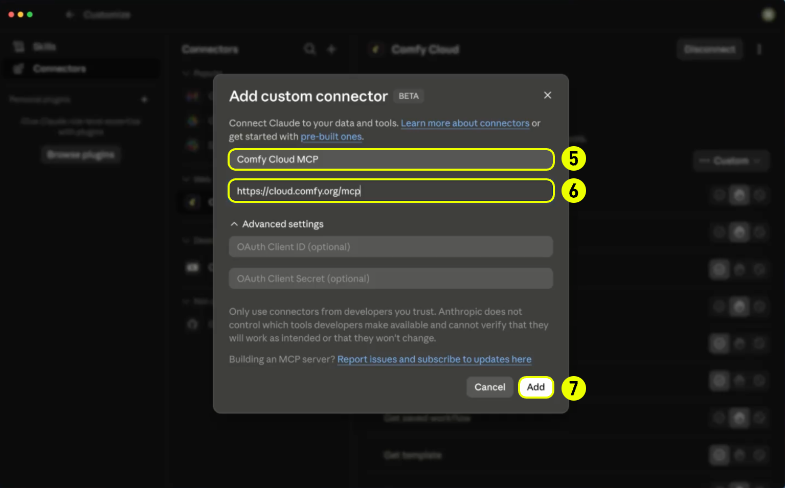
      </Step>
      <Step title="Войти">
        1. Когда откроется браузер, выберите рабочее пространство (например, **Personal Workspace**).
        2. Нажмите **Continue**, чтобы авторизовать коннектор. Вы подключены.

        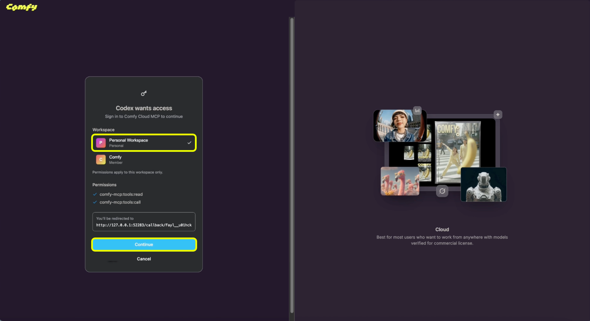
      </Step>
    </Steps>

  </Tab><Tab title="Claude Code">
    Установите плагин **comfy-cloud**. Он добавляет MCP-подключение и слэш-команды за один шаг. Плагин публикуется в репозитории [Comfy Skills](https://github.com/Comfy-Org/comfy-skills/), где размещены плагины для Claude Code и навыки агентов сообщества для Comfy.

    <Steps>
      <Step title="Добавить marketplace">
        Зарегистрируйте marketplace Comfy Skills (однократно):

        ```
        /plugin marketplace add Comfy-Org/comfy-skills
        ```
      </Step>
      <Step title="Установить плагин">
        ```
        /plugin install comfy-cloud@comfy-skills
        ```
      </Step>
      <Step title="Войти">
        Выполните `/mcp`, выберите **comfy-cloud** → **Authenticate**. Откроется браузер для входа, а токены обновляются автоматически.
      </Step>
    </Steps>

    Плагин добавляет следующие слэш-команды:

    | Команда | Что делает |
    | --- | --- |
    | `/comfy-cloud:generate-image` | Генерировать, редактировать или изменять изображение |
    | `/comfy-cloud:generate-video` | Генерировать, редактировать или продлевать видео |
    | `/comfy-cloud:generate-audio` | Генерировать аудио, музыку или звуковые эффекты |
    | `/comfy-cloud:generate-3d` | Генерировать 3D-модель по тексту или изображению |
    | `/comfy-cloud:remove-background` | Удалить фон изображения |
    | `/comfy-cloud:upscale-image` | Повысить разрешение изображения |
    | `/comfy-cloud:search-templates` | Найти готовые шаблоны рабочих процессов на [comfy.org](https://comfy.org) |
    | `/comfy-cloud:search-models` | Поиск доступных моделей |
    | `/comfy-cloud:search-nodes` | Поиск узлов и подсказки по их соединению |
    | `/comfy-cloud:help` | Узнать, какие возможности даёт ComfyUI Cloud |

    <Accordion title="Нужно только подключение, без плагина?">
      Добавьте сервер напрямую:

      ```bash
      claude mcp add --transport http comfy-cloud https://cloud.comfy.org/mcp
      ```

      Затем выполните `/mcp`, выберите **comfy-cloud** → **Authenticate**. Добавьте `-s user`, чтобы подключение было доступно во всех ваших проектах.

      Этот способ по-прежнему предоставляет те же рабочие процессы в виде MCP-промптов: `/mcp__comfy-cloud__generate-image`, `/mcp__comfy-cloud__search-models` и так далее (префикс `/mcp__<name>__` использует имя, которое вы передали в `claude mcp add`). Плагин, описанный выше, рекомендуется, поскольку он оборачивает их в более удобные команды `/comfy-cloud:*`.
    </Accordion>
  </Tab><Tab title="Cursor">
    Cursor подключается к удалённым серверам MCP по HTTP. Cursor **не** поддерживает MCP OAuth на сегодняшний день. Добавьте Comfy Cloud с API-ключом Comfy Cloud в конфигурацию MCP.

    <Steps>
      <Step title="Откройте настройки Cursor">
        Нажмите на шестерёнку **Settings** в правом верхнем углу (с пометкой **1**).

        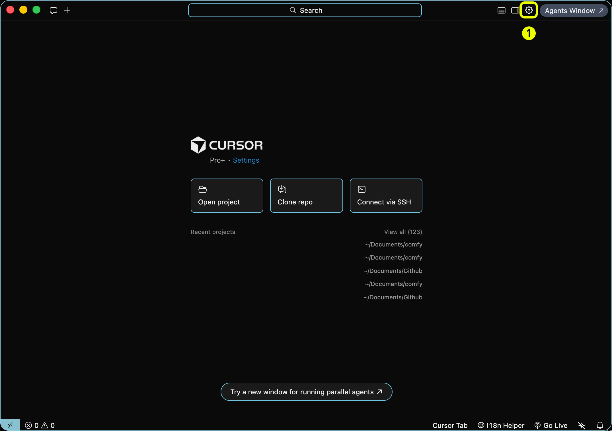
      </Step>
      <Step title="Откройте Tools & MCP">
        1. На боковой панели нажмите **Tools & MCPs** (с пометкой **2**).
        2. Нажмите **+ New MCP Server** (с пометкой **3**) → **Add a Custom MCP Server**.

        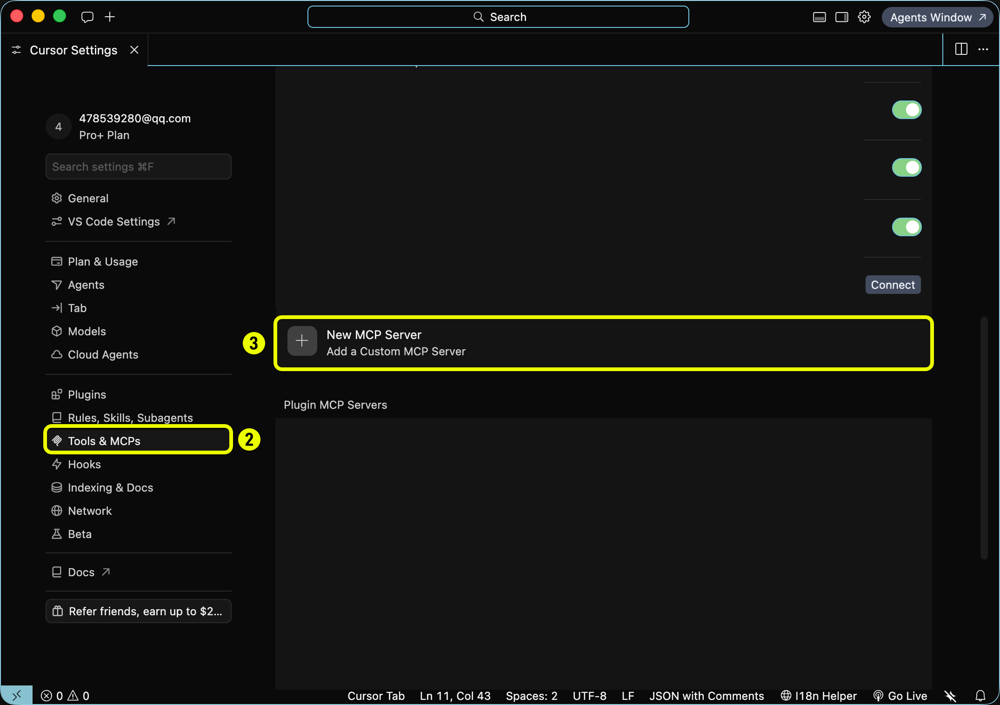
      </Step>
      <Step title="Добавьте API-ключ">
        Отредактируйте `~/.cursor/mcp.json` (глобальный) или `.cursor/mcp.json` (проектный). Укажите URL сервера и передайте API-ключ Comfy Cloud в заголовке `X-API-Key`. Создайте ключ на [platform.comfy.org/profile/api-keys](https://platform.comfy.org/profile/api-keys) (начинается с `comfyui-`):

        ```json
        {
          "mcpServers": {
            "comfy-cloud": {
              "url": "https://cloud.comfy.org/mcp",
              "headers": {
                "X-API-Key": "${env:COMFY_API_KEY}"
              }
            }
          }
        }
        ```

        Задайте `COMFY_API_KEY` в оболочке или системном окружении. Лучше использовать `${env:COMFY_API_KEY}`, чем жёстко прописывать ключ в файле, который вы можете закоммитить в Git.

        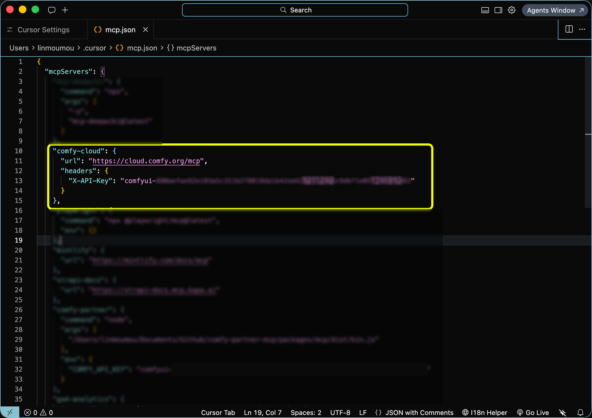
      </Step>
      <Step title="Начните генерировать">
        Спрашивайте обычным языком («сгенерируй изображение кота-космонавта», «найди шаблон видео Wan 2.2»). Cursor вызывает инструменты MCP от вашего имени.
      </Step>
    </Steps>
  </Tab><Tab title="Codex">
    [Codex](https://developers.openai.com/codex/cli) подключается к Comfy Cloud по Streamable HTTP. Добавьте сервер в разделе **Settings**, затем войдите через OAuth.

    <video
      controls
      className="w-full aspect-video rounded-xl"
      src="/images/agent_tools/CodeX_Oauth_mcp.mp4"
    ></video>

    <Steps>
      <Step title="Открыть панель настроек">
        1. Нажмите **Settings** (обозначено **1**) под *Logged in with API key*.
        2. Нажмите **Settings** (обозначено **2**), чтобы открыть полную панель настроек.

        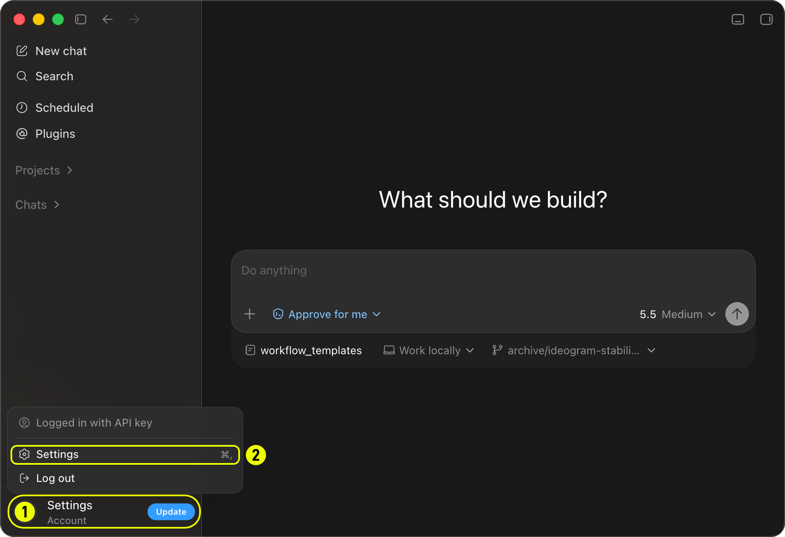
      </Step>
      <Step title="Открыть настройки MCP-сервера">
        1. Нажмите **MCP servers** (обозначено **3**) в списке настроек.
        2. Нажмите **+ Add server** (обозначено **4**), чтобы добавить новый MCP-сервер.

        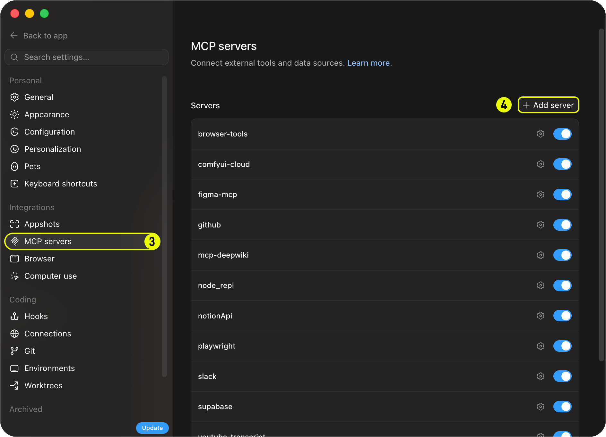
      </Step>
      <Step title="Подключиться к Comfy Cloud">
        1. Выберите **Streamable HTTP** в качестве типа подключения.
        2. Введите имя, например **Comfy Cloud MCP**, в поле **Name** (обозначено **5**).
        3. Введите URL `https://cloud.comfy.org/mcp` в поле **URL** (обозначено **6**).
        4. Нажмите **Save** (обозначено **7**).

        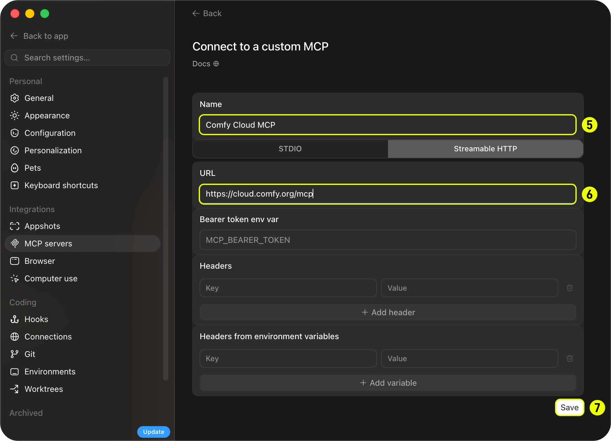
      </Step>
      <Step title="Пройти аутентификацию">
        1. Нажмите **Authenticate** (обозначено **8**) у сохранённой записи сервера.

        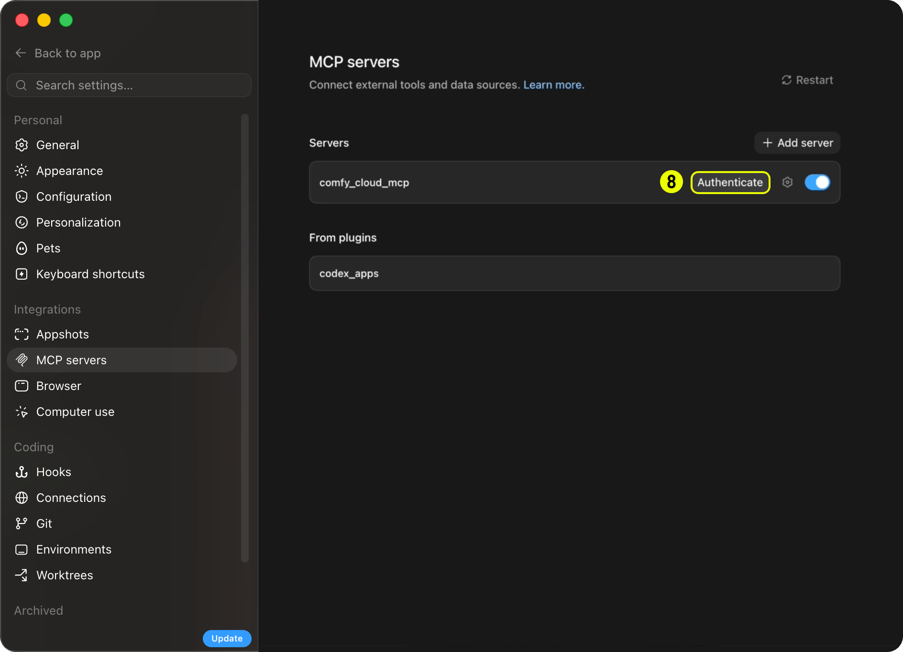

        2. Во всплывающем окне браузера выберите рабочее пространство и нажмите **Continue**, чтобы завершить вход. Подключение установлено.

        
      </Step>
    </Steps>

    Спрашивайте обычным языком («сгенерируй изображение кота-космонавта», «найди шаблон видео Wan 2.2»). Codex вызывает инструменты MCP от вашего имени.

    <Accordion title="Предпочитаете CLI?">
      Зарегистрируйте сервер и войдите из терминала:

      ```bash
      codex mcp add comfy-cloud --url https://cloud.comfy.org/mcp
      codex mcp login comfy-cloud
      ```

      Эта команда добавляет запись в `~/.codex/config.toml` (или в `.codex/config.toml` в доверенном проекте).
    </Accordion>

    <Accordion title="API-ключ вместо OAuth (без браузера или в CI)">
      Если браузер недоступен, добавьте сервер с заголовком, значение которого берётся из переменной окружения. Создайте ключ на [platform.comfy.org/profile/api-keys](https://platform.comfy.org/profile/api-keys) (начинается с `comfyui-`), затем добавьте в `~/.codex/config.toml`:

      ```toml
      [mcp_servers.comfy-cloud]
      url = "https://cloud.comfy.org/mcp"
      env_http_headers = { "X-API-Key" = "COMFY_API_KEY" }
      ```

      Задайте `COMFY_API_KEY` в оболочке или системном окружении. Не добавляйте ключ в систему контроля версий.
    </Accordion>

    <Accordion title="Codex постоянно просит войти снова (invalid_grant или повторное использование refresh-токена)">
      **Симптом:** Codex выводит вас из Comfy Cloud и снова и снова просит пройти аутентификацию, иногда каждые несколько минут. В предупреждениях или логах Codex может упоминаться `invalid_grant`, уже использованный или отозванный refresh-токен либо неудачное обновление токена OAuth.

      **Причина:** Это связано с тем, как Codex хранит и обновляет учётные данные OAuth для MCP, а не с Comfy Cloud. Когда несколько процессов Codex (сеансы TUI, сервер приложения, команды `codex mcp`) используют один сервер OAuth, один процесс может обновить токен, который другой уже ротировал. Сервер авторизации расценивает это как повторное использование токена и завершает сеанс. Пользователи других OAuth MCP-серверов сообщают о таком же поведении. Эти проблемы открыты в репозитории Codex, поэтому вы можете проверить их текущий статус:

      - [openai/codex#46028](https://github.com/openai/codex/issues/46028): долгоживущие клиенты повторно используют ротированные refresh-токены
      - [openai/codex#48507](https://github.com/openai/codex/issues/48507): параллельные процессы соревнуются за ротацию refresh-токена, и следующий запуск получает `invalid_grant`
      - [openai/codex#41133](https://github.com/openai/codex/issues/41133): при завершении работы может потеряться ротированный refresh-токен
      - [openai/codex#17265](https://github.com/openai/codex/issues/17265): Codex не обновляет сохранённые токены OAuth для MCP

      **Обходной путь 1: включить в Codex флаг координации обновления.** В Codex есть флаг функции `mcp_oauth_refresh_coordination`, который координирует обновление токенов OAuth между процессами Codex. Это настройка Codex, а не Comfy. Codex указывает её как находящуюся в разработке и отключённую по умолчанию, и ни Codex, ни Comfy не поддерживают её как официальное исправление. В openai/codex#46028 её включение остановило повторное использование устаревшего токена в тесте автора отчёта. Если в вашей версии Codex она всё ещё отключена, добавьте её в `~/.codex/config.toml`:

      ```toml
      [features]
      mcp_oauth_refresh_coordination = true
      ```

      Закройте и перезапустите каждый запущенный сеанс Codex, чтобы все они подхватили флаг. Если Codex уже показывает **comfy-cloud** как вышедший из системы, войдите ещё раз (`codex mcp login comfy-cloud` или **Authenticate** в разделе **Settings**). Если в более поздней версии Codex флаг включён по умолчанию или удалён, этот шаг можно пропустить.

      **Обходной путь 2: оставить обновление каждого сервера одному процессу Codex.** Если флаг недоступен или не помогает, перенесите запись `[mcp_servers.comfy-cloud]` из глобального `~/.codex/config.toml` в `.codex/config.toml` доверенного проекта, чтобы её загружали и обновляли только сеансы в этом проекте. Не запускайте одновременно много сеансов Codex с Comfy Cloud и закрывайте сеансы Codex перед перезапуском компьютера. Это обходной путь, описанный в openai/codex#48507.

      Перенос записи не останавливает процессы Codex, которые уже загрузили глобальную конфигурацию: они продолжают обновлять старое определение сервера. После переноса закройте все запущенные сеансы Codex и остановите сервер приложения Codex, затем запускайте Codex только в проекте, где находится эта запись.

      Если вам не нужен OAuth, описанная выше настройка с API-ключом не использует токены обновления.

      Эти шаги уменьшают число выходов из системы, но могут не устранить их полностью. Мы также работаем над изменениями на стороне Comfy Cloud, чтобы это происходило реже.
    </Accordion>
  </Tab><Tab title="OpenClaw">
    Установите навык **Comfy Cloud** из [ClawHub](https://clawhub.ai/comfy-org/skills/comfy). Он подключает OpenClaw к размещённому на сервере MCP (`cloud.comfy.org/mcp`). Только для облака: он не управляет локальной установкой ComfyUI.

    <Steps>
      <Step title="Установить навык">
        ```bash
        openclaw skills install @comfy-org/comfy
        ```

        Страница навыка: [clawhub.ai/comfy-org/skills/comfy](https://clawhub.ai/comfy-org/skills/comfy).
      </Step>
      <Step title="Подключиться через OAuth (рекомендуется)">
        Зарегистрируйте сервер MCP и войдите под своей учётной записью Comfy:

        ```bash
        openclaw mcp set comfy '{"url":"https://cloud.comfy.org/mcp","transport":"streamable-http","auth":"oauth"}'
        openclaw mcp login comfy
        openclaw gateway restart
        ```

        Команда `openclaw mcp login` выводит URL авторизации. Откройте его, войдите и завершите процесс, как указывает CLI (он может попросить запустить команду повторно со значением `--code`). Проверьте результат с помощью `openclaw mcp status --verbose`.

        <Note>
          Если задано `auth: "oauth"`, OpenClaw игнорирует статические `headers` в этой записи сервера. Не объединяйте OAuth с заголовком, содержащим жёстко заданный API-ключ.
        </Note>
      </Step>
      <Step title="Начать генерацию">
        Спрашивайте обычным языком («сгенерируй изображение кота-космонавта», «найди шаблон видео Wan 2.2»). OpenClaw вызывает инструменты MCP от вашего имени.
      </Step>
    </Steps>

    <Accordion title="API-ключ вместо OAuth (headless или CI)">
      Создайте ключ на [platform.comfy.org/profile/api-keys](https://platform.comfy.org/profile/api-keys) (он начинается с `comfyui-`), экспортируйте его, а затем зарегистрируйте сервер:

      ```bash
      export COMFY_API_KEY="comfyui-..."
      openclaw mcp set comfy '{"url":"https://cloud.comfy.org/mcp","transport":"streamable-http","headers":{"Authorization":"Bearer ${COMFY_API_KEY}"}}'
      openclaw gateway restart
      ```

      Для OpenClaw предпочитайте `Authorization: Bearer`, а не пользовательский заголовок `X-API-Key`. Некоторые сборки OpenClaw отбрасывают пользовательские заголовки в транспортах streamable-http; Bearer надёжнее проходит через прокси. Поместите `COMFY_API_KEY` в профиль вашей оболочки или в окружение OpenClaw. Не коммитьте ключ.
    </Accordion>
  </Tab><Tab title="Другие клиенты">
    Любой MCP-клиент, поддерживающий транспорт **remote HTTP**, может подключиться к Comfy Cloud. URL сервера всегда `https://cloud.comfy.org/mcp`.

    <Steps>
      <Step title="Добавить URL сервера">
        Добавьте запись удалённого MCP-сервера, указывающую на `https://cloud.comfy.org/mcp`. Большинство клиентов используют JSON-конфигурацию с полем `url`:

        ```json
        {
          "mcpServers": {
            "comfy-cloud": {
              "url": "https://cloud.comfy.org/mcp"
            }
          }
        }
        ```

        **Windsurf** использует `serverUrl` вместо `url`. **Amp** использует ту же структуру `mcpServers` в **Settings → MCP Servers** или в `~/.config/amp/settings.json`.
      </Step>
      <Step title="Пройти аутентификацию">
        Если ваш клиент поддерживает MCP OAuth, войдите через браузер, когда появится запрос. В противном случае добавьте заголовок с API-ключом (см. ниже).
      </Step>
      <Step title="Перезапустить и проверить">
        Перезапустите клиент. Инструменты Comfy Cloud (`search_templates`, `submit_workflow`, `get_output` и другие) должны появиться в списке сервера **comfy-cloud**.
      </Step>
    </Steps>

    **Без графического интерфейса / CI (API-ключ):** если OAuth недоступен, создайте ключ на [platform.comfy.org/profile/api-keys](https://platform.comfy.org/profile/api-keys) и передайте его в заголовке `X-API-Key`:

    ```json
    {
      "mcpServers": {
        "comfy-cloud": {
          "url": "https://cloud.comfy.org/mcp",
          "headers": {
            "X-API-Key": "comfyui-…"
          }
        }
      }
    }
    ```

    Для Claude Code из терминала:

    ```bash
    claude mcp add --transport http comfy-cloud https://cloud.comfy.org/mcp -H "X-API-Key: comfyui-…"
    ```

    Предпочитайте `${env:COMFY_API_KEY}` или подстановку секретов вашего клиента вместо жёсткого прописывания ключей в конфигурационных файлах, которые вы коммитите в Git.
  </Tab>
</Tabs>

### Что умеет ваш агент

Вы не вызываете инструменты MCP сами. Агент выбирает нужный инструмент исходя из того, что вы попросите. Слэш-команды и промпты (ниже) это ярлыки, которые направляют агента к типичным задачам, но обычный язык тоже работает («сгенерируй изображение кота-космонавта», «увеличь это фото», «найди видеошаблон Wan 2.2»).

Типичный сценарий:

1. **Найти** доступное (`search_templates`, `search_models`, `search_nodes` или `cql` для вопросов в стиле графа).
2. **Запустить** генерацию: `run_template` для подходящего готового шаблона, `submit_workflow` для пользовательского рабочего процесса (с `upload_file`, когда нужна входная картинка), или `partner_generate` для моделей партнёров, таких как Flux, Grok, Gemini, OpenAI, Ideogram и Seedance.
3. **Дождаться и получить** выходы (`wait_for_job`, затем `get_output` возвращает команду скачивания, которую агент выполняет в вашей оболочке).

Сервер предпочитает сначала сопоставить [готовые шаблоны](https://comfy.org/workflows), а не строить рабочий процесс с нуля, что обычно даёт лучшие результаты быстрее.

### Инструменты MCP в Comfy Cloud

Это инструменты, к которым ваш агент получает доступ после подключения. Имена совпадают с теми, что отображаются в логах MCP-клиента и отладочном выводе.

**Обнаружение**

| Инструмент | Описание |
| --- | --- |
| `search_templates` | Поиск готовых шаблонов рабочих процессов на [comfy.org](https://comfy.org/workflows) по тексту, тегу, типу медиа или модели |
| `get_template` | Получить полный JSON рабочего процесса шаблона для просмотра или ручного редактирования |
| `get_template_schema` | Показывает, какие параметры шаблона можно переопределить во время выполнения |
| `search_models` | Поиск по каталогу моделей по тексту, типу, базовой модели или источнику |
| `search_nodes` | Поиск доступных узлов по тексту, категории или типам входов и выходов. Также показывает **чертежи подграфов** (готовые группы узлов, такие как Текст в изображение или Удалить фон) |
| `get_node` | Получить полную спецификацию входов для конкретных узлов, включая полные списки опций |
| `cql` | Выполнить запрос к графу на [CQL](https://github.com/Comfy-Org/cql) для структурных вопросов (например, какие узлы создают изображения или какие есть пути между типами узлов). Используйте `search_nodes`, когда нужны полные спецификации входов конкретного узла |
| `get_prompting_guide` | Стиль промпта и рекомендуемые настройки (steps, cfg, sampler, resolution) для каждого семейства моделей |
| `get_catalog_overview` | Карта каталога верхнего уровня: доступные фасеты моделей, шаблонов и узлов, а также количество моделей по источникам. Полезный первый вызов для ориентации |
| `get_creative_technique` | Получить рецепт для именованной творческой техники (рекомендуемые узлы и настройки), прежде чем делать вывод, что цель недостижима |
| `estimate_credits` | Офлайн-оценка стоимости рабочего процесса или шаблона перед запуском. Она оценивает только платные **API-узлы** (партнёрские модели, такие как Flux или Grok) и не учитывает время GPU, очереди и хранения, поэтому оценка `0` означает «цена не рассчитана», а не «бесплатно». См. [Кредиты и расходы](#кредиты-и-расходы) |

**Генерация**

| Инструмент | Описание |
| --- | --- |
| `run_template` | Запустить готовый шаблон по имени с необязательными переопределениями параметров: предпочтительный путь, когда шаблон подходит |
| `submit_workflow` | Отправить рабочий процесс в формате API ComfyUI для выполнения в Comfy Cloud |
| `partner_generate` | Генерировать с помощью моделей партнёрских API (Flux/BFL, Grok, Gemini, OpenAI, Ideogram, Seedream/Seedance и другие) |
| `upload_file` | Загрузить входное изображение или файл для использования в рабочих процессах (например, с LoadImage) |
| `apply_slots` | Применить переопределения параметров к внутренним значениям рабочего процесса и вернуть изменённый рабочий процесс |

**Задания и пакеты**

| Инструмент | Описание |
| --- | --- |
| `get_job_status` | Опрашивать статус выполнения отправленного рабочего процесса |
| `wait_for_job` | Дождаться завершения задания вместо повторного опроса |
| `get_output` | Получить выходные изображения, видео или аудио из завершённого рабочего процесса |
| `use_previous_output` | Связывать рабочие процессы, повторно используя выход одного запуска как вход другого |
| `cancel_job` | Отменить задание в ожидании или в процессе выполнения |
| `get_queue` | Проверить, сколько заданий выполняется и ожидает |
| `submit_batch`, `get_batch_status`, `get_batch_output`, `wait_for_batch` | Отправить много генераций одним вызовом и собрать их вместе позже: ID пакета остаётся действительным между сессиями |

**Сохранённые рабочие процессы**

| Инструмент | Описание |
| --- | --- |
| `list_saved_workflows` | Просматривать сохранённые рабочие процессы из Comfy Cloud |
| `get_saved_workflow` | Просмотреть узлы, входы и настраиваемые параметры сохранённого рабочего процесса |
| `save_workflow` | Сохранить рабочий процесс в свою учётную запись Comfy Cloud |
| `update_workflow` | Обновить существующий рабочий процесс на месте как новую версию (предыдущие версии остаются восстановимыми) |
| `run_saved_workflow` | Запустить сохранённый рабочий процесс по имени файла: сервер автоматически преобразует его из формата редактора в исполняемый формат |
| `get_workflow_upload_url` | Получить одноразовый URL для загрузки файла рабочего процесса. Завершение загрузки сохраняет рабочий процесс в вашу учётную запись Comfy Cloud, что удобно для рабочих процессов, слишком больших для передачи в строке |

**Публикация рабочих процессов**

| Инструмент | Описание |
| --- | --- |
| `share_workflow` | Опубликовать сохранённый рабочий процесс и вернуть URL `?share=<id>`, который может открыть любой |
| `import_shared_workflow` | Преобразовать URL для публикации или чистый ID публикации в JSON рабочего процесса, при необходимости сохранив его в вашу учётную запись |

**ID публикации в URL хаба:** последний шестнадцатеричный токен, разделённый дефисами, в URL хаба `comfy.org/workflows/<slug>-<hex>` и есть ID публикации. Например, `comfy.org/workflows/topaz-starlight-upscale-1c77e82713b7` имеет ID публикации `1c77e82713b7`. Передайте этот токен в `import_shared_workflow` как `share_id`. Параметр `share_url` принимает только URL запросов `?share=<id>` вида `https://cloud.comfy.org/?share=...`, но не URL страниц хаба.

**Приложения и ссылки**

| Инструмент | Описание |
| --- | --- |
| `create_app` | Превратить сохранённый рабочий процесс в приложение режима приложения: упрощённое представление «запустить этот рабочий процесс» с выбранными входами и выходами |
| `get_app_mode_url` | Получить постоянную ссылку, открывающую рабочий процесс как запускаемое приложение |
| `get_workflow_canvas_url` | Получить ссылку, открывающую рабочий процесс прямо на холсте Comfy Cloud, готовым к просмотру, редактированию или запуску |

**Выставление счетов и использование**

| Инструмент | Описание |
| --- | --- |
| `get_usage_report` | Использование и расходы на основе счетов постфактум. Не включает текущий баланс кредитов |
| `get_billing_activity` | Лента событий использования по заданиям и событий учётной записи, сначала новые. Это ближайший к стоимости отдельного задания сигнал: задания на облачных GPU сообщают секунды GPU, а задания API-узлов сообщают использованные кредиты |
| `get_billing_status` | Баланс кредитов, уровень подписки и ссылка на выставление счетов. **Недоступно в общем доступе:** отключено по умолчанию и скрыто до выпуска сверки счетов, поэтому большинство подключений его не предоставит. Для информации о расходах используйте `get_usage_report` или `get_billing_activity` |

**Учётная запись и сессия**

| Инструмент | Описание |
| --- | --- |
| `get_server_info` | Подтвердить, к какому серверу подключился агент: окружение, хост, версия и состояние аутентификации |
| `submit_feedback` | Получить ссылку на опрос обратной связи || `report_session_summary` | Поделиться анонимизированной сводкой сеанса с командой Comfy: **только с вашего явного согласия**; агент должен сначала спросить, при этом промпты, пути к файлам и личная информация не включаются |

**Промпты (Claude Desktop)**

Claude Desktop не поддерживает слеш-команды Claude Code. Вместо этого откройте **выбор промпта** для тех же рабочих процессов:

| Промпт | Описание |
| --- | --- |
| `generate-image` | Сгенерировать изображение по текстовому описанию |
| `generate-video` | Сгенерировать видео по тексту или изображению |
| `generate-audio` | Сгенерировать аудио, музыку или звуковые эффекты |
| `generate-3d` | Сгенерировать 3D-модель по тексту или изображению |
| `upscale-image` | Повысить разрешение изображения |
| `remove-background` | Удалить фон с изображения |
| `search-templates` | Найти готовые шаблоны рабочих процессов |
| `search-models` | Поиск моделей (чекпойнты, LoRA, VAE) |
| `search-nodes` | Поиск узлов и подсказки по соединениям |
| `help` | Узнать, что можно сделать с ComfyUI Cloud |

Вы также можете пропустить промпты и спросить обычным языком. Инструменты MCP работают так же.

### Кредиты и расходы

Поиск бесплатный: `search_templates`, `search_models` и `search_nodes` работают с обычным [аккаунтом Comfy](https://cloud.comfy.org). Для запуска генераций требуется активная подписка Comfy Cloud. Один лишь баланс кредитов или пополнений не даёт доступа: чтобы запускать генерации, нужна активная подписка, даже если у вас есть неиспользованные кредиты.

**Запуски на стандартных моделях всё равно расходуют кредиты.** Запуск в Cloud на стандартной модели (без партнёрского узла) тарифицируется по секундам активной работы GPU. `estimate_credits` не оценивает это время: он учитывает только платные **API-узлы** (партнёрские модели, такие как Flux или Grok). Поэтому оценка `0` означает, что в запуске нет платных API-узлов, а не то, что запуск бесплатный. Чтобы узнать, что именно израсходовал запуск, используйте `get_usage_report` или `get_billing_activity`, который показывает секунды GPU по каждой задаче.

### Загрузка и скачивание

Сервер MCP работает в облаке, и сам MCP не записывает файлы на вашу машину. Когда генерация завершается, ваш агент вызывает `get_output`, который возвращает:

1. **Временную подписанную ссылку для скачивания** (действительна в течение короткого окна).
2. Готовую к выполнению **shell-команду** (`curl` на macOS и Linux, `curl.exe` на Windows).

Ваш агент должен выполнить эту команду в вашей оболочке. Команда содержит путь назначения и имя файла.

<Warning>
  Выполняйте возвращённую команду **дословно**. Не перекодируйте и не редактируйте подписанную ссылку. Подпись находится в строке запроса и ломается при изменении URL.
</Warning>

Если ваш клиент MCP не умеет выполнять shell-команды (в некоторых конфигурациях доступен только GUI), скопируйте команду и выполните её самостоятельно в терминале.

Загрузка и скачивание ресурсов зависят от доступа клиента к файлам. Если Claude Desktop или другой клиент-агент испытывает трудности с загрузкой или скачиванием ресурсов, это может быть связано с доступом агента к вашим локальным каталогам. Пользователям Claude мы рекомендуем **Claude Code** (десктопное приложение или терминал), у которого больше возможностей. Аналогично, для других семейств агентов агент для программирования обычно лучше, чем веб-версия чата.

### Известные ограничения

Comfy Cloud MCP находится на раннем этапе развития. Перечисленные ограничения известны, и мы работаем над ними:

**Рабочие процессы**

- **Ассеты, сгенерированные через `submit_workflow`, могут не содержать метаданные рабочего процесса.** При открытии в ComfyUI они могут не восстановить исходный рабочий процесс.
- **Сборка рабочего процесса зависит от точности агента.** Сложным рабочим процессам с множеством узлов может потребоваться повторная попытка или уточнение.

**Работа с файлами**

- **Для выходов требуется шаг скачивания через оболочку.** См. [Загрузка и скачивание](#загрузка-и-скачивание).
- **Ограничения размера загружаемых файлов** могут зависеть от вашего MCP-клиента. Некоторые клиенты устанавливают собственные лимиты на загрузку файлов.

**Аутентификация**

- **OAuth или API-ключ.** Claude Code и Claude Desktop используют однократный поток OAuth через браузер. **Cursor** требует API-ключ Comfy Cloud в вашей конфигурации MCP (без OAuth). Другие headless-клиенты могут вместо этого передавать API-ключ Comfy Cloud через заголовок `X-API-Key`. Для клиентов, которые не могут открыть браузер, планируется поток OAuth с кодом устройства.

## Локальное подключение Comfy MCP

Подключение с открытым исходным кодом: ваш клиент запускает сервер на вашей машине, и тот управляет установленным там ComfyUI.

[**comfy-mcp**](https://github.com/Comfy-Org/comfy-mcp) это **локальный MCP-сервер от самой Comfy**: официальный способ управлять **локальной** установкой ComfyUI из AI-агентов (Claude Code, Claude Desktop, Cursor и других MCP-клиентов).

В отличие от облачных и партнёрских серверов, он обращается к ComfyUI, запущенному на **вашей собственной машине**, поэтому может запускать ваши рабочие процессы и проверять узлы, пользовательские узлы и модели, которые действительно есть в вашей установке.

<Tip>
  **Самый быстрый способ настройки: поручите это агенту.** Вставьте `https://docs.comfy.org/agent-tools/mcp#installation` в свой AI-клиент и попросите его настроить локальное подключение за вас.
</Tip>

### Требования

- **Python 3.10+**
- **[comfy-cli](https://github.com/Comfy-Org/comfy-cli)** в вашем `PATH` (`pip install "comfy-cli>=1.14.0"`): движок, поверх которого работает каждый инструмент
- **Рабочее пространство ComfyUI**: создайте его с помощью `comfy install`, если его у вас нет (существующая копия репозитория подойдёт через `comfy set-default <path>`)
- **Запущенный ComfyUI для инструментов выполнения.** Запустите его с помощью `comfy launch` или вызовите `launch_comfyui`. Сервер не запускает ComfyUI автоматически.

---

### Установка

Из [PyPI](https://pypi.org/project/comfy-mcp/):

```bash
pip install comfy-mcp
```

Это помещает консольный скрипт `comfy-mcp` в ваш `PATH`: эта команда и есть MCP-сервер (он общается по MCP через stdio). Укажите на неё ваш AI-клиент, как описано ниже. (Хотите доработать сам сервер? Вместо этого выполните `pip install -e .` из клона [репозитория](https://github.com/Comfy-Org/comfy-mcp).)

<Note>
  **`COMFY_BIN` (необязательно).** MCP-клиенты запускают сервер в своём собственном окружении, которое часто **не** включает `PATH` вашей оболочки. Если `comfy` находится в virtualenv или в нестандартном месте, задайте `COMFY_BIN` как абсолютный путь к нему (например, `/path/to/venv/bin/comfy`). В каждом примере для клиента ниже показано, куда его добавлять; пропустите его, если `comfy` уже есть в том окружении, с которым ваш клиент запускает сервер.
</Note>

---

### Ручная конфигурация

Все клиенты используют один и тот же контракт MCP stdio: запускайте команду `comfy-mcp` как сервер. Выберите свой клиент:

<Tabs>
  <Tab title="Claude Desktop">
    Отредактируйте `claude_desktop_config.json` (Settings → Developer → Edit Config; в macOS он находится по пути `~/Library/Application Support/Claude/claude_desktop_config.json`), добавьте сервер, затем перезапустите Claude Desktop:

    ```json
    {
      "mcpServers": {
        "comfy-mcp": {
          "command": "comfy-mcp",
          "env": { "COMFY_BIN": "/path/to/venv/bin/comfy" }
        }
      }
    }
    ```
  </Tab>

  <Tab title="Claude Code">
    Одна команда регистрирует сервер:

    ```bash
    claude mcp add comfy-mcp -e COMFY_BIN=/path/to/venv/bin/comfy -- comfy-mcp
    ```

    Или добавьте его в проект через `.mcp.json` в корне репозитория:

    ```json
    {
      "mcpServers": {
        "comfy-mcp": {
          "command": "comfy-mcp",
          "env": { "COMFY_BIN": "/path/to/venv/bin/comfy" }
        }
      }
    }
    ```
  </Tab>

  <Tab title="Cursor">
    Добавьте сервер в `~/.cursor/mcp.json` (глобально) или `.cursor/mcp.json` (для отдельного проекта):

    ```json
    {
      "mcpServers": {
        "comfy-mcp": {
          "command": "comfy-mcp",
          "env": { "COMFY_BIN": "/path/to/venv/bin/comfy" }
        }
      }
    }
    ```
  </Tab>
</Tabs>

---

### Быстрый старт

С нуля до сгенерированного изображения:

<Steps>
  <Step title="Установите компоненты">
    ```bash
    pip install "comfy-cli>=1.14.0"  # движок
    comfy install                    # создать рабочее пространство ComfyUI (пропустите, если оно уже есть)
    pip install comfy-mcp            # этот MCP-сервер → команда `comfy-mcp`
    ```
  </Step>
  <Step title="Запустите ComfyUI и оставьте его работать">
    ```bash
    comfy launch
    ```
  </Step>
  <Step title="Добавьте сервер в свой клиент">
    Используйте фрагмент для своего клиента, приведённый выше, затем перезапустите или перезагрузите его, чтобы инструменты появились.
  </Step>
  <Step title="Попросите агента запустить рабочий процесс">
    Например:

    > «Подтвердите, что мой локальный ComfyUI запущен, затем запустите рабочий процесс `~/workflows/txt2img.json` и покажите мне изображение.»

    Под капотом агент вызывает `server_info`, чтобы подтвердить, что ComfyUI работает, `run_workflow` для выполнения JSON рабочего процесса и `fetch_outputs` для сбора результата.
  </Step>
</Steps>

---

### Инструменты

Каждый инструмент соответствует команде `comfy-cli`, запускаемой с `--where local`. Основное:

| Инструмент | Назначение |
|---|---|
| `server_info()` | Запущен ли локальный ComfyUI, где и какое рабочее пространство. **Вызывайте первым.** |
| `run_workflow(workflow_path, wait=True)` | Запускает JSON рабочего процесса; `wait=False` отправляет задачу асинхронно и возвращает `prompt_id`. |
| `job_status` / `wait_for_job` / `watch_job` | Опрашивает, ожидает или транслирует отправленную задачу. |
| `fetch_outputs(prompt_id, out_dir)` | Копирует выходы завершённой задачи в `out_dir`. |
| `launch_comfyui` / `stop_comfyui` | Запускает или останавливает локальный ComfyUI. |
| `search_templates` / `fetch_template` | Находит встроенный шаблон и записывает его готовый к запуску JSON рабочего процесса. |
| `search_nodes` / `get_node` / `list_nodes` | Проверяет классы узлов в вашей **живой локальной** установке (включая пользовательские узлы). |
| `search_models` | Показывает список файлов моделей на диске. |
| `validate_workflow` | Предварительно проверяет рабочий процесс по живым `object_info` перед долгим запуском. |

Интроспекция узлов и поиск моделей читают вашу **живую установку**, включая пользовательские узлы; это и есть локальное отличие от облачного подключения. Полный список инструментов и справочник смотрите в [репозитории](https://github.com/Comfy-Org/comfy-mcp).

---

## Связанные ресурсы

| Ресурс | Для чего |
| --- | --- |
| [Comfy Skills](https://github.com/Comfy-Org/comfy-skills/) | Маркетплейс плагинов Claude Code и библиотека навыков сообщества. Здесь распространяется плагин **comfy-cloud**, использованный выше; просматривайте или добавляйте другие навыки для рабочих процессов Comfy. |
| [Comfy Cloud on ClawHub](https://clawhub.ai/comfy-org/skills/comfy) | Навык OpenClaw (`openclaw skills install @comfy-org/comfy`) для размещённого сервера MCP Comfy Cloud. |
| [Comfy CLI](/ru/agent-tools/cli) | Инструмент командной строки для локальной установки и запуска ComfyUI, а также для вызова размещённых партнёрских узлов из скриптов или CI (`comfy generate`, в статусе БЕТА). Дополняет MCP, когда нужны рабочие процессы в терминале или автоматизация. |
| [Поделиться рабочим процессом в Comfy Cloud](/ru/cloud/share-workflow) | Делитесь рабочими процессами из интерфейса Comfy Cloud (инструмент MCP `share_workflow` делает это из сеанса агента). |

## Смотрите также: Comfy Agent

Хотите получить возможности агента **внутри** ComfyUI, а не через внешний клиент MCP?

<Card title="Comfy Agent" icon="comments" href="/ru/agent-tools/in-app-agent">
  Встроенный помощник ComfyUI для создания, редактирования и запуска рабочих процессов. **Общедоступно в Cloud.** Локальная версия (Comfy Desktop) скоро будет.
</Card>

## Обратная связь

Попробуйте Comfy MCP и расскажите нам, что работает, а что нет:

- **[Опрос для обратной связи](https://links.comfy.org/cloudmcpbeta)**: сообщите об ошибках, предложите функции или поделитесь общими впечатлениями.
- **Discord**: [#comfy-mcp-and-cli](https://discord.gg/xWJn6nhE3R) в Discord-сообществе Comfy для вопросов и обсуждений.

## Часто задаваемые вопросы

### Начало работы

<AccordionGroup>
  <Accordion title="Какие клиенты поддерживаются?">
    Любой клиент, совместимый с MCP.

    **Облачному подключению** нужна поддержка удалённого HTTP. **Claude Code**, **Claude Desktop**, **Cursor**, **Codex** и **OpenClaw** имеют готовую настройку выше; **Windsurf**, **Amp** и другие используют тот же URL с OAuth или API-ключом.

    **Локальному подключению** нужен клиент, который может запустить локальный stdio-сервер как подпроцесс. Это исключает клиенты, работающие в браузере. [claude.ai](https://claude.ai) и ChatGPT принимают только удалённые коннекторы.
  </Accordion>
  <Accordion title="Какой URL у сервера?">
    Облачное подключение работает по адресу `https://cloud.comfy.org/mcp`.

    У локального подключения нет URL. Ваш клиент запускает команду `comfy-mcp` напрямую и общается с ней через stdio.
  </Accordion>
  <Accordion title="Можно ли использовать его с локальным ComfyUI?">
    Да. Это [локальное подключение Comfy MCP](#локальное-подключение-comfy-mcp). Оно управляет ComfyUI, установленным на вашей машине, поэтому агент видит модели, LoRA и пользовательские узлы, которые у вас действительно есть, и работает на вашем GPU.
  </Accordion>
  <Accordion title="Можно ли подключить облачное и локальное подключения одновременно?">
    Да, и мы рекомендуем так поступить, если вы запускаете ComfyUI локально. Большинство клиентов спокойно размещают два MCP-сервера, и ваш агент их не путает. Каждое подключение выполняет свои рабочие процессы и возвращает свои результаты.

    Однако эти два входа в систему **раздельные**. Вход в одном не выполняет вход в другом, хотя это одна и та же учётная запись Comfy.
  </Accordion>
  <Accordion title="Как узнать, сможет ли моя машина запустить локальное подключение?">
    Спросите своего агента. Он проверяет ваше оборудование, прежде чем запускать что-то тяжёлое.

    На **Mac** используйте облачное подключение для генерации: сегодняшние открытые модели слишком велики, чтобы работать с приемлемой скоростью на Apple GPU. На **ПК с дискретной видеокартой** 24 ГБ и более VRAM справляются с большинством задач, включая видео; 8–24 ГБ достаточно для изображений, но видео будет медленным или не поместится; при менее 8 ГБ используйте облако.
  </Accordion>
  <Accordion title="Доступно ли это в общем доступе?">
    Да. Облачное подключение общедоступно, а локальное подключение доступно для локальных установок ComfyUI. Смотрите раздел [Обратная связь](#обратная-связь), чтобы сообщить о проблемах или поделиться предложениями.
  </Accordion>
</AccordionGroup>

### Стоимость и доступ

<AccordionGroup>
  <Accordion title="Это стоит денег?">
    Поиск бесплатен при обоих подключениях: для поиска шаблонов, моделей и узлов достаточно аккаунта Comfy.

    В **облачном подключении** для запуска генераций нужна активная подписка Comfy Cloud; новые пользователи получают 5 бесплатных запусков. В **локальном подключении** запуски бесплатны, поскольку выполняются на вашем оборудовании, с одним исключением: партнёрские модели выполняются на инфраструктуре партнёра и расходуют кредиты.
  </Accordion>
  <Accordion title="Нужен ли API-ключ?">
    Не нужен для интерактивных клиентов с поддержкой OAuth, включая Claude Code, Claude Desktop, Codex и OpenClaw.

    Для **Cursor** требуется API-ключ Comfy Cloud в вашей конфигурации MCP; MCP OAuth там пока не поддерживается. Headless- и CI-конфигурациям без браузера он тоже нужен. См. вкладки **Cursor** и **Other clients** в разделе [Настроить облачное подключение](#настроить-облачное-подключение).
  </Accordion>
</AccordionGroup>

### Использование

<AccordionGroup>
  <Accordion title="Что может мой агент после подключения?">
    Вы не вызываете инструменты MCP сами: агент выбирает их исходя из вашего запроса. Обычно он **обнаруживает** доступное (`search_templates`, `search_models`, `search_nodes`), **запускает** генерацию, а затем **ожидает и получает** результат. См. [Что может ваш агент](#что-умеет-ваш-агент).
  </Accordion>
  <Accordion title="Куда попадают мои результаты?">
    При **облачном подключении** сервер никогда не пишет на вашу машину: `get_output` возвращает временную подписанную ссылку и готовую к выполнению команду скачивания, которую ваш агент выполняет в вашей оболочке. См. [Загрузка и скачивание](#загрузка-и-скачивание).

    При **локальном подключении** ComfyUI пишет в каталог `output/` вашего рабочего пространства, а `fetch_outputs(prompt_id, out_dir)` копирует файлы завершённой задачи в любое указанное вами место.
  </Accordion>
  <Accordion title="Я начал с одного подключения, а теперь мне нужно другое. Что делать?">
    Отменять ничего не нужно: добавьте второе подключение рядом с первым.

    Переход **локальное → облачное** (нужны облачные GPU или партнёрские модели): попросите агента авторизовать вас, затем добавьте `https://cloud.comfy.org/mcp` в свой клиент.

    Переход **облачное → локальное** (нужны собственные модели и пользовательские узлы): установите ComfyUI и локальный сервер, затем укажите на него в своём клиенте. Большую часть этого агент может сделать за вас.
  </Accordion>
  <Accordion title="Как переключаться между локальным и облачным подключениями?">
    Просто спросите агента. Когда добавлены оба подключения, скажите, где должна выполняться задача: «запусти это в Comfy Cloud», «сделай это локально», и он использует нужное подключение. Переключать режим и что-то перенастраивать между запусками не нужно.

    Если рабочий процесс окажется слишком тяжёлым для вашей машины, агент сообщит об этом и предложит выполнить его в Comfy Cloud. А если настроено только одно подключение, попросите добавить второе: см. [Настроить облачное подключение](#настроить-облачное-подключение) или [Локальное подключение Comfy MCP](#локальное-подключение-comfy-mcp).
  </Accordion>
  <Accordion title="Как обновить Comfy MCP?">
    При **облачном подключении** делать ничего не нужно: оно размещено в облаке, так что у вас всегда текущая версия.

    При **локальном подключении** попросите агента заняться этим. После этого **перезапустите клиент** или начните новый сеанс: серверы MCP загружаются при старте сеанса, поэтому работающий продолжает отдавать старую версию, пока вы этого не сделаете.
  </Accordion>
</AccordionGroup>

### Устранение неполадок

<AccordionGroup>
  <Accordion title="Работают ли слэш-команды в Claude Desktop?">
    Нет. Слэш-команды поставляются в плагине Claude Code. Claude Desktop подключается к тому же серверу MCP: инструменты работают, если спрашивать обычным языком или использовать выбор промптов, но он не поддерживает плагины Claude Code и слэш-команды.
  </Accordion>
  <Accordion title="Я ввёл /comfy или /cloud, но ничего не появилось.">
    Команды `/comfy` или `/cloud` не существует. Команды появляются под одним из двух префиксов в зависимости от способа подключения:

    - **Плагин (рекомендуется):** `/comfy-cloud:generate-image`, `/comfy-cloud:generate-video`, … Введите `/comfy-cloud:`, чтобы увидеть их все.
    - **Прямое подключение (без плагина):** `/mcp__comfy-cloud__generate-image`, … Введите `/mcp__`, чтобы увидеть их.

    В любом случае можно просто спросить обычным языком («сгенерируй изображение …»). Инструменты MCP вызываются моделью и не требуют слэш-команды.
  </Accordion>
  <Accordion title="При входе не открылся браузер.">
    В Claude Code выполните `/mcp`, выберите **comfy-cloud** и нажмите **Authenticate**. В Claude Desktop снова откройте коннектор через **Настроить → Connectors** и запустите вход.
  </Accordion>
</AccordionGroup>
