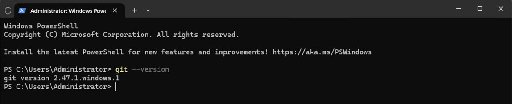
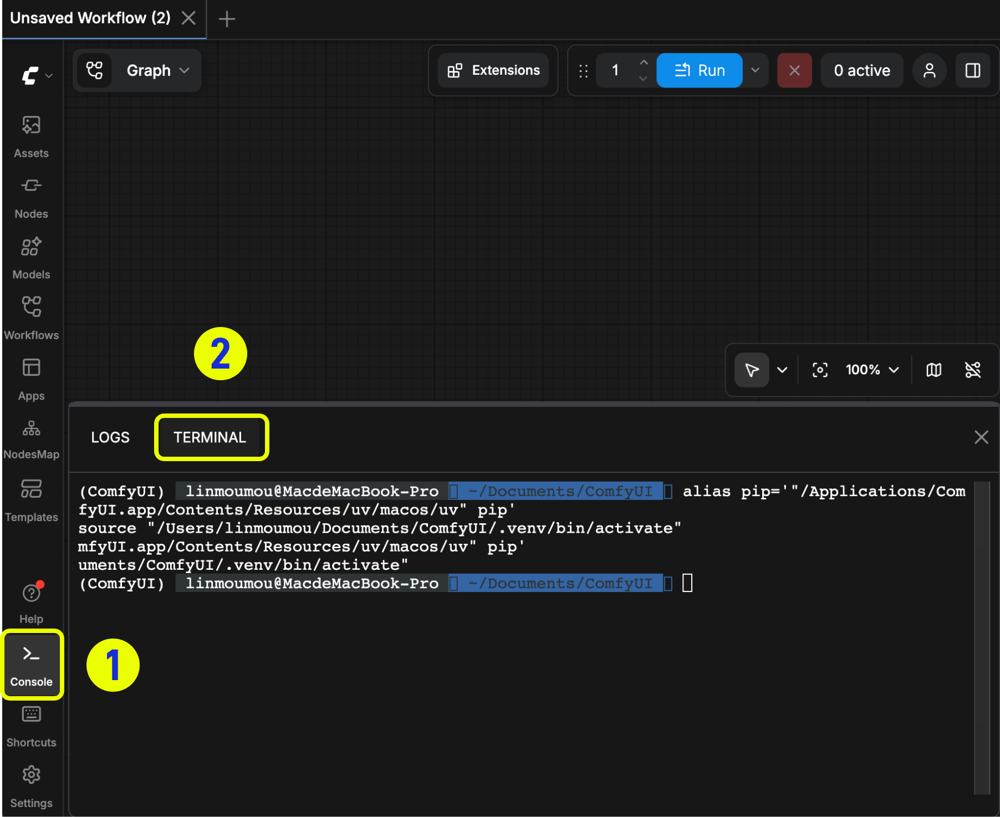
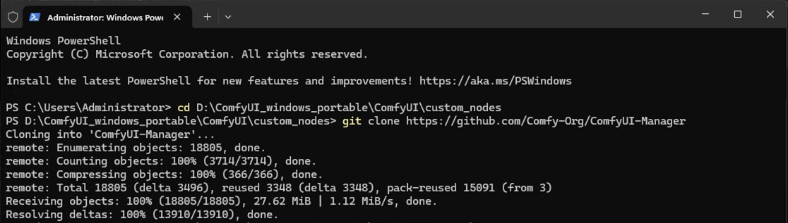
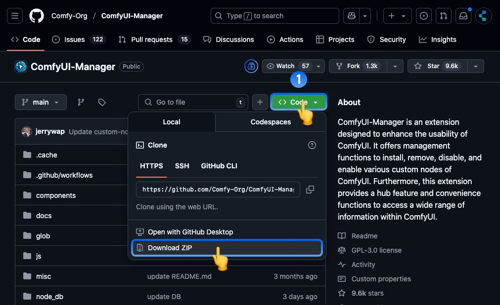
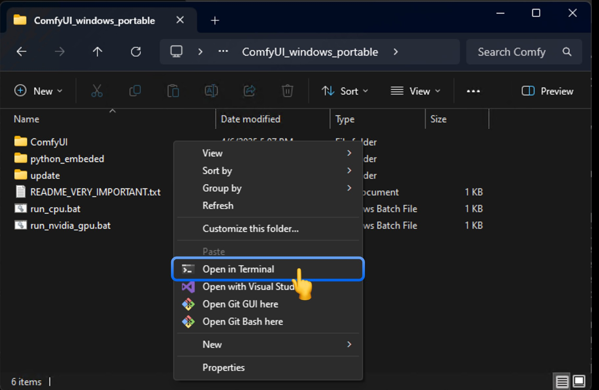
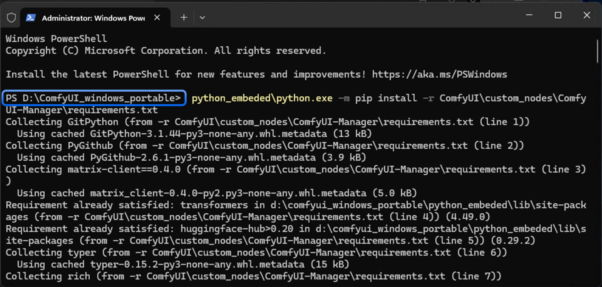
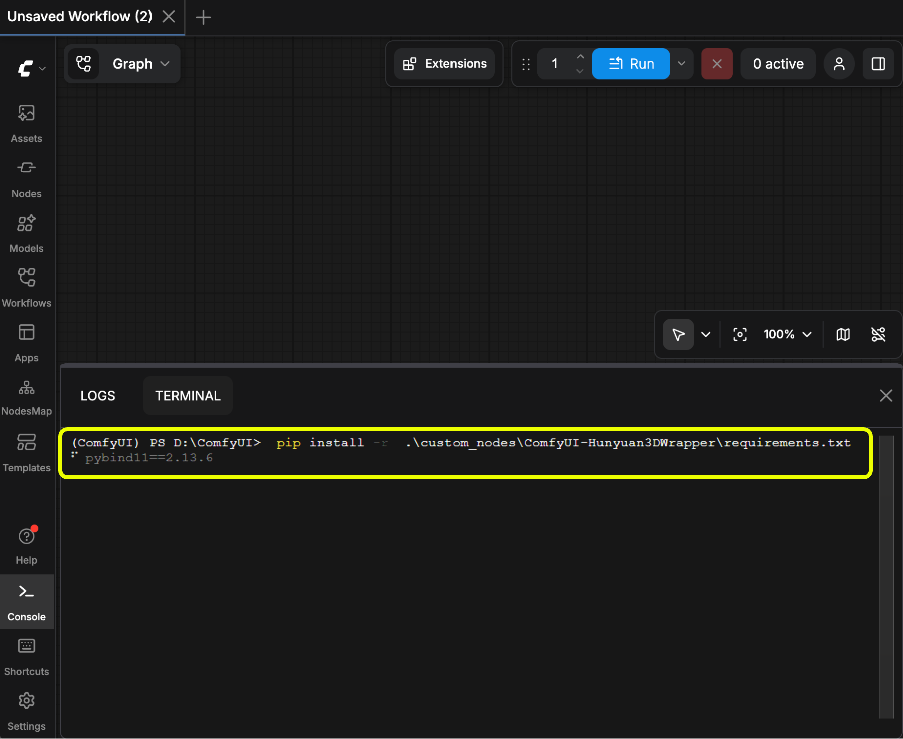
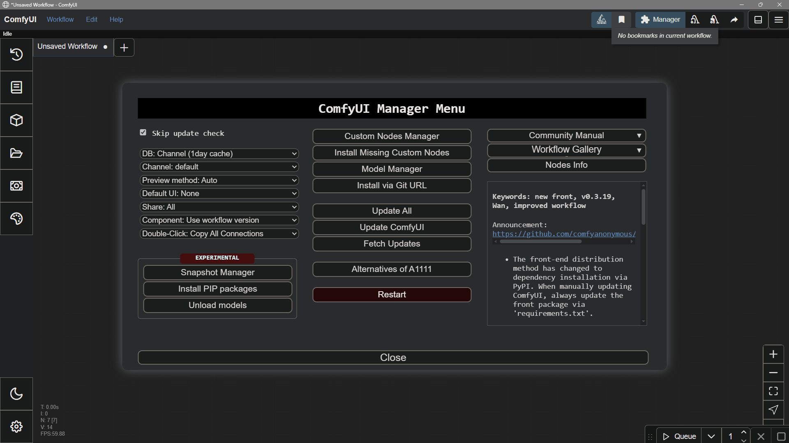

## О пользовательских узлах

После установки ComfyUI вы обнаружите, что он включает множество встроенных узлов. Эти нативные узлы называются узлами **Comfy Core**, которые официально поддерживаются ComfyUI.

Кроме того, существует множество [**пользовательских узлов**](https://registry.comfy.org), созданных разными авторами из сообщества ComfyUI. Эти пользовательские узлы привносят в ComfyUI обширную функциональность, значительно расширяя его возможности и границы функций.

В этом руководстве мы рассмотрим различные операции с пользовательскими узлами, включая установку, обновление, отключение, удаление и установку зависимостей.

Любой может разрабатывать собственные расширения для ComfyUI и делиться ими с другими. Множество пользовательских узлов сообщества вы найдете [здесь](https://registry.comfy.org). Если вы хотите разрабатывать свои пользовательские узлы, перейдите в раздел ниже, чтобы начать:

<Card title="Начать разработку пользовательских узлов" icon="link" href="/ru/custom-nodes/overview">
  Узнайте, как начать разработку пользовательского узла
</Card>

## Управление пользовательскими узлами

В этом разделе мы рассмотрим:
- Установку пользовательских узлов
- Установку зависимостей узлов
- Контроль версий пользовательских узлов
- Удаление пользовательских узлов
- Временное отключение пользовательских узлов
- Устранение конфликтов зависимостей пользовательских узлов


### 1. Установка пользовательских узлов

В настоящее время ComfyUI поддерживает несколько способов установки пользовательских узлов, в том числе:

- [Установка через ComfyUI Manager (рекомендуется)](#установить-через-comfyui-manager)
- Установка через Git
- Ручная установка

Мы рекомендуем устанавливать пользовательские узлы через **ComfyUI Manager**: это один из важнейших инструментов экосистемы пользовательских узлов ComfyUI. Он упрощает управление пользовательскими узлами (поиск, установку, обновление, отключение и удаление): достаточно найти нужный узел в ComfyUI Manager и нажать кнопку установки.

Однако поскольку все пользовательские узлы сейчас размещены на GitHub, для регионов, где доступ к GitHub затруднён, мы подготовили в этом руководстве подробные инструкции по разным способам установки пользовательских узлов.

Кроме того, поскольку для управления плагинами мы рекомендуем **ComfyUI Manager**, советуем использовать для управления плагинами именно этот инструмент. Его исходный код можно найти [здесь](https://github.com/Comfy-Org/ComfyUI-Manager).
Поэтому в этой документации мы используем установку ComfyUI Manager как пример установки пользовательского узла, а способы управления узлами с его помощью опишем в соответствующих вводных разделах.

<Tabs>

<Tab title="Установить через ComfyUI Manager">

Поскольку ComfyUI Manager обладает очень широкими возможностями, установке через него посвящён отдельный документ. Перейдите по ссылке ниже, чтобы узнать, как устанавливать пользовательские узлы с помощью ComfyUI Manager.

<Card title="Установить пользовательские узлы с помощью ComfyUI Manager" icon="link" href="/ru/installation/install_custom_node#method-1-comfyui-manager-recommended">
  Узнайте, как использовать ComfyUI Manager для установки пользовательских узлов
</Card>
</Tab><Tab title="Установка через Git">

<Steps>

<Step title="Убедиться, что Git установлен">
Сначала нужно убедиться, что Git установлен в вашей системе. Проверить наличие Git можно, введя следующую команду в терминале системы:

```bash
git --version
```

Если Git установлен, вы увидите вывод, похожий на следующий:



Если Git ещё не установлен, перейдите на [git-scm.com](https://git-scm.com/), чтобы скачать соответствующий установочный пакет. Пользователям Linux следует обратиться к [git-scm.com/downloads/linux](https://git-scm.com/downloads/linux) за инструкциями по установке.

<Tip>
Для версии Comfy Desktop можно использовать терминал Desktop, как показано ниже, чтобы завершить установку.

</Tip>
</Step>

<Step title="Клонировать код пользовательского узла в папку">

После установки Git нам понадобится адрес репозитория пользовательского узла. Здесь в качестве примера используется адрес репозитория ComfyUI-Manager:

```bash
https://github.com/Comfy-Org/ComfyUI-Manager
```

<Tip>В регионах, где нет стабильного доступа к GitHub, можно попробовать использовать другие сайты хостинга кода, например gitee, чтобы сделать форк соответствующего репозитория, а затем использовать этот адрес репозитория для установки узла.</Tip>

Сначала нужно перейти в папку пользовательских узлов ComfyUI. Если рассматривать портативную версию ComfyUI, то при расположении папки `D:\ComfyUI_windows_portable` папка пользовательских узлов должна находиться по пути `D:\ComfyUI_windows_portable\ComfyUI\custom_nodes`. Сначала нужно с помощью команды `cd` перейти в соответствующий каталог:

```bash
cd D:\ComfyUI_windows_portable\ComfyUI\custom_nodes
```

Затем с помощью команды `git clone` завершаем установку узла:

```bash
git clone https://github.com/Comfy-Org/ComfyUI-Manager
```

Если всё пройдёт гладко, вы увидите вывод, похожий на следующий:



Это означает, что вы успешно склонировали код пользовательского узла. Далее нужно установить соответствующие зависимости.
</Step>
<Step title="Установить зависимости">
Обратитесь к инструкциям в разделе [Установка зависимостей узлов](#2-установка-зависимостей-узлов), чтобы установить зависимости.
</Step>
</Steps>

</Tab><Tab title="Ручная установка">
Ручная установка не рекомендуется как основной способ, но служит запасным вариантом, когда установить через git не получается.

<Warning>
Плагины, установленные таким способом, потеряют информацию об истории версий git, и дальнейшее управление версиями будет неудобным.
</Warning>

<Steps>
<Step title="Скачать ZIP-архив с кодом пользовательского узла">

Для ручной установки нужно сначала скачать код соответствующего узла, а затем распаковать его в нужный каталог.



Перейдите на страницу репозитория соответствующего пользовательского узла:
1. Нажмите кнопку `Code`
2. Затем нажмите кнопку `Download ZIP`, чтобы скачать ZIP-архив
3. Распакуйте ZIP-архив

</Step>
<Step title="Скопировать файлы в каталог пользовательских узлов ComfyUI">
Скопируйте распакованный код из предыдущих шагов в каталог пользовательских узлов ComfyUI. На примере портативной версии ComfyUI: если папка расположена по пути `D:\ComfyUI_windows_portable`, то папку пользовательских узлов можно найти по пути `D:\ComfyUI_windows_portable\ComfyUI\custom_nodes`. Скопируйте распакованный код из предыдущих шагов в соответствующий каталог.

</Step>
<Step title="Установить зависимости">
Инструкции по установке зависимостей см. в разделе [Установка зависимостей узлов](#2-установка-зависимостей-узлов).
</Step>
</Steps>
</Tab>

</Tabs>

### 2. Установка зависимостей узлов

Все пользовательские узлы требуют установки связанных зависимостей. Например, для ComfyUI-Manager можно открыть файл [requirements.txt](https://github.com/Comfy-Org/ComfyUI-Manager/blob/main/requirements.txt) и посмотреть требования к пакетам зависимостей.

На предыдущих шагах мы только клонировали код пользовательского узла локально и не устанавливали соответствующие зависимости, поэтому далее их нужно установить.

<Note>
На самом деле, если вы используете ComfyUI-Manager для установки плагинов, ComfyUI Manager автоматически выполнит установку зависимостей. Вам нужно лишь перезапустить ComfyUI после установки плагина. Именно поэтому мы настоятельно рекомендуем устанавливать пользовательские узлы через ComfyUI Manager.

Но в некоторых ситуациях установить пользовательские узлы через ComfyUI Manager может не получиться, поэтому мы приводим это более подробное руководство по установке зависимостей.
</Note>

В главе [Зависимости](/ru/basic-concepts/dependencies) мы рассказали о зависимостях в ComfyUI. ComfyUI представляет собой проект на **Python**, и для его запуска мы создали независимое окружение выполнения **Python**. Все связанные зависимости должны быть установлены в этом независимом окружении **Python**.

Если выполнить `pip install -r requirements.txt` напрямую в системном терминале, соответствующие зависимости могут быть установлены в системное окружение **Python**, из-за чего в окружении ComfyUI они по-прежнему будут отсутствовать, и соответствующие пользовательские узлы не смогут работать нормально.

Поэтому далее нужно использовать независимое окружение выполнения Python ComfyUI, чтобы завершить установку зависимостей.

В зависимости от версии ComfyUI мы будем использовать разные способы установки соответствующих зависимостей:

<Tabs>
<Tab title="ComfyUI Portable">
Версия ComfyUI Portable использует встроенный Python, расположенный в каталоге `\ComfyUI_windows_portable\python_embeded`. Для установки зависимостей нужно использовать именно этот Python.

Сначала откройте терминал в каталоге портативной версии или после запуска терминала перейдите в каталог `\ComfyUI_windows_portable\` с помощью команды `cd`.



Убедитесь, что текущий каталог терминала: `\ComfyUI_windows_portable\`, как показано ниже для `D:\ComfyUI_windows_portable\`



Затем используйте `python_embeded\python.exe`, чтобы установить зависимости:

```bash
python_embeded\python.exe -m pip install -r ComfyUI\custom_nodes\ComfyUI-Manager\requirements.txt
```
Разумеется, вместо ComfyUI-Manager можно указать имя фактически установленного пользовательского узла, но убедитесь, что в каталоге соответствующего узла есть файл `requirements.txt`.
</Tab>

<Tab title="Comfy Desktop">

<Tip>
Поскольку в Comfy Desktop при установке уже устанавливаются ComfyUI-Manager и его зависимости, а в этом руководстве установка пользовательских узлов рассматривается на примере ComfyUI Manager, выполнять установку зависимостей ComfyUI Manager в десктопной версии на самом деле не нужно.
Если не возникнет непредвиденных проблем, рекомендуем устанавливать пользовательские узлы через ComfyUI Manager, тогда устанавливать зависимости вручную не потребуется.
</Tip>


Затем используйте следующую команду, чтобы установить зависимости для соответствующего плагина:

```bash
pip install -r .\custom_nodes\<corresponding_custom_node_name>\requirements.txt
```
Как показано ниже, это установка зависимостей для ComfyUI-Hunyuan3Dwrapper:



</Tab>

<Tab title="Пользователи с собственным окружением Python">
Если вы используете собственное окружение Python, рекомендуем выполнить `pip install -r requirements.txt`, чтобы установить зависимости.
</Tab>

</Tabs>

### Управление версиями пользовательских узлов

Управление версиями пользовательских узлов фактически основано на системе контроля версий Git. Вы можете управлять версиями узлов через Git, но ComfyUI Manager уже очень хорошо интегрировал эту функцию управления версиями. Большое спасибо [@Dr.Lt.Data](https://github.com/ltdrdata) за такой удобный инструмент.

В этом разделе мы по-прежнему объясним два разных способа управления версиями плагинов, но если вы используете ZIP-архивы для ручной установки, соответствующая информация об истории версий git будет потеряна, что сделает управление версиями невозможным.

<Tabs>

<Tab title="Управление версиями с помощью ComfyUI Manager">

<Tip>Поскольку мы продолжаем дорабатывать ComfyUI Manager, фактический последний интерфейс и шаги могут существенно измениться</Tip>

<Steps>
<Step title="Войти в интерфейс управления узлами">
Выполните соответствующие операции, как показано, чтобы войти в интерфейс ComfyUI Manager
</Step>
<Step title="Найти соответствующий пакет пользовательских узлов">
Вы можете использовать соответствующие фильтры, чтобы отобрать установленные пакеты узлов, а затем выполнить соответствующее управление узлами
</Step>
<Step title="Выполнить переключение версии">
Переключитесь на соответствующую версию. Менеджер поможет вам выполнить обновление и установку соответствующих зависимостей. Обычно после переключения версии нужно перезапустить ComfyUI, чтобы изменения вступили в силу.
</Step>
</Steps>

</Tab>

<Tab title="Управление версиями с помощью Git">

<Steps>
<Step title="Перейти в каталог через командную строку">

Найдите папку каталога, в которой находится ваш узел, например `ComfyUI/custom_nodes/ComfyUI-Manager`.
Используйте команду `cd`, чтобы войти в соответствующую папку:
```bash
cd <your_installation_directory>/ComfyUI/custom_nodes/ComfyUI-Manager
```

</Step>
<Step title="Просмотреть версии с помощью команд Git">

Вы можете использовать следующую команду, чтобы просмотреть все доступные теги и релизы:
```bash
git tag
```
Она выведет все теги версий, и вы сможете выбрать версию, на которую хотите переключиться.

</Step>
<Step title="Переключиться на указанную версию">
Используйте следующую команду, чтобы переключиться на указанный тег или релиз:
```bash
git checkout <tag_name>
```
Замените `<tag_name>` на конкретный тег версии, на которую хотите переключиться.

</Step>
<Step title="Переключиться на конкретную версию коммита">
Если вы хотите переключиться на конкретную версию коммита, используйте следующую команду:
```bash
git checkout <commit_hash>
```
Замените `<commit_hash>` на конкретный хеш коммита, на который хотите переключиться.

</Step>
<Step title="Установить зависимости">
Поскольку зависимости соответствующего пакета пользовательских узлов могут измениться после переключения версии, вам нужно переустановить зависимости для соответствующего узла. Обратитесь к инструкциям в разделе [Установка зависимостей узлов](#2-установка-зависимостей-узлов), чтобы войти в соответствующую среду для установки.
</Step>
</Steps>

</Tab>

</Tabs>

### Удаление пользовательских узлов

Будет обновлено

### Временно отключить пользовательские узлы

Будет обновлено

### Конфликты зависимостей пользовательских узлов

Будет обновлено

## ComfyUI Менеджер



Сейчас этот инструмент включён по умолчанию в [десктопной версии](/ru/installation/desktop/overview#установить-comfy-desktop-для-вашей-ос), тогда как в [портативной версии](/ru/installation/comfyui_portable_windows) вам нужно обратиться к инструкциям по установке в разделе [Установить менеджер](#1-установка-пользовательских-узлов) этого документа.

<Note>
По мере развития ComfyUI ComfyUI Manager играет всё более важную роль в ComfyUI. В настоящее время ComfyUI-Manager официально присоединился к организации Comfy Org, официально став частью основных зависимостей ComfyUI, и продолжает поддерживаться оригинальным автором [Dr.Lt.Data](https://github.com/ltdrdata). Для получения дополнительной информации можно прочитать [этот пост в блоге](https://blog.comfy.org/p/comfyui-manager-joins-comfy-org).
В будущих итерациях мы значительно оптимизируем использование ComfyUI Manager, поэтому интерфейс, показанный в этой документации, может отличаться от последней версии ComfyUI Manager.
</Note>

### Установить менеджер

Если вы запускаете серверное приложение ComfyUI, вам нужно установить менеджер. Если ComfyUI запущен, закройте его перед продолжением.

Первым шагом будет установка Git, приложения командной строки для контроля версий программного обеспечения. Git загрузит менеджер ComfyUI с [github.com](https://github.com). Скачайте и установите Git с [git-scm.com](https://git-scm.com/).

После установки Git перейдите в каталог серверной программы ComfyUI и откройте папку с названием **custom_nodes**. Откройте окно командной строки или терминал. Убедитесь, что в командной строке текущим каталогом указан **custom_nodes**. Выполните следующую команду, чтобы клонировать репозиторий ComfyUI-Manager:

```bash
git clone https://github.com/Comfy-Org/ComfyUI-Manager.git
```

Это загрузит менеджер. Технически это называется _клонированием Git-репозитория_.

### Найти отсутствующие узлы

После установки менеджера вы можете найти отсутствующие узлы с помощью менеджера.


## Разработать пользовательский узел

Если у вас есть навыки разработки, начните с документации ниже, чтобы узнать, как приступить к разработке пользовательского узла.

<Card title="Начать разработку пользовательских узлов" icon="link" href="/ru/custom-nodes/overview">
  Узнайте, как начать разработку пользовательского узла
</Card>
