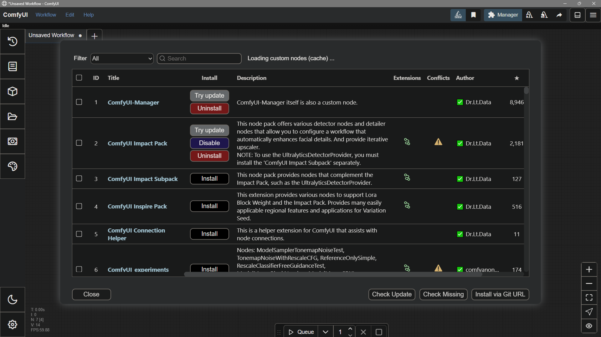

{/*
description: "Разберитесь в зависимостях ресурсов и ПО в ComfyUI"
*/}

## Рабочий процесс зависит от других файлов

Мы часто берём различные файлы рабочих процессов у сообщества, но нередко обнаруживаем, что после загрузки рабочий процесс не запускается сразу. Это происходит потому, что файл рабочего процесса зависит не только от самого рабочего процесса, но и от других файлов: входных медиаассетов, моделей, пользовательских узлов, связанных зависимостей Python и т. д.
Рабочие процессы ComfyUI работают нормально только тогда, когда удовлетворены все соответствующие зависимости.

Зависимости рабочих процессов ComfyUI в основном делятся на следующие категории:

- Ассеты (медиафайлы, включая аудио, видео, изображения и другие входы)
- Пользовательские узлы
- Зависимости Python
- Модели (например, модели Stable Diffusion и т. д.)

## Ассеты

Модель ИИ является примером **_ассета_**. В медиапроизводстве ассет представляет собой медиафайл, который служит источником входных данных. Например, программа для видеомонтажа работает с видеофайлами, хранящимися на диске. Файл проекта программы монтажа содержит ссылки на эти ассеты видеофайлов, что позволяет выполнять недеструктивный монтаж без изменения исходных видеофайлов.

ComfyUI работает так же. Рабочий процесс может выполняться только в том случае, если все необходимые ассеты найдены и загружены. Генеративные модели ИИ, изображения, фильмы и звуки являются примерами ассетов, от которых может зависеть рабочий процесс. Поэтому они называются **_зависимыми ассетами_** или **_зависимостями ассетов_**.

## Пользовательские узлы

Пользовательские узлы являются важным компонентом ComfyUI и расширяют его функциональность. Их создаёт сообщество: такие узлы можно установить, чтобы добавить новые возможности в ваши рабочие процессы.

## Зависимости Python

ComfyUI написан на Python. Для запуска ComfyUI мы собираем отдельное окружение Python, и все связанные зависимости устанавливаются именно в это изолированное окружение.

### Зависимости ComfyUI

Текущие зависимости ComfyUI можно посмотреть в файле [requirements.txt](https://github.com/Comfy-Org/ComfyUI/blob/master/requirements.txt):

{/* Примечание: это требования на момент написания, а не обязательно самая последняя обновлённая версия. Актуальную версию смотрите по ссылке на GitHub выше. */}

```text
comfyui-frontend-package==1.49.6
comfyui-workflow-templates==0.11.48
comfyui-embedded-docs==0.5.10
torch
torchsde
torchvision
torchaudio
numpy>=1.25.0
einops
transformers>=4.50.3
tokenizers>=0.13.3
sentencepiece
safetensors>=0.4.2
aiohttp>=3.11.8
yarl>=1.18.0
pyyaml
Pillow
scipy
tqdm
psutil
alembic
SQLAlchemy>=2.0.0
filelock
av>=17.0.0
comfy-kitchen==0.2.31
comfy-aimdo==0.4.15
requests
simpleeval>=1.0.0
blake3

#не основные зависимости:
kornia>=0.7.1
spandrel
pydantic~=2.0
pydantic-settings~=2.0
PyOpenGL>=3.1.8
comfy-angle
```

По мере развития ComfyUI мы можем соответствующим образом корректировать зависимости: добавлять новые или удалять те, которые больше не нужны.
Поэтому, если вы обновляете ComfyUI через Git, после получения последних обновлений нужно выполнить следующую команду в соответствующем окружении:

```bash
pip install -r requirements.txt
```

Это гарантирует, что зависимости ComfyUI актуальны и программа работает корректно. Вы также можете изменить версии конкретных пакетов, чтобы обновить или откатить отдельные зависимости.

Кроме того, фронтенд ComfyUI [ComfyUI_frontend](https://github.com/Comfy-Org/ComfyUI_frontend) сейчас поддерживается как отдельный проект. Мы обновляем версию зависимости `comfyui-frontend-package` после того, как соответствующая версия стабилизируется. Если вам нужно переключиться на другую версию фронтенда, информацию о версиях можно посмотреть [здесь](https://pypi.org/project/comfyui-frontend-package/#history).

### Зависимости пользовательских узлов

Благодаря усилиям многих авторов из сообщества ComfyUI мы можем расширять функциональность ComfyUI с помощью различных пользовательских узлов, открывая впечатляющие возможности для творчества.

Обычно у каждого пользовательского узла есть свои зависимости и отдельный файл `requirements.txt`.
Если вы устанавливаете пользовательские узлы через [ComfyUI Manager](https://github.com/Comfy-Org/ComfyUI-Manager), ComfyUI Manager обычно автоматически устанавливает нужные зависимости.

Бывают и случаи, когда зависимости приходится устанавливать вручную. Сейчас все пользовательские узлы устанавливаются в каталог `ComfyUI/custom_nodes`.

Нужно перейти в каталог соответствующего плагина в окружении Python ComfyUI и выполнить `pip install -r requirements.txt`, чтобы установить зависимости.

Если вы используете [Windows Portable версию](/ru/installation/comfyui_portable_windows), можно выполнить следующую команду в каталоге `ComfyUI_windows_portable`:
```
python_embeded\python.exe -m pip install -r ComfyUI\custom_nodes\<custom_node_name>\requirements.txt
```
чтобы установить зависимости для соответствующего узла.

### Конфликты зависимостей

Конфликты зависимостей часто возникают при использовании ComfyUI. Вы можете обнаружить, что после установки или обновления пользовательского узла ранее установленные пользовательские узлы больше не находятся в библиотеке нод ComfyUI или появляются всплывающие окна с ошибками. Одна из возможных причин: конфликты зависимостей.

Причин конфликтов зависимостей может быть много, например:

1. Фиксация версии пользовательского узла

Некоторые плагины могут фиксировать точную версию библиотеки-зависимости (например, `open_clip_torch==2.26.1`), тогда как другим плагинам может требоваться более высокая версия (например, `open_clip_torch>=2.29.0`), из-за чего удовлетворить оба требования к версии одновременно невозможно.

**Решение**: можно попробовать заменить зависимость с фиксированной версией на ограничение диапазоном, например `open_clip_torch>=2.26.1`, а затем переустановить зависимости, чтобы решить эти проблемы.

2. Загрязнение окружения

При установке зависимостей пользовательских узлов могут перезаписываться версии библиотек, уже установленных другими плагинами. Например, несколько плагинов могут зависеть от `PyTorch`, но требовать разные версии CUDA, и плагин, установленный позже, нарушит работу существующего окружения.

**Решения**:
- Можно попробовать вручную установить конкретные версии зависимостей в виртуальном окружении Python, чтобы решить такие проблемы.
- Или запустить второй экземпляр ComfyUI в собственном окружении Python, когда нужны несовместимые версии: плагины загружаются в то окружение, в котором работает сам ComfyUI, поэтому одно лишь отдельное окружение не поможет.
- Попробуйте устанавливать плагины по одному, перезапуская ComfyUI после каждой установки, чтобы отследить, возникают ли конфликты зависимостей.

3. Версии зависимостей пользовательских узлов несовместимы с версиями зависимостей ComfyUI

Такие конфликты зависимостей может быть сложнее решить, и, возможно, потребуется обновить или откатить ComfyUI либо изменить версии зависимостей пользовательских узлов.

**Решение**: такие конфликты зависимостей может быть сложнее решить, и, возможно, потребуется обновить или откатить ComfyUI либо изменить версии зависимостей пользовательских узлов.

## Модели

Модели являются важным ресурсом, от которого зависит ComfyUI. Различные пользовательские узлы и рабочие процессы строятся вокруг конкретных моделей, таких как серия Stable Diffusion, серия Flux, Ltxv и другие.
Эти модели служат основной базой для создания с помощью ComfyUI, поэтому необходимо убедиться, что используемые вами модели доступны должным образом. Обычно наши модели сохраняются в соответствующем каталоге внутри `ComfyUI/models/`. Конечно, вы также можете создать [extra_model_paths.yaml](https://github.com/Comfy-Org/ComfyUI/blob/master/extra_model_paths.yaml.example), изменив шаблон, чтобы ComfyUI распознавал дополнительные пути к моделям.
Это позволяет нескольким экземплярам ComfyUI совместно использовать одну и ту же библиотеку моделей, снижая использование дискового пространства.

## Программное обеспечение

У такого расширенного приложения, как ComfyUI, также есть **_программные зависимости_**. Это библиотеки программного кода и данных, необходимые для работы приложения. Пользовательские узлы служат примером программных зависимостей. На ещё более фундаментальном уровне самой главной зависимостью ComfyUI является среда программирования Python. Для запуска конкретной версии ComfyUI требуется правильная версия Python. Обновления Python, ComfyUI и пользовательских узлов можно выполнять в окне **ComfyUI Manager**.


