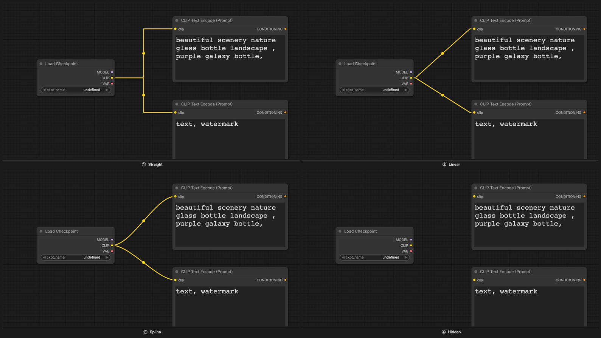
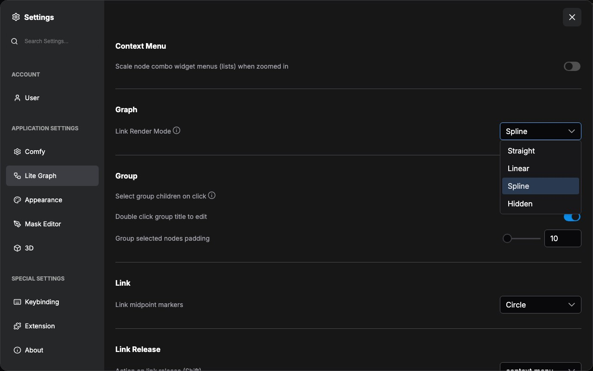
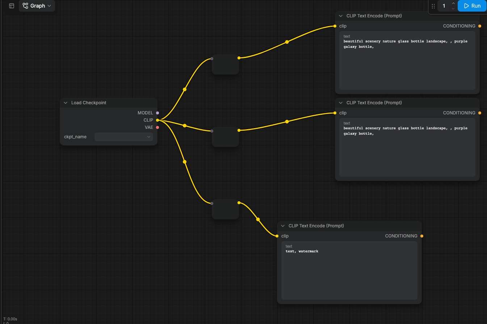
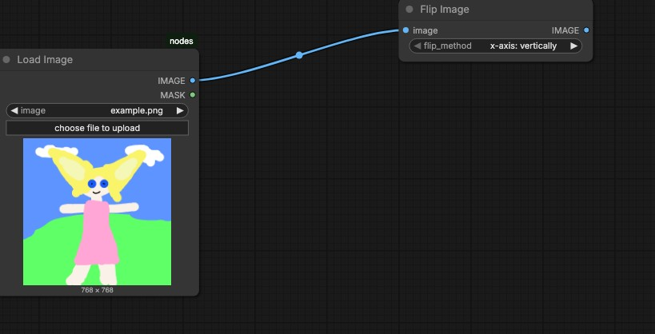
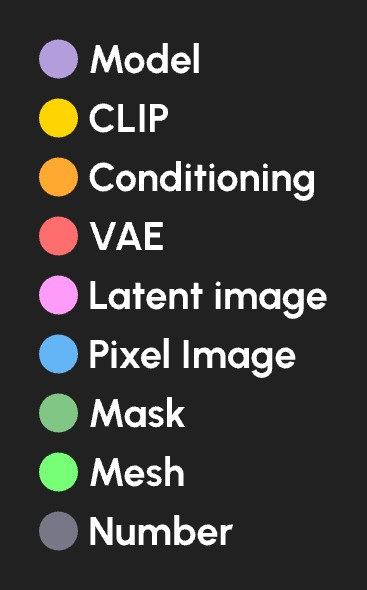

## Связи соединяют узлы

В ComfyUI линии или кривые, нарисованные между узлами, называются **_связями_** (также их называют **_соединениями_** или проводами). Они передают данные с выхода одного узла на вход другого, определяя поток вашего рабочего процесса.

Связи могут отображаться в нескольких визуальных стилях: кривые, прямые углы, прямые линии или полностью скрыты.

Чтобы изменить стиль связей, перейдите в **Setup Menu** → **Display (Lite Graph)** → **Graph** → **Link Render Mode**.

Также можно временно скрыть все связи через **Canvas Menu**.

<Tip>
Отображение связей особенно полезно при изучении, публикации или отладке рабочего процесса. Оно делает поток данных видимым с первого взгляда. В готовых рабочих процессах, которые не предназначены для редактирования, скрытие связей помогает уменьшить визуальный беспорядок.
</Tip>

### Узел Reroute

Когда рабочий процесс усложняется, провода связей могут пересекаться или проходить позади узлов, из-за чего читать его становится сложно. Узел **Reroute** позволяет вручную направить провод через любую точку двумерного пространства графа, сохраняя компоновку чистой и удобочитаемой.

В ComfyUI также есть встроенная функция перенаправления на холсте графа. Для новых рабочих процессов мы рекомендуем использовать именно её.

## Цветовая кодировка

Каждый тип данных в ComfyUI имеет собственный цвет. Порты входа и выхода узлов, а также соединяющие их провода связей используют одну и ту же цветовую схему. **Соединять можно только порты одного цвета**. Это обеспечивает типобезопасность во всём рабочем процессе.

| Тип данных                        | Цвет          |
|-----------------------------------|---------------|
| Диффузионная модель               | Лавандовый    |
| Модель CLIP                       | Жёлтый        |
| Модель VAE                        | Розово-красный|
| Условие                           | Оранжевый     |
| Латентное изображение             | Розовый       |
| Пиксельное изображение            | Синий         |
| Маска                             | Зелёный       |
| Число (целое или с плавающей точкой) | Серый      |
| Сетка                             | Ярко-зелёный  |