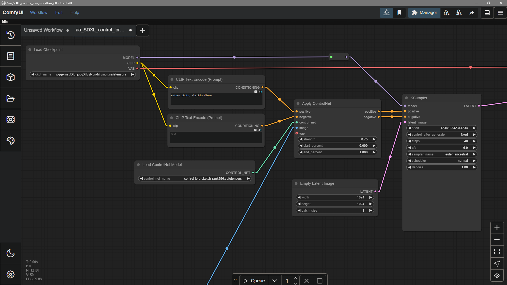

import ExternalModels from "/snippets/ru/install/add-external-models.mdx"

## Модели простыми словами

В ComfyUI **модели** представляют собой файлы весов, которые фактически выполняют ваш рабочий процесс. К ним относятся **чекпойнты**, **VAE**, **LoRA**, **ControlNet** и апскейлеры. Само приложение занимает мало места. Эти файлы **не** входят в комплект по умолчанию. Обычно вы **скачиваете их из интернета**, кладёте в `ComfyUI/models/` (или следуете подсказкам шаблона), а затем выбираете файл в нужном **узле-загрузчике** (на холсте они часто выглядят как узлы, имена которых начинаются с **Load**).

### Поддерживаемые модели в ComfyUI

- **Встроенная поддержка от разработчиков намеренно ограничена**, но постепенно расширяется по мере развития ComfyUI и экосистемы открытого исходного кода. Когда модель получает полноценную поддержку, вы **обычно видите новую запись в [библиотеке шаблонов рабочих процессов](/ru/interface/features/template)**, где показаны ожидаемый граф и подходящая модель.
- **Не каждый чекпойнт или файл весов работает сразу.** Для **моделей с нативной поддержкой и их типичных сопутствующих весов** держите ComfyUI **[обновлённым](/ru/installation/update_comfyui)** и убедитесь, что подходящий рабочий процесс есть в **[библиотеке шаблонов](/ru/interface/features/template)**, прежде чем решать, что ваши файлы лежат не в том месте.
- **Многие другие модели подключаются через пользовательские узлы сообщества.** Пути, узлы-загрузчики и структура графа могут отличаться от общих указаний про `ComfyUI/models/` на этой странице. **Всегда следуйте README или документации проекта.** ComfyUI легко расширяется, поэтому реализации у разных авторов различаются. Об установке и решении проблем см. [Как установить пользовательские узлы](/ru/installation/install_custom_node).

## Использовать модели в ComfyUI

1. **Поместите файлы в нужное место.** Скачайте их с сайтов сообщества, например с [Hugging Face](https://huggingface.co), [Civitai](https://civitai.green) или со страницы проекта на [GitHub](https://github.com), а затем положите в `ComfyUI/models/` в подпапку, соответствующую типу модели (например, `checkpoints`, `loras`, `vae`).
2. **Добавьте соответствующий узел-загрузчик.** Выберите загрузчик для этого типа модели (checkpoint, LoRA, VAE и т. д.). В списке узлов их названия часто начинаются с **Load**.
3. **Выберите файл** в выпадающем списке этого узла-загрузчика.
4. **Подключите узел-загрузчик** к остальному графу. Если вы копировали файлы вручную, пока ComfyUI был открыт, **перезапустите** приложение (или обновите по необходимости), чтобы списки обновились.

### Учитывайте большие объёмы загрузки

Одна генеративная модель часто занимает **много гигабайт**. Заранее оцените место на диске и время, необходимое для загрузки или синхронизации.

## Помимо основного чекпойнта

Основной диффузионный чекпойнт делает многое, но многие рабочие процессы добавляют **более мелкие вспомогательные модели**, например:

- **LoRA**: лёгкие дополнения, настроенные на стиль, персонажа или концепцию
- **ControlNet**: дополнительное направление по рёбрам, глубине, позе и т. д.
- **Инпейтинг**: заливка или замена областей внутри существующего изображения

## Удалить модели

В интерфейсе пока нет кнопки «удалить». Чтобы удалить модель, **удалите её файл** (или файлы) из папки внутри `ComfyUI/models/`, куда вы её поместили.

<ExternalModels />

## Частые проблемы

<AccordionGroup>
  <Accordion title="Поддерживает ли ComfyUI модели в формате GGUF?">
    ComfyUI не поддерживает модели в формате GGUF нативно. Чтобы использовать модели GGUF, необходимо установить пользовательские узлы от сообщества, например [ComfyUI-GGUF](https://github.com/city96/ComfyUI-GGUF).
  </Accordion>

  <Accordion title="Почему я не вижу свою модель?">
    Если вы установили модель, но не можете найти её в ComfyUI, выполните следующие шаги:

    - Убедитесь, что модель находится в правильном месте:
      - Путь по умолчанию: `ComfyUI/models/` (например, `checkpoints`, `loras`, `vae`)
      - Для **Comfy Desktop**: нажмите на меню-капсулу в верхней части приложения, затем откройте вкладку **Storage**, чтобы проверить каталоги моделей. Капсула есть только в десктопном приложении, но не при запуске ComfyUI в браузере.

      
    - Нажмите клавишу `r`, чтобы обновить определения узлов, и ComfyUI сможет обнаружить модель
    - Перезапустите ComfyUI
    - Убедитесь, что в узле загрузки выбрана правильная модель
  </Accordion>
</AccordionGroup>

## Хотите немного больше контекста?

<AccordionGroup>
  <Accordion title="Что здесь понимается под «моделью»?">
    Здесь **модель** это файл данных, в котором закодировано то, чему научилась сеть. В нём достаточно информации, чтобы превращать входы (например, текст и шум) в выходы (например, изображение). Типичные примеры в рабочих процессах с изображениями: диффузионные чекпойнты, текстовые и визуальные энкодеры, такие как **CLIP**, и **апскейлеры** вроде RealESRGAN.
  </Accordion>

  <Accordion title="Базовые модели и варианты от сообщества">
    Крупные **базовые** модели от лабораторий и open-source проектов являются универсальными. Сообщество часто **дообучает** их или объединяет в новые чекпойнты и LoRA, которые лучше выглядят в определённом стиле, работают немного легче или добавляют новое поведение. Это похоже на выбор любимого чекпойнта на Civitai или Hugging Face.
  </Accordion>
</AccordionGroup>
