В ComfyUI узлы являются основными строительными блоками для выполнения задач. Каждый узел представляет собой независимо созданный модуль, будь то узел **Comfy Core** или **Custom Node**, с собственной уникальной функциональностью. Узлы соединяются друг с другом через связи, что позволяет строить сложную функциональность, словно собирая конструктор LEGO.
Комбинации разных узлов создают безграничные возможности ComfyUI.

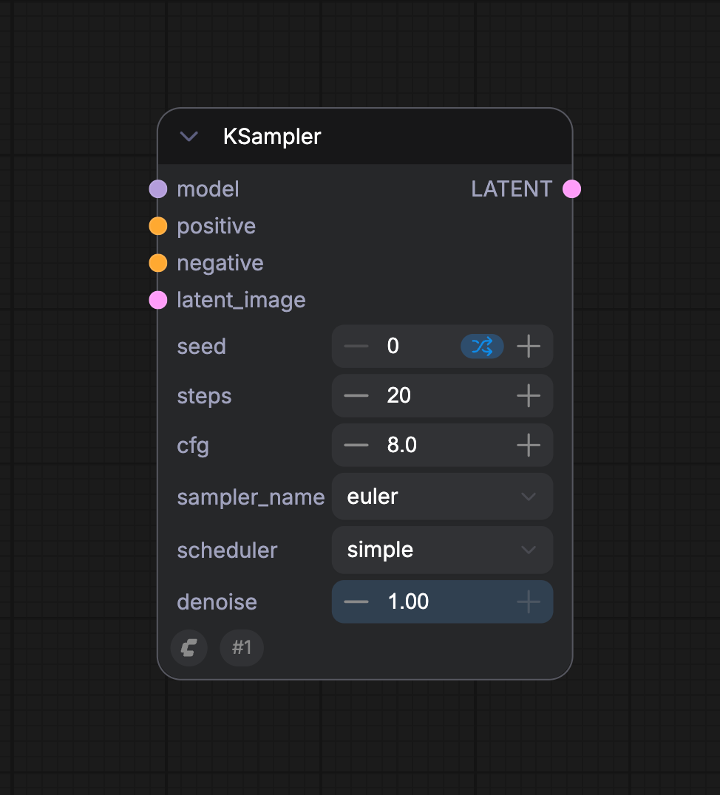

Например, у узла K-Sampler, как вы можете видеть, есть несколько входов и выходов, а также множество настроек параметров. Эти параметры определяют логику выполнения узла. За каждым узлом стоит хорошо написанная логика на Python, позволяющая получить нужную функциональность без необходимости писать код самостоятельно.

<Note>
ComfyUI активно развивается, поэтому некоторые детали здесь могут быть устаревшими. Если вы заметили, что что-то изменилось, [помогите нам обновить документацию](https://github.com/Comfy-Org/docs).
</Note>

## Узлы выполняют операции

В информатике **_узел_** представляет собой контейнер для информации, обычно содержащий запрограммированные инструкции для выполнения некоторой задачи. Узлы почти никогда не существуют изолированно: они почти всегда соединены с другими узлами в сетевом графе. В ComfyUI узлы имеют визуальную форму блоков, соединённых друг с другом.

Узлы ComfyUI обычно являются **_функциональными операторами_**. Это означает, что они работают с некоторыми данными, чтобы выполнить функцию. Функция представляет собой процесс, который принимает входные данные, выполняет над ними некоторую операцию и создаёт выходные данные. Иными словами, узлы выполняют некоторую работу, способствуя выполнению задачи, например генерации изображения. Поэтому узлы ComfyUI почти всегда имеют хотя бы один вход или выход и обычно имеют несколько входов и выходов.

## Различные состояния узлов

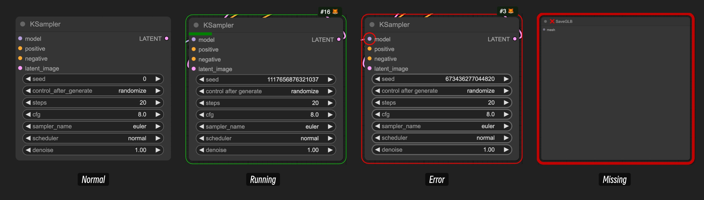

В ComfyUI узлы могут находиться в нескольких состояниях. Ниже перечислены некоторые распространённые состояния узлов:

1. **Обычное состояние**: состояние по умолчанию
2. **Состояние выполнения**: состояние выполнения, обычно отображается, когда узел выполняется после запуска рабочего процесса
3. **Состояние ошибки**: ошибка узла, обычно отображается после запуска рабочего процесса, если есть проблема с входом узла; при этом проблемный входной узел помечается красным. Нужно исправить проблемный вход, чтобы рабочий процесс выполнился корректно
4. **Состояние «Отсутствует»**: это состояние обычно появляется после импорта рабочих процессов, возможны два варианта:
    - Отсутствует встроенный узел Comfy Core: обычно это происходит потому, что ComfyUI был обновлён, а вы используете более старую версию ComfyUI. Чтобы решить эту проблему, нужно обновить ComfyUI
    - Отсутствует пользовательский узел: рабочий процесс использует пользовательские узлы, созданные сторонними авторами, но в вашей локальной версии ComfyUI эти пользовательские узлы не установлены. Найти и установить их можно с помощью [ComfyUI Manager](/ru/manager/overview) или воспользоваться другими способами, описанными в разделе [Как установить пользовательские узлы](/ru/installation/install_custom_node)

## Связи между узлами

В ComfyUI узлы соединяются через [связи](/ru/basic-concepts/links), что позволяет данным одного типа передаваться между различными обрабатывающими блоками для получения итогового результата.

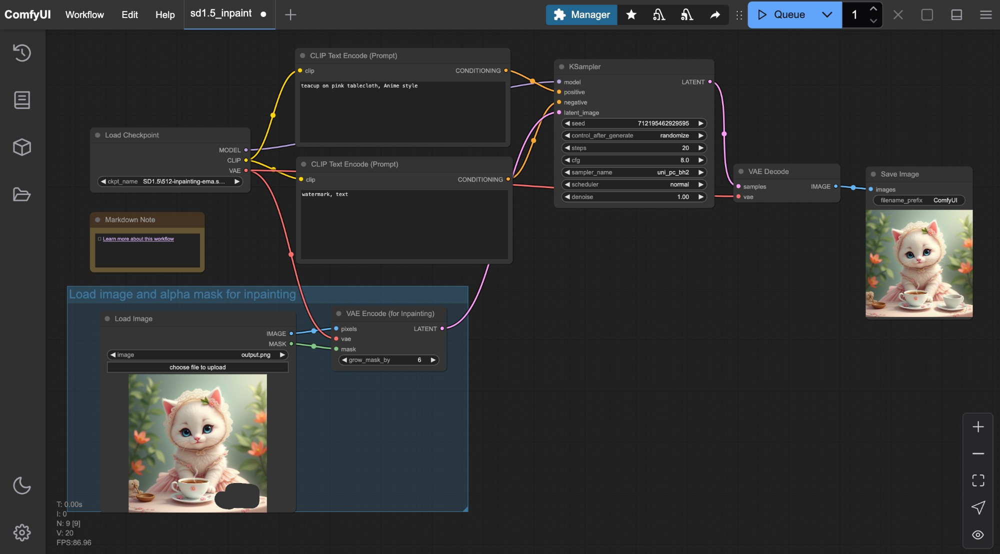

Каждый узел получает некоторые входные данные, обрабатывает их своим модулем и преобразует в соответствующие выходные данные. Связи между разными узлами должны соответствовать требованиям к типам данных. В ComfyUI для различения типов данных узлов используются разные цвета. Ниже приведены некоторые основные типы данных:

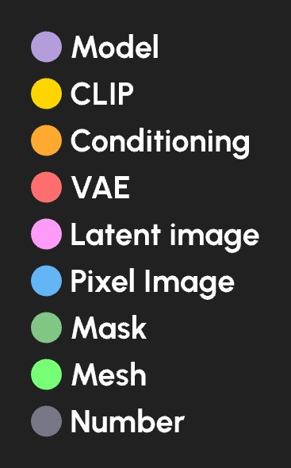

| Тип данных                         | Цвет                                                                                                              |
|------------------------------------|--------------------------------------------------------------------------------------------------------------------|
| диффузионная модель                | лавандовый                                                                                                         |
| модель CLIP                        | жёлтый                                                                                                             |
| модель VAE                         | розовый                                                                                                            |
| условие                            | оранжевый                                                                                                          |
| латентное изображение              | розовый                                                                                                            |
| пиксельное изображение             | синий                                                                                                              |
| маска                              | зелёный                                                                                                            |
| число (целое или с плавающей точкой) | серый                                                                                                            |
| сетка                              | ярко-зелёный                                                                                                       |

По мере развития ComfyUI мы можем добавлять новые типы данных, чтобы охватить больше сценариев.

### Подключение и отключение узлов

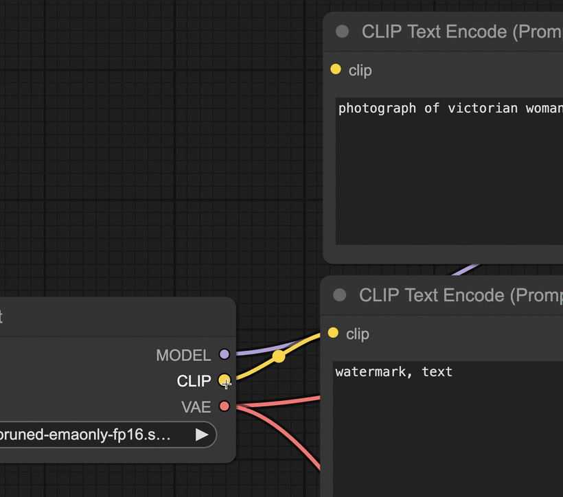

**Подключение**: перетащите от выходной точки одного узла к входу того же цвета на другом узле, чтобы соединить их
**Отключение**: нажмите на входную точку и перетащите левой кнопкой мыши, чтобы разорвать связь, или отмените соединение через меню в средней точке связи

## Внешний вид узла

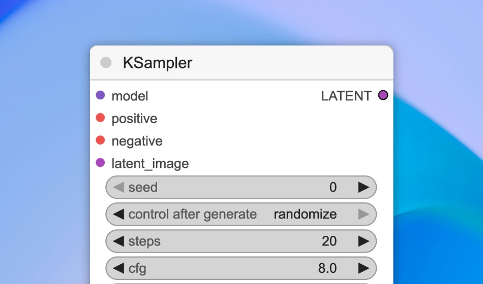

Мы предоставляем различные настройки стиля, чтобы вы могли настроить внешний вид узлов:
- Изменяйте стили
- Дважды щёлкните по заголовку узла, чтобы изменить имя узла
- Измените размер узла, перетаскивая любой угол

<video
  controls
  className="w-full aspect-video"
  src="/images/concepts/node/node_appearance.mp4"
></video>

### Значки узлов

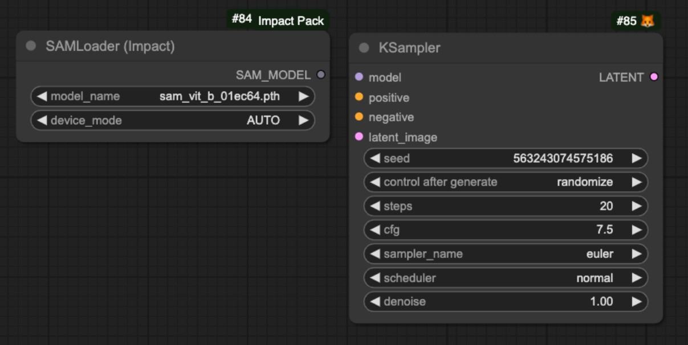

Мы предоставляем несколько вариантов отображения значков узлов, например:
- ID узла
- Источник узла

В настоящее время **узлы Comfy Core** отображаются со значком лисы, а пользовательские узлы используют свои имена. Так вы можете быстро понять, из какого пакета узлов взят узел.

Настроить соответствующий показ можно в меню:

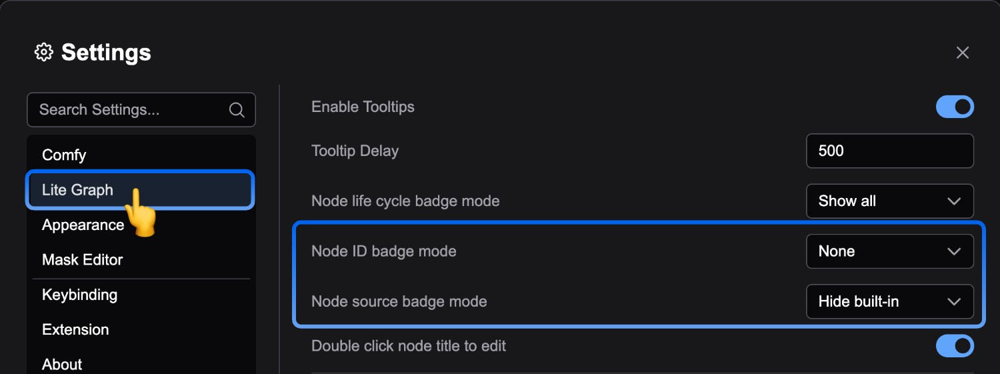

## Контекстные меню узлов

Контекстные меню узлов делятся в основном на два типа:
- Контекстное меню самого узла
- Контекстное меню для входов и выходов

### Контекстное меню узла

Щёлкнув правой кнопкой мыши по узлу, вы можете развернуть соответствующее контекстное меню узла:
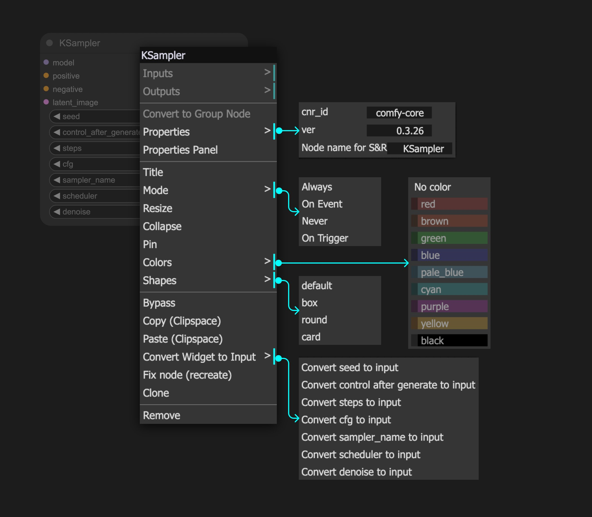

В контекстном меню узла, открываемом правой кнопкой мыши, можно:
- Настроить цветовой стиль узла
- Изменить заголовок
- Клонировать, копировать или удалить узел
- Задать режим узла

В этом меню, помимо настроек внешнего вида, важны следующие операции:

- **Mode**: задать режим узла: Always, Never, Bypass

#### Режим
Что касается режимов, вы можете заметить, что сейчас доступно четыре режима: Always, Never, On Event и On Trigger, но фактически работают только **Always** и **Never**. **On Event** и **On Trigger** пока не действуют, поскольку эта функция ещё не реализована полностью. Кроме того, **Bypass** тоже можно считать режимом. Ниже приведено описание доступных режимов:

- **Always**: режим узла по умолчанию. Узел выполняется при первом запуске, а также когда после последнего выполнения изменился хотя бы один из его входов
- **Never**: узел не будет выполняться ни при каких обстоятельствах, как будто он был удалён. Последующие узлы не могут прочитать или получить из него какие-либо данные
- **Bypass**: узел не будет выполняться ни при каких обстоятельствах, но последующие узлы всё равно могут попытаться получить данные, не обработанные этим узлом

Ниже приведено сравнение режимов `Never` и `Bypass`:

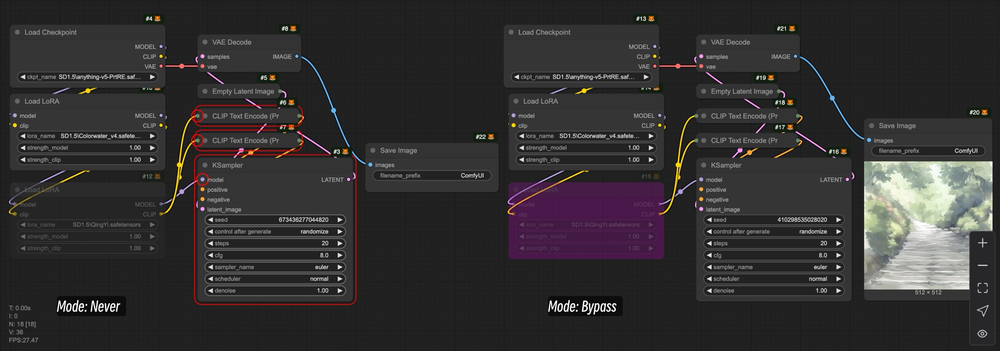

В этом примере видно, что в обоих рабочих процессах одновременно применяются две модели LoRA, а разница в том, что один узел `Load LoRA` установлен в режим `Never`, а другой в режим `Bypass`.
- Узел в режиме `Never` приводит к тому, что последующие узлы выдают ошибки, так как не получают входных данных
- Узел в режиме `Bypass` по-прежнему позволяет последующим узлам получать необработанные данные, поэтому они загружают выходные данные первого узла `Load LoRA`, и дальнейший рабочий процесс продолжает выполняться нормально

#### Разрешение предпросмотра изображения

В [Nodes 2.0](/ru/interface/nodes-2) узел с одним изображением показывает изображения больше 1024 px как уменьшенную копию. Выберите **Показать в полном разрешении** (Show Full Resolution) в контекстном меню узла, чтобы загрузить оригинал, и **Показать уменьшенный предпросмотр** (Show Downscaled Preview), чтобы вернуться. Переключатель появляется только при включённом параметре **Уменьшать большие предпросмотры изображений** (Downscale large image previews) в настройках LiteGraph (это значение по умолчанию). Узлы с несколькими выходами изображений такого переключателя не имеют и подчиняются этой настройке. Требуется фронтенд ComfyUI версии 1.61.3 или новее.

### Контекстное меню входов и выходов

Это контекстное меню в основном связано с типом данных соответствующего входа или выхода:

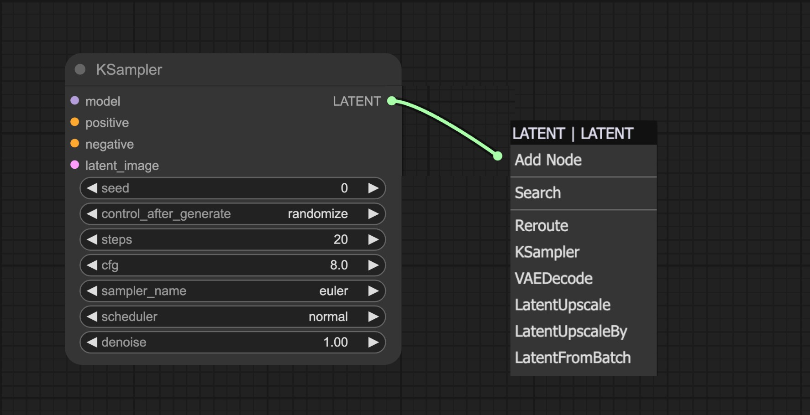

Если при перетаскивании входа или выхода узла появляется соединение, но вы не подключили его к входу или выходу другого узла, то при отпускании кнопки мыши откроется контекстное меню для этого входа или выхода, с помощью которого можно быстро добавить узлы подходящих типов.
Количество предлагаемых узлов можно настроить в настройках:

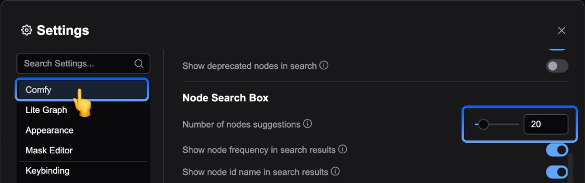

## Панель инструментов выбора узла

<video
  controls
  className="w-full aspect-video"
  src="/images/concepts/node/selection_toolbox.mp4"
></video>

**Панель инструментов выбора узла** — это плавающая панель, которая предоставляет быстрые операции для узлов. Когда вы выбираете узел, она появляется над выбранным узлом. С её помощью можно:
- Изменить цвет узла
- Быстро переключить узел в режим Bypass (не выполнять при запуске)
- Заблокировать узел
- Удалить узел

Конечно, эти функции также доступны в контекстном меню соответствующего узла. Панель инструментов выбора узла лишь предоставляет быстрый способ выполнения этих операций. Если вы хотите отключить эту функцию, её можно выключить в настройках.

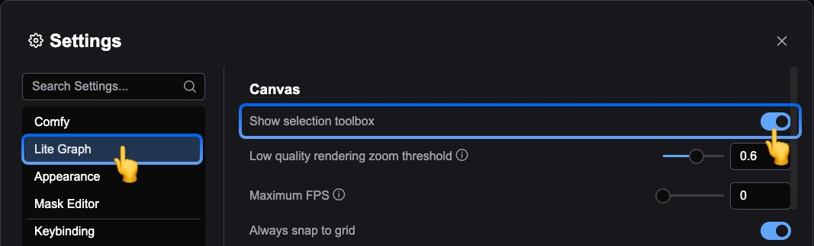

## Подграфы

Можно свернуть выбранные узлы в один переиспользуемый узел подграфа, чтобы упорядочить сложные графы и использовать одну и ту же структуру в разных рабочих процессах.

<Card title="Подграф" icon="share-nodes" href="/ru/interface/features/subgraph">
  Узнайте, как создавать, редактировать и вкладывать подграфы, а также публиковать их чертежи в библиотеку нод.
</Card>

## Пользовательские узлы

В базовой установке ComfyUI есть множество узлов **Comfy Core**. Сообщество также поддерживает большой каталог [**пользовательских узлов**](https://registry.comfy.org) для специализированных рабочих процессов.

Полная информация о том, как установить пользовательские узлы: **ComfyUI Manager**, клонирование через Git, скачивание ZIP-архива, зависимости и советы по безопасности, приведена в разделе [Как установить пользовательские узлы](/ru/installation/install_custom_node).

### ComfyUI Manager

Используйте **ComfyUI Manager** для повседневной работы с пользовательскими узлами: поиск и установка из реестра, обновление или отключение пакетов, обнаружение отсутствующих узлов в импортированных рабочих процессах, а также управление моделями и снимками состояния вместе с расширениями. В десктопных сборках он включён по умолчанию; в портативной версии и при ручной установке его может потребоваться сначала включить.

<Card title="ComfyUI Manager" icon="puzzle-piece" href="/ru/manager/overview">
  Обзор, включение Manager и работа с установкой узлов
</Card>
