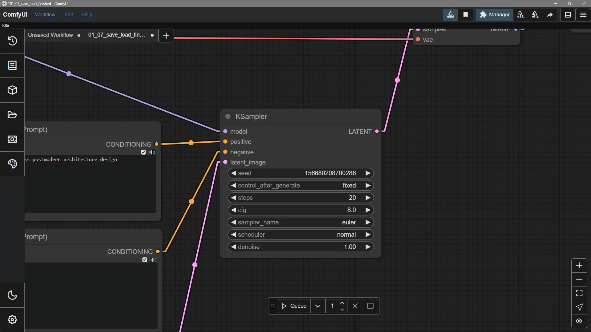

## Узлы как контейнеры свойств

У узлов обычно есть **_свойства_**. Свойства узла, также известные как **_параметры_** или **_атрибуты_**, представляют собой переменные, которые можно изменять. Некоторые свойства можно настроить вручную с помощью поля ввода, которое называется **_виджетом_**. Другие свойства могут управляться автоматически другими узлами, подключёнными к **_входу_** свойства или порту. Обычно свойство можно преобразовать из виджета во вход и наоборот, что позволяет пользователям управлять значениями свойства вручную или автоматически.

Свойства могут принимать разные формы и содержать различные типы информации. Например, узел **Load Checkpoint** имеет одно свойство: путь к файлу чекпойнта генеративной модели. Узел **KSampler** имеет несколько свойств, таких как количество **шагов** выборки, масштаб **CFG**, **sampler\_name** и т. д.

## Типы данных

Информация может принимать различные формы, которые называются **_типами данных_**. Например, буквенно-цифровой текст называется **_строкой_** (**_string_**), целое число это **_integer_**, а число с десятичной точкой называется числом с **_плавающей точкой_** (**_float_**). В ComfyUI постоянно добавляются новые типы данных.

ComfyUI написан на языке сценариев Python, который очень снисходителен к типам данных. В противоположность этому, среда ComfyUI очень **_строго типизирована_**. Это означает, что разные типы данных нельзя смешивать. Например, нельзя подключить выход изображения ко входу целого числа. Это огромное преимущество для пользователей: оно направляет их к правильному построению рабочего процесса и предотвращает ошибки программы.