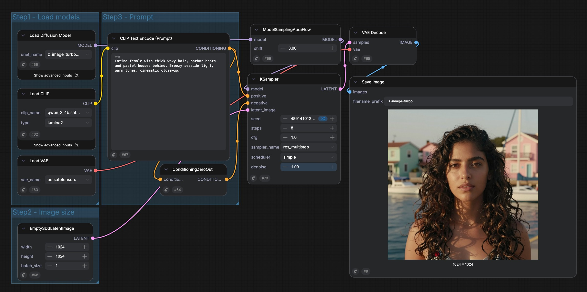
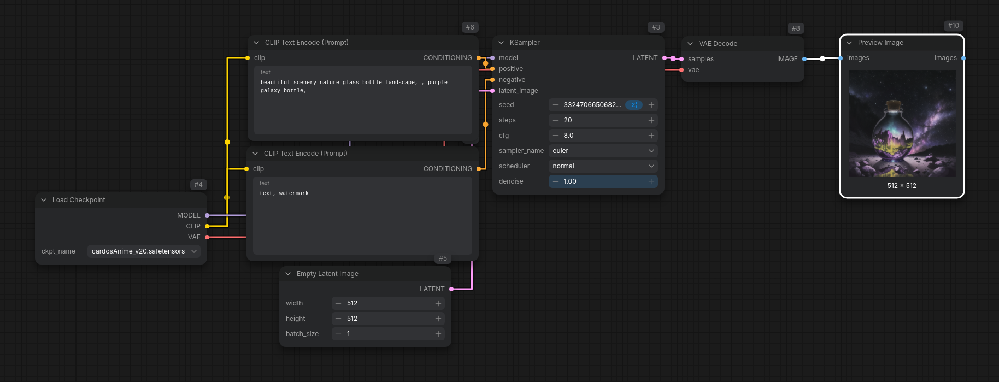

## Что такое рабочий процесс?

Рабочий процесс — это набор шагов, которые указывают ComfyUI, как создать что-либо.

Рабочий процесс можно сравнить с рецептом:

- Рецепт — это рабочий процесс.
- Каждая инструкция в рецепте — это узел.
- Ингредиенты включают промпты, изображения и модели.
- Результат — сгенерированное изображение, видео, аудио или другой вывод.

Например, простой рабочий процесс для изображения может:

1. Загрузить модель.
2. Прочитать текстовый промпт.
3. Сгенерировать изображение.
4. Сохранить изображение.

ComfyUI отображает эти шаги в виде блоков на холсте.

## Узлы как шаги

Узел выполняет одну конкретную задачу. Одни узлы загружают файлы, другие изменяют данные, а третьи генерируют или сохраняют результат.

Например:

- Узел **Load Checkpoint** загружает ИИ-модель.
- Узел **CLIP Text Encode** превращает ваш промпт в инструкции для модели.
- Узел **KSampler** генерирует изображение на основе модели и этих инструкций.
- Узел **Save Image** сохраняет результат на ваш компьютер.

Вы можете объединять узлы разными способами, чтобы создавать разные рабочие процессы. Чтобы использовать узлы, писать код не требуется.

Узнать больше об узлах можно в разделе [Узлы](/ru/basic-concepts/nodes).

## Связи передают данные между узлами

Узлы работают вместе, передавая данные от одного узла другому. Связь соединяет выход одного узла со входом другого узла.

Например, модель, загруженную узлом **Load Checkpoint**, можно передать в узел **KSampler**. Текстовые инструкции, созданные узлом кодирования текста, также можно передать в сэмплер.

Соединять можно только совместимые типы данных. Например, выход изображения нельзя напрямую подключить ко входу, который ожидает число.

Узнать больше о связях можно в разделе [Связи](/ru/basic-concepts/links).

## Свойства управляют каждым этапом

Узлы содержат свойства. Свойства представляют собой настройки, которые определяют, как работает узел.

Например, узел сэмплера может иметь свойства для:

- Количество шагов
- Масштаб направления
- Метод выборки
- Размер изображения

Обычно свойство можно задать непосредственно на узле. Некоторые свойства также могут получать значения от другого узла.

Узнать больше о свойствах можно в разделе [Свойства](/ru/basic-concepts/properties).

## Запуск рабочего процесса

При запуске рабочего процесса ComfyUI выполняет необходимые узлы и передаёт данные по связям между ними. Рабочий процесс продолжается до тех пор, пока не создаст итоговый результат.

Если узел отсутствует, содержит ошибку или не получает нужные данные, ComfyUI не может завершить рабочий процесс. Такой узел помечается, чтобы вы могли найти и исправить проблему.

## Начать с шаблона

Чтобы начать, откройте встроенный шаблон рабочего процесса через **Workflow** → **Browse Workflow Templates**. Шаблоны представляют собой полные примеры, которые можно запустить и отредактировать.

Шаблоны используют основные узлы, включённые в ComfyUI. Они также предложат скачать необходимые модели.

Сообщество создало множество пользовательских узлов, которые добавляют новые возможности. Узнать больше: [Пользовательские узлы](/ru/basic-concepts/custom-nodes).

## Сохранение и совместное использование рабочих процессов

Вы можете сохранить рабочий процесс в виде JSON-файла и поделиться им отдельно от сгенерированных медиафайлов.

При сохранении выходных данных с помощью встроенного узла сохранения ComfyUI также может сохранить рабочий процесс внутри выходного файла. Затем вы можете перетащить файл обратно на холст, чтобы восстановить рабочий процесс.

Чтобы поделиться самим графом в виде изображения, откройте меню вкладки рабочего процесса и выберите **Export (Workflow Image)**. ComfyUI сохраняет PNG холста со встроенным рабочим процессом, поэтому файл открывается в любой программе просмотра изображений и по-прежнему загружается обратно на холст как рабочий процесс. Требуется ComfyUI frontend 1.61.4 или более поздней версии. Отрисовка больших графов занимает несколько секунд.

Подробнее о встроенных данных, поддерживаемых форматах файлов и программном доступе см. в разделе [Метаданные рабочего процесса](/ru/development/api-development/workflow-metadata).

## Немного предыстории

Технически рабочий процесс представляет собой граф узлов. Узлы являются точками графа, а связи показывают, как данные перемещаются между ними.

Это также называют визуальным программированием, поскольку вы создаёте программу, упорядочивая и соединяя визуальные блоки вместо написания кода.
